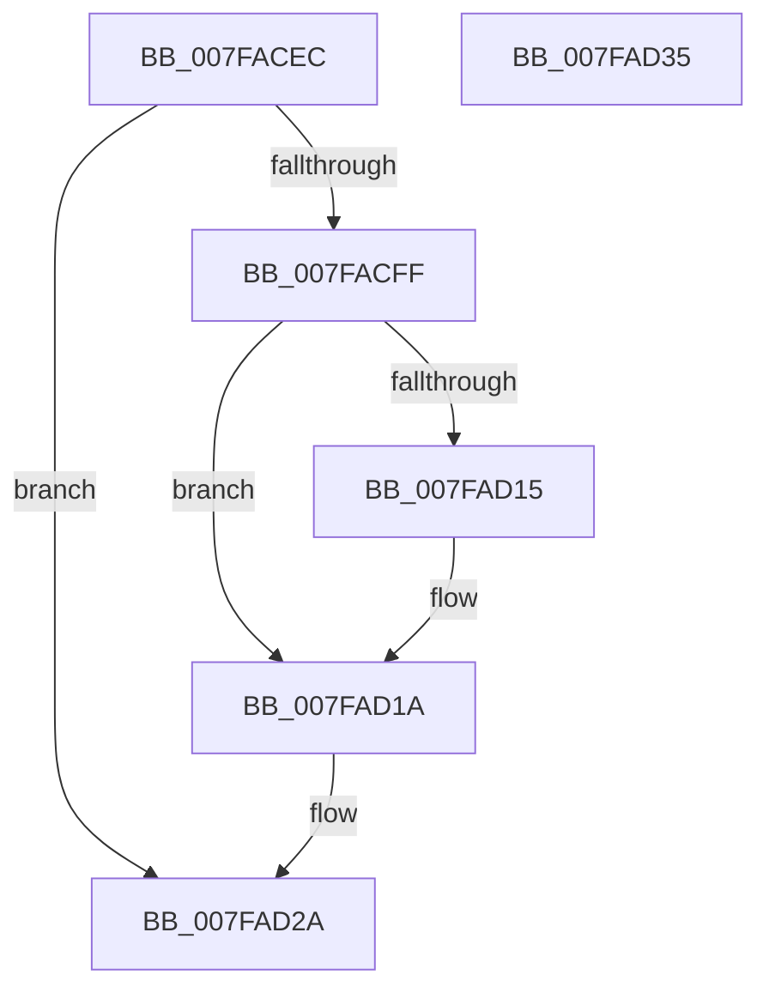

# MiReleaseAddMemoryLocks

- RVA: `0x007FACEC`–`0x007FAD36` (길이 `74` bytes)
- VA: `0x00000001407FACEC`
- 실행 섹션: `PAGE`
- PDB 이름 있음: `예`; PDB Function 태그: `아니요`
- unwind 정보 RVA: `0x0005CAAC`
- 디코드: `20`개 명령, `74/74` bytes 표시
- 미해석 바이트: `0` (있으면 어셈블리에 `.byte`로 보존)

> 이 문서는 커널 이미지의 기계어와 PDB 기호를 분석해 생성했습니다. 4번과 5번은 함수 원형과 자료형을 바이너리 사용 방식에서 추정한 C 해석이며 원본 소스 복구 결과는 아닙니다.

## 1. Dependencies

- 직접 호출 지점: **2**; 고유 호출 대상: **2**
- 직접 호출자로 확인된 함수: **3**
- RIP 상대 이미지 참조: **1**

### Outgoing calls
- `0x007FAD15` → [MiUnlockDynamicMemoryNestedExclusive](../../text/67/MiUnlockDynamicMemoryNestedExclusive_function_00673CC0.md) (function, `0x00673CC0`)
- `0x007FAD21` → [MiUnlockDynamicMemoryExclusive](../../text/67/MiUnlockDynamicMemoryExclusive_function_00673C5C.md) (function, `0x00673C5C`)

### Direct callers
- [MiReturnAddMemoryResources](../../text/67/MiReturnAddMemoryResources_function_00673BC0.md) at `0x00673BDA`
- [MiAddPhysicalMemory](MiAddPhysicalMemory_function_007F95FC.md) at `0x007F982F`
- [MiRemovePhysicalMemory](MiRemovePhysicalMemory_function_007FAD3C.md) at `0x007FAEB6`
- [MiRemovePhysicalMemory](MiRemovePhysicalMemory_function_007FAD3C.md) at `0x007FAF0E`

### Static image references
- `0x007FAD08` → RVA `0x00E38D00` (`.data`; read)

## 2. Other-region calls and transfers

- 다른 실행 섹션으로 향하는 call: **2**
  - `0x007FAD15` → [MiUnlockDynamicMemoryNestedExclusive](../../text/67/MiUnlockDynamicMemoryNestedExclusive_function_00673CC0.md) (`PAGE` → `.text`)
  - `0x007FAD21` → [MiUnlockDynamicMemoryExclusive](../../text/67/MiUnlockDynamicMemoryExclusive_function_00673C5C.md) (`PAGE` → `.text`)
- 별도 외부 분기/꼬리 이동을 확인하지 못했습니다.

## 3. Assembly (complete function range)

```asm
007FACEC  48 89 5C 24 08                  mov qword ptr [rsp + 8], rbx
007FACF1  57                              push rdi
007FACF2  48 83 EC 20                     sub rsp, 0x20
007FACF6  80 79 2C 00                     cmp byte ptr [rcx + 0x2c], 0
007FACFA  48 8B D9                        mov rbx, rcx
007FACFD  74 2B                           je 0x1407fad2a
007FACFF  65 48 8B 3C 25 88 01 00 00      mov rdi, qword ptr gs:[0x188]
007FAD08  48 8D 05 F1 DF 63 00            lea rax, [rip + 0x63dff1]
007FAD0F  48 39 41 30                     cmp qword ptr [rcx + 0x30], rax
007FAD13  74 05                           je 0x1407fad1a
007FAD15  E8 A6 8F E7 FF                  call 0x140673cc0
007FAD1A  48 8B 4B 30                     mov rcx, qword ptr [rbx + 0x30]
007FAD1E  48 8B D7                        mov rdx, rdi
007FAD21  E8 36 8F E7 FF                  call 0x140673c5c
007FAD26  C6 43 2C 00                     mov byte ptr [rbx + 0x2c], 0
007FAD2A  48 8B 5C 24 30                  mov rbx, qword ptr [rsp + 0x30]
007FAD2F  48 83 C4 20                     add rsp, 0x20
007FAD33  5F                              pop rdi
007FAD34  C3                              ret
007FAD35  CC                              int3
```

## 4. C-style interpretation (structured pseudocode)

```c
__int64 __fastcall MiReleaseAddMemoryLocks(__int64 a1)
{
    __int64 result;
    __int64 v_rsp;
    unsigned __int64 v_stack_p8;

    v_stack_p8 = v_rbx;
    v_rsp = (v_rsp) - (32);
    if ((*(unsigned __int8 *)(a1 + 44)) == 0) goto loc_007FAD2A;
    result = v_rip + 6545393;
    if ((*(unsigned __int64 *)(a1 + 48)) != (v_rip + 6545393)) {
        result = MiUnlockDynamicMemoryNestedExclusive(a1, a2, a3, a4);
    }
    result = MiUnlockDynamicMemoryExclusive(*(unsigned __int64 *)(a1 + 48), *(unsigned __int64 *)(gs_base + (0 + 392)), a3, a4);
    *(unsigned __int8 *)(a1 + 44) = 0;
loc_007FAD2A:
    v_rsp = (v_rsp) + (32);
    return result;
}
```

## 5. (Beta) C Style

```c
int64_t MiReleaseAddMemoryLocks(void *Arg1)
{
    uint8_t *arg1 = (uint8_t *)Arg1;

    int64_t result;
    int64_t local_rsp;
    uint64_t v_stack_p8;

    v_stack_p8 = local_rbx;
    local_rsp = (local_rsp) - (32);
    if ((*(uint8_t *)(arg1 + 0x2C)) == 0) goto loc_007FAD2A;
    result = v_rip + 6545393;
    if ((*(uint64_t *)(arg1 + 0x30)) != (v_rip + 6545393)) {
        result = MiUnlockDynamicMemoryNestedExclusive(Arg1, a2, a3, a4);
    }
    result = MiUnlockDynamicMemoryExclusive(*(uint64_t *)(arg1 + 0x30), *(uint64_t *)(gs_base + (0 + 0x188)), a3, a4);
    *(uint8_t *)(arg1 + 0x2C) = 0;
loc_007FAD2A:
    local_rsp = (local_rsp) + (32);
    return result;
}
```

### 관측된 메모리 오프셋

구조체 형식이 확인되지 않은 접근은 인자 기준의 오프셋으로만 기록했습니다.

| 기준 인자 | 오프셋 표현 | 폭 (bit) | 접근 |
|---|---:|---:|---|
| `Arg1` | `+ 0x2C` | `8` | `R` |
| `Arg1` | `+ 0x2C` | `8` | `W` |
| `Arg1` | `+ 0x30` | `64` | `R` |

## 6. Execution-region graph

[열기: 2D/3D 그래프와 함수 탐색 컨트롤 패널](../../../control-panel.html?section=page&rva=0x007FACEC&view=graph)

- 2D 그래프는 위에서 아래로 흐르고, 3D 그래프는 빈 공간을 드래그해 회전합니다. Shift+드래그는 이동, 휠은 확대·축소, 함수 노드 선택은 대상 보고서 이동입니다.

### Static fallback


