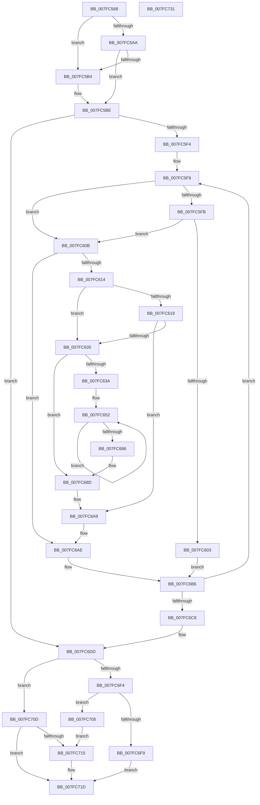

# MiRemoveMdlPages

- RVA: `0x007FC568`–`0x007FC732` (길이 `458` bytes)
- VA: `0x00000001407FC568`
- 실행 섹션: `PAGE`
- PDB 이름 있음: `예`; PDB Function 태그: `아니요`
- unwind 정보 RVA: `0x000BE498`
- 디코드: `128`개 명령, `458/458` bytes 표시
- 미해석 바이트: `0` (있으면 어셈블리에 `.byte`로 보존)

> 이 문서는 커널 이미지의 기계어와 PDB 기호를 분석해 생성했습니다. 4번과 5번은 함수 원형과 자료형을 바이너리 사용 방식에서 추정한 C 해석이며 원본 소스 복구 결과는 아닙니다.

## 1. Dependencies

- 직접 호출 지점: **6**; 고유 호출 대상: **6**
- 직접 호출자로 확인된 함수: **1**
- RIP 상대 이미지 참조: **0**

### Outgoing calls
- `0x007FC5B4` → [MiSortMdlFrames](../../text/67/MiSortMdlFrames_function_006778C4.md) (function, `0x006778C4`)
- `0x007FC622` → [MiRemovePhysicalMemory](MiRemovePhysicalMemory_function_007FAD3C.md) (function, `0x007FAD3C`)
- `0x007FC677` → [MiSetPfnOwnedAndActive](../../text/46/MiSetPfnOwnedAndActive_function_004652AC.md) (function, `0x004652AC`)
- `0x007FC699` → [MiFreeContiguousPages](../../text/3F/MiFreeContiguousPages_function_003F7178.md) (function, `0x003F7178`)
- `0x007FC6FE` → [ExFreePoolWithTag](../../poolcode/B8/ExFreePoolWithTag_function_00B82870.md) (function, `0x00B82870`)
- `0x007FC715` → [MiRemovePhysicalMemoryBatchComplete](../../text/67/MiRemovePhysicalMemoryBatchComplete_function_00673B98.md) (function, `0x00673B98`)

### Direct callers
- [MiAllocatePagesForMdl](../../text/3E/MiAllocatePagesForMdl_function_003EABEC.md) at `0x003EADFE`

### Static image references
- 디코드된 RIP-relative 메모리 참조가 없습니다.

## 2. Other-region calls and transfers

- 다른 실행 섹션으로 향하는 call: **5**
  - `0x007FC5B4` → [MiSortMdlFrames](../../text/67/MiSortMdlFrames_function_006778C4.md) (`PAGE` → `.text`)
  - `0x007FC677` → [MiSetPfnOwnedAndActive](../../text/46/MiSetPfnOwnedAndActive_function_004652AC.md) (`PAGE` → `.text`)
  - `0x007FC699` → [MiFreeContiguousPages](../../text/3F/MiFreeContiguousPages_function_003F7178.md) (`PAGE` → `.text`)
  - `0x007FC6FE` → [ExFreePoolWithTag](../../poolcode/B8/ExFreePoolWithTag_function_00B82870.md) (`PAGE` → `POOLCODE`)
  - `0x007FC715` → [MiRemovePhysicalMemoryBatchComplete](../../text/67/MiRemovePhysicalMemoryBatchComplete_function_00673B98.md) (`PAGE` → `.text`)
- 별도 외부 분기/꼬리 이동을 확인하지 못했습니다.

## 3. Assembly (complete function range)

```asm
007FC568  48 89 54 24 10                  mov qword ptr [rsp + 0x10], rdx
007FC56D  48 89 4C 24 08                  mov qword ptr [rsp + 8], rcx
007FC572  53                              push rbx
007FC573  55                              push rbp
007FC574  56                              push rsi
007FC575  57                              push rdi
007FC576  41 54                           push r12
007FC578  41 55                           push r13
007FC57A  41 56                           push r14
007FC57C  41 57                           push r15
007FC57E  48 83 EC 58                     sub rsp, 0x58
007FC582  44 8B 71 28                     mov r14d, dword ptr [rcx + 0x28]
007FC586  4C 8D 79 30                     lea r15, [rcx + 0x30]
007FC58A  49 C1 EE 0C                     shr r14, 0xc
007FC58E  4C 8B EA                        mov r13, rdx
007FC591  48 8B F9                        mov rdi, rcx
007FC594  4C 89 74 24 40                  mov qword ptr [rsp + 0x40], r14
007FC599  41 8B 45 38                     mov eax, dword ptr [r13 + 0x38]
007FC59D  4B 8D 14 F7                     lea rdx, [r15 + r14*8]
007FC5A1  48 89 54 24 30                  mov qword ptr [rsp + 0x30], rdx
007FC5A6  A8 60                           test al, 0x60
007FC5A8  74 0A                           je 0x1407fc5b4
007FC5AA  49 81 7D 18 00 02 00 00         cmp qword ptr [r13 + 0x18], 0x200
007FC5B2  73 0A                           jae 0x1407fc5be
007FC5B4  E8 0B B3 E7 FF                  call 0x1406778c4
007FC5B9  48 8B 54 24 30                  mov rdx, qword ptr [rsp + 0x30]
007FC5BE  41 8B 45 38                     mov eax, dword ptr [r13 + 0x38]
007FC5C2  33 DB                           xor ebx, ebx
007FC5C4  C1 E8 0F                        shr eax, 0xf
007FC5C7  49 83 CC FF                     or r12, 0xffffffffffffffff
007FC5CB  83 E0 10                        and eax, 0x10
007FC5CE  89 9C 24 B8 00 00 00            mov dword ptr [rsp + 0xb8], ebx
007FC5D5  0D 00 00 50 00                  or eax, 0x500000
007FC5DA  44 8B C3                        mov r8d, ebx
007FC5DD  89 84 24 B0 00 00 00            mov dword ptr [rsp + 0xb0], eax
007FC5E4  8B EB                           mov ebp, ebx
007FC5E6  8B F3                           mov esi, ebx
007FC5E8  49 8B CC                        mov rcx, r12
007FC5EB  4C 3B FA                        cmp r15, rdx
007FC5EE  0F 87 E9 00 00 00               ja 0x1407fc6dd
007FC5F4  8B F8                           mov edi, eax
007FC5F6  4C 8B F1                        mov r14, rcx
007FC5F9  74 10                           je 0x1407fc60b
007FC5FB  4D 8B 27                        mov r12, qword ptr [r15]
007FC5FE  4C 3B E1                        cmp r12, rcx
007FC601  75 08                           jne 0x1407fc60b
007FC603  48 FF C5                        inc rbp
007FC606  E9 AB 00 00 00                  jmp 0x1407fc6b6
007FC60B  48 85 ED                        test rbp, rbp
007FC60E  0F 84 9A 00 00 00               je 0x1407fc6ae
007FC614  45 85 C0                        test r8d, r8d
007FC617  78 1C                           js 0x1407fc635
007FC619  44 8B C7                        mov r8d, edi
007FC61C  48 8B D5                        mov rdx, rbp
007FC61F  49 8B CE                        mov rcx, r14
007FC622  E8 15 E7 FF FF                  call 0x1407fad3c
007FC627  89 84 24 B8 00 00 00            mov dword ptr [rsp + 0xb8], eax
007FC62E  44 8B C0                        mov r8d, eax
007FC631  85 C0                           test eax, eax
007FC633  79 74                           jns 0x1407fc6a9
007FC635  48 85 ED                        test rbp, rbp
007FC638  74 53                           je 0x1407fc68d
007FC63A  4F 8D 2C 76                     lea r13, [r14 + r14*2]
007FC63E  49 C1 E5 04                     shl r13, 4
007FC642  48 B8 00 00 00 00 00 DE FF FF   movabs rax, 0xffffde0000000000
007FC64C  4C 03 E8                        add r13, rax
007FC64F  48 8B FD                        mov rdi, rbp
007FC652  41 8B 45 20                     mov eax, dword ptr [r13 + 0x20]
007FC656  BA 01 00 00 00                  mov edx, 1
007FC65B  C1 E8 10                        shr eax, 0x10
007FC65E  49 C7 C0 F8 FF FF FF            mov r8, 0xfffffffffffffff8
007FC665  44 0F B6 C8                     movzx r9d, al
007FC669  49 8B CD                        mov rcx, r13
007FC66C  41 C1 E9 06                     shr r9d, 6
007FC670  66 C7 44 24 20 02 00            mov word ptr [rsp + 0x20], 2
007FC677  E8 30 8C C6 FF                  call 0x1404652ac
007FC67C  49 83 C5 30                     add r13, 0x30
007FC680  48 83 EF 01                     sub rdi, 1
007FC684  75 CC                           jne 0x1407fc652
007FC686  8B BC 24 B0 00 00 00            mov edi, dword ptr [rsp + 0xb0]
007FC68D  41 B8 20 00 00 00               mov r8d, 0x20
007FC693  48 8B D5                        mov rdx, rbp
007FC696  49 8B CE                        mov rcx, r14
007FC699  E8 DA AA BF FF                  call 0x1403f7178
007FC69E  44 8B 84 24 B8 00 00 00         mov r8d, dword ptr [rsp + 0xb8]
007FC6A6  48 03 F5                        add rsi, rbp
007FC6A9  48 8B 54 24 30                  mov rdx, qword ptr [rsp + 0x30]
007FC6AE  4D 8B F4                        mov r14, r12
007FC6B1  BD 01 00 00 00                  mov ebp, 1
007FC6B6  49 83 C7 08                     add r15, 8
007FC6BA  49 8D 4C 24 01                  lea rcx, [r12 + 1]
007FC6BF  4C 3B FA                        cmp r15, rdx
007FC6C2  0F 86 31 FF FF FF               jbe 0x1407fc5f9
007FC6C8  48 8B BC 24 A0 00 00 00         mov rdi, qword ptr [rsp + 0xa0]
007FC6D0  4C 8B 74 24 40                  mov r14, qword ptr [rsp + 0x40]
007FC6D5  4C 8B AC 24 A8 00 00 00         mov r13, qword ptr [rsp + 0xa8]
007FC6DD  49 8B 45 00                     mov rax, qword ptr [r13]
007FC6E1  49 8B CE                        mov rcx, r14
007FC6E4  48 F7 D9                        neg rcx
007FC6E7  F0 48 01 88 C0 4C 00 00         lock add qword ptr [rax + 0x4cc0], rcx
007FC6EF  48 85 F6                        test rsi, rsi
007FC6F2  74 19                           je 0x1407fc70d
007FC6F4  49 3B F6                        cmp rsi, r14
007FC6F7  75 0C                           jne 0x1407fc705
007FC6F9  33 D2                           xor edx, edx
007FC6FB  48 8B CF                        mov rcx, rdi
007FC6FE  E8 6D 61 38 00                  call 0x140b82870
007FC703  EB 18                           jmp 0x1407fc71d
007FC705  C1 E6 0C                        shl esi, 0xc
007FC708  29 77 28                        sub dword ptr [rdi + 0x28], esi
007FC70B  EB 08                           jmp 0x1407fc715
007FC70D  48 8B DF                        mov rbx, rdi
007FC710  49 3B F6                        cmp rsi, r14
007FC713  74 08                           je 0x1407fc71d
007FC715  E8 7E 74 E7 FF                  call 0x140673b98
007FC71A  48 8B DF                        mov rbx, rdi
007FC71D  48 8B C3                        mov rax, rbx
007FC720  48 83 C4 58                     add rsp, 0x58
007FC724  41 5F                           pop r15
007FC726  41 5E                           pop r14
007FC728  41 5D                           pop r13
007FC72A  41 5C                           pop r12
007FC72C  5F                              pop rdi
007FC72D  5E                              pop rsi
007FC72E  5D                              pop rbp
007FC72F  5B                              pop rbx
007FC730  C3                              ret
007FC731  CC                              int3
```

## 4. C-style interpretation (structured pseudocode)

```c
__int64 __fastcall MiRemoveMdlPages(__int64 a1, __int64 a2)
{
    __int64 result;
    __int64 v_r12;
    __int64 v_r13;
    __int64 v_r14;
    __int64 v_r15;
    __int64 v_rbp;
    __int64 v_rbx;
    __int64 v_rdi;
    __int64 v_rsi;
    __int64 v_rsp;
    unsigned __int64 v_stack_m58;
    unsigned __int64 v_stack_m68;
    unsigned __int16 v_stack_m78;
    unsigned __int64 v_stack_p10;
    unsigned int v_stack_p18;
    unsigned int v_stack_p20;
    unsigned __int64 v_stack_p8;

    v_stack_p10 = a2;
    v_stack_p8 = a1;
    v_rsp = (v_rsp) - (88);
    v_r14 = ((unsigned int)(*(unsigned int *)(a1 + 40))) >> (12);
    v_stack_m58 = v_r14;
    v_stack_m68 = a1 + 48 + v_r14 * 8;
    if ((((unsigned __int8)((unsigned int)(*(unsigned int *)(a2 + 56)))) & (96)) == 0) goto loc_007FC5B4;
    result = (unsigned int)(*(unsigned int *)(a2 + 56));
    if ((*(unsigned __int64 *)(a2 + 24)) < 512) {
        result = MiSortMdlFrames(a1, a1 + 48 + v_r14 * 8, a3, a4);
        a2 = v_stack_m68;
    }
    v_rbx = 0;
    result = (unsigned int)(((unsigned int)(*(unsigned int *)(a2 + 56))) >> (15));
    v_r12 = (v_r12) | (-1);
    result = (unsigned int)((result) & (16));
    v_stack_p20 = 0;
    result = (unsigned int)((result) | (0x500000ULL));
    v_stack_p18 = (unsigned int)(result);
    if ((a1 + 48) > a2) goto loc_007FC6DD;
loc_007FC5F9:
    if ((a1 + 48) == a2) goto loc_007FC60B;
    if ((*(unsigned __int64 *)(a1 + 48)) != v_r12) goto loc_007FC60B;
    v_rbp = (0) + 1;
    goto loc_007FC6B6;
loc_007FC60B:
    if (v_rbp == 0) goto loc_007FC6AE;
    if (sign_flag) goto loc_007FC635;
    result = MiRemovePhysicalMemory(v_r12, v_rbp, (unsigned int)((unsigned int)((unsigned int)((unsigned int)(result)))), a4);
    v_stack_p20 = (unsigned int)(result);
    if (!sign_flag) goto loc_007FC6A9;
loc_007FC635:
    if (v_rbp == 0) goto loc_007FC68D;
    v_r13 = (v_r12 + v_r12 * 2) << (4);
    v_r13 = (v_r13) + (result);
loc_007FC652:
    result = (unsigned int)(((unsigned int)(*(unsigned int *)(v_r13 + 32))) >> (16));
    a4 = (unsigned int)(((unsigned __int8)(result)) >> (6));
    v_stack_m78 = 2;
    result = MiSetPfnOwnedAndActive(v_r13, 1, -8, a4);
    v_r13 = (v_r13) + (48);
    v_rdi = (v_rbp) - (1);
    if (condition_is_not_equal) goto loc_007FC652;
loc_007FC68D:
    result = MiFreeContiguousPages(v_r12, v_rbp, 32, a4);
    v_rsi = (0) + (v_rbp);
loc_007FC6A9:
loc_007FC6AE:
loc_007FC6B6:
    v_r15 = (a1 + 48) + (8);
    if (v_r15 <= v_stack_m68) goto loc_007FC5F9;
loc_007FC6DD:
    a1 = -(v_stack_m58);
    if (v_rsi == 0) goto loc_007FC70D;
    if (v_rsi != v_stack_m58) goto loc_007FC705;
    a2 = 0;
    result = ExFreePoolWithTag(v_stack_p8, a2, (unsigned int)(v_stack_p20), a4);
    goto loc_007FC71D;
loc_007FC705:
    v_rsi = (unsigned int)((v_rsi) << (12));
    goto loc_007FC715;
loc_007FC70D:
    v_rbx = v_stack_p8;
    if (v_rsi != v_stack_m58) {
        result = MiRemovePhysicalMemoryBatchComplete(v_stack_p8, a2, (unsigned int)(v_stack_p20), a4);
        v_rbx = v_stack_p8;
    }
    v_rsp = (v_rsp) + (88);
    return v_rbx;
}
```

## 5. (Beta) C Style

```c
int64_t MiRemoveMdlPages(void *Arg1, void *Arg2)
{
    uint8_t *arg1 = (uint8_t *)Arg1;
    uint8_t *arg2 = (uint8_t *)Arg2;

    int64_t result;
    int64_t local_r12;
    int64_t local_r13;
    int64_t local_r14;
    int64_t local_r15;
    int64_t local_rbp;
    int64_t local_rbx;
    int64_t local_rdi;
    int64_t local_rsi;
    int64_t local_rsp;
    uint64_t v_stack_m58;
    uint64_t v_stack_m68;
    uint16_t v_stack_m78;
    uint64_t v_stack_p10;
    uint32_t v_stack_p18;
    uint32_t v_stack_p20;
    uint64_t v_stack_p8;

    v_stack_p10 = Arg2;
    v_stack_p8 = Arg1;
    local_rsp = (local_rsp) - (88);
    local_r14 = ((uint32_t)(*(uint32_t *)(arg1 + 0x28))) >> (12);
    v_stack_m58 = local_r14;
    v_stack_m68 = Arg1 + 48 + local_r14 * 8;
    if ((((uint8_t)((uint32_t)(*(uint32_t *)(arg2 + 0x38)))) & (96)) == 0) goto loc_007FC5B4;
    result = (uint32_t)(*(uint32_t *)(arg2 + 0x38));
    if ((*(uint64_t *)(arg2 + 0x18)) < 512) {
        result = MiSortMdlFrames(Arg1, Arg1 + 48 + local_r14 * 8, a3, a4);
        Arg2 = v_stack_m68;
    }
    local_rbx = 0;
    result = (uint32_t)(((uint32_t)(*(uint32_t *)(arg2 + 0x38))) >> (15));
    local_r12 = (local_r12) | (-1);
    result = (uint32_t)((result) & (16));
    v_stack_p20 = 0;
    result = (uint32_t)((result) | (0x500000ULL));
    v_stack_p18 = (uint32_t)(result);
    if ((Arg1 + 48) > Arg2) goto loc_007FC6DD;
loc_007FC5F9:
    if ((Arg1 + 48) == Arg2) goto loc_007FC60B;
    if ((*(uint64_t *)(arg1 + 0x30)) != local_r12) goto loc_007FC60B;
    local_rbp = (0) + 1;
    goto loc_007FC6B6;
loc_007FC60B:
    if (local_rbp == 0) goto loc_007FC6AE;
    if (sign_flag) goto loc_007FC635;
    result = MiRemovePhysicalMemory(local_r12, local_rbp, (uint32_t)((uint32_t)((uint32_t)((uint32_t)(result)))), a4);
    v_stack_p20 = (uint32_t)(result);
    if (!sign_flag) goto loc_007FC6A9;
loc_007FC635:
    if (local_rbp == 0) goto loc_007FC68D;
    local_r13 = (local_r12 + local_r12 * 2) << (4);
    local_r13 = (local_r13) + (result);
loc_007FC652:
    result = (uint32_t)(((uint32_t)(*(uint32_t *)(local_r13 + 0x20))) >> (16));
    a4 = (uint32_t)(((uint8_t)(result)) >> (6));
    v_stack_m78 = 2;
    result = MiSetPfnOwnedAndActive(local_r13, 1, -8, a4);
    local_r13 = (local_r13) + (48);
    local_rdi = (local_rbp) - (1);
    if (condition_is_not_equal) goto loc_007FC652;
loc_007FC68D:
    result = MiFreeContiguousPages(local_r12, local_rbp, 32, a4);
    local_rsi = (0) + (local_rbp);
loc_007FC6A9:
loc_007FC6AE:
loc_007FC6B6:
    local_r15 = (Arg1 + 48) + (8);
    if (local_r15 <= v_stack_m68) goto loc_007FC5F9;
loc_007FC6DD:
    Arg1 = -(v_stack_m58);
    if (local_rsi == 0) goto loc_007FC70D;
    if (local_rsi != v_stack_m58) goto loc_007FC705;
    Arg2 = 0;
    result = ExFreePoolWithTag(v_stack_p8, Arg2, (uint32_t)(v_stack_p20), a4);
    goto loc_007FC71D;
loc_007FC705:
    local_rsi = (uint32_t)((local_rsi) << (12));
    goto loc_007FC715;
loc_007FC70D:
    local_rbx = v_stack_p8;
    if (local_rsi != v_stack_m58) {
        result = MiRemovePhysicalMemoryBatchComplete(v_stack_p8, Arg2, (uint32_t)(v_stack_p20), a4);
        local_rbx = v_stack_p8;
    }
    local_rsp = (local_rsp) + (88);
    return local_rbx;
}
```

### 관측된 메모리 오프셋

구조체 형식이 확인되지 않은 접근은 인자 기준의 오프셋으로만 기록했습니다.

| 기준 인자 | 오프셋 표현 | 폭 (bit) | 접근 |
|---|---:|---:|---|
| `Arg1` | `+ 0x0 + r14*8` | `64` | `R` |
| `Arg1` | `+ 0x28` | `32` | `R` |
| `Arg1` | `+ 0x30` | `64` | `R` |
| `Arg2` | `+ 0x18` | `64` | `R` |
| `Arg2` | `+ 0x38` | `32` | `R` |

## 6. Execution-region graph

[열기: 2D/3D 그래프와 함수 탐색 컨트롤 패널](../../../control-panel.html?section=page&rva=0x007FC568&view=graph)

- 2D 그래프는 위에서 아래로 흐르고, 3D 그래프는 빈 공간을 드래그해 회전합니다. Shift+드래그는 이동, 휠은 확대·축소, 함수 노드 선택은 대상 보고서 이동입니다.

### Static fallback


