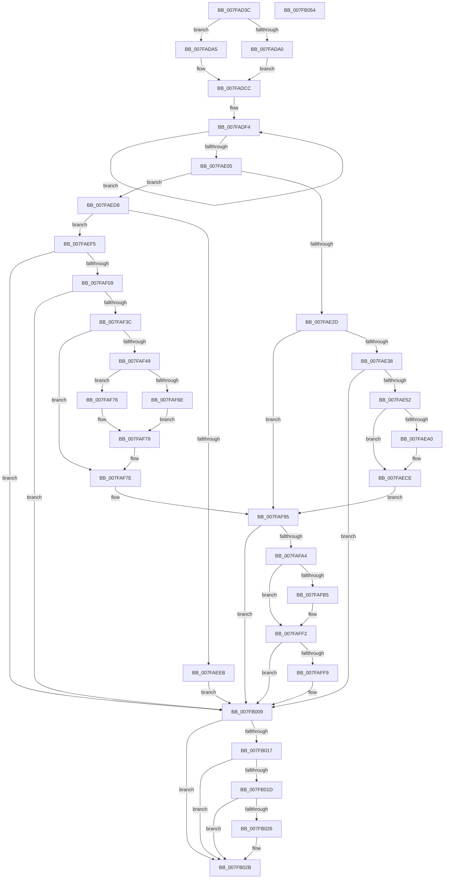

# MiRemovePhysicalMemory

- RVA: `0x007FAD3C`–`0x007FB055` (길이 `793` bytes)
- VA: `0x00000001407FAD3C`
- 실행 섹션: `PAGE`
- PDB 이름 있음: `예`; PDB Function 태그: `아니요`
- unwind 정보 RVA: `0x000D6A10`
- 디코드: `194`개 명령, `793/793` bytes 표시
- 미해석 바이트: `0` (있으면 어셈블리에 `.byte`로 보존)

> 이 문서는 커널 이미지의 기계어와 PDB 기호를 분석해 생성했습니다. 4번과 5번은 함수 원형과 자료형을 바이너리 사용 방식에서 추정한 C 해석이며 원본 소스 복구 결과는 아닙니다.

## 1. Dependencies

- 직접 호출 지점: **24**; 고유 호출 대상: **21**
- 직접 호출자로 확인된 함수: **5**
- RIP 상대 이미지 참조: **5**

### Outgoing calls
- `0x007FAD81` → [memset](../../text/6C/memset_function_006C6C40.md) (function, `0x006C6C40`)
- `0x007FAE0A` → [MiAcquireAddMemoryLocks](MiAcquireAddMemoryLocks_function_007F94F8.md) (function, `0x007F94F8`)
- `0x007FAE3D` → [MiGetDanglingExtent](../../text/68/MiGetDanglingExtent_function_006812C4.md) (function, `0x006812C4`)
- `0x007FAEB6` → [MiReleaseAddMemoryLocks](MiReleaseAddMemoryLocks_function_007FACEC.md) (function, `0x007FACEC`)
- `0x007FAEC4` → [MiAcquireAddMemoryLocks](MiAcquireAddMemoryLocks_function_007F94F8.md) (function, `0x007F94F8`)
- `0x007FAEC9` → [KeLeaveGuardedRegion](../../text/2E/KeLeaveGuardedRegion_function_002E2C40.md) (function, `0x002E2C40`)
- `0x007FAEE2` → [MiEntireRangeAlreadyExists](../../text/67/MiEntireRangeAlreadyExists_function_00672060.md) (function, `0x00672060`)
- `0x007FAEFA` → [MiAcquireRemoveMemoryResources](../../text/67/MiAcquireRemoveMemoryResources_function_00671A38.md) (function, `0x00671A38`)
- `0x007FAF0E` → [MiReleaseAddMemoryLocks](MiReleaseAddMemoryLocks_function_007FACEC.md) (function, `0x007FACEC`)
- `0x007FAF23` → [KeConfigureDynamicMemory](../../text/5B/KeConfigureDynamicMemory_function_005B8C9C.md) (function, `0x005B8C9C`)
- `0x007FAF2F` → [MiAcquireAddMemoryLocks](MiAcquireAddMemoryLocks_function_007F94F8.md) (function, `0x007F94F8`)
- `0x007FAF56` → [MiReduceCommitLimits](../../text/68/MiReduceCommitLimits_function_0068CDA0.md) (function, `0x0068CDA0`)
- `0x007FAF79` → [MiReturnCommit](../../text/24/MiReturnCommit_function_00248410.md) (function, `0x00248410`)
- `0x007FAF86` → [MiClearMirrorBitmaps](../../text/67/MiClearMirrorBitmaps_function_0067887C.md) (function, `0x0067887C`)
- `0x007FAF90` → [MiPerformMemoryChange](../../text/67/MiPerformMemoryChange_function_006733A8.md) (function, `0x006733A8`)
- `0x007FAF9A` → [MiUnmapPfns](MiUnmapPfns_function_007FB0A0.md) (function, `0x007FB0A0`)
- `0x007FAFA9` → [MiNotifyMemoryChange](MiNotifyMemoryChange_function_007FAC8C.md) (function, `0x007FAC8C`)
- `0x007FAFBE` → [MiPartitionDeleteMemoryNode](../../text/69/MiPartitionDeleteMemoryNode_function_00691A20.md) (function, `0x00691A20`)
- `0x007FAFED` → [MiHotAddHugeRange](MiHotAddHugeRange_function_007FBF6C.md) (function, `0x007FBF6C`)
- `0x007FAFF9` → [MiFlushEntireTbDueToAttributeChange](../../text/30/MiFlushEntireTbDueToAttributeChange_function_00308AE0.md) (function, `0x00308AE0`)
- `0x007FB004` → [MiFlushCacheRange](../../text/69/MiFlushCacheRange_function_006954C8.md) (function, `0x006954C8`)
- `0x007FB00E` → [MiReturnAddMemoryResources](../../text/67/MiReturnAddMemoryResources_function_00673BC0.md) (function, `0x00673BC0`)
- `0x007FB026` → [IoUpdateDumpPhysicalRanges](../../text/59/IoUpdateDumpPhysicalRanges_function_0059343C.md) (function, `0x0059343C`)
- `0x007FB034` → [_security_check_cookie](../../text/6A/_security_check_cookie_function_006AC640.md) (function, `0x006AC640`)

### Direct callers
- [MiDeleteExtentPfns](../../text/68/MiDeleteExtentPfns_function_006808B0.md) at `0x006808E6`
- [MmRemovePhysicalMemory](MmRemovePhysicalMemory_function_007FB560.md) at `0x007FB6C1`
- [MiRemoveMdlPages](MiRemoveMdlPages_function_007FC568.md) at `0x007FC622`
- [MiRemoveFileOnlyPages](../80/MiRemoveFileOnlyPages_function_008012FC.md) at `0x00801306`
- [MiHotRemovePartitionPageRun](../80/MiHotRemovePartitionPageRun_function_0080D8B8.md) at `0x0080D939`

### Static image references
- `0x007FAD58` → RVA `0x00E0A740` (`.data`; read)
- `0x007FAD93` → RVA `0x00E38D00` (`.data`; read)
- `0x007FADB3` → RVA `0x00E30088` (`.data`; read)
- `0x007FAE0F` → RVA `0x00E2ECF8` (`.data`; read)
- `0x007FAE1C` → RVA `0x00E2ECF8` (`.data`; write)

## 2. Other-region calls and transfers

- 다른 실행 섹션으로 향하는 call: **16**
  - `0x007FAD81` → [memset](../../text/6C/memset_function_006C6C40.md) (`PAGE` → `.text`)
  - `0x007FAE3D` → [MiGetDanglingExtent](../../text/68/MiGetDanglingExtent_function_006812C4.md) (`PAGE` → `.text`)
  - `0x007FAEC9` → [KeLeaveGuardedRegion](../../text/2E/KeLeaveGuardedRegion_function_002E2C40.md) (`PAGE` → `.text`)
  - `0x007FAEE2` → [MiEntireRangeAlreadyExists](../../text/67/MiEntireRangeAlreadyExists_function_00672060.md) (`PAGE` → `.text`)
  - `0x007FAEFA` → [MiAcquireRemoveMemoryResources](../../text/67/MiAcquireRemoveMemoryResources_function_00671A38.md) (`PAGE` → `.text`)
  - `0x007FAF23` → [KeConfigureDynamicMemory](../../text/5B/KeConfigureDynamicMemory_function_005B8C9C.md) (`PAGE` → `.text`)
  - `0x007FAF56` → [MiReduceCommitLimits](../../text/68/MiReduceCommitLimits_function_0068CDA0.md) (`PAGE` → `.text`)
  - `0x007FAF79` → [MiReturnCommit](../../text/24/MiReturnCommit_function_00248410.md) (`PAGE` → `.text`)
  - `0x007FAF86` → [MiClearMirrorBitmaps](../../text/67/MiClearMirrorBitmaps_function_0067887C.md) (`PAGE` → `.text`)
  - `0x007FAF90` → [MiPerformMemoryChange](../../text/67/MiPerformMemoryChange_function_006733A8.md) (`PAGE` → `.text`)
  - `0x007FAFBE` → [MiPartitionDeleteMemoryNode](../../text/69/MiPartitionDeleteMemoryNode_function_00691A20.md) (`PAGE` → `.text`)
  - `0x007FAFF9` → [MiFlushEntireTbDueToAttributeChange](../../text/30/MiFlushEntireTbDueToAttributeChange_function_00308AE0.md) (`PAGE` → `.text`)
  - `0x007FB004` → [MiFlushCacheRange](../../text/69/MiFlushCacheRange_function_006954C8.md) (`PAGE` → `.text`)
  - `0x007FB00E` → [MiReturnAddMemoryResources](../../text/67/MiReturnAddMemoryResources_function_00673BC0.md) (`PAGE` → `.text`)
  - `0x007FB026` → [IoUpdateDumpPhysicalRanges](../../text/59/IoUpdateDumpPhysicalRanges_function_0059343C.md) (`PAGE` → `.text`)
  - `0x007FB034` → [_security_check_cookie](../../text/6A/_security_check_cookie_function_006AC640.md) (`PAGE` → `.text`)
- 별도 외부 분기/꼬리 이동을 확인하지 못했습니다.

## 3. Assembly (complete function range)

```asm
007FAD3C  48 89 5C 24 20                  mov qword ptr [rsp + 0x20], rbx
007FAD41  55                              push rbp
007FAD42  56                              push rsi
007FAD43  57                              push rdi
007FAD44  41 54                           push r12
007FAD46  41 55                           push r13
007FAD48  41 56                           push r14
007FAD4A  41 57                           push r15
007FAD4C  48 8D 6C 24 D9                  lea rbp, [rsp - 0x27]
007FAD51  48 81 EC 00 01 00 00            sub rsp, 0x100
007FAD58  48 8B 05 E1 F9 60 00            mov rax, qword ptr [rip + 0x60f9e1]
007FAD5F  48 33 C4                        xor rax, rsp
007FAD62  48 89 45 17                     mov qword ptr [rbp + 0x17], rax
007FAD66  45 8B F0                        mov r14d, r8d
007FAD69  48 89 54 24 30                  mov qword ptr [rsp + 0x30], rdx
007FAD6E  48 8B FA                        mov rdi, rdx
007FAD71  48 8B D9                        mov rbx, rcx
007FAD74  33 D2                           xor edx, edx
007FAD76  48 8D 4C 24 40                  lea rcx, [rsp + 0x40]
007FAD7B  41 B8 B0 00 00 00               mov r8d, 0xb0
007FAD81  E8 BA BE EC FF                  call 0x1406c6c40
007FAD86  45 8B FE                        mov r15d, r14d
007FAD89  48 BA 28 00 00 00 00 DE FF FF   movabs rdx, 0xffffde0000000028
007FAD93  48 8D 05 66 DF 63 00            lea rax, [rip + 0x63df66]
007FAD9A  41 83 E7 40                     and r15d, 0x40
007FAD9E  74 05                           je 0x1407fada5
007FADA0  4C 8B E0                        mov r12, rax
007FADA3  EB 27                           jmp 0x1407fadcc
007FADA5  48 8D 0C 5B                     lea rcx, [rbx + rbx*2]
007FADA9  48 03 C9                        add rcx, rcx
007FADAC  48 8B C2                        mov rax, rdx
007FADAF  48 8B 04 C8                     mov rax, qword ptr [rax + rcx*8]
007FADB3  48 8B 0D CE 52 63 00            mov rcx, qword ptr [rip + 0x6352ce]
007FADBA  48 8B 7C 24 30                  mov rdi, qword ptr [rsp + 0x30]
007FADBF  48 C1 E8 2B                     shr rax, 0x2b
007FADC3  25 FF 03 00 00                  and eax, 0x3ff
007FADC8  4C 8B 24 C1                     mov r12, qword ptr [rcx + rax*8]
007FADCC  48 83 65 CF 00                  and qword ptr [rbp - 0x31], 0
007FADD1  48 8D 04 1F                     lea rax, [rdi + rbx]
007FADD5  48 89 44 24 58                  mov qword ptr [rsp + 0x58], rax
007FADDA  B9 02 00 00 00                  mov ecx, 2
007FADDF  48 8D 45 D7                     lea rax, [rbp - 0x29]
007FADE3  44 89 75 8F                     mov dword ptr [rbp - 0x71], r14d
007FADE7  48 89 5C 24 50                  mov qword ptr [rsp + 0x50], rbx
007FADEC  48 89 7D 87                     mov qword ptr [rbp - 0x79], rdi
007FADF0  4C 89 65 97                     mov qword ptr [rbp - 0x69], r12
007FADF4  48 89 40 08                     mov qword ptr [rax + 8], rax
007FADF8  48 89 00                        mov qword ptr [rax], rax
007FADFB  48 83 C0 18                     add rax, 0x18
007FADFF  48 83 E9 01                     sub rcx, 1
007FAE03  75 EF                           jne 0x1407fadf4
007FAE05  48 8D 4C 24 40                  lea rcx, [rsp + 0x40]
007FAE0A  E8 E9 E6 FF FF                  call 0x1407f94f8
007FAE0F  48 8B 05 E2 3E 63 00            mov rax, qword ptr [rip + 0x633ee2]
007FAE16  45 8B EE                        mov r13d, r14d
007FAE19  48 FF C0                        inc rax
007FAE1C  48 89 05 D5 3E 63 00            mov qword ptr [rip + 0x633ed5], rax
007FAE23  41 83 E5 02                     and r13d, 2
007FAE27  0F 84 AB 00 00 00               je 0x1407faed8
007FAE2D  33 F6                           xor esi, esi
007FAE2F  45 85 FF                        test r15d, r15d
007FAE32  0F 84 5D 01 00 00               je 0x1407faf95
007FAE38  48 8D 4C 24 30                  lea rcx, [rsp + 0x30]
007FAE3D  E8 82 64 E8 FF                  call 0x1406812c4
007FAE42  48 83 CA FF                     or rdx, 0xffffffffffffffff
007FAE46  48 8B D8                        mov rbx, rax
007FAE49  48 3B C2                        cmp rax, rdx
007FAE4C  0F 84 B7 01 00 00               je 0x1407fb009
007FAE52  48 8B 4C 24 30                  mov rcx, qword ptr [rsp + 0x30]
007FAE57  48 89 4D 87                     mov qword ptr [rbp - 0x79], rcx
007FAE5B  48 03 C8                        add rcx, rax
007FAE5E  48 89 44 24 50                  mov qword ptr [rsp + 0x50], rax
007FAE63  48 8D 04 40                     lea rax, [rax + rax*2]
007FAE67  48 89 4C 24 58                  mov qword ptr [rsp + 0x58], rcx
007FAE6C  48 03 C0                        add rax, rax
007FAE6F  48 B9 28 00 00 00 00 DE FF FF   movabs rcx, 0xffffde0000000028
007FAE79  48 8B C9                        mov rcx, rcx
007FAE7C  48 8B 04 C1                     mov rax, qword ptr [rcx + rax*8]
007FAE80  48 8B 0D 01 52 63 00            mov rcx, qword ptr [rip + 0x635201]
007FAE87  48 C1 E8 2B                     shr rax, 0x2b
007FAE8B  25 FF 03 00 00                  and eax, 0x3ff
007FAE90  4C 8B 24 C1                     mov r12, qword ptr [rcx + rax*8]
007FAE94  48 8D 0D 65 DE 63 00            lea rcx, [rip + 0x63de65]
007FAE9B  4C 3B E1                        cmp r12, rcx
007FAE9E  74 2E                           je 0x1407faece
007FAEA0  65 48 8B 04 25 88 01 00 00      mov rax, qword ptr gs:[0x188]
007FAEA9  48 8D 4C 24 40                  lea rcx, [rsp + 0x40]
007FAEAE  66 01 90 E6 01 00 00            add word ptr [rax + 0x1e6], dx
007FAEB5  90                              nop
007FAEB6  E8 31 FE FF FF                  call 0x1407facec
007FAEBB  48 8D 4C 24 40                  lea rcx, [rsp + 0x40]
007FAEC0  4C 89 65 97                     mov qword ptr [rbp - 0x69], r12
007FAEC4  E8 2F E6 FF FF                  call 0x1407f94f8
007FAEC9  E8 72 7D AE FF                  call 0x1402e2c40
007FAECE  48 8B 7C 24 30                  mov rdi, qword ptr [rsp + 0x30]
007FAED3  E9 BD 00 00 00                  jmp 0x1407faf95
007FAED8  48 8B 54 24 58                  mov rdx, qword ptr [rsp + 0x58]
007FAEDD  48 8B 4C 24 50                  mov rcx, qword ptr [rsp + 0x50]
007FAEE2  E8 79 71 E7 FF                  call 0x140672060
007FAEE7  85 C0                           test eax, eax
007FAEE9  75 0A                           jne 0x1407faef5
007FAEEB  BE 18 00 00 C0                  mov esi, 0xc0000018
007FAEF0  E9 14 01 00 00                  jmp 0x1407fb009
007FAEF5  48 8D 4C 24 40                  lea rcx, [rsp + 0x40]
007FAEFA  E8 39 6B E7 FF                  call 0x140671a38
007FAEFF  8B F0                           mov esi, eax
007FAF01  85 C0                           test eax, eax
007FAF03  0F 88 00 01 00 00               js 0x1407fb009
007FAF09  48 8D 4C 24 40                  lea rcx, [rsp + 0x40]
007FAF0E  E8 D9 FD FF FF                  call 0x1407facec
007FAF13  48 8D 53 FF                     lea rdx, [rbx - 1]
007FAF17  41 B8 20 00 00 00               mov r8d, 0x20
007FAF1D  48 03 D7                        add rdx, rdi
007FAF20  48 8B CB                        mov rcx, rbx
007FAF23  E8 74 DD DB FF                  call 0x1405b8c9c
007FAF28  48 8D 4C 24 40                  lea rcx, [rsp + 0x40]
007FAF2D  8B F0                           mov esi, eax
007FAF2F  E8 C4 E5 FF FF                  call 0x1407f94f8
007FAF34  85 F6                           test esi, esi
007FAF36  0F 88 CD 00 00 00               js 0x1407fb009
007FAF3C  F7 45 8F 00 00 08 00            test dword ptr [rbp - 0x71], 0x80000
007FAF43  4C 8B 7D 87                     mov r15, qword ptr [rbp - 0x79]
007FAF47  75 35                           jne 0x1407faf7e
007FAF49  4D 8B C7                        mov r8, r15
007FAF4C  48 8D 0D AD DD 63 00            lea rcx, [rip + 0x63ddad]
007FAF53  49 8B D7                        mov rdx, r15
007FAF56  E8 45 1E E9 FF                  call 0x14068cda0
007FAF5B  F7 45 8F 00 00 40 00            test dword ptr [rbp - 0x71], 0x400000
007FAF62  48 8D 0D 97 DD 63 00            lea rcx, [rip + 0x63dd97]
007FAF69  49 8B D7                        mov rdx, r15
007FAF6C  74 08                           je 0x1407faf76
007FAF6E  41 B8 10 00 00 00               mov r8d, 0x10
007FAF74  EB 03                           jmp 0x1407faf79
007FAF76  45 33 C0                        xor r8d, r8d
007FAF79  E8 92 D4 A4 FF                  call 0x140248410
007FAF7E  48 8B 4C 24 50                  mov rcx, qword ptr [rsp + 0x50]
007FAF83  49 8B D7                        mov rdx, r15
007FAF86  E8 F1 D8 E7 FF                  call 0x14067887c
007FAF8B  48 8D 4C 24 40                  lea rcx, [rsp + 0x40]
007FAF90  E8 13 84 E7 FF                  call 0x1406733a8
007FAF95  48 8D 4C 24 40                  lea rcx, [rsp + 0x40]
007FAF9A  E8 01 01 00 00                  call 0x1407fb0a0
007FAF9F  45 85 ED                        test r13d, r13d
007FAFA2  75 65                           jne 0x1407fb009
007FAFA4  48 8D 4C 24 40                  lea rcx, [rsp + 0x40]
007FAFA9  E8 DE FC FF FF                  call 0x1407fac8c
007FAFAE  41 0F BA E6 10                  bt r14d, 0x10
007FAFB3  73 3D                           jae 0x1407faff2
007FAFB5  4C 8B C7                        mov r8, rdi
007FAFB8  48 8B D3                        mov rdx, rbx
007FAFBB  49 8B CC                        mov rcx, r12
007FAFBE  E8 5D 6A E9 FF                  call 0x140691a20
007FAFC3  41 8B C6                        mov eax, r14d
007FAFC6  C7 44 24 28 01 00 00 00         mov dword ptr [rsp + 0x28], 1
007FAFCE  25 00 02 00 00                  and eax, 0x200
007FAFD3  48 8B D3                        mov rdx, rbx
007FAFD6  F7 D8                           neg eax
007FAFD8  49 8B CC                        mov rcx, r12
007FAFDB  45 1B C0                        sbb r8d, r8d
007FAFDE  45 33 C9                        xor r9d, r9d
007FAFE1  41 83 C0 02                     add r8d, 2
007FAFE5  44 89 44 24 20                  mov dword ptr [rsp + 0x20], r8d
007FAFEA  4C 8B C7                        mov r8, rdi
007FAFED  E8 7A 0F 00 00                  call 0x1407fbf6c
007FAFF2  41 0F BA E6 14                  bt r14d, 0x14
007FAFF7  72 10                           jb 0x1407fb009
007FAFF9  E8 E2 DA B0 FF                  call 0x140308ae0
007FAFFE  48 8B D7                        mov rdx, rdi
007FB001  48 8B CB                        mov rcx, rbx
007FB004  E8 BF A4 E9 FF                  call 0x1406954c8
007FB009  48 8D 4C 24 40                  lea rcx, [rsp + 0x40]
007FB00E  E8 AD 8B E7 FF                  call 0x140673bc0
007FB013  85 F6                           test esi, esi
007FB015  78 14                           js 0x1407fb02b
007FB017  41 F6 C6 10                     test r14b, 0x10
007FB01B  75 0E                           jne 0x1407fb02b
007FB01D  41 F7 C6 02 00 10 00            test r14d, 0x100002
007FB024  75 05                           jne 0x1407fb02b
007FB026  E8 11 84 D9 FF                  call 0x14059343c
007FB02B  8B C6                           mov eax, esi
007FB02D  48 8B 4D 17                     mov rcx, qword ptr [rbp + 0x17]
007FB031  48 33 CC                        xor rcx, rsp
007FB034  E8 07 16 EB FF                  call 0x1406ac640
007FB039  48 8B 9C 24 58 01 00 00         mov rbx, qword ptr [rsp + 0x158]
007FB041  48 81 C4 00 01 00 00            add rsp, 0x100
007FB048  41 5F                           pop r15
007FB04A  41 5E                           pop r14
007FB04C  41 5D                           pop r13
007FB04E  41 5C                           pop r12
007FB050  5F                              pop rdi
007FB051  5E                              pop rsi
007FB052  5D                              pop rbp
007FB053  C3                              ret
007FB054  CC                              int3
```

## 4. C-style interpretation (structured pseudocode)

```c
__int64 __fastcall MiRemovePhysicalMemory(__int64 a1, __int64 a2, int a3, int a4)
{
    __int64 result;
    __int64 v_r13;
    __int64 v_r15;
    __int64 v_rsi;
    __int64 v_rsp;
    unsigned __int64 v_stack_m108;
    unsigned int v_stack_m110;
    unsigned int v_stack_m118;
    unsigned __int64 v_stack_m48;
    unsigned __int64 v_stack_m5F;
    unsigned __int64 v_stack_m88;
    unsigned __int64 v_stack_m90;
    unsigned __int64 v_stack_mC8;
    unsigned int v_stack_mD0;
    unsigned __int64 v_stack_mD8;
    unsigned __int64 v_stack_mE0;
    unsigned __int64 v_stack_mE8;
    unsigned __int64 v_stack_mF8;
    unsigned __int64 v_stack_p20;

    v_stack_p20 = v_rbx;
    v_rsp = (v_rsp) - (256);
    result = (*(unsigned __int64 *)(v_rip + 6355425)) ^ (v_rsp);
    v_stack_m48 = result;
    v_stack_m108 = a2;
    a2 = 0;
    result = memset(v_stack_mF8, a2, 176, a4);
    v_r15 = (unsigned int)(((unsigned int)((unsigned int)((unsigned int)(a3)))) & (64));
    if (condition_is_equal) goto loc_007FADA5;
    goto loc_007FADCC;
loc_007FADA5:
    a1 = (a1 + a1 * 2) + (a1 + a1 * 2);
    result = (*(unsigned __int64 *)(0 + a1 * 8)) >> (43);
    result = (unsigned int)((result) & (0x3FFULL));
loc_007FADCC:
    v_stack_mE0 = v_stack_m108 + a1 * 1;
    v_stack_mD0 = (unsigned int)((unsigned int)(a3));
    v_stack_mE8 = a1;
    v_stack_mD8 = v_stack_m108;
    v_stack_mC8 = *(unsigned __int64 *)(*(unsigned __int64 *)(v_rip + 6509262) + result * 8);
loc_007FADF4:
    *(unsigned __int64 *)(v_stack_m88 + 8) = v_stack_m88;
    *(unsigned __int64 *)(v_stack_m88) = v_stack_m88;
    result = (v_stack_m88) + (24);
    a1 = (2) - (1);
    if (condition_is_not_equal) goto loc_007FADF4;
    result = MiAcquireAddMemoryLocks(v_stack_mF8, a2, 176, a4);
    result = (*(unsigned __int64 *)(v_rip + 6504162)) + 1;
    *(unsigned __int64 *)(v_rip + 6504149) = result;
    v_r13 = (unsigned int)(((unsigned int)((unsigned int)((unsigned int)(a3)))) & (2));
    if (condition_is_equal) goto loc_007FAED8;
    v_rsi = 0;
    if ((unsigned int)(v_r15) == 0) goto loc_007FAF95;
    result = MiGetDanglingExtent(v_stack_m108, a2, 176, a4);
    a2 = (a2) | (-1);
    if (result == a2) goto loc_007FB009;
    v_stack_mD8 = v_stack_m108;
    a1 = (v_stack_m108) + (result);
    v_stack_mE8 = result;
    v_stack_mE0 = a1;
    result = (result + result * 2) + (result + result * 2);
    result = (*(unsigned __int64 *)(a1 + result * 8)) >> (43);
    result = (unsigned int)((result) & (0x3FFULL));
    if ((*(unsigned __int64 *)(*(unsigned __int64 *)(v_rip + 6509057) + result * 8)) != (v_rip + 6544997)) {
        result = *(unsigned __int64 *)(gs_base + (0 + 392));
        a1 = v_stack_mF8;
        result = MiReleaseAddMemoryLocks(a1, a2, 176, a4);
        a1 = v_stack_mF8;
        v_stack_mC8 = *(unsigned __int64 *)(*(unsigned __int64 *)(v_rip + 6509057) + result * 8);
        result = MiAcquireAddMemoryLocks(a1, a2, 176, a4);
        result = KeLeaveGuardedRegion(a1, a2, 176, a4);
    }
    goto loc_007FAF95;
loc_007FAED8:
    result = MiEntireRangeAlreadyExists(v_stack_mE8, v_stack_mE0, 176, a4);
    if ((unsigned int)(result) != 0) goto loc_007FAEF5;
    goto loc_007FB009;
loc_007FAEF5:
    result = MiAcquireRemoveMemoryResources(v_stack_mF8, v_stack_mE0, 176, a4);
    if (sign_flag) goto loc_007FB009;
    result = MiReleaseAddMemoryLocks(v_stack_mF8, v_stack_mE0, 176, a4);
    a2 = (result - 1) + (v_stack_m108);
    result = KeConfigureDynamicMemory(result, a2, 32, a4);
    result = MiAcquireAddMemoryLocks(v_stack_mF8, a2, 32, a4);
    if (sign_flag) goto loc_007FB009;
    if (((v_stack_mD0) & (0x80000ULL)) != 0) goto loc_007FAF7E;
    result = MiReduceCommitLimits(v_rip + 6544813, v_stack_mD8, v_stack_mD8, a4);
    if (((v_stack_mD0) & (0x400000ULL)) == 0) goto loc_007FAF76;
    goto loc_007FAF79;
loc_007FAF76:
    a3 = 0;
loc_007FAF79:
    result = MiReturnCommit(v_rip + 6544791, v_stack_mD8, a3, a4);
loc_007FAF7E:
    result = MiClearMirrorBitmaps(v_stack_mE8, v_stack_mD8, a3, a4);
    result = MiPerformMemoryChange(v_stack_mF8, v_stack_mD8, a3, a4);
loc_007FAF95:
    result = MiUnmapPfns(v_stack_mF8, v_stack_mD8, a3, a4);
    if ((unsigned int)(v_r13) != 0) goto loc_007FB009;
    result = MiNotifyMemoryChange(v_stack_mF8, v_stack_mD8, a3, a4);
    if (!(condition_is_above_or_equal)) {
        a3 = v_stack_m108;
        a2 = result;
        a1 = *(unsigned __int64 *)(*(unsigned __int64 *)(v_rip + 6509057) + result * 8);
        result = MiPartitionDeleteMemoryNode(a1, a2, a3, a4);
        result = (unsigned int)((unsigned int)(a3));
        v_stack_m110 = 1;
        result = (unsigned int)((result) & (512));
        a2 = result;
        result = (unsigned int)(-(result));
        a1 = *(unsigned __int64 *)(*(unsigned __int64 *)(v_rip + 6509057) + result * 8);
        a4 = 0;
        a3 = (unsigned int)((a3) + (2));
        v_stack_m118 = a3;
        a3 = v_stack_m108;
        result = MiHotAddHugeRange(a1, a2, a3, a4);
    }
    if (!(condition_is_below)) {
        result = MiFlushEntireTbDueToAttributeChange(a1, a2, a3, a4);
        a2 = v_stack_m108;
        a1 = result;
        result = MiFlushCacheRange(a1, a2, a3, a4);
    }
    result = MiReturnAddMemoryResources(v_stack_mF8, a2, a3, a4);
    if (sign_flag) goto loc_007FB02B;
    if ((((unsigned __int8)((unsigned int)(a3))) & (16)) != 0) goto loc_007FB02B;
    if ((((unsigned int)((unsigned int)(a3))) & (0x100002ULL)) == 0) {
        result = IoUpdateDumpPhysicalRanges(v_stack_mF8, a2, a3, a4);
    }
    a1 = (v_stack_m48) ^ (v_rsp);
    result = _security_check_cookie(a1, a2, a3, a4);
    v_rsp = (v_rsp) + (256);
    return result;
}
```

## 5. (Beta) C Style

```c
int64_t MiRemovePhysicalMemory(void *Arg1, int64_t Arg2, int32_t Arg3, int32_t Arg4)
{
    uint8_t *arg1 = (uint8_t *)Arg1;

    int64_t result;
    int64_t local_r13;
    int64_t local_r15;
    int64_t local_rsi;
    int64_t local_rsp;
    uint64_t v_stack_m108;
    uint32_t v_stack_m110;
    uint32_t v_stack_m118;
    uint64_t v_stack_m48;
    uint64_t v_stack_m5F;
    uint64_t v_stack_m88;
    uint64_t v_stack_m90;
    uint64_t v_stack_mC8;
    uint32_t v_stack_mD0;
    uint64_t v_stack_mD8;
    uint64_t v_stack_mE0;
    uint64_t v_stack_mE8;
    uint64_t v_stack_mF8;
    uint64_t v_stack_p20;

    v_stack_p20 = local_rbx;
    local_rsp = (local_rsp) - (256);
    result = (*(uint64_t *)(v_rip + 0x60F9E1)) ^ (local_rsp);
    v_stack_m48 = result;
    v_stack_m108 = Arg2;
    Arg2 = 0;
    result = memset(v_stack_mF8, Arg2, 176, Arg4);
    local_r15 = (uint32_t)(((uint32_t)((uint32_t)((uint32_t)(Arg3)))) & (64));
    if (condition_is_equal) goto loc_007FADA5;
    goto loc_007FADCC;
loc_007FADA5:
    Arg1 = (Arg1 + Arg1 * 2) + (Arg1 + Arg1 * 2);
    result = (*(uint64_t *)(0 + arg1 * 8)) >> (43);
    result = (uint32_t)((result) & (0x3FFULL));
loc_007FADCC:
    v_stack_mE0 = v_stack_m108 + Arg1 * 1;
    v_stack_mD0 = (uint32_t)((uint32_t)(Arg3));
    v_stack_mE8 = Arg1;
    v_stack_mD8 = v_stack_m108;
    v_stack_mC8 = *(uint64_t *)(*(uint64_t *)(v_rip + 0x6352CE) + result * 8);
loc_007FADF4:
    *(uint64_t *)(v_stack_m88 + 0x8) = v_stack_m88;
    *(uint64_t *)(v_stack_m88) = v_stack_m88;
    result = (v_stack_m88) + (24);
    Arg1 = (2) - (1);
    if (condition_is_not_equal) goto loc_007FADF4;
    result = MiAcquireAddMemoryLocks(v_stack_mF8, Arg2, 176, Arg4);
    result = (*(uint64_t *)(v_rip + 0x633EE2)) + 1;
    *(uint64_t *)(v_rip + 0x633ED5) = result;
    local_r13 = (uint32_t)(((uint32_t)((uint32_t)((uint32_t)(Arg3)))) & (2));
    if (condition_is_equal) goto loc_007FAED8;
    local_rsi = 0;
    if ((uint32_t)(local_r15) == 0) goto loc_007FAF95;
    result = MiGetDanglingExtent(v_stack_m108, Arg2, 176, Arg4);
    Arg2 = (Arg2) | (-1);
    if (result == Arg2) goto loc_007FB009;
    v_stack_mD8 = v_stack_m108;
    Arg1 = (v_stack_m108) + (result);
    v_stack_mE8 = result;
    v_stack_mE0 = Arg1;
    result = (result + result * 2) + (result + result * 2);
    result = (*(uint64_t *)(arg1 + result * 8)) >> (43);
    result = (uint32_t)((result) & (0x3FFULL));
    if ((*(uint64_t *)(*(uint64_t *)(v_rip + 0x635201) + result * 8)) != (v_rip + 6544997)) {
        result = *(uint64_t *)(gs_base + (0 + 0x188));
        Arg1 = v_stack_mF8;
        result = MiReleaseAddMemoryLocks(Arg1, Arg2, 176, Arg4);
        Arg1 = v_stack_mF8;
        v_stack_mC8 = *(uint64_t *)(*(uint64_t *)(v_rip + 0x635201) + result * 8);
        result = MiAcquireAddMemoryLocks(Arg1, Arg2, 176, Arg4);
        result = KeLeaveGuardedRegion(Arg1, Arg2, 176, Arg4);
    }
    goto loc_007FAF95;
loc_007FAED8:
    result = MiEntireRangeAlreadyExists(v_stack_mE8, v_stack_mE0, 176, Arg4);
    if ((uint32_t)(result) != 0) goto loc_007FAEF5;
    goto loc_007FB009;
loc_007FAEF5:
    result = MiAcquireRemoveMemoryResources(v_stack_mF8, v_stack_mE0, 176, Arg4);
    if (sign_flag) goto loc_007FB009;
    result = MiReleaseAddMemoryLocks(v_stack_mF8, v_stack_mE0, 176, Arg4);
    Arg2 = (result - 1) + (v_stack_m108);
    result = KeConfigureDynamicMemory(result, Arg2, 32, Arg4);
    result = MiAcquireAddMemoryLocks(v_stack_mF8, Arg2, 32, Arg4);
    if (sign_flag) goto loc_007FB009;
    if (((v_stack_mD0) & (0x80000ULL)) != 0) goto loc_007FAF7E;
    result = MiReduceCommitLimits(v_rip + 6544813, v_stack_mD8, v_stack_mD8, Arg4);
    if (((v_stack_mD0) & (0x400000ULL)) == 0) goto loc_007FAF76;
    goto loc_007FAF79;
loc_007FAF76:
    Arg3 = 0;
loc_007FAF79:
    result = MiReturnCommit(v_rip + 6544791, v_stack_mD8, Arg3, Arg4);
loc_007FAF7E:
    result = MiClearMirrorBitmaps(v_stack_mE8, v_stack_mD8, Arg3, Arg4);
    result = MiPerformMemoryChange(v_stack_mF8, v_stack_mD8, Arg3, Arg4);
loc_007FAF95:
    result = MiUnmapPfns(v_stack_mF8, v_stack_mD8, Arg3, Arg4);
    if ((uint32_t)(local_r13) != 0) goto loc_007FB009;
    result = MiNotifyMemoryChange(v_stack_mF8, v_stack_mD8, Arg3, Arg4);
    if (!(condition_is_above_or_equal)) {
        Arg3 = v_stack_m108;
        Arg2 = result;
        Arg1 = *(uint64_t *)(*(uint64_t *)(v_rip + 0x635201) + result * 8);
        result = MiPartitionDeleteMemoryNode(Arg1, Arg2, Arg3, Arg4);
        result = (uint32_t)((uint32_t)(Arg3));
        v_stack_m110 = 1;
        result = (uint32_t)((result) & (512));
        Arg2 = result;
        result = (uint32_t)(-(result));
        Arg1 = *(uint64_t *)(*(uint64_t *)(v_rip + 0x635201) + result * 8);
        Arg4 = 0;
        Arg3 = (uint32_t)((Arg3) + (2));
        v_stack_m118 = Arg3;
        Arg3 = v_stack_m108;
        result = MiHotAddHugeRange(Arg1, Arg2, Arg3, Arg4);
    }
    if (!(condition_is_below)) {
        result = MiFlushEntireTbDueToAttributeChange(Arg1, Arg2, Arg3, Arg4);
        Arg2 = v_stack_m108;
        Arg1 = result;
        result = MiFlushCacheRange(Arg1, Arg2, Arg3, Arg4);
    }
    result = MiReturnAddMemoryResources(v_stack_mF8, Arg2, Arg3, Arg4);
    if (sign_flag) goto loc_007FB02B;
    if ((((uint8_t)((uint32_t)(Arg3))) & (16)) != 0) goto loc_007FB02B;
    if ((((uint32_t)((uint32_t)(Arg3))) & (0x100002ULL)) == 0) {
        result = IoUpdateDumpPhysicalRanges(v_stack_mF8, Arg2, Arg3, Arg4);
    }
    Arg1 = (v_stack_m48) ^ (local_rsp);
    result = _security_check_cookie(Arg1, Arg2, Arg3, Arg4);
    local_rsp = (local_rsp) + (256);
    return result;
}
```

### 관측된 메모리 오프셋

구조체 형식이 확인되지 않은 접근은 인자 기준의 오프셋으로만 기록했습니다.

| 기준 인자 | 오프셋 표현 | 폭 (bit) | 접근 |
|---|---:|---:|---|
| `Arg1` | `- 0x1` | `64` | `R` |
| `Arg1` | `+ 0x0 + rbx*2` | `64` | `R` |

## 6. Execution-region graph

[열기: 2D/3D 그래프와 함수 탐색 컨트롤 패널](../../../control-panel.html?section=page&rva=0x007FAD3C&view=graph)

- 2D 그래프는 위에서 아래로 흐르고, 3D 그래프는 빈 공간을 드래그해 회전합니다. Shift+드래그는 이동, 휠은 확대·축소, 함수 노드 선택은 대상 보고서 이동입니다.

### Static fallback


