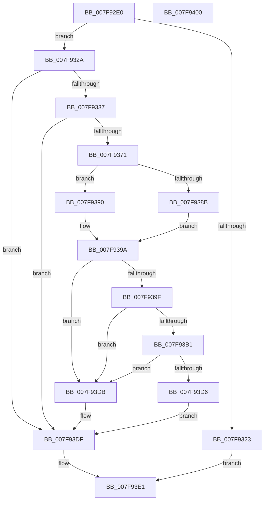

# MiReserveBestDriverRange

- RVA: `0x007F92E0`–`0x007F9401` (길이 `289` bytes)
- VA: `0x00000001407F92E0`
- 실행 섹션: `PAGE`
- PDB 이름 있음: `예`; PDB Function 태그: `아니요`
- unwind 정보 RVA: `0x0005FEF8`
- 디코드: `84`개 명령, `289/289` bytes 표시
- 미해석 바이트: `0` (있으면 어셈블리에 `.byte`로 보존)

> 이 문서는 커널 이미지의 기계어와 PDB 기호를 분석해 생성했습니다. 4번과 5번은 함수 원형과 자료형을 바이너리 사용 방식에서 추정한 C 해석이며 원본 소스 복구 결과는 아닙니다.

## 1. Dependencies

- 직접 호출 지점: **5**; 고유 호출 대상: **3**
- 직접 호출자로 확인된 함수: **1**
- RIP 상대 이미지 참조: **1**

### Outgoing calls
- `0x007F9317` → [RtlFindClearBits](../../text/40/RtlFindClearBits_function_0040E680.md) (function, `0x0040E680`)
- `0x007F932A` → [KeIsImportOptimizationEnabled](../../text/4A/KeIsImportOptimizationEnabled_function_004A8FB8.md) (function, `0x004A8FB8`)
- `0x007F9368` → [MiIsDriverVaImportOptimizable](../../text/67/MiIsDriverVaImportOptimizable_function_0067F9B4.md) (function, `0x0067F9B4`)
- `0x007F93A4` → [RtlFindClearBits](../../text/40/RtlFindClearBits_function_0040E680.md) (function, `0x0040E680`)
- `0x007F93CD` → [MiIsDriverVaImportOptimizable](../../text/67/MiIsDriverVaImportOptimizable_function_0067F9B4.md) (function, `0x0067F9B4`)

### Direct callers
- [MiReserveExistingDriverPtes](../AF/MiReserveExistingDriverPtes_function_00AF84DC.md) at `0x00AF8552`

### Static image references
- `0x007F9371` → RVA `0x00FC6CB0` (`ALMOSTRO`; read)

## 2. Other-region calls and transfers

- 다른 실행 섹션으로 향하는 call: **5**
  - `0x007F9317` → [RtlFindClearBits](../../text/40/RtlFindClearBits_function_0040E680.md) (`PAGE` → `.text`)
  - `0x007F932A` → [KeIsImportOptimizationEnabled](../../text/4A/KeIsImportOptimizationEnabled_function_004A8FB8.md) (`PAGE` → `.text`)
  - `0x007F9368` → [MiIsDriverVaImportOptimizable](../../text/67/MiIsDriverVaImportOptimizable_function_0067F9B4.md) (`PAGE` → `.text`)
  - `0x007F93A4` → [RtlFindClearBits](../../text/40/RtlFindClearBits_function_0040E680.md) (`PAGE` → `.text`)
  - `0x007F93CD` → [MiIsDriverVaImportOptimizable](../../text/67/MiIsDriverVaImportOptimizable_function_0067F9B4.md) (`PAGE` → `.text`)
- 별도 외부 분기/꼬리 이동을 확인하지 못했습니다.

## 3. Assembly (complete function range)

```asm
007F92E0  48 8B C4                        mov rax, rsp
007F92E3  48 89 58 08                     mov qword ptr [rax + 8], rbx
007F92E7  48 89 68 10                     mov qword ptr [rax + 0x10], rbp
007F92EB  48 89 70 18                     mov qword ptr [rax + 0x18], rsi
007F92EF  48 89 78 20                     mov qword ptr [rax + 0x20], rdi
007F92F3  41 54                           push r12
007F92F5  41 56                           push r14
007F92F7  41 57                           push r15
007F92F9  48 83 EC 20                     sub rsp, 0x20
007F92FD  4D 8B F0                        mov r14, r8
007F9300  41 C7 00 01 00 00 00            mov dword ptr [r8], 1
007F9307  44 8B 41 20                     mov r8d, dword ptr [rcx + 0x20]
007F930B  48 8D 79 10                     lea rdi, [rcx + 0x10]
007F930F  48 8B F1                        mov rsi, rcx
007F9312  8B EA                           mov ebp, edx
007F9314  48 8B CF                        mov rcx, rdi
007F9317  E8 64 53 C1 FF                  call 0x14040e680
007F931C  8B D8                           mov ebx, eax
007F931E  83 F8 FF                        cmp eax, -1
007F9321  75 07                           jne 0x1407f932a
007F9323  0B C0                           or eax, eax
007F9325  E9 B7 00 00 00                  jmp 0x1407f93e1
007F932A  E8 89 FC CA FF                  call 0x1404a8fb8
007F932F  84 C0                           test al, al
007F9331  0F 84 A8 00 00 00               je 0x1407f93df
007F9337  4C 8B 4E 08                     mov r9, qword ptr [rsi + 8]
007F933B  4C 8B E5                        mov r12, rbp
007F933E  49 C1 E4 10                     shl r12, 0x10
007F9342  49 C1 E1 19                     shl r9, 0x19
007F9346  49 BF 00 00 00 00 80 F6 FF FF   movabs r15, 0xfffff68000000000
007F9350  48 8B CB                        mov rcx, rbx
007F9353  49 C1 E7 19                     shl r15, 0x19
007F9357  48 C1 E1 20                     shl rcx, 0x20
007F935B  49 8B D4                        mov rdx, r12
007F935E  49 2B CF                        sub rcx, r15
007F9361  49 03 C9                        add rcx, r9
007F9364  48 C1 F9 10                     sar rcx, 0x10
007F9368  E8 47 66 E8 FF                  call 0x14067f9b4
007F936D  85 C0                           test eax, eax
007F936F  75 6E                           jne 0x1407f93df
007F9371  4C 8B 05 38 D9 7C 00            mov r8, qword ptr [rip + 0x7cd938]
007F9378  4D 2B CF                        sub r9, r15
007F937B  49 81 C0 00 00 00 80            add r8, -0x80000000
007F9382  49 C1 F9 10                     sar r9, 0x10
007F9386  4D 3B C1                        cmp r8, r9
007F9389  77 05                           ja 0x1407f9390
007F938B  45 33 C0                        xor r8d, r8d
007F938E  EB 0A                           jmp 0x1407f939a
007F9390  4D 2B C1                        sub r8, r9
007F9393  49 C1 E8 10                     shr r8, 0x10
007F9397  41 FF C0                        inc r8d
007F939A  44 3B 07                        cmp r8d, dword ptr [rdi]
007F939D  73 3C                           jae 0x1407f93db
007F939F  8B D5                           mov edx, ebp
007F93A1  48 8B CF                        mov rcx, rdi
007F93A4  E8 D7 52 C1 FF                  call 0x14040e680
007F93A9  44 8B C8                        mov r9d, eax
007F93AC  83 F8 FF                        cmp eax, -1
007F93AF  74 2A                           je 0x1407f93db
007F93B1  48 8B 4E 08                     mov rcx, qword ptr [rsi + 8]
007F93B5  45 8B C1                        mov r8d, r9d
007F93B8  48 C1 E1 19                     shl rcx, 0x19
007F93BC  49 8B D4                        mov rdx, r12
007F93BF  49 C1 E0 20                     shl r8, 0x20
007F93C3  49 03 C8                        add rcx, r8
007F93C6  49 2B CF                        sub rcx, r15
007F93C9  48 C1 F9 10                     sar rcx, 0x10
007F93CD  E8 E2 65 E8 FF                  call 0x14067f9b4
007F93D2  85 C0                           test eax, eax
007F93D4  74 05                           je 0x1407f93db
007F93D6  41 8B D9                        mov ebx, r9d
007F93D9  EB 04                           jmp 0x1407f93df
007F93DB  41 83 26 00                     and dword ptr [r14], 0
007F93DF  8B C3                           mov eax, ebx
007F93E1  48 8B 5C 24 40                  mov rbx, qword ptr [rsp + 0x40]
007F93E6  48 8B 6C 24 48                  mov rbp, qword ptr [rsp + 0x48]
007F93EB  48 8B 74 24 50                  mov rsi, qword ptr [rsp + 0x50]
007F93F0  48 8B 7C 24 58                  mov rdi, qword ptr [rsp + 0x58]
007F93F5  48 83 C4 20                     add rsp, 0x20
007F93F9  41 5F                           pop r15
007F93FB  41 5E                           pop r14
007F93FD  41 5C                           pop r12
007F93FF  C3                              ret
007F9400  CC                              int3
```

## 4. C-style interpretation (structured pseudocode)

```c
__int64 __fastcall MiReserveBestDriverRange(__int64 a1, int a2, __int64 a3)
{
    __int64 result;
    __int64 v_r12;
    __int64 v_r15;
    __int64 v_rsp;
    unsigned __int64 v_stack_p10;
    unsigned __int64 v_stack_p18;
    unsigned __int64 v_stack_p20;
    unsigned __int64 v_stack_p8;

    *(unsigned __int64 *)(v_rsp + 8) = v_rbx;
    *(unsigned __int64 *)(v_rsp + 16) = v_rbp;
    *(unsigned __int64 *)(v_rsp + 24) = v_rsi;
    *(unsigned __int64 *)(v_rsp + 32) = v_rdi;
    v_rsp = (v_rsp) - (32);
    *(unsigned int *)(a3) = 1;
    result = RtlFindClearBits(a1 + 16, a2, (unsigned int)(*(unsigned int *)(a1 + 32)), a4);
    if (((unsigned int)(result)) != -1) goto loc_007F932A;
    result = (unsigned int)((result) | ((unsigned int)(result)));
    goto loc_007F93E1;
loc_007F932A:
    result = KeIsImportOptimizationEnabled(a1 + 16, a2, (unsigned int)(*(unsigned int *)(a1 + 32)), a4);
    if ((unsigned __int8)(result) == 0) goto loc_007F93DF;
    v_r12 = ((unsigned int)(a2)) << (16);
    a4 = (*(unsigned __int64 *)(a1 + 8)) << (25);
    v_r15 = (v_r15) << (25);
    a1 = ((unsigned int)((unsigned int)(result))) << (32);
    a1 = (a1) - (v_r15);
    a1 = (a1) + (a4);
    a1 = (a1) >> (16);
    result = MiIsDriverVaImportOptimizable(a1, v_r12, (unsigned int)(*(unsigned int *)(a1 + 32)), a4);
    if ((unsigned int)(result) != 0) goto loc_007F93DF;
    a4 = (a4) - (v_r15);
    a3 = (*(unsigned __int64 *)(v_rip + 8182072)) + (0xFFFFFFFF80000000ULL);
    a4 = (a4) >> (16);
    if (a3 > a4) goto loc_007F9390;
    a3 = 0;
    goto loc_007F939A;
loc_007F9390:
    a3 = (a3) - (a4);
    a3 = (a3) >> (16);
    a3 = (unsigned int)((a3) + 1);
loc_007F939A:
    if (((unsigned int)(a3)) >= (*(unsigned int *)(a1 + 16))) goto loc_007F93DB;
    result = RtlFindClearBits(a1 + 16, (unsigned int)((unsigned int)((unsigned int)(a2))), a3, a4);
    if (((unsigned int)(result)) == -1) goto loc_007F93DB;
    a1 = (*(unsigned __int64 *)(a1 + 8)) << (25);
    a3 = ((unsigned int)((unsigned int)((unsigned int)((unsigned int)(result))))) << (32);
    a1 = (a1) + (a3);
    a1 = (a1) - (v_r15);
    a1 = (a1) >> (16);
    result = MiIsDriverVaImportOptimizable(a1, v_r12, a3, (unsigned int)((unsigned int)(result)));
    if ((unsigned int)(result) == 0) goto loc_007F93DB;
    goto loc_007F93DF;
loc_007F93DB:
loc_007F93DF:
loc_007F93E1:
    v_rsp = (v_rsp) + (32);
    return (unsigned int)((unsigned int)((unsigned int)((unsigned int)((unsigned int)((unsigned int)(result))))));
}
```

## 5. (Beta) C Style

```c
int64_t MiReserveBestDriverRange(void *Arg1, int32_t Arg2, void *Arg3)
{
    uint8_t *arg1 = (uint8_t *)Arg1;
    uint8_t *arg3 = (uint8_t *)Arg3;

    int64_t result;
    int64_t local_r12;
    int64_t local_r15;
    int64_t local_rsp;
    uint64_t v_stack_p10;
    uint64_t v_stack_p18;
    uint64_t v_stack_p20;
    uint64_t v_stack_p8;

    *(uint64_t *)(local_rsp + 0x8) = local_rbx;
    *(uint64_t *)(local_rsp + 0x10) = local_rbp;
    *(uint64_t *)(local_rsp + 0x18) = local_rsi;
    *(uint64_t *)(local_rsp + 0x20) = local_rdi;
    local_rsp = (local_rsp) - (32);
    *(uint32_t *)(arg3) = 1;
    result = RtlFindClearBits(Arg1 + 16, Arg2, (uint32_t)(*(uint32_t *)(arg1 + 0x20)), a4);
    if (((uint32_t)(result)) != -1) goto loc_007F932A;
    result = (uint32_t)((result) | ((uint32_t)(result)));
    goto loc_007F93E1;
loc_007F932A:
    result = KeIsImportOptimizationEnabled(Arg1 + 16, Arg2, (uint32_t)(*(uint32_t *)(arg1 + 0x20)), a4);
    if ((uint8_t)(result) == 0) goto loc_007F93DF;
    local_r12 = ((uint32_t)(Arg2)) << (16);
    a4 = (*(uint64_t *)(arg1 + 0x8)) << (25);
    local_r15 = (local_r15) << (25);
    Arg1 = ((uint32_t)((uint32_t)(result))) << (32);
    Arg1 = (Arg1) - (local_r15);
    Arg1 = (Arg1) + (a4);
    Arg1 = (Arg1) >> (16);
    result = MiIsDriverVaImportOptimizable(Arg1, local_r12, (uint32_t)(*(uint32_t *)(arg1 + 0x20)), a4);
    if ((uint32_t)(result) != 0) goto loc_007F93DF;
    a4 = (a4) - (local_r15);
    Arg3 = (*(uint64_t *)(v_rip + 0x7CD938)) + (0xFFFFFFFF80000000ULL);
    a4 = (a4) >> (16);
    if (Arg3 > a4) goto loc_007F9390;
    Arg3 = 0;
    goto loc_007F939A;
loc_007F9390:
    Arg3 = (Arg3) - (a4);
    Arg3 = (Arg3) >> (16);
    Arg3 = (uint32_t)((Arg3) + 1);
loc_007F939A:
    if (((uint32_t)(Arg3)) >= (*(uint32_t *)(arg1 + 0x10))) goto loc_007F93DB;
    result = RtlFindClearBits(Arg1 + 16, (uint32_t)((uint32_t)((uint32_t)(Arg2))), Arg3, a4);
    if (((uint32_t)(result)) == -1) goto loc_007F93DB;
    Arg1 = (*(uint64_t *)(arg1 + 0x8)) << (25);
    Arg3 = ((uint32_t)((uint32_t)((uint32_t)((uint32_t)(result))))) << (32);
    Arg1 = (Arg1) + (Arg3);
    Arg1 = (Arg1) - (local_r15);
    Arg1 = (Arg1) >> (16);
    result = MiIsDriverVaImportOptimizable(Arg1, local_r12, Arg3, (uint32_t)((uint32_t)(result)));
    if ((uint32_t)(result) == 0) goto loc_007F93DB;
    goto loc_007F93DF;
loc_007F93DB:
loc_007F93DF:
loc_007F93E1:
    local_rsp = (local_rsp) + (32);
    return (uint32_t)((uint32_t)((uint32_t)((uint32_t)((uint32_t)((uint32_t)(result))))));
}
```

### 관측된 메모리 오프셋

구조체 형식이 확인되지 않은 접근은 인자 기준의 오프셋으로만 기록했습니다.

| 기준 인자 | 오프셋 표현 | 폭 (bit) | 접근 |
|---|---:|---:|---|
| `Arg1` | `+ 0x0` | `32` | `R` |
| `Arg1` | `+ 0x8` | `64` | `R` |
| `Arg1` | `+ 0x10` | `64` | `R` |
| `Arg1` | `+ 0x20` | `32` | `R` |
| `Arg3` | `+ 0x0` | `32` | `R/W` |
| `Arg3` | `+ 0x0` | `32` | `W` |

## 6. Execution-region graph

[열기: 2D/3D 그래프와 함수 탐색 컨트롤 패널](../../../control-panel.html?section=page&rva=0x007F92E0&view=graph)

- 2D 그래프는 위에서 아래로 흐르고, 3D 그래프는 빈 공간을 드래그해 회전합니다. Shift+드래그는 이동, 휠은 확대·축소, 함수 노드 선택은 대상 보고서 이동입니다.

### Static fallback


