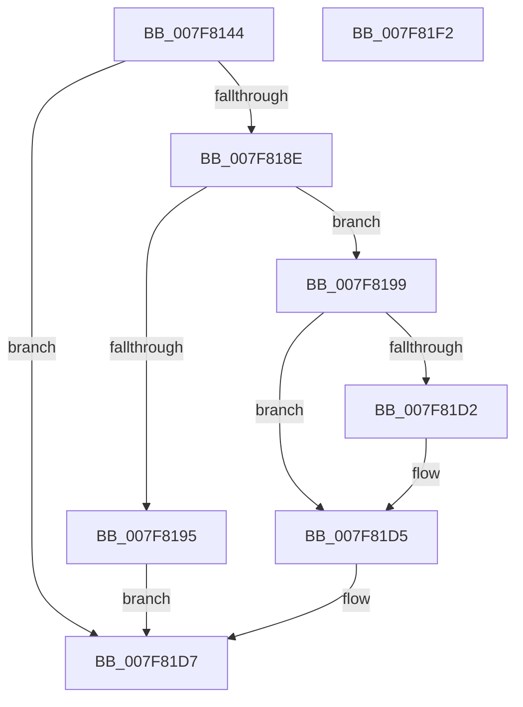

# MiResolveImageImports

- RVA: `0x007F8144`–`0x007F81F3` (길이 `175` bytes)
- VA: `0x00000001407F8144`
- 실행 섹션: `PAGE`
- PDB 이름 있음: `예`; PDB Function 태그: `아니요`
- unwind 정보 RVA: `0x00091ECC`
- 디코드: `50`개 명령, `175/175` bytes 표시
- 미해석 바이트: `0` (있으면 어셈블리에 `.byte`로 보존)

> 이 문서는 커널 이미지의 기계어와 PDB 기호를 분석해 생성했습니다. 4번과 5번은 함수 원형과 자료형을 바이너리 사용 방식에서 추정한 C 해석이며 원본 소스 복구 결과는 아닙니다.

## 1. Dependencies

- 직접 호출 지점: **3**; 고유 호출 대상: **3**
- 직접 호출자로 확인된 함수: **1**
- RIP 상대 이미지 참조: **0**

### Outgoing calls
- `0x007F8185` → [MiSetImportTableProtection](../AC/MiSetImportTableProtection_function_00AC2D2C.md) (function, `0x00AC2D2C`)
- `0x007F81B5` → [MiResolveImageReferences](../A2/MiResolveImageReferences_function_00A23BE4.md) (function, `0x00A23BE4`)
- `0x007F81C4` → [MiRestoreImportTableProtection](MiRestoreImportTableProtection_function_007F81FC.md) (function, `0x007F81FC`)

### Direct callers
- [MmLoadSystemImageEx](../99/MmLoadSystemImageEx_function_00999B8C.md) at `0x00999F7B`

### Static image references
- 디코드된 RIP-relative 메모리 참조가 없습니다.

## 2. Other-region calls and transfers

- 다른 실행 섹션으로 향하는 call: **0**
- 별도 외부 분기/꼬리 이동을 확인하지 못했습니다.

## 3. Assembly (complete function range)

```asm
007F8144  4C 8B DC                        mov r11, rsp
007F8147  49 89 5B 08                     mov qword ptr [r11 + 8], rbx
007F814B  49 89 6B 10                     mov qword ptr [r11 + 0x10], rbp
007F814F  49 89 73 18                     mov qword ptr [r11 + 0x18], rsi
007F8153  49 89 7B 20                     mov qword ptr [r11 + 0x20], rdi
007F8157  41 56                           push r14
007F8159  48 83 EC 50                     sub rsp, 0x50
007F815D  48 8B BC 24 88 00 00 00         mov rdi, qword ptr [rsp + 0x88]
007F8165  33 C0                           xor eax, eax
007F8167  0F 57 C0                        xorps xmm0, xmm0
007F816A  4C 8B F2                        mov r14, rdx
007F816D  0F 11 44 24 30                  movups xmmword ptr [rsp + 0x30], xmm0
007F8172  49 8D 53 D8                     lea rdx, [r11 - 0x28]
007F8176  49 89 43 E8                     mov qword ptr [r11 - 0x18], rax
007F817A  88 07                           mov byte ptr [rdi], al
007F817C  49 8B F1                        mov rsi, r9
007F817F  49 8B E8                        mov rbp, r8
007F8182  48 8B D9                        mov rbx, rcx
007F8185  E8 A2 AB 2C 00                  call 0x140ac2d2c
007F818A  85 C0                           test eax, eax
007F818C  78 49                           js 0x1407f81d7
007F818E  83 7C 24 40 00                  cmp dword ptr [rsp + 0x40], 0
007F8193  75 04                           jne 0x1407f8199
007F8195  33 C0                           xor eax, eax
007F8197  EB 3E                           jmp 0x1407f81d7
007F8199  8B 84 24 80 00 00 00            mov eax, dword ptr [rsp + 0x80]
007F81A0  4D 8B CE                        mov r9, r14
007F81A3  0F BA 6B 68 0C                  bts dword ptr [rbx + 0x68], 0xc
007F81A8  4C 8B C5                        mov r8, rbp
007F81AB  48 8B D6                        mov rdx, rsi
007F81AE  89 44 24 20                     mov dword ptr [rsp + 0x20], eax
007F81B2  48 8B CB                        mov rcx, rbx
007F81B5  E8 2A BA 22 00                  call 0x140a23be4
007F81BA  48 8D 54 24 30                  lea rdx, [rsp + 0x30]
007F81BF  48 8B CB                        mov rcx, rbx
007F81C2  8B F0                           mov esi, eax
007F81C4  E8 33 00 00 00                  call 0x1407f81fc
007F81C9  0F BA 73 68 0C                  btr dword ptr [rbx + 0x68], 0xc
007F81CE  85 F6                           test esi, esi
007F81D0  79 03                           jns 0x1407f81d5
007F81D2  C6 07 01                        mov byte ptr [rdi], 1
007F81D5  8B C6                           mov eax, esi
007F81D7  48 8B 5C 24 60                  mov rbx, qword ptr [rsp + 0x60]
007F81DC  48 8B 6C 24 68                  mov rbp, qword ptr [rsp + 0x68]
007F81E1  48 8B 74 24 70                  mov rsi, qword ptr [rsp + 0x70]
007F81E6  48 8B 7C 24 78                  mov rdi, qword ptr [rsp + 0x78]
007F81EB  48 83 C4 50                     add rsp, 0x50
007F81EF  41 5E                           pop r14
007F81F1  C3                              ret
007F81F2  CC                              int3
```

## 4. C-style interpretation (structured pseudocode)

```c
__int64 __fastcall MiResolveImageImports(__int64 a1, __int64 a2, __int64 a3, __int64 a4, unsigned int a5, __int64 a6)
{
    __int64 result;
    __int64 v_rsp;
    unsigned int v_stack_m18;
    unsigned __int64 v_stack_m28;
    unsigned int v_stack_m38;
    unsigned __int64 v_stack_p10;
    unsigned __int64 v_stack_p18;
    unsigned __int64 v_stack_p20;
    unsigned __int64 v_stack_p8;

    *(unsigned __int64 *)(v_rsp + 8) = v_rbx;
    *(unsigned __int64 *)(v_rsp + 16) = v_rbp;
    *(unsigned __int64 *)(v_rsp + 24) = v_rsi;
    *(unsigned __int64 *)(v_rsp + 32) = v_rdi;
    v_rsp = (v_rsp) - (80);
    result = 0;
    v_stack_m28 = v_xmm0;
    *(unsigned __int64 *)(v_rsp - 24) = 0;
    *(unsigned __int8 *)(a6) = 0;
    result = MiSetImportTableProtection(a1, v_rsp - 40, a3, a4);
    if (sign_flag) goto loc_007F81D7;
    if (v_stack_m18 != 0) goto loc_007F8199;
    result = 0;
    goto loc_007F81D7;
loc_007F8199:
    v_stack_m38 = (unsigned int)((unsigned int)(a5));
    result = MiResolveImageReferences(a1, a4, a3, a2);
    result = MiRestoreImportTableProtection(a1, v_stack_m28, a3, a2);
    if (sign_flag) {
        *(unsigned __int8 *)(a6) = 1;
    }
loc_007F81D7:
    v_rsp = (v_rsp) + (80);
    return (unsigned int)((unsigned int)((unsigned int)((unsigned int)(result))));
}
```

## 5. (Beta) C Style

```c
int64_t MiResolveImageImports(void *Arg1, int64_t Arg2, int64_t Arg3, int64_t Arg4, uint32_t Arg5, void *Arg6)
{
    uint8_t *arg1 = (uint8_t *)Arg1;
    uint8_t *arg6 = (uint8_t *)Arg6;

    int64_t result;
    int64_t local_rsp;
    uint32_t v_stack_m18;
    uint64_t v_stack_m28;
    uint32_t v_stack_m38;
    uint64_t v_stack_p10;
    uint64_t v_stack_p18;
    uint64_t v_stack_p20;
    uint64_t v_stack_p8;

    *(uint64_t *)(local_rsp + 0x8) = local_rbx;
    *(uint64_t *)(local_rsp + 0x10) = local_rbp;
    *(uint64_t *)(local_rsp + 0x18) = local_rsi;
    *(uint64_t *)(local_rsp + 0x20) = local_rdi;
    local_rsp = (local_rsp) - (80);
    result = 0;
    v_stack_m28 = v_xmm0;
    *(uint64_t *)(local_rsp - 0x18) = 0;
    *(uint8_t *)(arg6) = 0;
    result = MiSetImportTableProtection(Arg1, local_rsp - 40, Arg3, Arg4);
    if (sign_flag) goto loc_007F81D7;
    if (v_stack_m18 != 0) goto loc_007F8199;
    result = 0;
    goto loc_007F81D7;
loc_007F8199:
    v_stack_m38 = (uint32_t)((uint32_t)(Arg5));
    result = MiResolveImageReferences(Arg1, Arg4, Arg3, Arg2);
    result = MiRestoreImportTableProtection(Arg1, v_stack_m28, Arg3, Arg2);
    if (sign_flag) {
        *(uint8_t *)(arg6) = 1;
    }
loc_007F81D7:
    local_rsp = (local_rsp) + (80);
    return (uint32_t)((uint32_t)((uint32_t)((uint32_t)(result))));
}
```

### 관측된 메모리 오프셋

구조체 형식이 확인되지 않은 접근은 인자 기준의 오프셋으로만 기록했습니다.

| 기준 인자 | 오프셋 표현 | 폭 (bit) | 접근 |
|---|---:|---:|---|
| `Arg1` | `+ 0x68` | `32` | `R/W` |
| `Arg6` | `+ 0x0` | `8` | `W` |

## 6. Execution-region graph

[열기: 2D/3D 그래프와 함수 탐색 컨트롤 패널](../../../control-panel.html?section=page&rva=0x007F8144&view=graph)

- 2D 그래프는 위에서 아래로 흐르고, 3D 그래프는 빈 공간을 드래그해 회전합니다. Shift+드래그는 이동, 휠은 확대·축소, 함수 노드 선택은 대상 보고서 이동입니다.

### Static fallback


