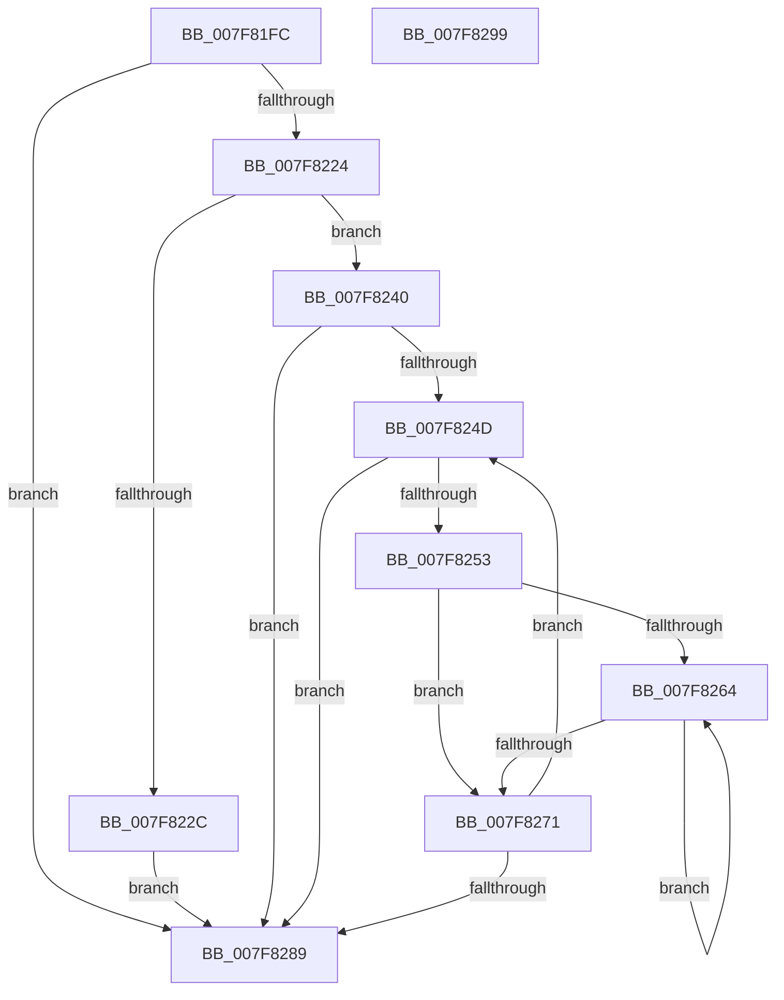

# MiRestoreImportTableProtection

- RVA: `0x007F81FC`–`0x007F829A` (길이 `158` bytes)
- VA: `0x00000001407F81FC`
- 실행 섹션: `PAGE`
- PDB 이름 있음: `예`; PDB Function 태그: `아니요`
- unwind 정보 RVA: `0x00060BC4`
- 디코드: `47`개 명령, `158/158` bytes 표시
- 미해석 바이트: `0` (있으면 어셈블리에 `.byte`로 보존)

> 이 문서는 커널 이미지의 기계어와 PDB 기호를 분석해 생성했습니다. 4번과 5번은 함수 원형과 자료형을 바이너리 사용 방식에서 추정한 C 해석이며 원본 소스 복구 결과는 아닙니다.

## 1. Dependencies

- 직접 호출 지점: **3**; 고유 호출 대상: **2**
- 직접 호출자로 확인된 함수: **1**
- RIP 상대 이미지 참조: **0**

### Outgoing calls
- `0x007F8215` → [MiSectionControlArea](../../text/29/MiSectionControlArea_function_00294CB0.md) (function, `0x00294CB0`)
- `0x007F8239` → [MiSetImageProtection](../../text/38/MiSetImageProtection_function_003843D0.md) (function, `0x003843D0`)
- `0x007F827E` → [MiSetImageProtection](../../text/38/MiSetImageProtection_function_003843D0.md) (function, `0x003843D0`)

### Direct callers
- [MiResolveImageImports](MiResolveImageImports_function_007F8144.md) at `0x007F81C4`

### Static image references
- 디코드된 RIP-relative 메모리 참조가 없습니다.

## 2. Other-region calls and transfers

- 다른 실행 섹션으로 향하는 call: **3**
  - `0x007F8215` → [MiSectionControlArea](../../text/29/MiSectionControlArea_function_00294CB0.md) (`PAGE` → `.text`)
  - `0x007F8239` → [MiSetImageProtection](../../text/38/MiSetImageProtection_function_003843D0.md) (`PAGE` → `.text`)
  - `0x007F827E` → [MiSetImageProtection](../../text/38/MiSetImageProtection_function_003843D0.md) (`PAGE` → `.text`)
- 별도 외부 분기/꼬리 이동을 확인하지 못했습니다.

## 3. Assembly (complete function range)

```asm
007F81FC  48 89 5C 24 08                  mov qword ptr [rsp + 8], rbx
007F8201  48 89 74 24 10                  mov qword ptr [rsp + 0x10], rsi
007F8206  57                              push rdi
007F8207  48 83 EC 20                     sub rsp, 0x20
007F820B  48 8B F9                        mov rdi, rcx
007F820E  48 8B DA                        mov rbx, rdx
007F8211  48 8B 49 70                     mov rcx, qword ptr [rcx + 0x70]
007F8215  E8 96 CA A9 FF                  call 0x140294cb0
007F821A  48 83 B8 90 00 00 00 00         cmp qword ptr [rax + 0x90], 0
007F8222  74 65                           je 0x1407f8289
007F8224  48 8B 13                        mov rdx, qword ptr [rbx]
007F8227  48 85 D2                        test rdx, rdx
007F822A  74 14                           je 0x1407f8240
007F822C  44 8B 43 14                     mov r8d, dword ptr [rbx + 0x14]
007F8230  41 B9 00 01 00 00               mov r9d, 0x100
007F8236  48 8B CF                        mov rcx, rdi
007F8239  E8 92 C1 B8 FF                  call 0x1403843d0
007F823E  EB 49                           jmp 0x1407f8289
007F8240  48 8B 5B 08                     mov rbx, qword ptr [rbx + 8]
007F8244  48 8B 77 30                     mov rsi, qword ptr [rdi + 0x30]
007F8248  48 85 DB                        test rbx, rbx
007F824B  74 3C                           je 0x1407f8289
007F824D  8B 03                           mov eax, dword ptr [rbx]
007F824F  85 C0                           test eax, eax
007F8251  74 36                           je 0x1407f8289
007F8253  8B 53 10                        mov edx, dword ptr [rbx + 0x10]
007F8256  48 03 C6                        add rax, rsi
007F8259  48 03 D6                        add rdx, rsi
007F825C  45 33 C0                        xor r8d, r8d
007F825F  4C 39 00                        cmp qword ptr [rax], r8
007F8262  74 0D                           je 0x1407f8271
007F8264  48 8D 40 08                     lea rax, [rax + 8]
007F8268  41 FF C0                        inc r8d
007F826B  48 83 38 00                     cmp qword ptr [rax], 0
007F826F  75 F3                           jne 0x1407f8264
007F8271  41 C1 E0 03                     shl r8d, 3
007F8275  41 B9 00 01 00 00               mov r9d, 0x100
007F827B  48 8B CF                        mov rcx, rdi
007F827E  E8 4D C1 B8 FF                  call 0x1403843d0
007F8283  48 83 C3 14                     add rbx, 0x14
007F8287  75 C4                           jne 0x1407f824d
007F8289  48 8B 5C 24 30                  mov rbx, qword ptr [rsp + 0x30]
007F828E  48 8B 74 24 38                  mov rsi, qword ptr [rsp + 0x38]
007F8293  48 83 C4 20                     add rsp, 0x20
007F8297  5F                              pop rdi
007F8298  C3                              ret
007F8299  CC                              int3
```

## 4. C-style interpretation (structured pseudocode)

```c
__int64 __fastcall MiRestoreImportTableProtection(__int64 a1, __int64 a2)
{
    __int64 result;
    __int64 v_rbx;
    __int64 v_rsp;
    unsigned __int64 v_stack_p10;
    unsigned __int64 v_stack_p8;

    v_stack_p8 = v_rbx;
    v_stack_p10 = v_rsi;
    v_rsp = (v_rsp) - (32);
    result = MiSectionControlArea(*(unsigned __int64 *)(a1 + 112), a2, a3, a4);
    if ((*(unsigned __int64 *)(result + 144)) == 0) goto loc_007F8289;
    if (*(unsigned __int64 *)(a2) == 0) goto loc_007F8240;
    result = MiSetImageProtection(a1, *(unsigned __int64 *)(a2), (unsigned int)(*(unsigned int *)(a2 + 20)), 256);
    goto loc_007F8289;
loc_007F8240:
    if (*(unsigned __int64 *)(a2 + 8) == 0) goto loc_007F8289;
loc_007F824D:
    if ((unsigned int)((unsigned int)(*(unsigned int *)(*(unsigned __int64 *)(a2 + 8)))) == 0) goto loc_007F8289;
    result = ((unsigned int)(*(unsigned int *)(*(unsigned __int64 *)(a2 + 8)))) + (*(unsigned __int64 *)(a1 + 48));
    a2 = ((unsigned int)(*(unsigned int *)(*(unsigned __int64 *)(a2 + 8) + 16))) + (*(unsigned __int64 *)(a1 + 48));
    a3 = 0;
    if ((*(unsigned __int64 *)(result)) == 0) goto loc_007F8271;
loc_007F8264:
    a3 = (unsigned int)((a3) + 1);
    if ((*(unsigned __int64 *)(result + 8)) != 0) goto loc_007F8264;
loc_007F8271:
    a3 = (unsigned int)((a3) << (3));
    result = MiSetImageProtection(a1, a2, a3, 256);
    v_rbx = (*(unsigned __int64 *)(a2 + 8)) + (20);
    if (condition_is_not_equal) goto loc_007F824D;
loc_007F8289:
    v_rsp = (v_rsp) + (32);
    return result;
}
```

## 5. (Beta) C Style

```c
int64_t MiRestoreImportTableProtection(void *Arg1, void *Arg2)
{
    uint8_t *arg1 = (uint8_t *)Arg1;
    uint8_t *arg2 = (uint8_t *)Arg2;

    int64_t result;
    int64_t local_rbx;
    int64_t local_rsp;
    uint64_t v_stack_p10;
    uint64_t v_stack_p8;

    v_stack_p8 = local_rbx;
    v_stack_p10 = local_rsi;
    local_rsp = (local_rsp) - (32);
    result = MiSectionControlArea(*(uint64_t *)(arg1 + 0x70), Arg2, a3, a4);
    if ((*(uint64_t *)(result + 0x90)) == 0) goto loc_007F8289;
    if (*(uint64_t *)(arg2) == 0) goto loc_007F8240;
    result = MiSetImageProtection(Arg1, *(uint64_t *)(arg2), (uint32_t)(*(uint32_t *)(arg2 + 0x14)), 256);
    goto loc_007F8289;
loc_007F8240:
    if (*(uint64_t *)(arg2 + 0x8) == 0) goto loc_007F8289;
loc_007F824D:
    if ((uint32_t)((uint32_t)(*(uint32_t *)(*(uint64_t *)(arg2 + 0x8)))) == 0) goto loc_007F8289;
    result = ((uint32_t)(*(uint32_t *)(*(uint64_t *)(arg2 + 0x8)))) + (*(uint64_t *)(arg1 + 0x30));
    Arg2 = ((uint32_t)(*(uint32_t *)(*(uint64_t *)(arg2 + 0x8) + 0x10))) + (*(uint64_t *)(arg1 + 0x30));
    a3 = 0;
    if ((*(uint64_t *)(result)) == 0) goto loc_007F8271;
loc_007F8264:
    a3 = (uint32_t)((a3) + 1);
    if ((*(uint64_t *)(result + 0x8)) != 0) goto loc_007F8264;
loc_007F8271:
    a3 = (uint32_t)((a3) << (3));
    result = MiSetImageProtection(Arg1, Arg2, a3, 256);
    local_rbx = (*(uint64_t *)(arg2 + 0x8)) + (20);
    if (condition_is_not_equal) goto loc_007F824D;
loc_007F8289:
    local_rsp = (local_rsp) + (32);
    return result;
}
```

### 관측된 메모리 오프셋

구조체 형식이 확인되지 않은 접근은 인자 기준의 오프셋으로만 기록했습니다.

| 기준 인자 | 오프셋 표현 | 폭 (bit) | 접근 |
|---|---:|---:|---|
| `Arg1` | `+ 0x30` | `64` | `R` |
| `Arg1` | `+ 0x70` | `64` | `R` |
| `Arg2` | `+ 0x0` | `64` | `R` |
| `Arg2` | `+ 0x8` | `64` | `R` |
| `Arg2` | `+ 0x14` | `32` | `R` |

## 6. Execution-region graph

[열기: 2D/3D 그래프와 함수 탐색 컨트롤 패널](../../../control-panel.html?section=page&rva=0x007F81FC&view=graph)

- 2D 그래프는 위에서 아래로 흐르고, 3D 그래프는 빈 공간을 드래그해 회전합니다. Shift+드래그는 이동, 휠은 확대·축소, 함수 노드 선택은 대상 보고서 이동입니다.

### Static fallback


