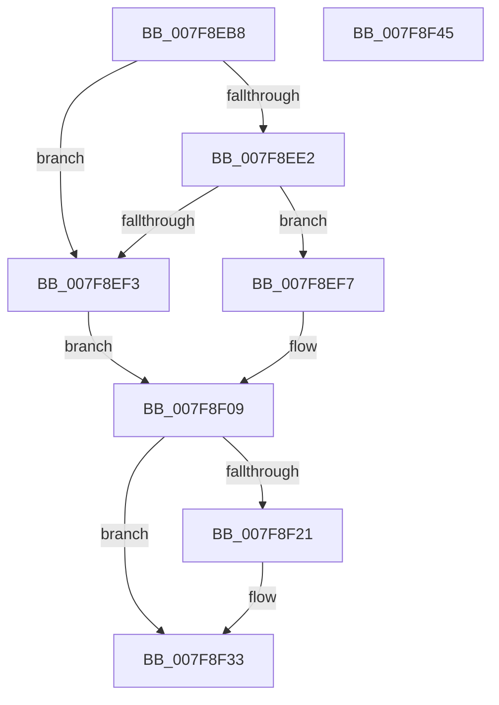

# MiSplitDriverPage

- RVA: `0x007F8EB8`–`0x007F8F46` (길이 `142` bytes)
- VA: `0x00000001407F8EB8`
- 실행 섹션: `PAGE`
- PDB 이름 있음: `예`; PDB Function 태그: `아니요`
- unwind 정보 RVA: `0x00060BC4`
- 디코드: `41`개 명령, `142/142` bytes 표시
- 미해석 바이트: `0` (있으면 어셈블리에 `.byte`로 보존)

> 이 문서는 커널 이미지의 기계어와 PDB 기호를 분석해 생성했습니다. 4번과 5번은 함수 원형과 자료형을 바이너리 사용 방식에서 추정한 C 해석이며 원본 소스 복구 결과는 아닙니다.

## 1. Dependencies

- 직접 호출 지점: **6**; 고유 호출 대상: **6**
- 직접 호출자로 확인된 함수: **1**
- RIP 상대 이미지 참조: **1**

### Outgoing calls
- `0x007F8EE2` → [MiGetBaseLoaderPortion](../../text/4D/MiGetBaseLoaderPortion_function_004D9D34.md) (function, `0x004D9D34`)
- `0x007F8EF7` → [MmAcquireLoadLockShared](../../text/2A/MmAcquireLoadLockShared_function_002A389C.md) (function, `0x002A389C`)
- `0x007F8F04` → [MiLockLoaderEntry](../../text/2A/MiLockLoaderEntry_function_002A3EE0.md) (function, `0x002A3EE0`)
- `0x007F8F15` → [MiMakeDriverPagesPrivate](../../text/38/MiMakeDriverPagesPrivate_function_00384C60.md) (function, `0x00384C60`)
- `0x007F8F26` → [MiUnlockLoaderEntry](../../text/2A/MiUnlockLoaderEntry_function_002A3E28.md) (function, `0x002A3E28`)
- `0x007F8F2E` → [MmReleaseLoadLockShared](../../text/2A/MmReleaseLoadLockShared_function_002A3FB0.md) (function, `0x002A3FB0`)

### Direct callers
- [sub_006D7AEE](../../text/6D/Unknown_function_006D7AEE.md) at `0x006D7B22`

### Static image references
- `0x007F8ED3` → RVA `0x00E2D910` (`.data`; read)

## 2. Other-region calls and transfers

- 다른 실행 섹션으로 향하는 call: **6**
  - `0x007F8EE2` → [MiGetBaseLoaderPortion](../../text/4D/MiGetBaseLoaderPortion_function_004D9D34.md) (`PAGE` → `.text`)
  - `0x007F8EF7` → [MmAcquireLoadLockShared](../../text/2A/MmAcquireLoadLockShared_function_002A389C.md) (`PAGE` → `.text`)
  - `0x007F8F04` → [MiLockLoaderEntry](../../text/2A/MiLockLoaderEntry_function_002A3EE0.md) (`PAGE` → `.text`)
  - `0x007F8F15` → [MiMakeDriverPagesPrivate](../../text/38/MiMakeDriverPagesPrivate_function_00384C60.md) (`PAGE` → `.text`)
  - `0x007F8F26` → [MiUnlockLoaderEntry](../../text/2A/MiUnlockLoaderEntry_function_002A3E28.md) (`PAGE` → `.text`)
  - `0x007F8F2E` → [MmReleaseLoadLockShared](../../text/2A/MmReleaseLoadLockShared_function_002A3FB0.md) (`PAGE` → `.text`)
- 별도 외부 분기/꼬리 이동을 확인하지 못했습니다.

## 3. Assembly (complete function range)

```asm
007F8EB8  48 89 5C 24 08                  mov qword ptr [rsp + 8], rbx
007F8EBD  48 89 74 24 10                  mov qword ptr [rsp + 0x10], rsi
007F8EC2  57                              push rdi
007F8EC3  48 83 EC 20                     sub rsp, 0x20
007F8EC7  65 4C 8B 04 25 88 01 00 00      mov r8, qword ptr gs:[0x188]
007F8ED0  48 8B F2                        mov rsi, rdx
007F8ED3  48 8B 05 36 4A 63 00            mov rax, qword ptr [rip + 0x634a36]
007F8EDA  48 8B F9                        mov rdi, rcx
007F8EDD  49 3B C0                        cmp rax, r8
007F8EE0  74 11                           je 0x1407f8ef3
007F8EE2  E8 4D 0E CE FF                  call 0x1404d9d34
007F8EE7  48 8B 80 F0 00 00 00            mov rax, qword ptr [rax + 0xf0]
007F8EEE  49 3B C0                        cmp rax, r8
007F8EF1  75 04                           jne 0x1407f8ef7
007F8EF3  33 DB                           xor ebx, ebx
007F8EF5  EB 12                           jmp 0x1407f8f09
007F8EF7  E8 A0 A9 AA FF                  call 0x1402a389c
007F8EFC  33 D2                           xor edx, edx
007F8EFE  48 8B CF                        mov rcx, rdi
007F8F01  48 8B D8                        mov rbx, rax
007F8F04  E8 D7 AF AA FF                  call 0x1402a3ee0
007F8F09  45 33 C9                        xor r9d, r9d
007F8F0C  4C 8B C6                        mov r8, rsi
007F8F0F  48 8B D6                        mov rdx, rsi
007F8F12  48 8B CF                        mov rcx, rdi
007F8F15  E8 46 BD B8 FF                  call 0x140384c60
007F8F1A  8B F0                           mov esi, eax
007F8F1C  48 85 DB                        test rbx, rbx
007F8F1F  74 12                           je 0x1407f8f33
007F8F21  33 D2                           xor edx, edx
007F8F23  48 8B CF                        mov rcx, rdi
007F8F26  E8 FD AE AA FF                  call 0x1402a3e28
007F8F2B  48 8B CB                        mov rcx, rbx
007F8F2E  E8 7D B0 AA FF                  call 0x1402a3fb0
007F8F33  48 8B 5C 24 30                  mov rbx, qword ptr [rsp + 0x30]
007F8F38  8B C6                           mov eax, esi
007F8F3A  48 8B 74 24 38                  mov rsi, qword ptr [rsp + 0x38]
007F8F3F  48 83 C4 20                     add rsp, 0x20
007F8F43  5F                              pop rdi
007F8F44  C3                              ret
007F8F45  CC                              int3
```

## 4. C-style interpretation (structured pseudocode)

```c
__int64 __fastcall MiSplitDriverPage(__int64 a1, __int64 a2, __int64 a3, int a4)
{
    __int64 result;
    __int64 v_rbx;
    __int64 v_rsp;
    unsigned __int64 v_stack_p10;
    unsigned __int64 v_stack_p8;

    v_stack_p8 = v_rbx;
    v_stack_p10 = v_rsi;
    v_rsp = (v_rsp) - (32);
    if ((*(unsigned __int64 *)(v_rip + 6507062)) == (*(unsigned __int64 *)(gs_base + (0 + 392)))) goto loc_007F8EF3;
    result = MiGetBaseLoaderPortion(a1, a2, *(unsigned __int64 *)(gs_base + (0 + 392)), a4);
    if ((*(unsigned __int64 *)(result + 240)) != (*(unsigned __int64 *)(gs_base + (0 + 392)))) goto loc_007F8EF7;
loc_007F8EF3:
    v_rbx = 0;
    goto loc_007F8F09;
loc_007F8EF7:
    result = MmAcquireLoadLockShared(a1, a2, *(unsigned __int64 *)(gs_base + (0 + 392)), a4);
    a2 = 0;
    result = MiLockLoaderEntry(a1, a2, *(unsigned __int64 *)(gs_base + (0 + 392)), a4);
loc_007F8F09:
    a4 = 0;
    result = MiMakeDriverPagesPrivate(a1, 0, 0, a4);
    if (result != 0) {
        a2 = 0;
        a1 = a1;
        result = MiUnlockLoaderEntry(a1, a2, 0, a4);
        a1 = result;
        result = MmReleaseLoadLockShared(a1, a2, 0, a4);
    }
    v_rsp = (v_rsp) + (32);
    return (unsigned int)((unsigned int)((unsigned int)((unsigned int)(result))));
}
```

## 5. (Beta) C Style

```c
int64_t MiSplitDriverPage(int64_t Arg1, int64_t Arg2, int64_t Arg3, int32_t Arg4)
{
    int64_t result;
    int64_t local_rbx;
    int64_t local_rsp;
    uint64_t v_stack_p10;
    uint64_t v_stack_p8;

    v_stack_p8 = local_rbx;
    v_stack_p10 = local_rsi;
    local_rsp = (local_rsp) - (32);
    if ((*(uint64_t *)(v_rip + 0x634A36)) == (*(uint64_t *)(gs_base + (0 + 0x188)))) goto loc_007F8EF3;
    result = MiGetBaseLoaderPortion(Arg1, Arg2, *(uint64_t *)(gs_base + (0 + 0x188)), Arg4);
    if ((*(uint64_t *)(result + 0xF0)) != (*(uint64_t *)(gs_base + (0 + 0x188)))) goto loc_007F8EF7;
loc_007F8EF3:
    local_rbx = 0;
    goto loc_007F8F09;
loc_007F8EF7:
    result = MmAcquireLoadLockShared(Arg1, Arg2, *(uint64_t *)(gs_base + (0 + 0x188)), Arg4);
    Arg2 = 0;
    result = MiLockLoaderEntry(Arg1, Arg2, *(uint64_t *)(gs_base + (0 + 0x188)), Arg4);
loc_007F8F09:
    Arg4 = 0;
    result = MiMakeDriverPagesPrivate(Arg1, 0, 0, Arg4);
    if (result != 0) {
        Arg2 = 0;
        Arg1 = Arg1;
        result = MiUnlockLoaderEntry(Arg1, Arg2, 0, Arg4);
        Arg1 = result;
        result = MmReleaseLoadLockShared(Arg1, Arg2, 0, Arg4);
    }
    local_rsp = (local_rsp) + (32);
    return (uint32_t)((uint32_t)((uint32_t)((uint32_t)(result))));
}
```

## 6. Execution-region graph

[열기: 2D/3D 그래프와 함수 탐색 컨트롤 패널](../../../control-panel.html?section=page&rva=0x007F8EB8&view=graph)

- 2D 그래프는 위에서 아래로 흐르고, 3D 그래프는 빈 공간을 드래그해 회전합니다. Shift+드래그는 이동, 휠은 확대·축소, 함수 노드 선택은 대상 보고서 이동입니다.

### Static fallback


