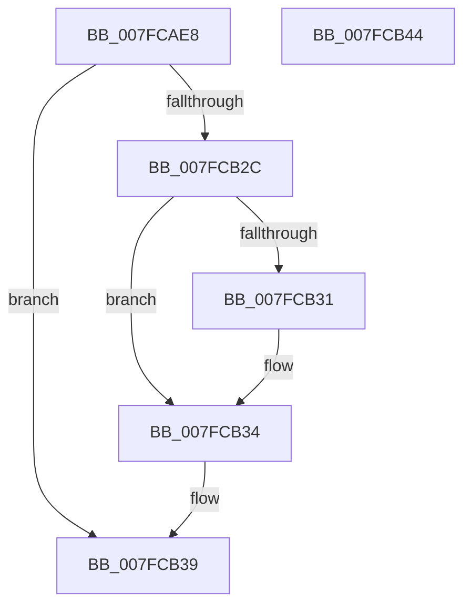

# MiSplitMirrorBitMap

- RVA: `0x007FCAE8`–`0x007FCB45` (길이 `93` bytes)
- VA: `0x00000001407FCAE8`
- 실행 섹션: `PAGE`
- PDB 이름 있음: `예`; PDB Function 태그: `아니요`
- unwind 정보 RVA: `0x0005CAAC`
- 디코드: `29`개 명령, `93/93` bytes 표시
- 미해석 바이트: `0` (있으면 어셈블리에 `.byte`로 보존)

> 이 문서는 커널 이미지의 기계어와 PDB 기호를 분석해 생성했습니다. 4번과 5번은 함수 원형과 자료형을 바이너리 사용 방식에서 추정한 C 해석이며 원본 소스 복구 결과는 아닙니다.

## 1. Dependencies

- 직접 호출 지점: **1**; 고유 호출 대상: **1**
- 직접 호출자로 확인된 함수: **2**
- RIP 상대 이미지 참조: **0**

### Outgoing calls
- `0x007FCB23` → [MiSplitBitmapPages](../../text/3B/MiSplitBitmapPages_function_003B4A34.md) (function, `0x003B4A34`)

### Direct callers
- [MiActOnMirrorBitmap](../AC/MiActOnMirrorBitmap_function_00AC21D0.md) at `0x00AC2219`
- [MiUpdateMirrorBitmaps](../AD/MiUpdateMirrorBitmaps_function_00ADA220.md) at `0x00ADA293`

### Static image references
- 디코드된 RIP-relative 메모리 참조가 없습니다.

## 2. Other-region calls and transfers

- 다른 실행 섹션으로 향하는 call: **1**
  - `0x007FCB23` → [MiSplitBitmapPages](../../text/3B/MiSplitBitmapPages_function_003B4A34.md) (`PAGE` → `.text`)
- 별도 외부 분기/꼬리 이동을 확인하지 못했습니다.

## 3. Assembly (complete function range)

```asm
007FCAE8  48 89 5C 24 08                  mov qword ptr [rsp + 8], rbx
007FCAED  57                              push rdi
007FCAEE  48 83 EC 20                     sub rsp, 0x20
007FCAF2  48 8B 41 08                     mov rax, qword ptr [rcx + 8]
007FCAF6  4A 8D 3C 02                     lea rdi, [rdx + r8]
007FCAFA  4C 8B D2                        mov r10, rdx
007FCAFD  4C 8D 47 07                     lea r8, [rdi + 7]
007FCB01  49 C1 E8 03                     shr r8, 3
007FCB05  45 33 C9                        xor r9d, r9d
007FCB08  49 C1 EA 03                     shr r10, 3
007FCB0C  48 8B D9                        mov rbx, rcx
007FCB0F  4C 03 D0                        add r10, rax
007FCB12  4D 2B C2                        sub r8, r10
007FCB15  49 8B D2                        mov rdx, r10
007FCB18  4C 03 C0                        add r8, rax
007FCB1B  41 8D 49 08                     lea ecx, [r9 + 8]
007FCB1F  49 C1 E0 03                     shl r8, 3
007FCB23  E8 0C 7F BB FF                  call 0x1403b4a34
007FCB28  85 C0                           test eax, eax
007FCB2A  74 0D                           je 0x1407fcb39
007FCB2C  48 3B 3B                        cmp rdi, qword ptr [rbx]
007FCB2F  76 03                           jbe 0x1407fcb34
007FCB31  48 89 3B                        mov qword ptr [rbx], rdi
007FCB34  B8 01 00 00 00                  mov eax, 1
007FCB39  48 8B 5C 24 30                  mov rbx, qword ptr [rsp + 0x30]
007FCB3E  48 83 C4 20                     add rsp, 0x20
007FCB42  5F                              pop rdi
007FCB43  C3                              ret
007FCB44  CC                              int3
```

## 4. C-style interpretation (structured pseudocode)

```c
__int64 __fastcall MiSplitMirrorBitMap(__int64 a1, __int64 a2, __int64 a3, int a4)
{
    __int64 result;
    __int64 v_r10;
    __int64 v_rsp;
    unsigned __int64 v_stack_p8;

    v_stack_p8 = v_rbx;
    v_rsp = (v_rsp) - (32);
    a3 = (a2 + a3 * 1 + 7) >> (3);
    a4 = 0;
    v_r10 = (a2) >> (3);
    v_r10 = (v_r10) + (*(unsigned __int64 *)(a1 + 8));
    a3 = (a3) - (v_r10);
    a3 = (a3) + (*(unsigned __int64 *)(a1 + 8));
    a3 = (a3) << (3);
    result = MiSplitBitmapPages(a4 + 8, v_r10, a3, a4);
    if ((unsigned int)(result) == 0) goto loc_007FCB39;
    if ((a2 + a3 * 1) >= = (*(unsigned __int64 *)(a1))) {
        *(unsigned __int64 *)(a1) = a2 + a3 * 1;
    }
loc_007FCB39:
    v_rsp = (v_rsp) + (32);
    return 1;
}
```

## 5. (Beta) C Style

```c
int64_t MiSplitMirrorBitMap(void *Arg1, void *Arg2, int64_t Arg3, int32_t Arg4)
{
    uint8_t *arg1 = (uint8_t *)Arg1;
    uint8_t *arg2 = (uint8_t *)Arg2;

    int64_t result;
    int64_t local_r10;
    int64_t local_rsp;
    uint64_t v_stack_p8;

    v_stack_p8 = local_rbx;
    local_rsp = (local_rsp) - (32);
    Arg3 = (Arg2 + Arg3 * 1 + 7) >> (3);
    Arg4 = 0;
    local_r10 = (Arg2) >> (3);
    local_r10 = (local_r10) + (*(uint64_t *)(arg1 + 0x8));
    Arg3 = (Arg3) - (local_r10);
    Arg3 = (Arg3) + (*(uint64_t *)(arg1 + 0x8));
    Arg3 = (Arg3) << (3);
    result = MiSplitBitmapPages(Arg4 + 8, local_r10, Arg3, Arg4);
    if ((uint32_t)(result) == 0) goto loc_007FCB39;
    if ((Arg2 + Arg3 * 1) >= = (*(uint64_t *)(arg1))) {
        *(void **)(arg1) = Arg2 + Arg3 * 1;
    }
loc_007FCB39:
    local_rsp = (local_rsp) + (32);
    return 1;
}
```

### 관측된 메모리 오프셋

구조체 형식이 확인되지 않은 접근은 인자 기준의 오프셋으로만 기록했습니다.

| 기준 인자 | 오프셋 표현 | 폭 (bit) | 접근 |
|---|---:|---:|---|
| `Arg1` | `+ 0x0` | `64` | `R` |
| `Arg1` | `+ 0x0` | `64` | `W` |
| `Arg1` | `+ 0x8` | `64` | `R` |
| `Arg2` | `+ 0x0 + r8*1` | `64` | `R` |
| `Arg2` | `+ 0x7` | `64` | `R` |

## 6. Execution-region graph

[열기: 2D/3D 그래프와 함수 탐색 컨트롤 패널](../../../control-panel.html?section=page&rva=0x007FCAE8&view=graph)

- 2D 그래프는 위에서 아래로 흐르고, 3D 그래프는 빈 공간을 드래그해 회전합니다. Shift+드래그는 이동, 휠은 확대·축소, 함수 노드 선택은 대상 보고서 이동입니다.

### Static fallback


