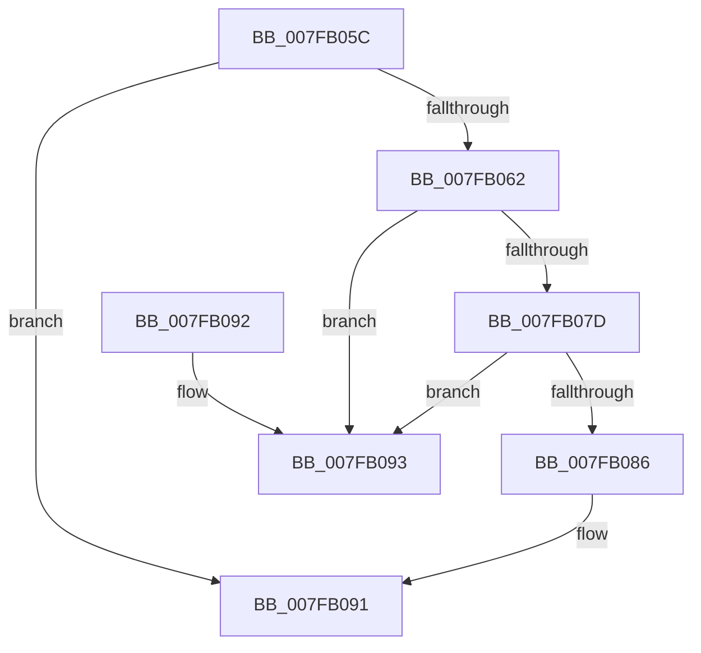

# MiUnlinkHotAddFlight

- RVA: `0x007FB05C`–`0x007FB09A` (길이 `62` bytes)
- VA: `0x00000001407FB05C`
- 실행 섹션: `PAGE`
- PDB 이름 있음: `예`; PDB Function 태그: `아니요`
- unwind 정보 RVA: `0x000DB714`
- 디코드: `18`개 명령, `62/62` bytes 표시
- 미해석 바이트: `0` (있으면 어셈블리에 `.byte`로 보존)

> 이 문서는 커널 이미지의 기계어와 PDB 기호를 분석해 생성했습니다. 4번과 5번은 함수 원형과 자료형을 바이너리 사용 방식에서 추정한 C 해석이며 원본 소스 복구 결과는 아닙니다.

## 1. Dependencies

- 직접 호출 지점: **0**; 고유 호출 대상: **0**
- 직접 호출자로 확인된 함수: **3**
- RIP 상대 이미지 참조: **2**

### Outgoing calls
- 직접 디코드된 call 명령이 없습니다.

### Direct callers
- [MiPerformMemoryChange](../../text/67/MiPerformMemoryChange_function_006733A8.md) at `0x00673416`
- [MiReturnAddMemoryResources](../../text/67/MiReturnAddMemoryResources_function_00673BC0.md) at `0x00673BD2`
- [MiHonorExistingHotMemoryFlights](MiHonorExistingHotMemoryFlights_function_007FA514.md) at `0x007FA60F`

### Static image references
- `0x007FB062` → RVA `0x00E2ED10` (`.data`; read/write)
- `0x007FB06E` → RVA `0x00E2ED14` (`.data`; read/write)

## 2. Other-region calls and transfers

- 다른 실행 섹션으로 향하는 call: **0**
- 별도 외부 분기/꼬리 이동을 확인하지 못했습니다.

## 3. Assembly (complete function range)

```asm
007FB05C  48 83 39 00                     cmp qword ptr [rcx], 0
007FB060  74 2F                           je 0x1407fb091
007FB062  FF 0D A8 3C 63 00               dec dword ptr [rip + 0x633ca8]
007FB068  8B 81 98 00 00 00               mov eax, dword ptr [rcx + 0x98]
007FB06E  29 05 A0 3C 63 00               sub dword ptr [rip + 0x633ca0], eax
007FB074  48 8B 11                        mov rdx, qword ptr [rcx]
007FB077  48 39 4A 08                     cmp qword ptr [rdx + 8], rcx
007FB07B  75 16                           jne 0x1407fb093
007FB07D  48 8B 41 08                     mov rax, qword ptr [rcx + 8]
007FB081  48 39 08                        cmp qword ptr [rax], rcx
007FB084  75 0D                           jne 0x1407fb093
007FB086  48 89 10                        mov qword ptr [rax], rdx
007FB089  48 89 42 08                     mov qword ptr [rdx + 8], rax
007FB08D  48 83 21 00                     and qword ptr [rcx], 0
007FB091  C3                              ret
007FB092  CC                              int3
007FB093  B9 03 00 00 00                  mov ecx, 3
007FB098  CD 29                           int 0x29
```

## 4. C-style interpretation (structured pseudocode)

```c
__int64 __fastcall MiUnlinkHotAddFlight(__int64 a1)
{
    if ((*(unsigned __int64 *)(a1)) == 0) goto loc_007FB091;
    if ((*(unsigned __int64 *)(*(unsigned __int64 *)(a1) + 8)) != a1) goto loc_007FB093;
    if ((*(unsigned __int64 *)(*(unsigned __int64 *)(a1 + 8))) != a1) goto loc_007FB093;
    *(unsigned __int64 *)(*(unsigned __int64 *)(a1 + 8)) = *(unsigned __int64 *)(a1);
    *(unsigned __int64 *)(*(unsigned __int64 *)(a1) + 8) = *(unsigned __int64 *)(a1 + 8);
loc_007FB091:
    return *(unsigned __int64 *)(a1 + 8);
loc_007FB093:
    return *(unsigned __int64 *)(a1 + 8);
}
```

## 5. (Beta) C Style

```c
int64_t MiUnlinkHotAddFlight(void *Arg1)
{
    uint8_t *arg1 = (uint8_t *)Arg1;

    if ((*(uint64_t *)(arg1)) == 0) goto loc_007FB091;
    if ((*(uint64_t *)(*(uint64_t *)(arg1) + 0x8)) != Arg1) goto loc_007FB093;
    if ((*(uint64_t *)(*(uint64_t *)(arg1 + 0x8))) != Arg1) goto loc_007FB093;
    *(uint64_t *)(*(uint64_t *)(arg1 + 0x8)) = *(uint64_t *)(arg1);
    *(uint64_t *)(*(uint64_t *)(arg1) + 0x8) = *(uint64_t *)(arg1 + 0x8);
loc_007FB091:
    return *(uint64_t *)(arg1 + 0x8);
loc_007FB093:
    return *(uint64_t *)(arg1 + 0x8);
}
```

### 관측된 메모리 오프셋

구조체 형식이 확인되지 않은 접근은 인자 기준의 오프셋으로만 기록했습니다.

| 기준 인자 | 오프셋 표현 | 폭 (bit) | 접근 |
|---|---:|---:|---|
| `Arg1` | `+ 0x0` | `64` | `R` |
| `Arg1` | `+ 0x0` | `64` | `R/W` |
| `Arg1` | `+ 0x8` | `64` | `R` |
| `Arg1` | `+ 0x98` | `32` | `R` |

## 6. Execution-region graph

[열기: 2D/3D 그래프와 함수 탐색 컨트롤 패널](../../../control-panel.html?section=page&rva=0x007FB05C&view=graph)

- 2D 그래프는 위에서 아래로 흐르고, 3D 그래프는 빈 공간을 드래그해 회전합니다. Shift+드래그는 이동, 휠은 확대·축소, 함수 노드 선택은 대상 보고서 이동입니다.

### Static fallback


