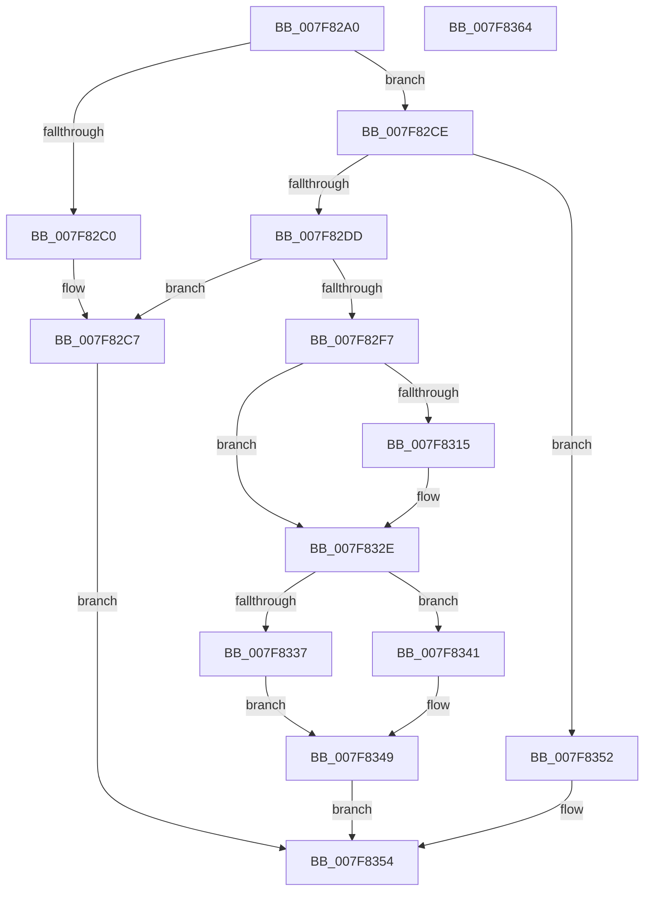

# MiUnloadApproved

- RVA: `0x007F82A0`–`0x007F8365` (길이 `197` bytes)
- VA: `0x00000001407F82A0`
- 실행 섹션: `PAGE`
- PDB 이름 있음: `예`; PDB Function 태그: `아니요`
- unwind 정보 RVA: `0x000717F8`
- 디코드: `58`개 명령, `197/197` bytes 표시
- 미해석 바이트: `0` (있으면 어셈블리에 `.byte`로 보존)

> 이 문서는 커널 이미지의 기계어와 PDB 기호를 분석해 생성했습니다. 4번과 5번은 함수 원형과 자료형을 바이너리 사용 방식에서 추정한 C 해석이며 원본 소스 복구 결과는 아닙니다.

## 1. Dependencies

- 직접 호출 지점: **7**; 고유 호출 대상: **7**
- 직접 호출자로 확인된 함수: **1**
- RIP 상대 이미지 참조: **1**

### Outgoing calls
- `0x007F82CE` → [MiGetBaseLoaderPortion](../../text/4D/MiGetBaseLoaderPortion_function_004D9D34.md) (function, `0x004D9D34`)
- `0x007F82E8` → [RtlFindExportedRoutineByName](../90/RtlFindExportedRoutineByName_function_0090F0A0.md) (function, `0x0090F0A0`)
- `0x007F8305` → [RtlPcToFileHeader](../../text/2F/RtlPcToFileHeader_function_002F1C50.md) (function, `0x002F1C50`)
- `0x007F8328` → [KeBugCheckEx](../../text/4F/KeBugCheckEx_function_004FD660.md) (function, `0x004FD660`)
- `0x007F832E` → [VfIsVerifierEnabled](../../text/4C/VfIsVerifierEnabled_function_004C72F0.md) (function, `0x004C72F0`)
- `0x007F833A` → [DifDllUnloadWrapper](../../text/6A/DifDllUnloadWrapper_function_006AB030.md) (function, `0x006AB030`)
- `0x007F8344` → `indirect target` (indirect, 간접 대상)

### Direct callers
- [MiDereferenceImports](MiDereferenceImports_function_007F7DB4.md) at `0x007F7E09`

### Static image references
- `0x007F82E1` → RVA `0x00B09D00` (` ?? ::NNGAKEGL::`string'`; read)

## 2. Other-region calls and transfers

- 다른 실행 섹션으로 향하는 call: **5**
  - `0x007F82CE` → [MiGetBaseLoaderPortion](../../text/4D/MiGetBaseLoaderPortion_function_004D9D34.md) (`PAGE` → `.text`)
  - `0x007F8305` → [RtlPcToFileHeader](../../text/2F/RtlPcToFileHeader_function_002F1C50.md) (`PAGE` → `.text`)
  - `0x007F8328` → [KeBugCheckEx](../../text/4F/KeBugCheckEx_function_004FD660.md) (`PAGE` → `.text`)
  - `0x007F832E` → [VfIsVerifierEnabled](../../text/4C/VfIsVerifierEnabled_function_004C72F0.md) (`PAGE` → `.text`)
  - `0x007F833A` → [DifDllUnloadWrapper](../../text/6A/DifDllUnloadWrapper_function_006AB030.md) (`PAGE` → `.text`)
- 별도 외부 분기/꼬리 이동을 확인하지 못했습니다.

## 3. Assembly (complete function range)

```asm
007F82A0  48 89 5C 24 10                  mov qword ptr [rsp + 0x10], rbx
007F82A5  48 89 74 24 18                  mov qword ptr [rsp + 0x18], rsi
007F82AA  57                              push rdi
007F82AB  48 83 EC 30                     sub rsp, 0x30
007F82AF  0F B7 41 6C                     movzx eax, word ptr [rcx + 0x6c]
007F82B3  BA 01 00 00 00                  mov edx, 1
007F82B8  48 8B F9                        mov rdi, rcx
007F82BB  66 3B C2                        cmp ax, dx
007F82BE  74 0E                           je 0x1407f82ce
007F82C0  66 2B C2                        sub ax, dx
007F82C3  66 89 41 6C                     mov word ptr [rcx + 0x6c], ax
007F82C7  33 C0                           xor eax, eax
007F82C9  E9 86 00 00 00                  jmp 0x1407f8354
007F82CE  E8 61 1A CE FF                  call 0x1404d9d34
007F82D3  8B 88 B8 00 00 00               mov ecx, dword ptr [rax + 0xb8]
007F82D9  84 C9                           test cl, cl
007F82DB  78 75                           js 0x1407f8352
007F82DD  48 8B 4F 30                     mov rcx, qword ptr [rdi + 0x30]
007F82E1  48 8D 15 18 1A 31 00            lea rdx, [rip + 0x311a18]
007F82E8  E8 B3 6D 11 00                  call 0x14090f0a0
007F82ED  33 DB                           xor ebx, ebx
007F82EF  48 8B F0                        mov rsi, rax
007F82F2  48 85 C0                        test rax, rax
007F82F5  74 D0                           je 0x1407f82c7
007F82F7  48 8B 4F 30                     mov rcx, qword ptr [rdi + 0x30]
007F82FB  48 8D 54 24 40                  lea rdx, [rsp + 0x40]
007F8300  48 89 5C 24 40                  mov qword ptr [rsp + 0x40], rbx
007F8305  E8 46 99 AF FF                  call 0x1402f1c50
007F830A  48 8B 4F 30                     mov rcx, qword ptr [rdi + 0x30]
007F830E  48 39 4C 24 40                  cmp qword ptr [rsp + 0x40], rcx
007F8313  74 19                           je 0x1407f832e
007F8315  45 33 C9                        xor r9d, r9d
007F8318  48 89 74 24 20                  mov qword ptr [rsp + 0x20], rsi
007F831D  45 33 C0                        xor r8d, r8d
007F8320  8D 53 0A                        lea edx, [rbx + 0xa]
007F8323  B9 39 01 00 00                  mov ecx, 0x139
007F8328  E8 33 53 D0 FF                  call 0x1404fd660
007F832D  CC                              int3
007F832E  E8 BD EF CC FF                  call 0x1404c72f0
007F8333  85 C0                           test eax, eax
007F8335  74 0A                           je 0x1407f8341
007F8337  48 8B CE                        mov rcx, rsi
007F833A  E8 F1 2C EB FF                  call 0x1406ab030
007F833F  EB 08                           jmp 0x1407f8349
007F8341  48 8B C6                        mov rax, rsi
007F8344  FF D0                           call rax
007F8346  0F 1F 00                        nop dword ptr [rax]
007F8349  85 C0                           test eax, eax
007F834B  0F 99 C3                        setns bl
007F834E  8B C3                           mov eax, ebx
007F8350  EB 02                           jmp 0x1407f8354
007F8352  8B C2                           mov eax, edx
007F8354  48 8B 5C 24 48                  mov rbx, qword ptr [rsp + 0x48]
007F8359  48 8B 74 24 50                  mov rsi, qword ptr [rsp + 0x50]
007F835E  48 83 C4 30                     add rsp, 0x30
007F8362  5F                              pop rdi
007F8363  C3                              ret
007F8364  CC                              int3
```

## 4. C-style interpretation (structured pseudocode)

```c
__int64 __fastcall MiUnloadApproved(__int64 a1, __int64 a2, int a3, int a4)
{
    __int64 result;
    __int64 v_rbx;
    __int64 v_rsp;
    unsigned __int64 v_stack_m18;
    unsigned __int64 v_stack_p10;
    unsigned __int64 v_stack_p18;
    unsigned __int64 v_stack_p8;

    v_stack_p10 = v_rbx;
    v_stack_p18 = v_rsi;
    v_rsp = (v_rsp) - (48);
    if (((unsigned __int16)(*(unsigned __int16 *)(a1 + 108))) == 1) goto loc_007F82CE;
    result = (unsigned __int16)((*(unsigned __int16 *)(a1 + 108)) - (1));
    *(unsigned __int16 *)(a1 + 108) = (unsigned __int16)(result);
loc_007F82C7:
    result = 0;
    goto loc_007F8354;
loc_007F82CE:
    result = MiGetBaseLoaderPortion(a1, 1, a3, a4);
    if (sign_flag) goto loc_007F8352;
    result = RtlFindExportedRoutineByName(*(unsigned __int64 *)(a1 + 48), v_rip + 3217944, a3, a4);
    v_rbx = 0;
    if (result == 0) goto loc_007F82C7;
    v_stack_p8 = 0;
    result = RtlPcToFileHeader(*(unsigned __int64 *)(a1 + 48), v_stack_p8, a3, a4);
    if (v_stack_p8 != (*(unsigned __int64 *)(a1 + 48))) {
        a4 = 0;
        v_stack_m18 = result;
        a3 = 0;
        a2 = v_rbx + 10;
        a1 = 313;
        result = KeBugCheckEx(a1, a2, a3, a4);
    }
    result = VfIsVerifierEnabled(a1, a2, a3, a4);
    if ((unsigned int)(result) == 0) goto loc_007F8341;
    result = DifDllUnloadWrapper(result, a2, a3, a4);
    goto loc_007F8349;
loc_007F8341:
    result = kernel_indirect_call(result, a2, a3, a4);
loc_007F8349:
    v_rbx = (!sign_flag) ? 1 : 0;
    goto loc_007F8354;
loc_007F8352:
loc_007F8354:
    v_rsp = (v_rsp) + (48);
    return (unsigned int)((unsigned int)(a2));
}
```

## 5. (Beta) C Style

```c
int64_t MiUnloadApproved(void *Arg1, int64_t Arg2, int32_t Arg3, int32_t Arg4)
{
    uint8_t *arg1 = (uint8_t *)Arg1;

    int64_t result;
    int64_t local_rbx;
    int64_t local_rsp;
    uint64_t v_stack_m18;
    uint64_t v_stack_p10;
    uint64_t v_stack_p18;
    uint64_t v_stack_p8;

    v_stack_p10 = local_rbx;
    v_stack_p18 = local_rsi;
    local_rsp = (local_rsp) - (48);
    if (((uint16_t)(*(uint16_t *)(arg1 + 0x6C))) == 1) goto loc_007F82CE;
    result = (uint16_t)((*(uint16_t *)(arg1 + 0x6C)) - (1));
    *(uint16_t *)(arg1 + 0x6C) = (uint16_t)(result);
loc_007F82C7:
    result = 0;
    goto loc_007F8354;
loc_007F82CE:
    result = MiGetBaseLoaderPortion(Arg1, 1, Arg3, Arg4);
    if (sign_flag) goto loc_007F8352;
    result = RtlFindExportedRoutineByName(*(uint64_t *)(arg1 + 0x30), v_rip + 3217944, Arg3, Arg4);
    local_rbx = 0;
    if (result == 0) goto loc_007F82C7;
    v_stack_p8 = 0;
    result = RtlPcToFileHeader(*(uint64_t *)(arg1 + 0x30), v_stack_p8, Arg3, Arg4);
    if (v_stack_p8 != (*(uint64_t *)(arg1 + 0x30))) {
        Arg4 = 0;
        v_stack_m18 = result;
        Arg3 = 0;
        Arg2 = local_rbx + 10;
        Arg1 = 313;
        result = KeBugCheckEx(Arg1, Arg2, Arg3, Arg4);
    }
    result = VfIsVerifierEnabled(Arg1, Arg2, Arg3, Arg4);
    if ((uint32_t)(result) == 0) goto loc_007F8341;
    result = DifDllUnloadWrapper(result, Arg2, Arg3, Arg4);
    goto loc_007F8349;
loc_007F8341:
    result = kernel_indirect_call(result, Arg2, Arg3, Arg4);
loc_007F8349:
    local_rbx = (!sign_flag) ? 1 : 0;
    goto loc_007F8354;
loc_007F8352:
loc_007F8354:
    local_rsp = (local_rsp) + (48);
    return (uint32_t)((uint32_t)(Arg2));
}
```

### 관측된 메모리 오프셋

구조체 형식이 확인되지 않은 접근은 인자 기준의 오프셋으로만 기록했습니다.

| 기준 인자 | 오프셋 표현 | 폭 (bit) | 접근 |
|---|---:|---:|---|
| `Arg1` | `+ 0x30` | `64` | `R` |
| `Arg1` | `+ 0x6C` | `16` | `R` |
| `Arg1` | `+ 0x6C` | `16` | `W` |

## 6. Execution-region graph

[열기: 2D/3D 그래프와 함수 탐색 컨트롤 패널](../../../control-panel.html?section=page&rva=0x007F82A0&view=graph)

- 2D 그래프는 위에서 아래로 흐르고, 3D 그래프는 빈 공간을 드래그해 회전합니다. Shift+드래그는 이동, 휠은 확대·축소, 함수 노드 선택은 대상 보고서 이동입니다.

### Static fallback


