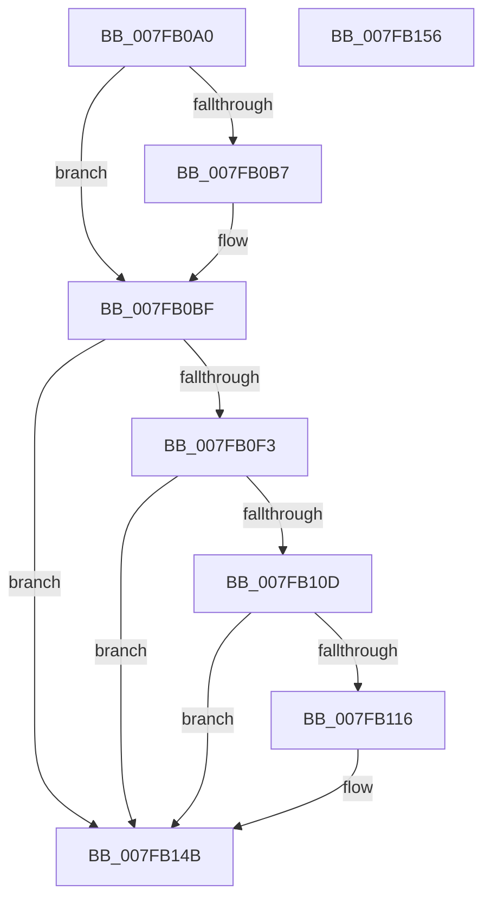

# MiUnmapPfns

- RVA: `0x007FB0A0`–`0x007FB157` (길이 `183` bytes)
- VA: `0x00000001407FB0A0`
- 실행 섹션: `PAGE`
- PDB 이름 있음: `예`; PDB Function 태그: `아니요`
- unwind 정보 RVA: `0x000C6200`
- 디코드: `42`개 명령, `183/183` bytes 표시
- 미해석 바이트: `0` (있으면 어셈블리에 `.byte`로 보존)

> 이 문서는 커널 이미지의 기계어와 PDB 기호를 분석해 생성했습니다. 4번과 5번은 함수 원형과 자료형을 바이너리 사용 방식에서 추정한 C 해석이며 원본 소스 복구 결과는 아닙니다.

## 1. Dependencies

- 직접 호출 지점: **3**; 고유 호출 대상: **3**
- 직접 호출자로 확인된 함수: **2**
- RIP 상대 이미지 참조: **10**

### Outgoing calls
- `0x007FB0D7` → [MiInitializeDynamicPfns](../../text/67/MiInitializeDynamicPfns_function_00672BD0.md) (function, `0x00672BD0`)
- `0x007FB0E7` → [MiPhysicalMemoryEverRemoved](../../text/67/MiPhysicalMemoryEverRemoved_function_00673958.md) (function, `0x00673958`)
- `0x007FB13F` → [ExQueueWorkItem](../../text/2F/ExQueueWorkItem_function_002F9520.md) (function, `0x002F9520`)

### Direct callers
- [MiAddPhysicalMemory](MiAddPhysicalMemory_function_007F95FC.md) at `0x007F9865`
- [MiRemovePhysicalMemory](MiRemovePhysicalMemory_function_007FAD3C.md) at `0x007FAF9A`

### Static image references
- `0x007FB0C3` → RVA `0x00E38D00` (`.data`; read)
- `0x007FB0F3` → RVA `0x00E38D48` (`.data`; read)
- `0x007FB0FE` → RVA `0x00E38D48` (`.data`; write)
- `0x007FB10D` → RVA `0x00E38DCC` (`.data`; read)
- `0x007FB116` → RVA `0x00E38D28` (`.data`; read/write)
- `0x007FB11E` → RVA `0x006720C0` (`MiFreeUnusedPfnPages`; read)
- `0x007FB12A` → RVA `0x00E38D38` (`.data`; write)
- `0x007FB131` → RVA `0x00E38D28` (`.data`; read)
- `0x007FB138` → RVA `0x00E38D40` (`.data`; write)
- `0x007FB144` → RVA `0x00E38DCC` (`.data`; write)

## 2. Other-region calls and transfers

- 다른 실행 섹션으로 향하는 call: **3**
  - `0x007FB0D7` → [MiInitializeDynamicPfns](../../text/67/MiInitializeDynamicPfns_function_00672BD0.md) (`PAGE` → `.text`)
  - `0x007FB0E7` → [MiPhysicalMemoryEverRemoved](../../text/67/MiPhysicalMemoryEverRemoved_function_00673958.md) (`PAGE` → `.text`)
  - `0x007FB13F` → [ExQueueWorkItem](../../text/2F/ExQueueWorkItem_function_002F9520.md) (`PAGE` → `.text`)
- 별도 외부 분기/꼬리 이동을 확인하지 못했습니다.

## 3. Assembly (complete function range)

```asm
007FB0A0  48 89 5C 24 08                  mov qword ptr [rsp + 8], rbx
007FB0A5  56                              push rsi
007FB0A6  48 83 EC 30                     sub rsp, 0x30
007FB0AA  44 8B 49 28                     mov r9d, dword ptr [rcx + 0x28]
007FB0AE  48 8B D9                        mov rbx, rcx
007FB0B1  41 F6 C1 01                     test r9b, 1
007FB0B5  74 08                           je 0x1407fb0bf
007FB0B7  41 83 E1 F6                     and r9d, 0xfffffff6
007FB0BB  41 83 C9 20                     or r9d, 0x20
007FB0BF  48 8B 51 20                     mov rdx, qword ptr [rcx + 0x20]
007FB0C3  48 8D 35 36 DC 63 00            lea rsi, [rip + 0x63dc36]
007FB0CA  48 8B 49 10                     mov rcx, qword ptr [rcx + 0x10]
007FB0CE  4C 8B C6                        mov r8, rsi
007FB0D1  48 83 64 24 20 00               and qword ptr [rsp + 0x20], 0
007FB0D7  E8 F4 7A E7 FF                  call 0x140672bd0
007FB0DC  48 8B 53 20                     mov rdx, qword ptr [rbx + 0x20]
007FB0E0  45 33 C0                        xor r8d, r8d
007FB0E3  48 8B 4B 10                     mov rcx, qword ptr [rbx + 0x10]
007FB0E7  E8 6C 88 E7 FF                  call 0x140673958
007FB0EC  8B 43 28                        mov eax, dword ptr [rbx + 0x28]
007FB0EF  A8 20                           test al, 0x20
007FB0F1  74 58                           je 0x1407fb14b
007FB0F3  48 8B 05 4E DC 63 00            mov rax, qword ptr [rip + 0x63dc4e]
007FB0FA  48 03 43 20                     add rax, qword ptr [rbx + 0x20]
007FB0FE  48 89 05 43 DC 63 00            mov qword ptr [rip + 0x63dc43], rax
007FB105  48 3D 55 55 00 00               cmp rax, 0x5555
007FB10B  72 3E                           jb 0x1407fb14b
007FB10D  80 3D B8 DC 63 00 00            cmp byte ptr [rip + 0x63dcb8], 0
007FB114  75 35                           jne 0x1407fb14b
007FB116  48 83 25 0A DC 63 00 00         and qword ptr [rip + 0x63dc0a], 0
007FB11E  48 8D 05 9B 6F E7 FF            lea rax, [rip - 0x189065]
007FB125  BA 01 00 00 00                  mov edx, 1
007FB12A  48 89 05 07 DC 63 00            mov qword ptr [rip + 0x63dc07], rax
007FB131  48 8D 0D F0 DB 63 00            lea rcx, [rip + 0x63dbf0]
007FB138  48 89 35 01 DC 63 00            mov qword ptr [rip + 0x63dc01], rsi
007FB13F  E8 DC E3 AF FF                  call 0x1402f9520
007FB144  C6 05 81 DC 63 00 01            mov byte ptr [rip + 0x63dc81], 1
007FB14B  48 8B 5C 24 40                  mov rbx, qword ptr [rsp + 0x40]
007FB150  48 83 C4 30                     add rsp, 0x30
007FB154  5E                              pop rsi
007FB155  C3                              ret
007FB156  CC                              int3
```

## 4. C-style interpretation (structured pseudocode)

```c
__int64 __fastcall MiUnmapPfns(__int64 a1)
{
    __int64 result;
    __int64 v_rsp;
    unsigned __int64 v_stack_m18;
    unsigned __int64 v_stack_p8;

    v_stack_p8 = v_rbx;
    v_rsp = (v_rsp) - (48);
    if ((((unsigned __int8)((unsigned int)(*(unsigned int *)(a1 + 40)))) & (1)) != 0) {
        a4 = (unsigned int)(((unsigned int)(*(unsigned int *)(a1 + 40))) & (0xFFFFFFF6ULL));
        a4 = (unsigned int)((a4) | (32));
    }
    result = MiInitializeDynamicPfns(*(unsigned __int64 *)(a1 + 16), *(unsigned __int64 *)(a1 + 32), v_rip + 6544438, a4);
    a3 = 0;
    result = MiPhysicalMemoryEverRemoved(*(unsigned __int64 *)(a1 + 16), *(unsigned __int64 *)(a1 + 32), a3, a4);
    if ((((unsigned __int8)((unsigned int)(*(unsigned int *)(a1 + 40)))) & (32)) == 0) goto loc_007FB14B;
    result = (*(unsigned __int64 *)(v_rip + 6544462)) + (*(unsigned __int64 *)(a1 + 32));
    *(unsigned __int64 *)(v_rip + 6544451) = result;
    if (result < 0x5555ULL) goto loc_007FB14B;
    if ((*(unsigned __int8 *)(v_rip + 6544568)) == 0) {
        result = v_rip - 1609829;
        a2 = 1;
        *(unsigned __int64 *)(v_rip + 6544391) = result;
        a1 = v_rip + 6544368;
        *(unsigned __int64 *)(v_rip + 6544385) = v_rip + 6544438;
        result = ExQueueWorkItem(a1, a2, a3, a4);
        *(unsigned __int8 *)(v_rip + 6544513) = 1;
    }
    v_rsp = (v_rsp) + (48);
    return result;
}
```

## 5. (Beta) C Style

```c
int64_t MiUnmapPfns(void *Arg1)
{
    uint8_t *arg1 = (uint8_t *)Arg1;

    int64_t result;
    int64_t local_rsp;
    uint64_t v_stack_m18;
    uint64_t v_stack_p8;

    v_stack_p8 = local_rbx;
    local_rsp = (local_rsp) - (48);
    if ((((uint8_t)((uint32_t)(*(uint32_t *)(arg1 + 0x28)))) & (1)) != 0) {
        a4 = (uint32_t)(((uint32_t)(*(uint32_t *)(arg1 + 0x28))) & (0xFFFFFFF6ULL));
        a4 = (uint32_t)((a4) | (32));
    }
    result = MiInitializeDynamicPfns(*(uint64_t *)(arg1 + 0x10), *(uint64_t *)(arg1 + 0x20), v_rip + 6544438, a4);
    a3 = 0;
    result = MiPhysicalMemoryEverRemoved(*(uint64_t *)(arg1 + 0x10), *(uint64_t *)(arg1 + 0x20), a3, a4);
    if ((((uint8_t)((uint32_t)(*(uint32_t *)(arg1 + 0x28)))) & (32)) == 0) goto loc_007FB14B;
    result = (*(uint64_t *)(v_rip + 0x63DC4E)) + (*(uint64_t *)(arg1 + 0x20));
    *(uint64_t *)(v_rip + 0x63DC43) = result;
    if (result < 0x5555ULL) goto loc_007FB14B;
    if ((*(uint8_t *)(v_rip + 0x63DCB8)) == 0) {
        result = v_rip - 1609829;
        a2 = 1;
        *(uint64_t *)(v_rip + 0x63DC07) = result;
        Arg1 = v_rip + 6544368;
        *(uint64_t *)(v_rip + 0x63DC01) = v_rip + 6544438;
        result = ExQueueWorkItem(Arg1, a2, a3, a4);
        *(uint8_t *)(v_rip + 0x63DC81) = 1;
    }
    local_rsp = (local_rsp) + (48);
    return result;
}
```

### 관측된 메모리 오프셋

구조체 형식이 확인되지 않은 접근은 인자 기준의 오프셋으로만 기록했습니다.

| 기준 인자 | 오프셋 표현 | 폭 (bit) | 접근 |
|---|---:|---:|---|
| `Arg1` | `+ 0x10` | `64` | `R` |
| `Arg1` | `+ 0x20` | `64` | `R` |
| `Arg1` | `+ 0x28` | `32` | `R` |

## 6. Execution-region graph

[열기: 2D/3D 그래프와 함수 탐색 컨트롤 패널](../../../control-panel.html?section=page&rva=0x007FB0A0&view=graph)

- 2D 그래프는 위에서 아래로 흐르고, 3D 그래프는 빈 공간을 드래그해 회전합니다. Shift+드래그는 이동, 휠은 확대·축소, 함수 노드 선택은 대상 보고서 이동입니다.

### Static fallback


