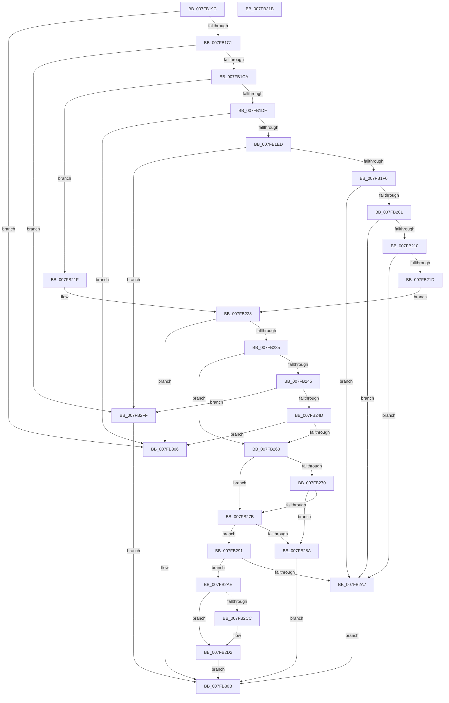

# MiValidateAddPhysicalMemoryParameters

- RVA: `0x007FB19C`–`0x007FB31C` (길이 `384` bytes)
- VA: `0x00000001407FB19C`
- 실행 섹션: `PAGE`
- PDB 이름 있음: `예`; PDB Function 태그: `아니요`
- unwind 정보 RVA: `0x000794E0`
- 디코드: `98`개 명령, `384/384` bytes 표시
- 미해석 바이트: `0` (있으면 어셈블리에 `.byte`로 보존)

> 이 문서는 커널 이미지의 기계어와 PDB 기호를 분석해 생성했습니다. 4번과 5번은 함수 원형과 자료형을 바이너리 사용 방식에서 추정한 C 해석이며 원본 소스 복구 결과는 아닙니다.

## 1. Dependencies

- 직접 호출 지점: **1**; 고유 호출 대상: **1**
- 직접 호출자로 확인된 함수: **1**
- RIP 상대 이미지 참조: **3**

### Outgoing calls
- `0x007FB2F6` → [MiLogAddPhysicalMemory](../../text/67/MiLogAddPhysicalMemory_function_006731A8.md) (function, `0x006731A8`)

### Direct callers
- [MiAddPhysicalMemory](MiAddPhysicalMemory_function_007F95FC.md) at `0x007F965C`

### Static image references
- `0x007FB235` → RVA `0x00E2DCE0` (`.data`; read)
- `0x007FB260` → RVA `0x00E35C00` (`.data`; read)
- `0x007FB2B3` → RVA `0x00E38D00` (`.data`; read)

## 2. Other-region calls and transfers

- 다른 실행 섹션으로 향하는 call: **1**
  - `0x007FB2F6` → [MiLogAddPhysicalMemory](../../text/67/MiLogAddPhysicalMemory_function_006731A8.md) (`PAGE` → `.text`)
- 별도 외부 분기/꼬리 이동을 확인하지 못했습니다.

## 3. Assembly (complete function range)

```asm
007FB19C  48 89 5C 24 08                  mov qword ptr [rsp + 8], rbx
007FB1A1  48 89 74 24 10                  mov qword ptr [rsp + 0x10], rsi
007FB1A6  57                              push rdi
007FB1A7  48 83 EC 30                     sub rsp, 0x30
007FB1AB  48 8B F1                        mov rsi, rcx
007FB1AE  49 8B D8                        mov rbx, r8
007FB1B1  B9 FF 0F 00 00                  mov ecx, 0xfff
007FB1B6  48 8B FA                        mov rdi, rdx
007FB1B9  85 0A                           test dword ptr [rdx], ecx
007FB1BB  0F 85 45 01 00 00               jne 0x1407fb306
007FB1C1  41 85 08                        test dword ptr [r8], ecx
007FB1C4  0F 85 35 01 00 00               jne 0x1407fb2ff
007FB1CA  4C 8B 12                        mov r10, qword ptr [rdx]
007FB1CD  49 8B 10                        mov rdx, qword ptr [r8]
007FB1D0  48 C1 EA 0C                     shr rdx, 0xc
007FB1D4  49 C1 EA 0C                     shr r10, 0xc
007FB1D8  41 0F BA E1 10                  bt r9d, 0x10
007FB1DD  73 40                           jae 0x1407fb21f
007FB1DF  B8 FF FF 03 00                  mov eax, 0x3ffff
007FB1E4  4C 85 D0                        test rax, r10
007FB1E7  0F 85 19 01 00 00               jne 0x1407fb306
007FB1ED  48 85 D0                        test rax, rdx
007FB1F0  0F 85 09 01 00 00               jne 0x1407fb2ff
007FB1F6  41 0F BA E1 0D                  bt r9d, 0xd
007FB1FB  0F 83 A6 00 00 00               jae 0x1407fb2a7
007FB201  41 8B C9                        mov ecx, r9d
007FB204  81 E1 00 00 20 00               and ecx, 0x200000
007FB20A  0F 84 97 00 00 00               je 0x1407fb2a7
007FB210  41 F7 C1 FF 95 D6 FF            test r9d, 0xffd695ff
007FB217  0F 85 8A 00 00 00               jne 0x1407fb2a7
007FB21D  EB 09                           jmp 0x1407fb228
007FB21F  41 8B C9                        mov ecx, r9d
007FB222  81 E1 00 00 20 00               and ecx, 0x200000
007FB228  4E 8D 04 12                     lea r8, [rdx + r10]
007FB22C  4D 3B D0                        cmp r10, r8
007FB22F  0F 83 D1 00 00 00               jae 0x1407fb306
007FB235  4C 8B 1D A4 2A 63 00            mov r11, qword ptr [rip + 0x632aa4]
007FB23C  49 8D 40 FF                     lea rax, [r8 - 1]
007FB240  49 3B C3                        cmp rax, r11
007FB243  76 1B                           jbe 0x1407fb260
007FB245  85 C9                           test ecx, ecx
007FB247  0F 85 B2 00 00 00               jne 0x1407fb2ff
007FB24D  49 8D 53 01                     lea rdx, [r11 + 1]
007FB251  4C 8B C2                        mov r8, rdx
007FB254  49 2B D2                        sub rdx, r10
007FB257  4D 3B D0                        cmp r10, r8
007FB25A  0F 83 A6 00 00 00               jae 0x1407fb306
007FB260  48 8B 05 99 A9 63 00            mov rax, qword ptr [rip + 0x63a999]
007FB267  4A 8D 0C 12                     lea rcx, [rdx + r10]
007FB26B  48 3B C8                        cmp rcx, rax
007FB26E  72 0B                           jb 0x1407fb27b
007FB270  48 05 00 08 00 00               add rax, 0x800
007FB276  4C 3B D0                        cmp r10, rax
007FB279  72 0F                           jb 0x1407fb28a
007FB27B  48 B8 FE FF FF FF 3F 00 00 00   movabs rax, 0x3ffffffffe
007FB285  48 3B C8                        cmp rcx, rax
007FB288  72 07                           jb 0x1407fb291
007FB28A  B8 18 00 00 C0                  mov eax, 0xc0000018
007FB28F  EB 7A                           jmp 0x1407fb30b
007FB291  41 F7 C1 F2 01 00 00            test r9d, 0x1f2
007FB298  0F 95 C1                        setne cl
007FB29B  41 0F BA E1 09                  bt r9d, 9
007FB2A0  0F 92 C0                        setb al
007FB2A3  84 C8                           test al, cl
007FB2A5  74 07                           je 0x1407fb2ae
007FB2A7  B8 F2 00 00 C0                  mov eax, 0xc00000f2
007FB2AC  EB 5D                           jmp 0x1407fb30b
007FB2AE  48 8B 4C 24 68                  mov rcx, qword ptr [rsp + 0x68]
007FB2B3  4C 8D 1D 46 DA 63 00            lea r11, [rip + 0x63da46]
007FB2BA  41 8B C1                        mov eax, r9d
007FB2BD  83 C8 01                        or eax, 1
007FB2C0  89 41 28                        mov dword ptr [rcx + 0x28], eax
007FB2C3  48 89 71 30                     mov qword ptr [rcx + 0x30], rsi
007FB2C7  49 3B F3                        cmp rsi, r11
007FB2CA  74 06                           je 0x1407fb2d2
007FB2CC  83 C8 08                        or eax, 8
007FB2CF  89 41 28                        mov dword ptr [rcx + 0x28], eax
007FB2D2  48 8B 44 24 60                  mov rax, qword ptr [rsp + 0x60]
007FB2D7  48 83 64 24 20 00               and qword ptr [rsp + 0x20], 0
007FB2DD  4C 89 41 18                     mov qword ptr [rcx + 0x18], r8
007FB2E1  4C 8B C3                        mov r8, rbx
007FB2E4  48 89 51 20                     mov qword ptr [rcx + 0x20], rdx
007FB2E8  48 8B D7                        mov rdx, rdi
007FB2EB  48 89 41 38                     mov qword ptr [rcx + 0x38], rax
007FB2EF  4C 89 51 10                     mov qword ptr [rcx + 0x10], r10
007FB2F3  48 8B CE                        mov rcx, rsi
007FB2F6  E8 AD 7E E7 FF                  call 0x1406731a8
007FB2FB  33 C0                           xor eax, eax
007FB2FD  EB 0C                           jmp 0x1407fb30b
007FB2FF  B8 F0 00 00 C0                  mov eax, 0xc00000f0
007FB304  EB 05                           jmp 0x1407fb30b
007FB306  B8 EF 00 00 C0                  mov eax, 0xc00000ef
007FB30B  48 8B 5C 24 40                  mov rbx, qword ptr [rsp + 0x40]
007FB310  48 8B 74 24 48                  mov rsi, qword ptr [rsp + 0x48]
007FB315  48 83 C4 30                     add rsp, 0x30
007FB319  5F                              pop rdi
007FB31A  C3                              ret
007FB31B  CC                              int3
```

## 4. C-style interpretation (structured pseudocode)

```c
__int64 __fastcall MiValidateAddPhysicalMemoryParameters(__int64 a1, __int64 a2, __int64 a3, int a4, __int64 a5, __int64 a6)
{
    __int64 result;
    __int64 v_r10;
    __int64 v_rsp;
    unsigned __int64 v_stack_m18;
    unsigned __int64 v_stack_p10;
    unsigned __int64 v_stack_p8;

    v_stack_p8 = v_rbx;
    v_stack_p10 = v_rsi;
    v_rsp = (v_rsp) - (48);
    if (((*(unsigned int *)(a2)) & ((unsigned int)((unsigned int)(0xFFFULL)))) != 0) goto loc_007FB306;
    if (((*(unsigned int *)(a3)) & ((unsigned int)((unsigned int)(0xFFFULL)))) != 0) goto loc_007FB2FF;
    a2 = (*(unsigned __int64 *)(a3)) >> (12);
    v_r10 = (*(unsigned __int64 *)(a2)) >> (12);
    if (condition_is_above_or_equal) goto loc_007FB21F;
    if ((((unsigned int)(0x3FFFFULL)) & (v_r10)) != 0) goto loc_007FB306;
    if ((((unsigned int)(0x3FFFFULL)) & (a2)) != 0) goto loc_007FB2FF;
    if (condition_is_above_or_equal) goto loc_007FB2A7;
    a1 = (unsigned int)(((unsigned int)(a4)) & (0x200000ULL));
    if (condition_is_equal) goto loc_007FB2A7;
    if (((a4) & (0xFFD695FFULL)) != 0) goto loc_007FB2A7;
    goto loc_007FB228;
loc_007FB21F:
    a1 = (unsigned int)(((unsigned int)(a4)) & (0x200000ULL));
loc_007FB228:
    if (v_r10 >= (a2 + v_r10 * 1)) goto loc_007FB306;
    if ((a2 + v_r10 * 1 - 1) <= (*(unsigned __int64 *)(v_rip + 6498980))) goto loc_007FB260;
    if ((unsigned int)(a1) != 0) goto loc_007FB2FF;
    a2 = (*(unsigned __int64 *)(v_rip + 6498980) + 1) - (v_r10);
    if (v_r10 >= (*(unsigned __int64 *)(v_rip + 6498980) + 1)) goto loc_007FB306;
loc_007FB260:
    if ((a2 + v_r10 * 1) < (*(unsigned __int64 *)(v_rip + 6531481))) goto loc_007FB27B;
    result = (*(unsigned __int64 *)(v_rip + 6531481)) + (0x800ULL);
    if (v_r10 < result) goto loc_007FB28A;
loc_007FB27B:
    if ((a2 + v_r10 * 1) < result) goto loc_007FB291;
loc_007FB28A:
    goto loc_007FB30B;
loc_007FB291:
    a1 = (((a4) & (498)) != 0) ? 1 : 0;
    result = (condition_is_below) ? 1 : 0;
    if ((((unsigned __int8)(result)) & ((unsigned __int8)(a1))) == 0) goto loc_007FB2AE;
loc_007FB2A7:
    goto loc_007FB30B;
loc_007FB2AE:
    result = (unsigned int)(((unsigned int)(a4)) | (1));
    *(unsigned int *)(a6 + 40) = (unsigned int)(result);
    *(unsigned __int64 *)(a6 + 48) = a1;
    if (a1 != (v_rip + 6543942)) {
        result = (unsigned int)((result) | (8));
        *(unsigned int *)(a6 + 40) = (unsigned int)(result);
    }
    *(unsigned __int64 *)(a6 + 24) = *(unsigned __int64 *)(v_rip + 6498980) + 1;
    *(unsigned __int64 *)(a6 + 32) = a2;
    *(unsigned __int64 *)(a6 + 56) = a5;
    *(unsigned __int64 *)(a6 + 16) = v_r10;
    result = MiLogAddPhysicalMemory(a1, a2, a3, a4);
    result = 0;
    goto loc_007FB30B;
loc_007FB2FF:
    goto loc_007FB30B;
loc_007FB306:
loc_007FB30B:
    v_rsp = (v_rsp) + (48);
    return (unsigned int)(0xC00000EFULL);
}
```

## 5. (Beta) C Style

```c
int64_t MiValidateAddPhysicalMemoryParameters(int64_t Arg1, void *Arg2, void *Arg3, int32_t Arg4, int64_t Arg5, void *Arg6)
{
    uint8_t *arg2 = (uint8_t *)Arg2;
    uint8_t *arg3 = (uint8_t *)Arg3;
    uint8_t *arg6 = (uint8_t *)Arg6;

    int64_t result;
    int64_t local_r10;
    int64_t local_rsp;
    uint64_t v_stack_m18;
    uint64_t v_stack_p10;
    uint64_t v_stack_p8;

    v_stack_p8 = local_rbx;
    v_stack_p10 = local_rsi;
    local_rsp = (local_rsp) - (48);
    if (((*(uint32_t *)(arg2)) & ((uint32_t)((uint32_t)(0xFFFULL)))) != 0) goto loc_007FB306;
    if (((*(uint32_t *)(arg3)) & ((uint32_t)((uint32_t)(0xFFFULL)))) != 0) goto loc_007FB2FF;
    Arg2 = (*(uint64_t *)(arg3)) >> (12);
    local_r10 = (*(uint64_t *)(arg2)) >> (12);
    if (condition_is_above_or_equal) goto loc_007FB21F;
    if ((((uint32_t)(0x3FFFFULL)) & (local_r10)) != 0) goto loc_007FB306;
    if ((((uint32_t)(0x3FFFFULL)) & (Arg2)) != 0) goto loc_007FB2FF;
    if (condition_is_above_or_equal) goto loc_007FB2A7;
    Arg1 = (uint32_t)(((uint32_t)(Arg4)) & (0x200000ULL));
    if (condition_is_equal) goto loc_007FB2A7;
    if (((Arg4) & (0xFFD695FFULL)) != 0) goto loc_007FB2A7;
    goto loc_007FB228;
loc_007FB21F:
    Arg1 = (uint32_t)(((uint32_t)(Arg4)) & (0x200000ULL));
loc_007FB228:
    if (local_r10 >= (Arg2 + local_r10 * 1)) goto loc_007FB306;
    if ((Arg2 + local_r10 * 1 - 1) <= (*(uint64_t *)(v_rip + 0x632AA4))) goto loc_007FB260;
    if ((uint32_t)(Arg1) != 0) goto loc_007FB2FF;
    Arg2 = (*(uint64_t *)(v_rip + 0x632AA4) + 1) - (local_r10);
    if (local_r10 >= (*(uint64_t *)(v_rip + 0x632AA4) + 1)) goto loc_007FB306;
loc_007FB260:
    if ((Arg2 + local_r10 * 1) < (*(uint64_t *)(v_rip + 0x63A999))) goto loc_007FB27B;
    result = (*(uint64_t *)(v_rip + 0x63A999)) + (0x800ULL);
    if (local_r10 < result) goto loc_007FB28A;
loc_007FB27B:
    if ((Arg2 + local_r10 * 1) < result) goto loc_007FB291;
loc_007FB28A:
    goto loc_007FB30B;
loc_007FB291:
    Arg1 = (((Arg4) & (498)) != 0) ? 1 : 0;
    result = (condition_is_below) ? 1 : 0;
    if ((((uint8_t)(result)) & ((uint8_t)(Arg1))) == 0) goto loc_007FB2AE;
loc_007FB2A7:
    goto loc_007FB30B;
loc_007FB2AE:
    result = (uint32_t)(((uint32_t)(Arg4)) | (1));
    *(uint32_t *)(arg6 + 0x28) = (uint32_t)(result);
    *(uint64_t *)(arg6 + 0x30) = Arg1;
    if (Arg1 != (v_rip + 6543942)) {
        result = (uint32_t)((result) | (8));
        *(uint32_t *)(arg6 + 0x28) = (uint32_t)(result);
    }
    *(uint64_t *)(arg6 + 0x18) = *(uint64_t *)(v_rip + 0x632AA4) + 1;
    *(void **)(arg6 + 0x20) = Arg2;
    *(uint64_t *)(arg6 + 0x38) = Arg5;
    *(uint64_t *)(arg6 + 0x10) = local_r10;
    result = MiLogAddPhysicalMemory(Arg1, Arg2, Arg3, Arg4);
    result = 0;
    goto loc_007FB30B;
loc_007FB2FF:
    goto loc_007FB30B;
loc_007FB306:
loc_007FB30B:
    local_rsp = (local_rsp) + (48);
    return (uint32_t)(0xC00000EFULL);
}
```

### 관측된 메모리 오프셋

구조체 형식이 확인되지 않은 접근은 인자 기준의 오프셋으로만 기록했습니다.

| 기준 인자 | 오프셋 표현 | 폭 (bit) | 접근 |
|---|---:|---:|---|
| `Arg2` | `+ 0x0` | `32` | `R` |
| `Arg2` | `+ 0x0` | `64` | `R` |
| `Arg3` | `+ 0x0` | `32` | `R` |
| `Arg3` | `+ 0x0` | `64` | `R` |
| `Arg6` | `+ 0x10` | `64` | `W` |
| `Arg6` | `+ 0x18` | `64` | `W` |
| `Arg6` | `+ 0x20` | `64` | `W` |
| `Arg6` | `+ 0x28` | `32` | `W` |
| `Arg6` | `+ 0x30` | `64` | `W` |
| `Arg6` | `+ 0x38` | `64` | `W` |

## 6. Execution-region graph

[열기: 2D/3D 그래프와 함수 탐색 컨트롤 패널](../../../control-panel.html?section=page&rva=0x007FB19C&view=graph)

- 2D 그래프는 위에서 아래로 흐르고, 3D 그래프는 빈 공간을 드래그해 회전합니다. Shift+드래그는 이동, 휠은 확대·축소, 함수 노드 선택은 대상 보고서 이동입니다.

### Static fallback


