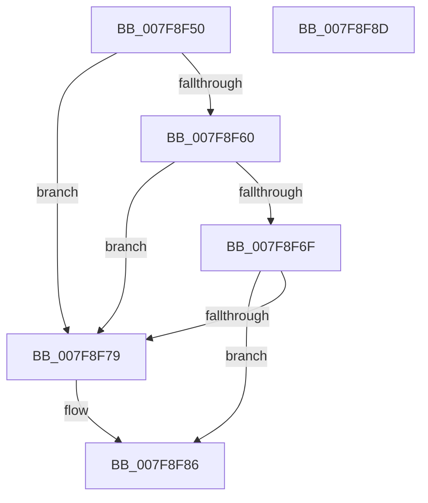

# MiWriteProtectSystemImages

- RVA: `0x007F8F50`–`0x007F8F8E` (길이 `62` bytes)
- VA: `0x00000001407F8F50`
- 실행 섹션: `PAGE`
- PDB 이름 있음: `예`; PDB Function 태그: `아니요`
- unwind 정보 RVA: `0x0005C788`
- 디코드: `17`개 명령, `62/62` bytes 표시
- 미해석 바이트: `0` (있으면 어셈블리에 `.byte`로 보존)

> 이 문서는 커널 이미지의 기계어와 PDB 기호를 분석해 생성했습니다. 4번과 5번은 함수 원형과 자료형을 바이너리 사용 방식에서 추정한 C 해석이며 원본 소스 복구 결과는 아닙니다.

## 1. Dependencies

- 직접 호출 지점: **2**; 고유 호출 대상: **2**
- 직접 호출자로 확인된 함수: **0**
- RIP 상대 이미지 참조: **0**

### Outgoing calls
- `0x007F8F60` → [MiSectionControlArea](../../text/29/MiSectionControlArea_function_00294CB0.md) (function, `0x00294CB0`)
- `0x007F8F81` → [MiProtectSystemImage](../AA/MiProtectSystemImage_function_00AA7D74.md) (function, `0x00AA7D74`)

### Direct callers
- 이 함수 시작 RVA로 연결되는 직접 call은 확인되지 않았습니다. 간접 호출은 완전히 역산할 수 없습니다.

### Static image references
- 디코드된 RIP-relative 메모리 참조가 없습니다.

## 2. Other-region calls and transfers

- 다른 실행 섹션으로 향하는 call: **1**
  - `0x007F8F60` → [MiSectionControlArea](../../text/29/MiSectionControlArea_function_00294CB0.md) (`PAGE` → `.text`)
- 별도 외부 분기/꼬리 이동을 확인하지 못했습니다.

## 3. Assembly (complete function range)

```asm
007F8F50  48 83 EC 28                     sub rsp, 0x28
007F8F54  4C 8B C1                        mov r8, rcx
007F8F57  48 8B 49 70                     mov rcx, qword ptr [rcx + 0x70]
007F8F5B  48 85 C9                        test rcx, rcx
007F8F5E  74 19                           je 0x1407f8f79
007F8F60  E8 4B BD A9 FF                  call 0x140294cb0
007F8F65  48 83 B8 90 00 00 00 00         cmp qword ptr [rax + 0x90], 0
007F8F6D  74 0A                           je 0x1407f8f79
007F8F6F  41 F7 40 68 00 00 00 08         test dword ptr [r8 + 0x68], 0x8000000
007F8F77  75 0D                           jne 0x1407f8f86
007F8F79  BA 01 00 00 00                  mov edx, 1
007F8F7E  49 8B C8                        mov rcx, r8
007F8F81  E8 EE ED 2A 00                  call 0x140aa7d74
007F8F86  33 C0                           xor eax, eax
007F8F88  48 83 C4 28                     add rsp, 0x28
007F8F8C  C3                              ret
007F8F8D  CC                              int3
```

## 4. C-style interpretation (structured pseudocode)

```c
__int64 __fastcall MiWriteProtectSystemImages(__int64 a1)
{
    __int64 result;
    __int64 v_rsp;

    v_rsp = (v_rsp) - (40);
    if (*(unsigned __int64 *)(a1 + 112) == 0) goto loc_007F8F79;
    result = MiSectionControlArea(*(unsigned __int64 *)(a1 + 112), a2, a1, a4);
    if ((*(unsigned __int64 *)(result + 144)) == 0) goto loc_007F8F79;
    if (((*(unsigned int *)(a1 + 104)) & (0x8000000ULL)) == 0) {
        a2 = 1;
        a1 = a1;
        result = MiProtectSystemImage(a1, a2, a1, a4);
    }
    result = 0;
    v_rsp = (v_rsp) + (40);
    return result;
}
```

## 5. (Beta) C Style

```c
int64_t MiWriteProtectSystemImages(void *Arg1)
{
    uint8_t *arg1 = (uint8_t *)Arg1;

    int64_t result;
    int64_t local_rsp;

    local_rsp = (local_rsp) - (40);
    if (*(uint64_t *)(arg1 + 0x70) == 0) goto loc_007F8F79;
    result = MiSectionControlArea(*(uint64_t *)(arg1 + 0x70), a2, Arg1, a4);
    if ((*(uint64_t *)(result + 0x90)) == 0) goto loc_007F8F79;
    if (((*(uint32_t *)(arg1 + 0x68)) & (0x8000000ULL)) == 0) {
        a2 = 1;
        Arg1 = Arg1;
        result = MiProtectSystemImage(Arg1, a2, Arg1, a4);
    }
    result = 0;
    local_rsp = (local_rsp) + (40);
    return result;
}
```

### 관측된 메모리 오프셋

구조체 형식이 확인되지 않은 접근은 인자 기준의 오프셋으로만 기록했습니다.

| 기준 인자 | 오프셋 표현 | 폭 (bit) | 접근 |
|---|---:|---:|---|
| `Arg1` | `+ 0x70` | `64` | `R` |

## 6. Execution-region graph

[열기: 2D/3D 그래프와 함수 탐색 컨트롤 패널](../../../control-panel.html?section=page&rva=0x007F8F50&view=graph)

- 2D 그래프는 위에서 아래로 흐르고, 3D 그래프는 빈 공간을 드래그해 회전합니다. Shift+드래그는 이동, 휠은 확대·축소, 함수 노드 선택은 대상 보고서 이동입니다.

### Static fallback


