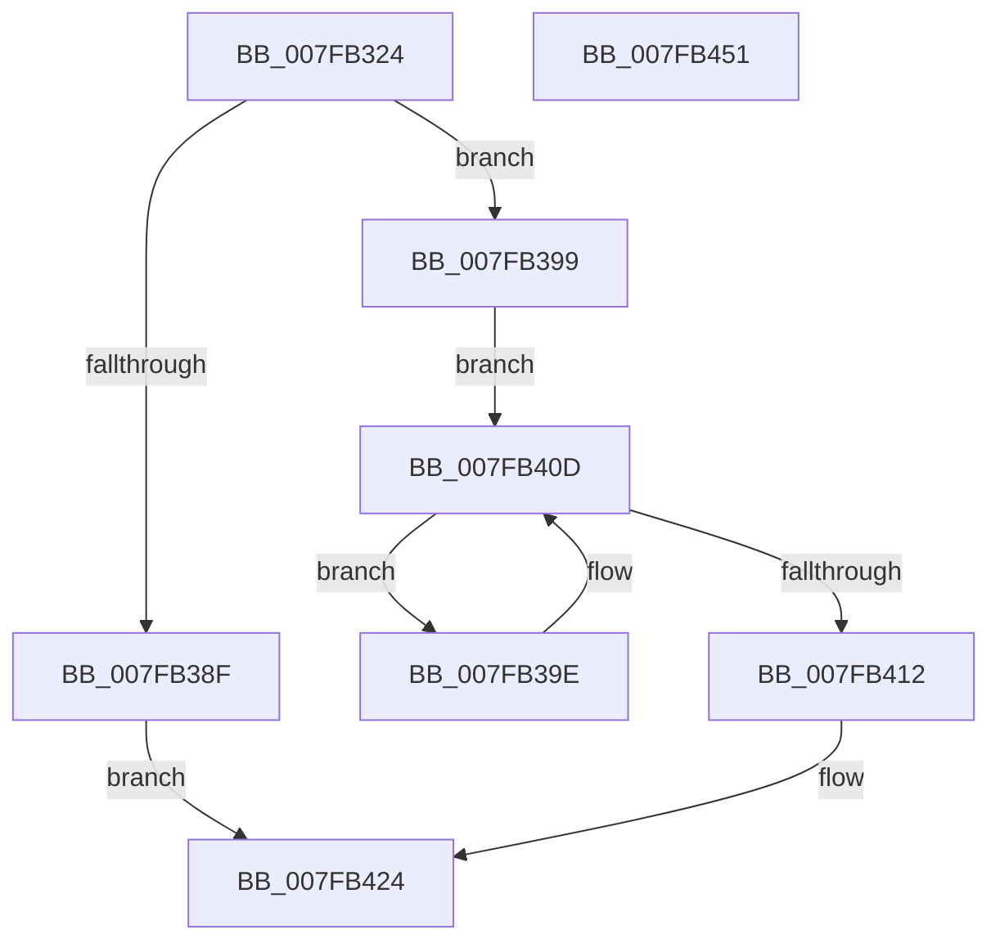

# MiZeroHotAddMemory

- RVA: `0x007FB324`–`0x007FB452` (길이 `302` bytes)
- VA: `0x00000001407FB324`
- 실행 섹션: `PAGE`
- PDB 이름 있음: `예`; PDB Function 태그: `아니요`
- unwind 정보 RVA: `0x000D7AA8`
- 디코드: `74`개 명령, `302/302` bytes 표시
- 미해석 바이트: `0` (있으면 어셈블리에 `.byte`로 보존)

> 이 문서는 커널 이미지의 기계어와 PDB 기호를 분석해 생성했습니다. 4번과 5번은 함수 원형과 자료형을 바이너리 사용 방식에서 추정한 C 해석이며 원본 소스 복구 결과는 아닙니다.

## 1. Dependencies

- 직접 호출 지점: **8**; 고유 호출 대상: **8**
- 직접 호출자로 확인된 함수: **1**
- RIP 상대 이미지 참조: **1**

### Outgoing calls
- `0x007FB361` → [memset](../../text/6C/memset_function_006C6C40.md) (function, `0x006C6C40`)
- `0x007FB382` → [MmMapIoSpaceEx](../../text/32/MmMapIoSpaceEx_function_00327830.md) (function, `0x00327830`)
- `0x007FB3A4` → [MiRestrictRangeToNode](../../text/40/MiRestrictRangeToNode_function_0040199C.md) (function, `0x0040199C`)
- `0x007FB3AF` → [MiPageToNode](../../text/33/MiPageToNode_function_00338CD0.md) (function, `0x00338CD0`)
- `0x007FB3C1` → [MiInitializeDpcGang](../../text/43/MiInitializeDpcGang_function_0043E9DC.md) (function, `0x0043E9DC`)
- `0x007FB3FB` → [MiStartDpcGang](../../text/2C/MiStartDpcGang_function_002C8C34.md) (function, `0x002C8C34`)
- `0x007FB41D` → [MmUnmapIoSpace](../../text/3F/MmUnmapIoSpace_function_003F78F0.md) (function, `0x003F78F0`)
- `0x007FB42F` → [_security_check_cookie](../../text/6A/_security_check_cookie_function_006AC640.md) (function, `0x006AC640`)

### Direct callers
- [MiMapNewPfns](MiMapNewPfns_function_007FA63C.md) at `0x007FA6C0`

### Static image references
- `0x007FB33F` → RVA `0x00E0A740` (`.data`; read)

## 2. Other-region calls and transfers

- 다른 실행 섹션으로 향하는 call: **8**
  - `0x007FB361` → [memset](../../text/6C/memset_function_006C6C40.md) (`PAGE` → `.text`)
  - `0x007FB382` → [MmMapIoSpaceEx](../../text/32/MmMapIoSpaceEx_function_00327830.md) (`PAGE` → `.text`)
  - `0x007FB3A4` → [MiRestrictRangeToNode](../../text/40/MiRestrictRangeToNode_function_0040199C.md) (`PAGE` → `.text`)
  - `0x007FB3AF` → [MiPageToNode](../../text/33/MiPageToNode_function_00338CD0.md) (`PAGE` → `.text`)
  - `0x007FB3C1` → [MiInitializeDpcGang](../../text/43/MiInitializeDpcGang_function_0043E9DC.md) (`PAGE` → `.text`)
  - `0x007FB3FB` → [MiStartDpcGang](../../text/2C/MiStartDpcGang_function_002C8C34.md) (`PAGE` → `.text`)
  - `0x007FB41D` → [MmUnmapIoSpace](../../text/3F/MmUnmapIoSpace_function_003F78F0.md) (`PAGE` → `.text`)
  - `0x007FB42F` → [_security_check_cookie](../../text/6A/_security_check_cookie_function_006AC640.md) (`PAGE` → `.text`)
- 별도 외부 분기/꼬리 이동을 확인하지 못했습니다.

## 3. Assembly (complete function range)

```asm
007FB324  48 89 5C 24 10                  mov qword ptr [rsp + 0x10], rbx
007FB329  48 89 6C 24 18                  mov qword ptr [rsp + 0x18], rbp
007FB32E  48 89 74 24 20                  mov qword ptr [rsp + 0x20], rsi
007FB333  57                              push rdi
007FB334  41 56                           push r14
007FB336  41 57                           push r15
007FB338  48 81 EC A0 01 00 00            sub rsp, 0x1a0
007FB33F  48 8B 05 FA F3 60 00            mov rax, qword ptr [rip + 0x60f3fa]
007FB346  48 33 C4                        xor rax, rsp
007FB349  48 89 84 24 90 01 00 00         mov qword ptr [rsp + 0x190], rax
007FB351  48 8B F1                        mov rsi, rcx
007FB354  33 D2                           xor edx, edx
007FB356  48 8D 4C 24 20                  lea rcx, [rsp + 0x20]
007FB35B  41 B8 68 01 00 00               mov r8d, 0x168
007FB361  E8 DA B8 EC FF                  call 0x1406c6c40
007FB366  4C 8B 76 10                     mov r14, qword ptr [rsi + 0x10]
007FB36A  41 B8 04 00 00 00               mov r8d, 4
007FB370  48 8B 6E 20                     mov rbp, qword ptr [rsi + 0x20]
007FB374  49 8B CE                        mov rcx, r14
007FB377  48 8B D5                        mov rdx, rbp
007FB37A  48 C1 E1 0C                     shl rcx, 0xc
007FB37E  48 C1 E2 0C                     shl rdx, 0xc
007FB382  E8 A9 C4 B2 FF                  call 0x140327830
007FB387  48 8B F8                        mov rdi, rax
007FB38A  48 85 C0                        test rax, rax
007FB38D  75 0A                           jne 0x1407fb399
007FB38F  B8 9A 00 00 C0                  mov eax, 0xc000009a
007FB394  E9 8B 00 00 00                  jmp 0x1407fb424
007FB399  4C 8B FF                        mov r15, rdi
007FB39C  EB 6F                           jmp 0x1407fb40d
007FB39E  48 8B D5                        mov rdx, rbp
007FB3A1  49 8B CE                        mov rcx, r14
007FB3A4  E8 F3 65 C0 FF                  call 0x14040199c
007FB3A9  49 8B CE                        mov rcx, r14
007FB3AC  48 8B D8                        mov rbx, rax
007FB3AF  E8 1C D9 B3 FF                  call 0x140338cd0
007FB3B4  41 B8 01 00 00 00               mov r8d, 1
007FB3BA  48 8D 4C 24 20                  lea rcx, [rsp + 0x20]
007FB3BF  8B D0                           mov edx, eax
007FB3C1  E8 16 36 C4 FF                  call 0x14043e9dc
007FB3C6  48 8B 4E 30                     mov rcx, qword ptr [rsi + 0x30]
007FB3CA  83 8C 24 D8 00 00 00 08         or dword ptr [rsp + 0xd8], 8
007FB3D2  48 89 8C 24 C8 00 00 00         mov qword ptr [rsp + 0xc8], rcx
007FB3DA  8B 4E 28                        mov ecx, dword ptr [rsi + 0x28]
007FB3DD  89 8C 24 D4 00 00 00            mov dword ptr [rsp + 0xd4], ecx
007FB3E4  48 8D 4C 24 20                  lea rcx, [rsp + 0x20]
007FB3E9  4C 89 74 24 20                  mov qword ptr [rsp + 0x20], r14
007FB3EE  48 89 5C 24 28                  mov qword ptr [rsp + 0x28], rbx
007FB3F3  4C 89 BC 24 C0 00 00 00         mov qword ptr [rsp + 0xc0], r15
007FB3FB  E8 34 D8 AC FF                  call 0x1402c8c34
007FB400  48 2B EB                        sub rbp, rbx
007FB403  4C 03 F3                        add r14, rbx
007FB406  48 C1 E3 0C                     shl rbx, 0xc
007FB40A  4C 03 FB                        add r15, rbx
007FB40D  48 85 ED                        test rbp, rbp
007FB410  75 8C                           jne 0x1407fb39e
007FB412  48 8B 56 20                     mov rdx, qword ptr [rsi + 0x20]
007FB416  48 8B CF                        mov rcx, rdi
007FB419  48 C1 E2 0C                     shl rdx, 0xc
007FB41D  E8 CE C4 BF FF                  call 0x1403f78f0
007FB422  33 C0                           xor eax, eax
007FB424  48 8B 8C 24 90 01 00 00         mov rcx, qword ptr [rsp + 0x190]
007FB42C  48 33 CC                        xor rcx, rsp
007FB42F  E8 0C 12 EB FF                  call 0x1406ac640
007FB434  4C 8D 9C 24 A0 01 00 00         lea r11, [rsp + 0x1a0]
007FB43C  49 8B 5B 28                     mov rbx, qword ptr [r11 + 0x28]
007FB440  49 8B 6B 30                     mov rbp, qword ptr [r11 + 0x30]
007FB444  49 8B 73 38                     mov rsi, qword ptr [r11 + 0x38]
007FB448  49 8B E3                        mov rsp, r11
007FB44B  41 5F                           pop r15
007FB44D  41 5E                           pop r14
007FB44F  5F                              pop rdi
007FB450  C3                              ret
007FB451  CC                              int3
```

## 4. C-style interpretation (structured pseudocode)

```c
__int64 __fastcall MiZeroHotAddMemory(__int64 a1, int a2)
{
    __int64 result;
    __int64 v_r14;
    __int64 v_r15;
    __int64 v_rbp;
    __int64 v_rbx;
    __int64 v_rsp;
    unsigned __int64 v_stack_m18;
    unsigned __int64 v_stack_m190;
    unsigned __int64 v_stack_m198;
    unsigned __int64 v_stack_m28;
    unsigned int v_stack_mE0;
    unsigned int v_stack_mE4;
    unsigned __int64 v_stack_mF0;
    unsigned __int64 v_stack_mF8;
    unsigned __int64 v_stack_p10;
    unsigned __int64 v_stack_p18;
    unsigned __int64 v_stack_p20;

    v_stack_p10 = v_rbx;
    v_stack_p18 = v_rbp;
    v_stack_p20 = v_rsi;
    v_rsp = (v_rsp) - (416);
    result = (*(unsigned __int64 *)(v_rip + 6353914)) ^ (v_rsp);
    v_stack_m28 = result;
    a2 = 0;
    result = memset(v_stack_m198, a2, 360, a4);
    a1 = (*(unsigned __int64 *)(a1 + 16)) << (12);
    a2 = (*(unsigned __int64 *)(a1 + 32)) << (12);
    result = MmMapIoSpaceEx(a1, a2, 4, a4);
    if (result != 0) goto loc_007FB399;
    goto loc_007FB424;
loc_007FB399:
    goto loc_007FB40D;
loc_007FB39E:
    result = MiRestrictRangeToNode(*(unsigned __int64 *)(a1 + 16), *(unsigned __int64 *)(a1 + 32), 4, a4);
    result = MiPageToNode(*(unsigned __int64 *)(a1 + 16), *(unsigned __int64 *)(a1 + 32), 4, a4);
    result = MiInitializeDpcGang(v_stack_m198, (unsigned int)((unsigned int)(result)), 1, a4);
    v_stack_mF0 = *(unsigned __int64 *)(a1 + 48);
    v_stack_mE4 = (unsigned int)((unsigned int)(*(unsigned int *)(a1 + 40)));
    v_stack_m198 = *(unsigned __int64 *)(a1 + 16);
    v_stack_m190 = result;
    v_stack_mF8 = result;
    result = MiStartDpcGang(v_stack_m198, (unsigned int)((unsigned int)(result)), 1, a4);
    v_rbp = (*(unsigned __int64 *)(a1 + 32)) - (result);
    v_r14 = (*(unsigned __int64 *)(a1 + 16)) + (result);
    v_rbx = (result) << (12);
    v_r15 = (result) + (v_rbx);
loc_007FB40D:
    if (v_rbp != 0) goto loc_007FB39E;
    a2 = (*(unsigned __int64 *)(a1 + 32)) << (12);
    result = MmUnmapIoSpace(result, a2, 1, a4);
    result = 0;
loc_007FB424:
    a1 = (v_stack_m28) ^ (v_rsp);
    result = _security_check_cookie(a1, a2, 1, a4);
    return result;
}
```

## 5. (Beta) C Style

```c
int64_t MiZeroHotAddMemory(void *Arg1, int32_t Arg2)
{
    uint8_t *arg1 = (uint8_t *)Arg1;

    int64_t result;
    int64_t local_r14;
    int64_t local_r15;
    int64_t local_rbp;
    int64_t local_rbx;
    int64_t local_rsp;
    uint64_t v_stack_m18;
    uint64_t v_stack_m190;
    uint64_t v_stack_m198;
    uint64_t v_stack_m28;
    uint32_t v_stack_mE0;
    uint32_t v_stack_mE4;
    uint64_t v_stack_mF0;
    uint64_t v_stack_mF8;
    uint64_t v_stack_p10;
    uint64_t v_stack_p18;
    uint64_t v_stack_p20;

    v_stack_p10 = local_rbx;
    v_stack_p18 = local_rbp;
    v_stack_p20 = local_rsi;
    local_rsp = (local_rsp) - (416);
    result = (*(uint64_t *)(v_rip + 0x60F3FA)) ^ (local_rsp);
    v_stack_m28 = result;
    Arg2 = 0;
    result = memset(v_stack_m198, Arg2, 360, a4);
    Arg1 = (*(uint64_t *)(arg1 + 0x10)) << (12);
    Arg2 = (*(uint64_t *)(arg1 + 0x20)) << (12);
    result = MmMapIoSpaceEx(Arg1, Arg2, 4, a4);
    if (result != 0) goto loc_007FB399;
    goto loc_007FB424;
loc_007FB399:
    goto loc_007FB40D;
loc_007FB39E:
    result = MiRestrictRangeToNode(*(uint64_t *)(arg1 + 0x10), *(uint64_t *)(arg1 + 0x20), 4, a4);
    result = MiPageToNode(*(uint64_t *)(arg1 + 0x10), *(uint64_t *)(arg1 + 0x20), 4, a4);
    result = MiInitializeDpcGang(v_stack_m198, (uint32_t)((uint32_t)(result)), 1, a4);
    v_stack_mF0 = *(uint64_t *)(arg1 + 0x30);
    v_stack_mE4 = (uint32_t)((uint32_t)(*(uint32_t *)(arg1 + 0x28)));
    v_stack_m198 = *(uint64_t *)(arg1 + 0x10);
    v_stack_m190 = result;
    v_stack_mF8 = result;
    result = MiStartDpcGang(v_stack_m198, (uint32_t)((uint32_t)(result)), 1, a4);
    local_rbp = (*(uint64_t *)(arg1 + 0x20)) - (result);
    local_r14 = (*(uint64_t *)(arg1 + 0x10)) + (result);
    local_rbx = (result) << (12);
    local_r15 = (result) + (local_rbx);
loc_007FB40D:
    if (local_rbp != 0) goto loc_007FB39E;
    Arg2 = (*(uint64_t *)(arg1 + 0x20)) << (12);
    result = MmUnmapIoSpace(result, Arg2, 1, a4);
    result = 0;
loc_007FB424:
    Arg1 = (v_stack_m28) ^ (local_rsp);
    result = _security_check_cookie(Arg1, Arg2, 1, a4);
    return result;
}
```

### 관측된 메모리 오프셋

구조체 형식이 확인되지 않은 접근은 인자 기준의 오프셋으로만 기록했습니다.

| 기준 인자 | 오프셋 표현 | 폭 (bit) | 접근 |
|---|---:|---:|---|
| `Arg1` | `+ 0x10` | `64` | `R` |
| `Arg1` | `+ 0x20` | `64` | `R` |
| `Arg1` | `+ 0x28` | `32` | `R` |
| `Arg1` | `+ 0x30` | `64` | `R` |

## 6. Execution-region graph

[열기: 2D/3D 그래프와 함수 탐색 컨트롤 패널](../../../control-panel.html?section=page&rva=0x007FB324&view=graph)

- 2D 그래프는 위에서 아래로 흐르고, 3D 그래프는 빈 공간을 드래그해 회전합니다. Shift+드래그는 이동, 휠은 확대·축소, 함수 노드 선택은 대상 보고서 이동입니다.

### Static fallback


