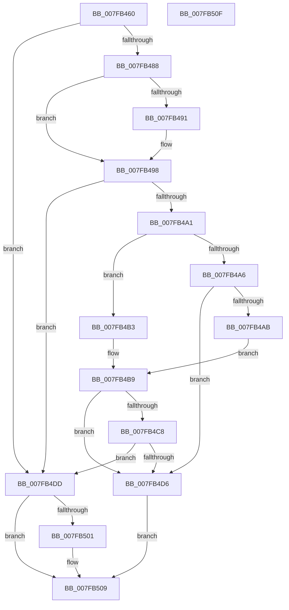

# MmAddPhysicalMemory

- RVA: `0x007FB460`–`0x007FB510` (길이 `176` bytes)
- VA: `0x00000001407FB460`
- 실행 섹션: `PAGE`
- PDB 이름 있음: `예`; PDB Function 태그: `아니요`
- unwind 정보 RVA: `0x00064C80`
- 디코드: `52`개 명령, `176/176` bytes 표시
- 미해석 바이트: `0` (있으면 어셈블리에 `.byte`로 보존)

> 이 문서는 커널 이미지의 기계어와 PDB 기호를 분석해 생성했습니다. 4번과 5번은 함수 원형과 자료형을 바이너리 사용 방식에서 추정한 C 해석이며 원본 소스 복구 결과는 아닙니다.

## 1. Dependencies

- 직접 호출 지점: **1**; 고유 호출 대상: **1**
- 직접 호출자로 확인된 함수: **1**
- RIP 상대 이미지 참조: **1**

### Outgoing calls
- `0x007FB4F8` → [MiAddPhysicalMemoryChunks](MiAddPhysicalMemoryChunks_function_007F98D4.md) (function, `0x007F98D4`)

### Direct callers
- [WheapClearPoison](../7D/WheapClearPoison_function_007D7DFC.md) at `0x007D7E85`

### Static image references
- `0x007FB4EC` → RVA `0x00E38D00` (`.data`; read)

## 2. Other-region calls and transfers

- 다른 실행 섹션으로 향하는 call: **0**
- 별도 외부 분기/꼬리 이동을 확인하지 못했습니다.

## 3. Assembly (complete function range)

```asm
007FB460  40 53                           push rbx
007FB462  48 83 EC 30                     sub rsp, 0x30
007FB466  48 8B 01                        mov rax, qword ptr [rcx]
007FB469  48 8B DA                        mov rbx, rdx
007FB46C  48 8B 12                        mov rdx, qword ptr [rdx]
007FB46F  45 33 C0                        xor r8d, r8d
007FB472  45 33 C9                        xor r9d, r9d
007FB475  48 89 54 24 48                  mov qword ptr [rsp + 0x48], rdx
007FB47A  48 89 44 24 40                  mov qword ptr [rsp + 0x40], rax
007FB47F  8B C8                           mov ecx, eax
007FB481  A9 FF 0F 00 00                  test eax, 0xfff
007FB486  74 55                           je 0x1407fb4dd
007FB488  44 8B C0                        mov r8d, eax
007FB48B  41 83 E0 01                     and r8d, 1
007FB48F  74 07                           je 0x1407fb498
007FB491  83 E1 FE                        and ecx, 0xfffffffe
007FB494  89 4C 24 40                     mov dword ptr [rsp + 0x40], ecx
007FB498  41 C1 E0 09                     shl r8d, 9
007FB49C  F6 C1 06                        test cl, 6
007FB49F  74 3C                           je 0x1407fb4dd
007FB4A1  F6 C1 02                        test cl, 2
007FB4A4  74 0D                           je 0x1407fb4b3
007FB4A6  F6 C1 04                        test cl, 4
007FB4A9  75 2B                           jne 0x1407fb4d6
007FB4AB  41 B9 00 02 00 00               mov r9d, 0x200
007FB4B1  EB 06                           jmp 0x1407fb4b9
007FB4B3  41 B9 00 00 04 00               mov r9d, 0x40000
007FB4B9  49 8B C1                        mov rax, r9
007FB4BC  48 C1 E0 0C                     shl rax, 0xc
007FB4C0  48 FF C8                        dec rax
007FB4C3  48 85 C2                        test rdx, rax
007FB4C6  75 0E                           jne 0x1407fb4d6
007FB4C8  83 E1 F9                        and ecx, 0xfffffff9
007FB4CB  89 4C 24 40                     mov dword ptr [rsp + 0x40], ecx
007FB4CF  48 85 44 24 40                  test qword ptr [rsp + 0x40], rax
007FB4D4  74 07                           je 0x1407fb4dd
007FB4D6  B8 0D 00 00 C0                  mov eax, 0xc000000d
007FB4DB  EB 2C                           jmp 0x1407fb509
007FB4DD  83 64 24 28 00                  and dword ptr [rsp + 0x28], 0
007FB4E2  48 8D 54 24 40                  lea rdx, [rsp + 0x40]
007FB4E7  44 89 44 24 20                  mov dword ptr [rsp + 0x20], r8d
007FB4EC  48 8D 0D 0D D8 63 00            lea rcx, [rip + 0x63d80d]
007FB4F3  4C 8D 44 24 48                  lea r8, [rsp + 0x48]
007FB4F8  E8 D7 E3 FF FF                  call 0x1407f98d4
007FB4FD  85 C0                           test eax, eax
007FB4FF  78 08                           js 0x1407fb509
007FB501  48 8B 4C 24 48                  mov rcx, qword ptr [rsp + 0x48]
007FB506  48 89 0B                        mov qword ptr [rbx], rcx
007FB509  48 83 C4 30                     add rsp, 0x30
007FB50D  5B                              pop rbx
007FB50E  C3                              ret
007FB50F  CC                              int3
```

## 4. C-style interpretation (structured pseudocode)

```c
__int64 __fastcall MmAddPhysicalMemory(__int64 a1, __int64 a2, int a3, int a4)
{
    __int64 result;
    __int64 v_rsp;
    unsigned int v_stack_m10;
    unsigned int v_stack_m18;
    unsigned __int64 v_stack_p10;
    unsigned __int64 v_stack_p8;

    v_rsp = (v_rsp) - (48);
    a3 = 0;
    a4 = 0;
    v_stack_p10 = *(unsigned __int64 *)(a2);
    v_stack_p8 = *(unsigned __int64 *)(a1);
    if ((((unsigned int)(*(unsigned __int64 *)(a1))) & (0xFFFULL)) == 0) goto loc_007FB4DD;
    a3 = (unsigned int)(((unsigned int)((unsigned int)(*(unsigned __int64 *)(a1)))) & (1));
    if (!(condition_is_equal)) {
        a1 = (unsigned int)(((unsigned int)((unsigned int)(*(unsigned __int64 *)(a1)))) & (0xFFFFFFFEULL));
        v_stack_p8 = (unsigned int)(a1);
    }
    a3 = (unsigned int)((a3) << (9));
    if ((((unsigned __int8)(a1)) & (6)) == 0) goto loc_007FB4DD;
    if ((((unsigned __int8)(a1)) & (2)) == 0) goto loc_007FB4B3;
    if ((((unsigned __int8)(a1)) & (4)) != 0) goto loc_007FB4D6;
    goto loc_007FB4B9;
loc_007FB4B3:
loc_007FB4B9:
    result = ((unsigned int)(0x40000ULL)) << (12);
    result = (result) - 1;
    if (((*(unsigned __int64 *)(a2)) & (result)) != 0) goto loc_007FB4D6;
    a1 = (unsigned int)((a1) & (0xFFFFFFF9ULL));
    v_stack_p8 = (unsigned int)(a1);
    if (((v_stack_p8) & (result)) == 0) goto loc_007FB4DD;
loc_007FB4D6:
    goto loc_007FB509;
loc_007FB4DD:
    v_stack_m18 = a3;
    result = MiAddPhysicalMemoryChunks(v_rip + 6543373, v_stack_p8, v_stack_p10, (unsigned int)(0x40000ULL));
    if (!(sign_flag)) {
        a1 = v_stack_p10;
        *(unsigned __int64 *)(a2) = a1;
    }
    v_rsp = (v_rsp) + (48);
    return result;
}
```

## 5. (Beta) C Style

```c
int64_t MmAddPhysicalMemory(void *Arg1, void *Arg2, int32_t Arg3, int32_t Arg4)
{
    uint8_t *arg1 = (uint8_t *)Arg1;
    uint8_t *arg2 = (uint8_t *)Arg2;

    int64_t result;
    int64_t local_rsp;
    uint32_t v_stack_m10;
    uint32_t v_stack_m18;
    uint64_t v_stack_p10;
    uint64_t v_stack_p8;

    local_rsp = (local_rsp) - (48);
    Arg3 = 0;
    Arg4 = 0;
    v_stack_p10 = *(uint64_t *)(arg2);
    v_stack_p8 = *(uint64_t *)(arg1);
    if ((((uint32_t)(*(uint64_t *)(arg1))) & (0xFFFULL)) == 0) goto loc_007FB4DD;
    Arg3 = (uint32_t)(((uint32_t)((uint32_t)(*(uint64_t *)(arg1)))) & (1));
    if (!(condition_is_equal)) {
        Arg1 = (uint32_t)(((uint32_t)((uint32_t)(*(uint64_t *)(arg1)))) & (0xFFFFFFFEULL));
        v_stack_p8 = (uint32_t)(Arg1);
    }
    Arg3 = (uint32_t)((Arg3) << (9));
    if ((((uint8_t)(Arg1)) & (6)) == 0) goto loc_007FB4DD;
    if ((((uint8_t)(Arg1)) & (2)) == 0) goto loc_007FB4B3;
    if ((((uint8_t)(Arg1)) & (4)) != 0) goto loc_007FB4D6;
    goto loc_007FB4B9;
loc_007FB4B3:
loc_007FB4B9:
    result = ((uint32_t)(0x40000ULL)) << (12);
    result = (result) - 1;
    if (((*(uint64_t *)(arg2)) & (result)) != 0) goto loc_007FB4D6;
    Arg1 = (uint32_t)((Arg1) & (0xFFFFFFF9ULL));
    v_stack_p8 = (uint32_t)(Arg1);
    if (((v_stack_p8) & (result)) == 0) goto loc_007FB4DD;
loc_007FB4D6:
    goto loc_007FB509;
loc_007FB4DD:
    v_stack_m18 = Arg3;
    result = MiAddPhysicalMemoryChunks(v_rip + 6543373, v_stack_p8, v_stack_p10, (uint32_t)(0x40000ULL));
    if (!(sign_flag)) {
        Arg1 = v_stack_p10;
        *(void **)(arg2) = Arg1;
    }
    local_rsp = (local_rsp) + (48);
    return result;
}
```

### 관측된 메모리 오프셋

구조체 형식이 확인되지 않은 접근은 인자 기준의 오프셋으로만 기록했습니다.

| 기준 인자 | 오프셋 표현 | 폭 (bit) | 접근 |
|---|---:|---:|---|
| `Arg1` | `+ 0x0` | `64` | `R` |
| `Arg2` | `+ 0x0` | `64` | `R` |
| `Arg2` | `+ 0x0` | `64` | `W` |

## 6. Execution-region graph

[열기: 2D/3D 그래프와 함수 탐색 컨트롤 패널](../../../control-panel.html?section=page&rva=0x007FB460&view=graph)

- 2D 그래프는 위에서 아래로 흐르고, 3D 그래프는 빈 공간을 드래그해 회전합니다. Shift+드래그는 이동, 휠은 확대·축소, 함수 노드 선택은 대상 보고서 이동입니다.

### Static fallback


