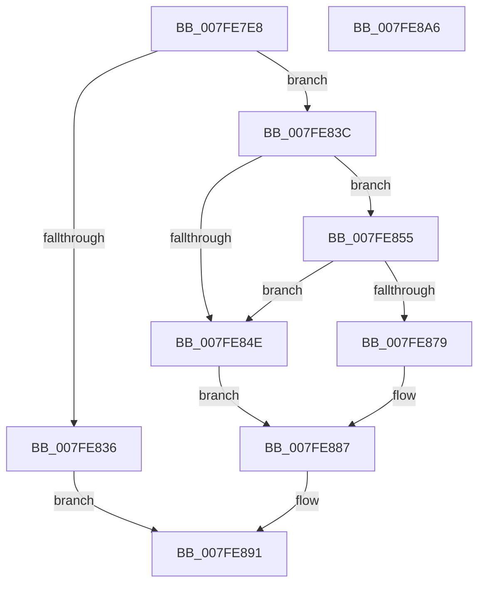

# MmAdjustSecuredVirtualMemorySize

- RVA: `0x007FE7E8`–`0x007FE8A7` (길이 `191` bytes)
- VA: `0x00000001407FE7E8`
- 실행 섹션: `PAGE`
- PDB 이름 있음: `예`; PDB Function 태그: `아니요`
- unwind 정보 RVA: `0x0006C8E8`
- 디코드: `53`개 명령, `191/191` bytes 표시
- 미해석 바이트: `0` (있으면 어셈블리에 `.byte`로 보존)

> 이 문서는 커널 이미지의 기계어와 PDB 기호를 분석해 생성했습니다. 4번과 5번은 함수 원형과 자료형을 바이너리 사용 방식에서 추정한 C 해석이며 원본 소스 복구 결과는 아닙니다.

## 1. Dependencies

- 직접 호출 지점: **2**; 고유 호출 대상: **2**
- 직접 호출자로 확인된 함수: **1**
- RIP 상대 이미지 참조: **1**

### Outgoing calls
- `0x007FE829` → [MiObtainReferencedSecureVad](../../text/29/MiObtainReferencedSecureVad_function_00295688.md) (function, `0x00295688`)
- `0x007FE88A` → [MiUnlockAndDereferenceVad](../../text/31/MiUnlockAndDereferenceVad_function_00316E60.md) (function, `0x00316E60`)

### Direct callers
- [VmpUnsecureMemoryForPin](../7A/VmpUnsecureMemoryForPin_function_007AE05C.md) at `0x007AE093`

### Static image references
- `0x007FE81C` → RVA `0x00E2DB80` (`.data`; read)

## 2. Other-region calls and transfers

- 다른 실행 섹션으로 향하는 call: **2**
  - `0x007FE829` → [MiObtainReferencedSecureVad](../../text/29/MiObtainReferencedSecureVad_function_00295688.md) (`PAGE` → `.text`)
  - `0x007FE88A` → [MiUnlockAndDereferenceVad](../../text/31/MiUnlockAndDereferenceVad_function_00316E60.md) (`PAGE` → `.text`)
- 별도 외부 분기/꼬리 이동을 확인하지 못했습니다.

## 3. Assembly (complete function range)

```asm
007FE7E8  48 8B C4                        mov rax, rsp
007FE7EB  48 89 58 10                     mov qword ptr [rax + 0x10], rbx
007FE7EF  48 89 68 18                     mov qword ptr [rax + 0x18], rbp
007FE7F3  48 89 70 20                     mov qword ptr [rax + 0x20], rsi
007FE7F7  57                              push rdi
007FE7F8  48 83 EC 20                     sub rsp, 0x20
007FE7FC  48 8B F2                        mov rsi, rdx
007FE7FF  33 DB                           xor ebx, ebx
007FE801  89 58 08                        mov dword ptr [rax + 8], ebx
007FE804  48 8D 54 24 30                  lea rdx, [rsp + 0x30]
007FE809  65 48 8B 04 25 88 01 00 00      mov rax, qword ptr gs:[0x188]
007FE812  49 8B E8                        mov rbp, r8
007FE815  48 8B B8 B8 00 00 00            mov rdi, qword ptr [rax + 0xb8]
007FE81C  48 33 3D 5D F3 62 00            xor rdi, qword ptr [rip + 0x62f35d]
007FE823  48 33 F9                        xor rdi, rcx
007FE826  48 8B CF                        mov rcx, rdi
007FE829  E8 5A 6E A9 FF                  call 0x140295688
007FE82E  4C 8B C0                        mov r8, rax
007FE831  48 85 C0                        test rax, rax
007FE834  75 06                           jne 0x1407fe83c
007FE836  8B 44 24 30                     mov eax, dword ptr [rsp + 0x30]
007FE83A  EB 55                           jmp 0x1407fe891
007FE83C  48 8B 57 08                     mov rdx, qword ptr [rdi + 8]
007FE840  48 8B C2                        mov rax, rdx
007FE843  48 25 00 F0 FF FF               and rax, 0xfffffffffffff000
007FE849  48 3B F0                        cmp rsi, rax
007FE84C  73 07                           jae 0x1407fe855
007FE84E  BB BB 00 00 C0                  mov ebx, 0xc00000bb
007FE853  EB 32                           jmp 0x1407fe887
007FE855  41 B9 FF 0F 00 00               mov r9d, 0xfff
007FE85B  48 8B C6                        mov rax, rsi
007FE85E  49 23 C1                        and rax, r9
007FE861  49 03 C1                        add rax, r9
007FE864  48 03 C5                        add rax, rbp
007FE867  48 25 00 F0 FF FF               and rax, 0xfffffffffffff000
007FE86D  48 FF C8                        dec rax
007FE870  48 03 C6                        add rax, rsi
007FE873  48 3B 47 10                     cmp rax, qword ptr [rdi + 0x10]
007FE877  77 D5                           ja 0x1407fe84e
007FE879  49 23 D1                        and rdx, r9
007FE87C  48 89 47 10                     mov qword ptr [rdi + 0x10], rax
007FE880  48 0B D6                        or rdx, rsi
007FE883  48 89 57 08                     mov qword ptr [rdi + 8], rdx
007FE887  49 8B C8                        mov rcx, r8
007FE88A  E8 D1 85 B1 FF                  call 0x140316e60
007FE88F  8B C3                           mov eax, ebx
007FE891  48 8B 5C 24 38                  mov rbx, qword ptr [rsp + 0x38]
007FE896  48 8B 6C 24 40                  mov rbp, qword ptr [rsp + 0x40]
007FE89B  48 8B 74 24 48                  mov rsi, qword ptr [rsp + 0x48]
007FE8A0  48 83 C4 20                     add rsp, 0x20
007FE8A4  5F                              pop rdi
007FE8A5  C3                              ret
007FE8A6  CC                              int3
```

## 4. C-style interpretation (structured pseudocode)

```c
__int64 __fastcall MmAdjustSecuredVirtualMemorySize(__int64 a1, __int64 a2, __int64 a3)
{
    __int64 result;
    __int64 v_rbx;
    __int64 v_rdi;
    __int64 v_rsp;
    unsigned __int64 v_stack_p10;
    unsigned __int64 v_stack_p18;
    unsigned __int64 v_stack_p20;
    unsigned __int64 v_stack_p8;

    *(unsigned __int64 *)(v_rsp + 16) = v_rbx;
    *(unsigned __int64 *)(v_rsp + 24) = v_rbp;
    *(unsigned __int64 *)(v_rsp + 32) = v_rsi;
    v_rsp = (v_rsp) - (32);
    v_rbx = 0;
    *(unsigned int *)(v_rsp + 8) = 0;
    v_rdi = (*(unsigned __int64 *)(*(unsigned __int64 *)(gs_base + (0 + 392)) + 184)) ^ (*(unsigned __int64 *)(v_rip + 6484829));
    v_rdi = (v_rdi) ^ (a1);
    result = MiObtainReferencedSecureVad(v_rdi, v_stack_p8, a3, a4);
    if (result != 0) goto loc_007FE83C;
    goto loc_007FE891;
loc_007FE83C:
    result = (*(unsigned __int64 *)(v_rdi + 8)) & (0xFFFFFFFFFFFFF000ULL);
    if (a2 >= result) goto loc_007FE855;
loc_007FE84E:
    goto loc_007FE887;
loc_007FE855:
    result = (a2) & ((unsigned int)(0xFFFULL));
    result = (result) + ((unsigned int)(0xFFFULL));
    result = (result) + (a3);
    result = (result) & (0xFFFFFFFFFFFFF000ULL);
    result = (result) - 1;
    result = (result) + (a2);
    if (result > (*(unsigned __int64 *)(v_rdi + 16))) goto loc_007FE84E;
    a2 = (*(unsigned __int64 *)(v_rdi + 8)) & ((unsigned int)(0xFFFULL));
    *(unsigned __int64 *)(v_rdi + 16) = result;
    a2 = (a2) | (a2);
    *(unsigned __int64 *)(v_rdi + 8) = a2;
loc_007FE887:
    result = MiUnlockAndDereferenceVad(result, a2, result, (unsigned int)(0xFFFULL));
loc_007FE891:
    v_rsp = (v_rsp) + (32);
    return (unsigned int)((unsigned int)((unsigned int)(0xC00000BBULL)));
}
```

## 5. (Beta) C Style

```c
int64_t MmAdjustSecuredVirtualMemorySize(int64_t Arg1, int64_t Arg2, int64_t Arg3)
{
    int64_t result;
    int64_t local_rbx;
    int64_t local_rdi;
    int64_t local_rsp;
    uint64_t v_stack_p10;
    uint64_t v_stack_p18;
    uint64_t v_stack_p20;
    uint64_t v_stack_p8;

    *(uint64_t *)(local_rsp + 0x10) = local_rbx;
    *(uint64_t *)(local_rsp + 0x18) = local_rbp;
    *(uint64_t *)(local_rsp + 0x20) = local_rsi;
    local_rsp = (local_rsp) - (32);
    local_rbx = 0;
    *(uint32_t *)(local_rsp + 0x8) = 0;
    local_rdi = (*(uint64_t *)(*(uint64_t *)(gs_base + (0 + 0x188)) + 0xB8)) ^ (*(uint64_t *)(v_rip + 0x62F35D));
    local_rdi = (local_rdi) ^ (Arg1);
    result = MiObtainReferencedSecureVad(local_rdi, v_stack_p8, Arg3, a4);
    if (result != 0) goto loc_007FE83C;
    goto loc_007FE891;
loc_007FE83C:
    result = (*(uint64_t *)(local_rdi + 0x8)) & (0xFFFFFFFFFFFFF000ULL);
    if (Arg2 >= result) goto loc_007FE855;
loc_007FE84E:
    goto loc_007FE887;
loc_007FE855:
    result = (Arg2) & ((uint32_t)(0xFFFULL));
    result = (result) + ((uint32_t)(0xFFFULL));
    result = (result) + (Arg3);
    result = (result) & (0xFFFFFFFFFFFFF000ULL);
    result = (result) - 1;
    result = (result) + (Arg2);
    if (result > (*(uint64_t *)(local_rdi + 0x10))) goto loc_007FE84E;
    Arg2 = (*(uint64_t *)(local_rdi + 0x8)) & ((uint32_t)(0xFFFULL));
    *(uint64_t *)(local_rdi + 0x10) = result;
    Arg2 = (Arg2) | (Arg2);
    *(uint64_t *)(local_rdi + 0x8) = Arg2;
loc_007FE887:
    result = MiUnlockAndDereferenceVad(result, Arg2, result, (uint32_t)(0xFFFULL));
loc_007FE891:
    local_rsp = (local_rsp) + (32);
    return (uint32_t)((uint32_t)((uint32_t)(0xC00000BBULL)));
}
```

## 6. Execution-region graph

[열기: 2D/3D 그래프와 함수 탐색 컨트롤 패널](../../../control-panel.html?section=page&rva=0x007FE7E8&view=graph)

- 2D 그래프는 위에서 아래로 흐르고, 3D 그래프는 빈 공간을 드래그해 회전합니다. Shift+드래그는 이동, 휠은 확대·축소, 함수 노드 선택은 대상 보고서 이동입니다.

### Static fallback


