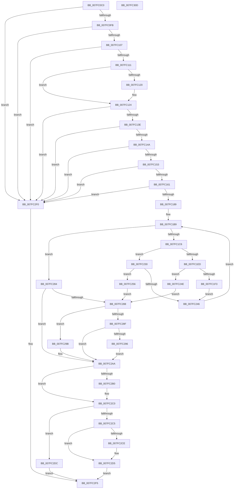

# MmAllocateMemoryRanges

- RVA: `0x007FC0C0`–`0x007FC30E` (길이 `590` bytes)
- VA: `0x00000001407FC0C0`
- 실행 섹션: `PAGE`
- PDB 이름 있음: `예`; PDB Function 태그: `아니요`
- unwind 정보 RVA: `0x0009D0F0`
- 디코드: `164`개 명령, `590/590` bytes 표시
- 미해석 바이트: `0` (있으면 어셈블리에 `.byte`로 보존)

> 이 문서는 커널 이미지의 기계어와 PDB 기호를 분석해 생성했습니다. 4번과 5번은 함수 원형과 자료형을 바이너리 사용 방식에서 추정한 C 해석이며 원본 소스 복구 결과는 아닙니다.

## 1. Dependencies

- 직접 호출 지점: **11**; 고유 호출 대상: **9**
- 직접 호출자로 확인된 함수: **2**
- RIP 상대 이미지 참조: **1**

### Outgoing calls
- `0x007FC177` → [MiPartitionObjectToPartition](../../text/3E/MiPartitionObjectToPartition_function_003EAB0C.md) (function, `0x003EAB0C`)
- `0x007FC1A2` → [MiInitializePageColorBase](../../text/32/MiInitializePageColorBase_function_00320410.md) (function, `0x00320410`)
- `0x007FC1CA` → [MiGetNextPageColor](../../text/44/MiGetNextPageColor_function_00442D64.md) (function, `0x00442D64`)
- `0x007FC1DD` → [MiGetHugeRange](../../text/67/MiGetHugeRange_function_00675954.md) (function, `0x00675954`)
- `0x007FC1F9` → [MmGetNextNode](../../text/43/MmGetNextNode_function_00436620.md) (function, `0x00436620`)
- `0x007FC21B` → [MiInitializePageColorBase](../../text/32/MiInitializePageColorBase_function_00320410.md) (function, `0x00320410`)
- `0x007FC23A` → [MiAddRun](MiAddRun_function_007FBD04.md) (function, `0x007FBD04`)
- `0x007FC27D` → [MiReleaseMemoryRuns](../../text/67/MiReleaseMemoryRuns_function_00676EF0.md) (function, `0x00676EF0`)
- `0x007FC2A5` → [MiReleaseMemoryRuns](../../text/67/MiReleaseMemoryRuns_function_00676EF0.md) (function, `0x00676EF0`)
- `0x007FC2BB` → [PsDereferencePartition](../../text/34/PsDereferencePartition_function_00342E70.md) (function, `0x00342E70`)
- `0x007FC2D0` → [ExFreePoolWithTag](../../poolcode/B8/ExFreePoolWithTag_function_00B82870.md) (function, `0x00B82870`)

### Direct callers
- [IopLiveDumpAllocateIoSpaceRanges](../../text/59/IopLiveDumpAllocateIoSpaceRanges_function_0059A50C.md) at `0x0059A573`
- [MiAllocateUserPhysicalRanges](../AC/MiAllocateUserPhysicalRanges_function_00ACD988.md) at `0x00ACDA61`

### Static image references
- `0x007FC114` → RVA `0x00FC5000` (`ALMOSTRO`; read)

## 2. Other-region calls and transfers

- 다른 실행 섹션으로 향하는 call: **10**
  - `0x007FC177` → [MiPartitionObjectToPartition](../../text/3E/MiPartitionObjectToPartition_function_003EAB0C.md) (`PAGE` → `.text`)
  - `0x007FC1A2` → [MiInitializePageColorBase](../../text/32/MiInitializePageColorBase_function_00320410.md) (`PAGE` → `.text`)
  - `0x007FC1CA` → [MiGetNextPageColor](../../text/44/MiGetNextPageColor_function_00442D64.md) (`PAGE` → `.text`)
  - `0x007FC1DD` → [MiGetHugeRange](../../text/67/MiGetHugeRange_function_00675954.md) (`PAGE` → `.text`)
  - `0x007FC1F9` → [MmGetNextNode](../../text/43/MmGetNextNode_function_00436620.md) (`PAGE` → `.text`)
  - `0x007FC21B` → [MiInitializePageColorBase](../../text/32/MiInitializePageColorBase_function_00320410.md) (`PAGE` → `.text`)
  - `0x007FC27D` → [MiReleaseMemoryRuns](../../text/67/MiReleaseMemoryRuns_function_00676EF0.md) (`PAGE` → `.text`)
  - `0x007FC2A5` → [MiReleaseMemoryRuns](../../text/67/MiReleaseMemoryRuns_function_00676EF0.md) (`PAGE` → `.text`)
  - `0x007FC2BB` → [PsDereferencePartition](../../text/34/PsDereferencePartition_function_00342E70.md) (`PAGE` → `.text`)
  - `0x007FC2D0` → [ExFreePoolWithTag](../../poolcode/B8/ExFreePoolWithTag_function_00B82870.md) (`PAGE` → `POOLCODE`)
- 별도 외부 분기/꼬리 이동을 확인하지 못했습니다.

## 3. Assembly (complete function range)

```asm
007FC0C0  48 89 5C 24 20                  mov qword ptr [rsp + 0x20], rbx
007FC0C5  55                              push rbp
007FC0C6  56                              push rsi
007FC0C7  57                              push rdi
007FC0C8  41 54                           push r12
007FC0CA  41 55                           push r13
007FC0CC  41 56                           push r14
007FC0CE  41 57                           push r15
007FC0D0  48 8B EC                        mov rbp, rsp
007FC0D3  48 83 EC 50                     sub rsp, 0x50
007FC0D7  45 33 FF                        xor r15d, r15d
007FC0DA  33 C0                           xor eax, eax
007FC0DC  83 39 01                        cmp dword ptr [rcx], 1
007FC0DF  0F 57 C0                        xorps xmm0, xmm0
007FC0E2  48 8B F1                        mov rsi, rcx
007FC0E5  4C 89 7D D8                     mov qword ptr [rbp - 0x28], r15
007FC0E9  44 88 7D 40                     mov byte ptr [rbp + 0x40], r15b
007FC0ED  0F 11 45 E8                     movups xmmword ptr [rbp - 0x18], xmm0
007FC0F1  48 89 45 F8                     mov qword ptr [rbp - 8], rax
007FC0F5  0F 85 F5 01 00 00               jne 0x1407fc2f0
007FC0FB  8B 49 04                        mov ecx, dword ptr [rcx + 4]
007FC0FE  83 F9 08                        cmp ecx, 8
007FC101  0F 83 E9 01 00 00               jae 0x1407fc2f0
007FC107  4C 39 7E 10                     cmp qword ptr [rsi + 0x10], r15
007FC10B  0F 84 DF 01 00 00               je 0x1407fc2f0
007FC111  8B 46 20                        mov eax, dword ptr [rsi + 0x20]
007FC114  44 0F B7 2D E4 8E 7C 00         movzx r13d, word ptr [rip + 0x7c8ee4]
007FC11C  85 C0                           test eax, eax
007FC11E  78 04                           js 0x1407fc124
007FC120  45 8D 6F 01                     lea r13d, [r15 + 1]
007FC124  8B D8                           mov ebx, eax
007FC126  0F BA F3 1F                     btr ebx, 0x1f
007FC12A  85 C0                           test eax, eax
007FC12C  0F 49 D8                        cmovns ebx, eax
007FC12F  0F B7 05 CA 8E 7C 00            movzx eax, word ptr [rip + 0x7c8eca]
007FC136  3B D8                           cmp ebx, eax
007FC138  0F 83 B2 01 00 00               jae 0x1407fc2f0
007FC13E  44 0F 20 C0                     mov rax, cr8
007FC142  84 C0                           test al, al
007FC144  0F 85 A6 01 00 00               jne 0x1407fc2f0
007FC14A  F6 C1 01                        test cl, 1
007FC14D  0F 84 9D 01 00 00               je 0x1407fc2f0
007FC153  48 81 7E 18 00 00 00 40         cmp qword ptr [rsi + 0x18], 0x40000000
007FC15B  0F 85 8F 01 00 00               jne 0x1407fc2f0
007FC161  80 E1 02                        and cl, 2
007FC164  4C 8D 45 40                     lea r8, [rbp + 0x40]
007FC168  F6 D9                           neg cl
007FC16A  48 8B 4E 08                     mov rcx, qword ptr [rsi + 8]
007FC16E  45 1B E4                        sbb r12d, r12d
007FC171  33 D2                           xor edx, edx
007FC173  41 83 E4 30                     and r12d, 0x30
007FC177  E8 90 E9 BE FF                  call 0x1403eab0c
007FC17C  48 89 45 50                     mov qword ptr [rbp + 0x50], rax
007FC180  48 85 C0                        test rax, rax
007FC183  0F 84 67 01 00 00               je 0x1407fc2f0
007FC189  8B CB                           mov ecx, ebx
007FC18B  44 8D 43 01                     lea r8d, [rbx + 1]
007FC18F  48 69 F9 80 DF 00 00            imul rdi, rcx, 0xdf80
007FC196  4C 8D 4D D0                     lea r9, [rbp - 0x30]
007FC19A  33 D2                           xor edx, edx
007FC19C  48 03 78 10                     add rdi, qword ptr [rax + 0x10]
007FC1A0  33 C9                           xor ecx, ecx
007FC1A2  E8 69 42 B2 FF                  call 0x140320410
007FC1A7  4C 8D 8F 70 3B 00 00            lea r9, [rdi + 0x3b70]
007FC1AE  44 89 7D 48                     mov dword ptr [rbp + 0x48], r15d
007FC1B2  4C 89 4D D0                     mov qword ptr [rbp - 0x30], r9
007FC1B6  45 8B F7                        mov r14d, r15d
007FC1B9  41 8B C6                        mov eax, r14d
007FC1BC  4C 3B 7E 10                     cmp r15, qword ptr [rsi + 0x10]
007FC1C0  0F 83 BE 00 00 00               jae 0x1407fc284
007FC1C6  48 8D 4D D0                     lea rcx, [rbp - 0x30]
007FC1CA  E8 95 6B C4 FF                  call 0x140442d64
007FC1CF  48 8B 4D 50                     mov rcx, qword ptr [rbp + 0x50]
007FC1D3  45 8D 84 24 00 10 00 00         lea r8d, [r12 + 0x1000]
007FC1DB  8B D0                           mov edx, eax
007FC1DD  E8 72 97 E7 FF                  call 0x140675954
007FC1E2  48 8B F8                        mov rdi, rax
007FC1E5  81 E7 FF FF 3F 00               and edi, 0x3fffff
007FC1EB  75 43                           jne 0x1407fc230
007FC1ED  41 83 C5 FF                     add r13d, -1
007FC1F1  74 5B                           je 0x1407fc24e
007FC1F3  48 8D 55 48                     lea rdx, [rbp + 0x48]
007FC1F7  8B CB                           mov ecx, ebx
007FC1F9  E8 22 A4 C3 FF                  call 0x140436620
007FC1FE  8B C8                           mov ecx, eax
007FC200  4C 8D 4D D0                     lea r9, [rbp - 0x30]
007FC204  48 69 F9 80 DF 00 00            imul rdi, rcx, 0xdf80
007FC20B  48 8B 4D 50                     mov rcx, qword ptr [rbp + 0x50]
007FC20F  44 8D 40 01                     lea r8d, [rax + 1]
007FC213  33 D2                           xor edx, edx
007FC215  48 03 79 10                     add rdi, qword ptr [rcx + 0x10]
007FC219  33 C9                           xor ecx, ecx
007FC21B  E8 F0 41 B2 FF                  call 0x140320410
007FC220  4C 8D 8F 70 3B 00 00            lea r9, [rdi + 0x3b70]
007FC227  49 FF CF                        dec r15
007FC22A  4C 89 4D D0                     mov qword ptr [rbp - 0x30], r9
007FC22E  EB 16                           jmp 0x1407fc246
007FC230  4C 8B C0                        mov r8, rax
007FC233  48 8D 55 E8                     lea rdx, [rbp - 0x18]
007FC237  48 8B CE                        mov rcx, rsi
007FC23A  E8 C5 FA FF FF                  call 0x1407fbd04
007FC23F  44 8B F0                        mov r14d, eax
007FC242  85 C0                           test eax, eax
007FC244  78 10                           js 0x1407fc256
007FC246  49 FF C7                        inc r15
007FC249  E9 6B FF FF FF                  jmp 0x1407fc1b9
007FC24E  41 BE 9A 00 00 C0               mov r14d, 0xc000009a
007FC254  EB 32                           jmp 0x1407fc288
007FC256  48 83 65 D8 00                  and qword ptr [rbp - 0x28], 0
007FC25B  48 8D 45 48                     lea rax, [rbp + 0x48]
007FC25F  48 C1 E7 1E                     shl rdi, 0x1e
007FC263  48 8D 55 D0                     lea rdx, [rbp - 0x30]
007FC267  45 33 C0                        xor r8d, r8d
007FC26A  48 89 7D 48                     mov qword ptr [rbp + 0x48], rdi
007FC26E  48 8B CE                        mov rcx, rsi
007FC271  48 89 45 E0                     mov qword ptr [rbp - 0x20], rax
007FC275  48 C7 45 D0 01 00 00 00         mov qword ptr [rbp - 0x30], 1
007FC27D  E8 6E AC E7 FF                  call 0x140676ef0
007FC282  EB 04                           jmp 0x1407fc288
007FC284  85 C0                           test eax, eax
007FC286  79 22                           jns 0x1407fc2aa
007FC288  8B 46 04                        mov eax, dword ptr [rsi + 4]
007FC28B  A8 04                           test al, 4
007FC28D  74 0C                           je 0x1407fc29b
007FC28F  48 83 7D E8 00                  cmp qword ptr [rbp - 0x18], 0
007FC294  74 14                           je 0x1407fc2aa
007FC296  45 33 F6                        xor r14d, r14d
007FC299  EB 0F                           jmp 0x1407fc2aa
007FC29B  45 33 C0                        xor r8d, r8d
007FC29E  48 8D 55 E8                     lea rdx, [rbp - 0x18]
007FC2A2  48 8B CE                        mov rcx, rsi
007FC2A5  E8 46 AC E7 FF                  call 0x140676ef0
007FC2AA  80 7D 40 00                     cmp byte ptr [rbp + 0x40], 0
007FC2AE  74 10                           je 0x1407fc2c0
007FC2B0  48 8B 45 50                     mov rax, qword ptr [rbp + 0x50]
007FC2B4  48 8B 88 B8 00 00 00            mov rcx, qword ptr [rax + 0xb8]
007FC2BB  E8 B0 6B B4 FF                  call 0x140342e70
007FC2C0  45 85 F6                        test r14d, r14d
007FC2C3  79 17                           jns 0x1407fc2dc
007FC2C5  48 8B 4D F8                     mov rcx, qword ptr [rbp - 8]
007FC2C9  48 85 C9                        test rcx, rcx
007FC2CC  74 07                           je 0x1407fc2d5
007FC2CE  33 D2                           xor edx, edx
007FC2D0  E8 9B 65 38 00                  call 0x140b82870
007FC2D5  B8 9A 00 00 C0                  mov eax, 0xc000009a
007FC2DA  EB 19                           jmp 0x1407fc2f5
007FC2DC  48 8B 45 F8                     mov rax, qword ptr [rbp - 8]
007FC2E0  48 89 46 30                     mov qword ptr [rsi + 0x30], rax
007FC2E4  48 8B 45 E8                     mov rax, qword ptr [rbp - 0x18]
007FC2E8  48 89 46 28                     mov qword ptr [rsi + 0x28], rax
007FC2EC  33 C0                           xor eax, eax
007FC2EE  EB 05                           jmp 0x1407fc2f5
007FC2F0  B8 0D 00 00 C0                  mov eax, 0xc000000d
007FC2F5  48 8B 9C 24 A8 00 00 00         mov rbx, qword ptr [rsp + 0xa8]
007FC2FD  48 83 C4 50                     add rsp, 0x50
007FC301  41 5F                           pop r15
007FC303  41 5E                           pop r14
007FC305  41 5D                           pop r13
007FC307  41 5C                           pop r12
007FC309  5F                              pop rdi
007FC30A  5E                              pop rsi
007FC30B  5D                              pop rbp
007FC30C  C3                              ret
007FC30D  CC                              int3
```

## 4. C-style interpretation (structured pseudocode)

```c
__int64 __fastcall MmAllocateMemoryRanges(__int64 a1, int a2)
{
    __int64 result;
    __int64 v_r12;
    __int64 v_r13;
    __int64 v_r14;
    __int64 v_r15;
    __int64 v_rbx;
    __int64 v_rdi;
    __int64 v_rsp;
    unsigned __int64 v_stack_m40;
    unsigned __int64 v_stack_m50;
    unsigned __int64 v_stack_m58;
    unsigned __int64 v_stack_m60;
    unsigned __int64 v_stack_m68;
    unsigned int v_stack_p10;
    unsigned __int64 v_stack_p18;
    unsigned __int64 v_stack_p20;
    unsigned __int8 v_stack_p8;

    v_stack_p20 = v_rbx;
    v_rsp = (v_rsp) - (80);
    v_r15 = 0;
    result = 0;
    v_stack_m60 = 0;
    v_stack_p8 = 0;
    v_stack_m50 = v_xmm0;
    v_stack_m40 = 0;
    if ((*(unsigned int *)(a1)) != 1) goto loc_007FC2F0;
    if (((unsigned int)((unsigned int)(*(unsigned int *)(a1 + 4)))) >= 8) goto loc_007FC2F0;
    if ((*(unsigned __int64 *)(a1 + 16)) == 0) goto loc_007FC2F0;
    v_r13 = *(unsigned __int16 *)(v_rip + 8163044);
    if (!(sign_flag)) {
        v_r13 = v_r15 + 1;
    }
    v_rbx = (unsigned int)((unsigned int)((unsigned int)(*(unsigned int *)(a1 + 32))));
    if (!sign_flag) { v_rbx = (unsigned int)((unsigned int)(*(unsigned int *)(a1 + 32))); }
    if (((unsigned int)(v_rbx)) >= ((unsigned int)(*(unsigned __int16 *)(v_rip + 8163018)))) goto loc_007FC2F0;
    if ((unsigned __int8)(v_cr8) != 0) goto loc_007FC2F0;
    if ((((unsigned __int8)((unsigned int)(*(unsigned int *)(a1 + 4)))) & (1)) == 0) goto loc_007FC2F0;
    if ((*(unsigned __int64 *)(a1 + 24)) != 0x40000000ULL) goto loc_007FC2F0;
    a1 = (unsigned __int8)(((unsigned int)(*(unsigned int *)(a1 + 4))) & (2));
    a1 = (unsigned __int8)(-(a1));
    a2 = 0;
    v_r12 = (unsigned int)((v_r12) & (48));
    result = MiPartitionObjectToPartition(*(unsigned __int64 *)(a1 + 8), a2, v_stack_p8, a4);
    v_stack_p18 = result;
    if (result == 0) goto loc_007FC2F0;
    v_rdi = (v_rdi) * ((unsigned int)((unsigned int)(v_rbx)));
    a2 = 0;
    v_rdi = (v_rdi) + (*(unsigned __int64 *)(result + 16));
    a1 = 0;
    result = MiInitializePageColorBase(a1, a2, v_rbx + 1, v_stack_m68);
    v_stack_p10 = 0;
    v_stack_m68 = v_rdi + 15216;
loc_007FC1B9:
    if (0 >= (*(unsigned __int64 *)(a1 + 16))) goto loc_007FC284;
    result = MiGetNextPageColor(v_stack_m68, a2, v_rbx + 1, v_rdi + 15216);
    result = MiGetHugeRange(v_stack_p18, (unsigned int)((unsigned int)(result)), v_r12 + 4096, v_rdi + 15216);
    v_rdi = (unsigned int)((result) & (0x3FFFFFULL));
    if (condition_is_not_equal) goto loc_007FC230;
    v_r13 = (unsigned int)((v_r13) + (-1));
    if (condition_is_equal) goto loc_007FC24E;
    result = MmGetNextNode((unsigned int)((unsigned int)(v_rbx)), v_stack_p10, v_r12 + 4096, v_rdi + 15216);
    v_rdi = (v_rdi) * ((unsigned int)((unsigned int)(result)));
    a2 = 0;
    v_rdi = (v_rdi) + (*(unsigned __int64 *)(v_stack_p18 + 16));
    a1 = 0;
    result = MiInitializePageColorBase(a1, a2, result + 1, v_stack_m68);
    v_r15 = (v_r15) - 1;
    v_stack_m68 = v_rdi + 15216;
    goto loc_007FC246;
loc_007FC230:
    result = MiAddRun(0, v_stack_m50, result, v_rdi + 15216);
    if (sign_flag) goto loc_007FC256;
loc_007FC246:
    v_r15 = (v_r15) + 1;
    goto loc_007FC1B9;
loc_007FC24E:
    goto loc_007FC288;
loc_007FC256:
    v_rdi = (v_rdi) << (30);
    a3 = 0;
    v_stack_p10 = v_rdi;
    v_stack_m58 = v_stack_p10;
    v_stack_m68 = 1;
    result = MiReleaseMemoryRuns(0, v_stack_m68, a3, v_rdi + 15216);
    goto loc_007FC288;
loc_007FC284:
    if (!sign_flag) goto loc_007FC2AA;
loc_007FC288:
    if ((((unsigned __int8)((unsigned int)(*(unsigned int *)(a1 + 4)))) & (4)) == 0) goto loc_007FC29B;
    if (v_stack_m50 == 0) goto loc_007FC2AA;
    v_r14 = 0;
    goto loc_007FC2AA;
loc_007FC29B:
    a3 = 0;
    result = MiReleaseMemoryRuns(0, v_stack_m50, a3, v_rdi + 15216);
loc_007FC2AA:
    if (v_stack_p8 != 0) {
        result = v_stack_p18;
        a1 = *(unsigned __int64 *)(result + 184);
        result = PsDereferencePartition(a1, v_stack_m50, a3, v_rdi + 15216);
    }
    if (!sign_flag) goto loc_007FC2DC;
    if (v_stack_m40 != 0) {
        a2 = 0;
        result = ExFreePoolWithTag(v_stack_m40, a2, a3, v_rdi + 15216);
    }
    goto loc_007FC2F5;
loc_007FC2DC:
    *(unsigned __int64 *)(a1 + 48) = v_stack_m40;
    *(unsigned __int64 *)(a1 + 40) = v_stack_m50;
    result = 0;
    goto loc_007FC2F5;
loc_007FC2F0:
loc_007FC2F5:
    v_rsp = (v_rsp) + (80);
    return (unsigned int)(0xC000000DULL);
}
```

## 5. (Beta) C Style

```c
int64_t MmAllocateMemoryRanges(void *Arg1, int32_t Arg2)
{
    uint8_t *arg1 = (uint8_t *)Arg1;

    int64_t result;
    int64_t local_r12;
    int64_t local_r13;
    int64_t local_r14;
    int64_t local_r15;
    int64_t local_rbx;
    int64_t local_rdi;
    int64_t local_rsp;
    uint64_t v_stack_m40;
    uint64_t v_stack_m50;
    uint64_t v_stack_m58;
    uint64_t v_stack_m60;
    uint64_t v_stack_m68;
    uint32_t v_stack_p10;
    uint64_t v_stack_p18;
    uint64_t v_stack_p20;
    uint8_t v_stack_p8;

    v_stack_p20 = local_rbx;
    local_rsp = (local_rsp) - (80);
    local_r15 = 0;
    result = 0;
    v_stack_m60 = 0;
    v_stack_p8 = 0;
    v_stack_m50 = v_xmm0;
    v_stack_m40 = 0;
    if ((*(uint32_t *)(arg1)) != 1) goto loc_007FC2F0;
    if (((uint32_t)((uint32_t)(*(uint32_t *)(arg1 + 0x4)))) >= 8) goto loc_007FC2F0;
    if ((*(uint64_t *)(arg1 + 0x10)) == 0) goto loc_007FC2F0;
    local_r13 = *(uint16_t *)(v_rip + 0x7C8EE4);
    if (!(sign_flag)) {
        local_r13 = local_r15 + 1;
    }
    local_rbx = (uint32_t)((uint32_t)((uint32_t)(*(uint32_t *)(arg1 + 0x20))));
    if (!sign_flag) { local_rbx = (uint32_t)((uint32_t)(*(uint32_t *)(arg1 + 0x20))); }
    if (((uint32_t)(local_rbx)) >= ((uint32_t)(*(uint16_t *)(v_rip + 0x7C8ECA)))) goto loc_007FC2F0;
    if ((uint8_t)(v_cr8) != 0) goto loc_007FC2F0;
    if ((((uint8_t)((uint32_t)(*(uint32_t *)(arg1 + 0x4)))) & (1)) == 0) goto loc_007FC2F0;
    if ((*(uint64_t *)(arg1 + 0x18)) != 0x40000000ULL) goto loc_007FC2F0;
    Arg1 = (uint8_t)(((uint32_t)(*(uint32_t *)(arg1 + 0x4))) & (2));
    Arg1 = (uint8_t)(-(Arg1));
    Arg2 = 0;
    local_r12 = (uint32_t)((local_r12) & (48));
    result = MiPartitionObjectToPartition(*(uint64_t *)(arg1 + 0x8), Arg2, v_stack_p8, a4);
    v_stack_p18 = result;
    if (result == 0) goto loc_007FC2F0;
    local_rdi = (local_rdi) * ((uint32_t)((uint32_t)(local_rbx)));
    Arg2 = 0;
    local_rdi = (local_rdi) + (*(uint64_t *)(result + 0x10));
    Arg1 = 0;
    result = MiInitializePageColorBase(Arg1, Arg2, local_rbx + 1, v_stack_m68);
    v_stack_p10 = 0;
    v_stack_m68 = local_rdi + 15216;
loc_007FC1B9:
    if (0 >= (*(uint64_t *)(arg1 + 0x10))) goto loc_007FC284;
    result = MiGetNextPageColor(v_stack_m68, Arg2, local_rbx + 1, local_rdi + 15216);
    result = MiGetHugeRange(v_stack_p18, (uint32_t)((uint32_t)(result)), local_r12 + 4096, local_rdi + 15216);
    local_rdi = (uint32_t)((result) & (0x3FFFFFULL));
    if (condition_is_not_equal) goto loc_007FC230;
    local_r13 = (uint32_t)((local_r13) + (-1));
    if (condition_is_equal) goto loc_007FC24E;
    result = MmGetNextNode((uint32_t)((uint32_t)(local_rbx)), v_stack_p10, local_r12 + 4096, local_rdi + 15216);
    local_rdi = (local_rdi) * ((uint32_t)((uint32_t)(result)));
    Arg2 = 0;
    local_rdi = (local_rdi) + (*(uint64_t *)(v_stack_p18 + 0x10));
    Arg1 = 0;
    result = MiInitializePageColorBase(Arg1, Arg2, result + 1, v_stack_m68);
    local_r15 = (local_r15) - 1;
    v_stack_m68 = local_rdi + 15216;
    goto loc_007FC246;
loc_007FC230:
    result = MiAddRun(0, v_stack_m50, result, local_rdi + 15216);
    if (sign_flag) goto loc_007FC256;
loc_007FC246:
    local_r15 = (local_r15) + 1;
    goto loc_007FC1B9;
loc_007FC24E:
    goto loc_007FC288;
loc_007FC256:
    local_rdi = (local_rdi) << (30);
    a3 = 0;
    v_stack_p10 = local_rdi;
    v_stack_m58 = v_stack_p10;
    v_stack_m68 = 1;
    result = MiReleaseMemoryRuns(0, v_stack_m68, a3, local_rdi + 15216);
    goto loc_007FC288;
loc_007FC284:
    if (!sign_flag) goto loc_007FC2AA;
loc_007FC288:
    if ((((uint8_t)((uint32_t)(*(uint32_t *)(arg1 + 0x4)))) & (4)) == 0) goto loc_007FC29B;
    if (v_stack_m50 == 0) goto loc_007FC2AA;
    local_r14 = 0;
    goto loc_007FC2AA;
loc_007FC29B:
    a3 = 0;
    result = MiReleaseMemoryRuns(0, v_stack_m50, a3, local_rdi + 15216);
loc_007FC2AA:
    if (v_stack_p8 != 0) {
        result = v_stack_p18;
        Arg1 = *(uint64_t *)(result + 0xB8);
        result = PsDereferencePartition(Arg1, v_stack_m50, a3, local_rdi + 15216);
    }
    if (!sign_flag) goto loc_007FC2DC;
    if (v_stack_m40 != 0) {
        Arg2 = 0;
        result = ExFreePoolWithTag(v_stack_m40, Arg2, a3, local_rdi + 15216);
    }
    goto loc_007FC2F5;
loc_007FC2DC:
    *(uint64_t *)(arg1 + 0x30) = v_stack_m40;
    *(uint64_t *)(arg1 + 0x28) = v_stack_m50;
    result = 0;
    goto loc_007FC2F5;
loc_007FC2F0:
loc_007FC2F5:
    local_rsp = (local_rsp) + (80);
    return (uint32_t)(0xC000000DULL);
}
```

### 관측된 메모리 오프셋

구조체 형식이 확인되지 않은 접근은 인자 기준의 오프셋으로만 기록했습니다.

| 기준 인자 | 오프셋 표현 | 폭 (bit) | 접근 |
|---|---:|---:|---|
| `Arg1` | `+ 0x0` | `32` | `R` |
| `Arg1` | `+ 0x4` | `32` | `R` |
| `Arg1` | `+ 0x8` | `64` | `R` |
| `Arg1` | `+ 0x10` | `64` | `R` |
| `Arg1` | `+ 0x18` | `64` | `R` |
| `Arg1` | `+ 0x20` | `32` | `R` |
| `Arg1` | `+ 0x28` | `64` | `W` |
| `Arg1` | `+ 0x30` | `64` | `W` |

## 6. Execution-region graph

[열기: 2D/3D 그래프와 함수 탐색 컨트롤 패널](../../../control-panel.html?section=page&rva=0x007FC0C0&view=graph)

- 2D 그래프는 위에서 아래로 흐르고, 3D 그래프는 빈 공간을 드래그해 회전합니다. Shift+드래그는 이동, 휠은 확대·축소, 함수 노드 선택은 대상 보고서 이동입니다.

### Static fallback


