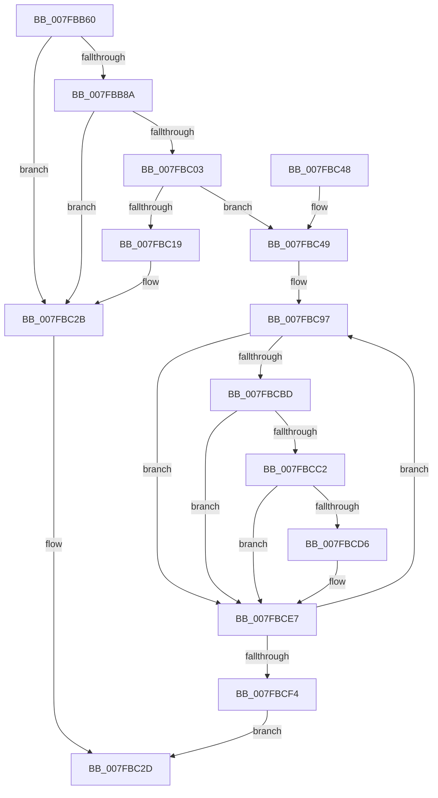

# MmAllocateNonCachedMemory

- RVA: `0x007FBB60`–`0x007FBCFC` (길이 `412` bytes)
- VA: `0x00000001407FBB60`
- 실행 섹션: `PAGE`
- PDB 이름 있음: `예`; PDB Function 태그: `아니요`
- unwind 정보 RVA: `0x000A5500`
- 디코드: `98`개 명령, `412/412` bytes 표시
- 미해석 바이트: `0` (있으면 어셈블리에 `.byte`로 보존)

> 이 문서는 커널 이미지의 기계어와 PDB 기호를 분석해 생성했습니다. 4번과 5번은 함수 원형과 자료형을 바이너리 사용 방식에서 추정한 C 해석이며 원본 소스 복구 결과는 아닙니다.

## 1. Dependencies

- 직접 호출 지점: **8**; 고유 호출 대상: **8**
- 직접 호출자로 확인된 함수: **1**
- RIP 상대 이미지 참조: **3**

### Outgoing calls
- `0x007FBBAD` → [KeGetIdealNodeNumberThread](../../text/49/KeGetIdealNodeNumberThread_function_00492A1C.md) (function, `0x00492A1C`)
- `0x007FBBF6` → [MiAllocatePagesForMdl](../../text/3E/MiAllocatePagesForMdl_function_003EABEC.md) (function, `0x003EABEC`)
- `0x007FBC0C` → [MiReservePtes](../../text/31/MiReservePtes_function_00318D20.md) (function, `0x00318D20`)
- `0x007FBC1C` → [MmFreePagesFromMdl](../../text/3F/MmFreePagesFromMdl_function_003F82E0.md) (function, `0x003F82E0`)
- `0x007FBC26` → [ExFreePoolWithTag](../../poolcode/B8/ExFreePoolWithTag_function_00B82870.md) (function, `0x00B82870`)
- `0x007FBC8C` → [MiMakeValidPte](../../text/2C/MiMakeValidPte_function_002C5590.md) (function, `0x002C5590`)
- `0x007FBCCC` → [MiGetPteAddress](../../text/43/MiGetPteAddress_function_0043E130.md) (function, `0x0043E130`)
- `0x007FBCE2` → [MiCheckLinearProtectedPteAccessedBit](../../text/29/MiCheckLinearProtectedPteAccessedBit_function_00292D80.md) (function, `0x00292D80`)

### Direct callers
- [DifMmAllocateNonCachedMemoryWrapper](../../text/63/DifMmAllocateNonCachedMemoryWrapper_function_00634720.md) at `0x006347ED`

### Static image references
- `0x007FBBD3` → RVA `0x00E38D00` (`.data`; read)
- `0x007FBC05` → RVA `0x00E35E80` (`.data`; read)
- `0x007FBCB2` → RVA `0x00FC6A88` (`ALMOSTRO`; read)

## 2. Other-region calls and transfers

- 다른 실행 섹션으로 향하는 call: **8**
  - `0x007FBBAD` → [KeGetIdealNodeNumberThread](../../text/49/KeGetIdealNodeNumberThread_function_00492A1C.md) (`PAGE` → `.text`)
  - `0x007FBBF6` → [MiAllocatePagesForMdl](../../text/3E/MiAllocatePagesForMdl_function_003EABEC.md) (`PAGE` → `.text`)
  - `0x007FBC0C` → [MiReservePtes](../../text/31/MiReservePtes_function_00318D20.md) (`PAGE` → `.text`)
  - `0x007FBC1C` → [MmFreePagesFromMdl](../../text/3F/MmFreePagesFromMdl_function_003F82E0.md) (`PAGE` → `.text`)
  - `0x007FBC26` → [ExFreePoolWithTag](../../poolcode/B8/ExFreePoolWithTag_function_00B82870.md) (`PAGE` → `POOLCODE`)
  - `0x007FBC8C` → [MiMakeValidPte](../../text/2C/MiMakeValidPte_function_002C5590.md) (`PAGE` → `.text`)
  - `0x007FBCCC` → [MiGetPteAddress](../../text/43/MiGetPteAddress_function_0043E130.md) (`PAGE` → `.text`)
  - `0x007FBCE2` → [MiCheckLinearProtectedPteAccessedBit](../../text/29/MiCheckLinearProtectedPteAccessedBit_function_00292D80.md) (`PAGE` → `.text`)
- 별도 외부 분기/꼬리 이동을 확인하지 못했습니다.

## 3. Assembly (complete function range)

```asm
007FBB60  48 8B C4                        mov rax, rsp
007FBB63  48 89 58 08                     mov qword ptr [rax + 8], rbx
007FBB67  48 89 68 10                     mov qword ptr [rax + 0x10], rbp
007FBB6B  48 89 70 18                     mov qword ptr [rax + 0x18], rsi
007FBB6F  48 89 78 20                     mov qword ptr [rax + 0x20], rdi
007FBB73  41 56                           push r14
007FBB75  48 83 EC 50                     sub rsp, 0x50
007FBB79  B8 FF FF FF FF                  mov eax, 0xffffffff
007FBB7E  4C 8B C1                        mov r8, rcx
007FBB81  48 3B C8                        cmp rcx, rax
007FBB84  0F 87 A1 00 00 00               ja 0x1407fbc2b
007FBB8A  48 F7 C1 FF 0F 00 00            test rcx, 0xfff
007FBB91  48 8B C1                        mov rax, rcx
007FBB94  65 48 8B 0C 25 88 01 00 00      mov rcx, qword ptr gs:[0x188]
007FBB9D  BE 00 00 00 00                  mov esi, 0
007FBBA2  40 0F 95 C6                     setne sil
007FBBA6  48 C1 E8 0C                     shr rax, 0xc
007FBBAA  48 03 F0                        add rsi, rax
007FBBAD  E8 6A 6E C9 FF                  call 0x140492a1c
007FBBB2  48 83 64 24 48 00               and qword ptr [rsp + 0x48], 0
007FBBB8  45 33 C9                        xor r9d, r9d
007FBBBB  0F B7 D0                        movzx edx, ax
007FBBBE  65 48 8B 04 25 88 01 00 00      mov rax, qword ptr gs:[0x188]
007FBBC7  48 8B 88 B8 00 00 00            mov rcx, qword ptr [rax + 0xb8]
007FBBCE  48 89 4C 24 40                  mov qword ptr [rsp + 0x40], rcx
007FBBD3  48 8D 0D 26 D1 63 00            lea rcx, [rip + 0x63d126]
007FBBDA  C7 44 24 38 04 00 00 00         mov dword ptr [rsp + 0x38], 4
007FBBE2  89 54 24 30                     mov dword ptr [rsp + 0x30], edx
007FBBE6  33 D2                           xor edx, edx
007FBBE8  83 64 24 28 00                  and dword ptr [rsp + 0x28], 0
007FBBED  4C 89 44 24 20                  mov qword ptr [rsp + 0x20], r8
007FBBF2  49 83 C8 FF                     or r8, 0xffffffffffffffff
007FBBF6  E8 F1 EF BE FF                  call 0x1403eabec
007FBBFB  48 8B D8                        mov rbx, rax
007FBBFE  48 85 C0                        test rax, rax
007FBC01  74 28                           je 0x1407fbc2b
007FBC03  8B D6                           mov edx, esi
007FBC05  48 8D 0D 74 A2 63 00            lea rcx, [rip + 0x63a274]
007FBC0C  E8 0F D1 B1 FF                  call 0x140318d20
007FBC11  48 8B F8                        mov rdi, rax
007FBC14  48 85 C0                        test rax, rax
007FBC17  75 30                           jne 0x1407fbc49
007FBC19  48 8B CB                        mov rcx, rbx
007FBC1C  E8 BF C6 BF FF                  call 0x1403f82e0
007FBC21  33 D2                           xor edx, edx
007FBC23  48 8B CB                        mov rcx, rbx
007FBC26  E8 45 6C 38 00                  call 0x140b82870
007FBC2B  33 C0                           xor eax, eax
007FBC2D  48 8B 5C 24 60                  mov rbx, qword ptr [rsp + 0x60]
007FBC32  48 8B 6C 24 68                  mov rbp, qword ptr [rsp + 0x68]
007FBC37  48 8B 74 24 70                  mov rsi, qword ptr [rsp + 0x70]
007FBC3C  48 8B 7C 24 78                  mov rdi, qword ptr [rsp + 0x78]
007FBC41  48 83 C4 50                     add rsp, 0x50
007FBC45  41 5E                           pop r14
007FBC47  C3                              ret
007FBC48  CC                              int3
007FBC49  4C 8D 73 30                     lea r14, [rbx + 0x30]
007FBC4D  49 8B 06                        mov rax, qword ptr [r14]
007FBC50  48 8D 0C 40                     lea rcx, [rax + rax*2]
007FBC54  48 03 C9                        add rcx, rcx
007FBC57  48 B8 10 00 00 00 00 DE FF FF   movabs rax, 0xffffde0000000010
007FBC61  48 8B EF                        mov rbp, rdi
007FBC64  48 89 1C C8                     mov qword ptr [rax + rcx*8], rbx
007FBC68  48 C1 E5 19                     shl rbp, 0x19
007FBC6C  48 B8 00 00 00 00 80 F6 FF FF   movabs rax, 0xfffff68000000000
007FBC76  48 C1 E0 19                     shl rax, 0x19
007FBC7A  33 D2                           xor edx, edx
007FBC7C  48 2B E8                        sub rbp, rax
007FBC7F  41 B8 0C 00 00 A0               mov r8d, 0xa000000c
007FBC85  48 8B CF                        mov rcx, rdi
007FBC88  48 C1 FD 10                     sar rbp, 0x10
007FBC8C  E8 FF 98 AC FF                  call 0x1402c5590
007FBC91  48 8B D8                        mov rbx, rax
007FBC94  4C 2B F7                        sub r14, rdi
007FBC97  49 8B 0C 3E                     mov rcx, qword ptr [r14 + rdi]
007FBC9B  48 BA FF 0F 00 00 00 00 F0 FF   movabs rdx, 0xfff0000000000fff
007FBCA5  48 C1 E1 0C                     shl rcx, 0xc
007FBCA9  48 33 D9                        xor rbx, rcx
007FBCAC  48 23 DA                        and rbx, rdx
007FBCAF  48 33 D9                        xor rbx, rcx
007FBCB2  48 0F BA 25 CD AD 7C 00 24      bt qword ptr [rip + 0x7cadcd], 0x24
007FBCBB  73 2A                           jae 0x1407fbce7
007FBCBD  F6 C3 20                        test bl, 0x20
007FBCC0  75 25                           jne 0x1407fbce7
007FBCC2  48 B9 00 00 00 00 00 80 FF FF   movabs rcx, 0xffff800000000000
007FBCCC  E8 5F 24 C4 FF                  call 0x14043e130
007FBCD1  48 3B F8                        cmp rdi, rax
007FBCD4  72 11                           jb 0x1407fbce7
007FBCD6  41 B8 80 00 00 00               mov r8d, 0x80
007FBCDC  48 8B D3                        mov rdx, rbx
007FBCDF  48 8B CF                        mov rcx, rdi
007FBCE2  E8 99 70 A9 FF                  call 0x140292d80
007FBCE7  48 89 1F                        mov qword ptr [rdi], rbx
007FBCEA  48 83 C7 08                     add rdi, 8
007FBCEE  48 83 EE 01                     sub rsi, 1
007FBCF2  75 A3                           jne 0x1407fbc97
007FBCF4  48 8B C5                        mov rax, rbp
007FBCF7  E9 31 FF FF FF                  jmp 0x1407fbc2d
```

## 4. C-style interpretation (structured pseudocode)

```c
__int64 __fastcall MmAllocateNonCachedMemory(__int64 a1, __int64 a2, __int64 a3, int a4)
{
    __int64 result;
    __int64 v_r14;
    __int64 v_rbp;
    __int64 v_rbx;
    __int64 v_rdi;
    __int64 v_rsi;
    __int64 v_rsp;
    unsigned __int64 v_stack_m10;
    unsigned __int64 v_stack_m18;
    unsigned int v_stack_m20;
    unsigned int v_stack_m28;
    unsigned int v_stack_m30;
    unsigned __int64 v_stack_m38;
    unsigned __int64 v_stack_p10;
    unsigned __int64 v_stack_p18;
    unsigned __int64 v_stack_p20;
    unsigned __int64 v_stack_p8;

    *(unsigned __int64 *)(v_rsp + 8) = v_rbx;
    *(unsigned __int64 *)(v_rsp + 16) = v_rbp;
    *(unsigned __int64 *)(v_rsp + 24) = v_rsi;
    *(unsigned __int64 *)(v_rsp + 32) = v_rdi;
    v_rsp = (v_rsp) - (80);
    if (a1 > ((unsigned int)(0xFFFFFFFFULL))) goto loc_007FBC2B;
    v_rsi = (((a1) & (0xFFFULL)) != 0) ? 1 : 0;
    result = (a1) >> (12);
    v_rsi = (v_rsi) + (result);
    result = KeGetIdealNodeNumberThread(*(unsigned __int64 *)(gs_base + (0 + 392)), a2, a1, a4);
    a4 = 0;
    v_stack_m18 = *(unsigned __int64 *)(*(unsigned __int64 *)(gs_base + (0 + 392)) + 184);
    v_stack_m20 = 4;
    v_stack_m28 = (unsigned int)((unsigned __int16)(result));
    a2 = 0;
    v_stack_m38 = a1;
    a3 = (a1) | (-1);
    result = MiAllocatePagesForMdl(v_rip + 6541606, a2, a3, a4);
    if (result == 0) goto loc_007FBC2B;
    result = MiReservePtes(v_rip + 6529652, (unsigned int)((unsigned int)(v_rsi)), a3, a4);
    if (result != 0) goto loc_007FBC49;
    result = MmFreePagesFromMdl(result, (unsigned int)((unsigned int)(v_rsi)), a3, a4);
    a2 = 0;
    result = ExFreePoolWithTag(result, a2, a3, a4);
loc_007FBC2B:
    result = 0;
loc_007FBC2D:
    v_rsp = (v_rsp) + (80);
    return result;
loc_007FBC49:
    a1 = (*(unsigned __int64 *)(v_stack_p8 + 48) + *(unsigned __int64 *)(v_stack_p8 + 48) * 2) + (*(unsigned __int64 *)(v_stack_p8 + 48) + *(unsigned __int64 *)(v_stack_p8 + 48) * 2);
    *(unsigned __int64 *)(*(unsigned __int64 *)(v_stack_p8 + 48) + a1 * 8) = v_stack_p8;
    v_rbp = (v_stack_p20) << (25);
    result = (*(unsigned __int64 *)(v_stack_p8 + 48)) << (25);
    a2 = 0;
    v_rbp = (v_rbp) - (result);
    v_rbp = (v_rbp) >> (16);
    result = MiMakeValidPte(v_stack_p20, a2, (unsigned int)(0xA000000CULL), a4);
    v_r14 = (v_stack_p8 + 48) - (v_stack_p20);
loc_007FBC97:
    a1 = (*(unsigned __int64 *)(v_r14 + v_stack_p20 * 1)) << (12);
    v_rbx = (result) ^ (a1);
    v_rbx = (v_rbx) & (0);
    v_rbx = (v_rbx) ^ (a1);
    if (condition_is_above_or_equal) goto loc_007FBCE7;
    if ((((unsigned __int8)(v_rbx)) & (32)) != 0) goto loc_007FBCE7;
    result = MiGetPteAddress(a1, a2, (unsigned int)(0xA000000CULL), a4);
    if (v_stack_p20 >= result) {
        a3 = 128;
        a2 = v_rbx;
        a1 = v_stack_p20;
        result = MiCheckLinearProtectedPteAccessedBit(a1, a2, a3, a4);
    }
    *(unsigned __int64 *)(v_stack_p20) = v_rbx;
    v_rdi = (v_stack_p20) + (8);
    v_rsi = (v_stack_p18) - (1);
    if (condition_is_not_equal) goto loc_007FBC97;
    goto loc_007FBC2D;
}
```

## 5. (Beta) C Style

```c
int64_t MmAllocateNonCachedMemory(int64_t Arg1, int64_t Arg2, int64_t Arg3, int32_t Arg4)
{
    int64_t result;
    int64_t local_r14;
    int64_t local_rbp;
    int64_t local_rbx;
    int64_t local_rdi;
    int64_t local_rsi;
    int64_t local_rsp;
    uint64_t v_stack_m10;
    uint64_t v_stack_m18;
    uint32_t v_stack_m20;
    uint32_t v_stack_m28;
    uint32_t v_stack_m30;
    uint64_t v_stack_m38;
    uint64_t v_stack_p10;
    uint64_t v_stack_p18;
    uint64_t v_stack_p20;
    uint64_t v_stack_p8;

    *(uint64_t *)(local_rsp + 0x8) = local_rbx;
    *(uint64_t *)(local_rsp + 0x10) = local_rbp;
    *(uint64_t *)(local_rsp + 0x18) = local_rsi;
    *(uint64_t *)(local_rsp + 0x20) = local_rdi;
    local_rsp = (local_rsp) - (80);
    if (Arg1 > ((uint32_t)(0xFFFFFFFFULL))) goto loc_007FBC2B;
    local_rsi = (((Arg1) & (0xFFFULL)) != 0) ? 1 : 0;
    result = (Arg1) >> (12);
    local_rsi = (local_rsi) + (result);
    result = KeGetIdealNodeNumberThread(*(uint64_t *)(gs_base + (0 + 0x188)), Arg2, Arg1, Arg4);
    Arg4 = 0;
    v_stack_m18 = *(uint64_t *)(*(uint64_t *)(gs_base + (0 + 0x188)) + 0xB8);
    v_stack_m20 = 4;
    v_stack_m28 = (uint32_t)((uint16_t)(result));
    Arg2 = 0;
    v_stack_m38 = Arg1;
    Arg3 = (Arg1) | (-1);
    result = MiAllocatePagesForMdl(v_rip + 6541606, Arg2, Arg3, Arg4);
    if (result == 0) goto loc_007FBC2B;
    result = MiReservePtes(v_rip + 6529652, (uint32_t)((uint32_t)(local_rsi)), Arg3, Arg4);
    if (result != 0) goto loc_007FBC49;
    result = MmFreePagesFromMdl(result, (uint32_t)((uint32_t)(local_rsi)), Arg3, Arg4);
    Arg2 = 0;
    result = ExFreePoolWithTag(result, Arg2, Arg3, Arg4);
loc_007FBC2B:
    result = 0;
loc_007FBC2D:
    local_rsp = (local_rsp) + (80);
    return result;
loc_007FBC49:
    Arg1 = (*(uint64_t *)(v_stack_p8 + 0x30) + *(uint64_t *)(v_stack_p8 + 0x30) * 2) + (*(uint64_t *)(v_stack_p8 + 0x30) + *(uint64_t *)(v_stack_p8 + 0x30) * 2);
    *(uint64_t *)(*(uint64_t *)(v_stack_p8 + 0x30) + Arg1 * 8) = v_stack_p8;
    local_rbp = (v_stack_p20) << (25);
    result = (*(uint64_t *)(v_stack_p8 + 0x30)) << (25);
    Arg2 = 0;
    local_rbp = (local_rbp) - (result);
    local_rbp = (local_rbp) >> (16);
    result = MiMakeValidPte(v_stack_p20, Arg2, (uint32_t)(0xA000000CULL), Arg4);
    local_r14 = (v_stack_p8 + 48) - (v_stack_p20);
loc_007FBC97:
    Arg1 = (*(uint64_t *)(local_r14 + v_stack_p20 * 1)) << (12);
    local_rbx = (result) ^ (Arg1);
    local_rbx = (local_rbx) & (0);
    local_rbx = (local_rbx) ^ (Arg1);
    if (condition_is_above_or_equal) goto loc_007FBCE7;
    if ((((uint8_t)(local_rbx)) & (32)) != 0) goto loc_007FBCE7;
    result = MiGetPteAddress(Arg1, Arg2, (uint32_t)(0xA000000CULL), Arg4);
    if (v_stack_p20 >= result) {
        Arg3 = 128;
        Arg2 = local_rbx;
        Arg1 = v_stack_p20;
        result = MiCheckLinearProtectedPteAccessedBit(Arg1, Arg2, Arg3, Arg4);
    }
    *(uint64_t *)(v_stack_p20) = local_rbx;
    local_rdi = (v_stack_p20) + (8);
    local_rsi = (v_stack_p18) - (1);
    if (condition_is_not_equal) goto loc_007FBC97;
    goto loc_007FBC2D;
}
```

## 6. Execution-region graph

[열기: 2D/3D 그래프와 함수 탐색 컨트롤 패널](../../../control-panel.html?section=page&rva=0x007FBB60&view=graph)

- 2D 그래프는 위에서 아래로 흐르고, 3D 그래프는 빈 공간을 드래그해 회전합니다. Shift+드래그는 이동, 휠은 확대·축소, 함수 노드 선택은 대상 보고서 이동입니다.

### Static fallback


