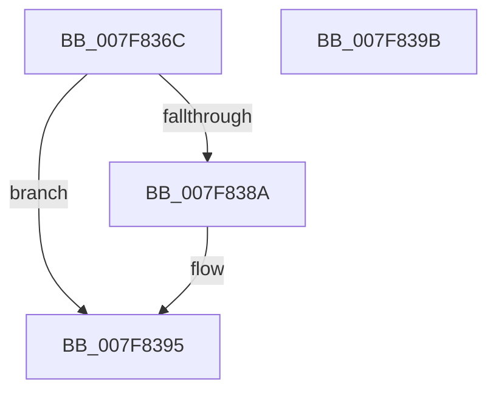

# MmCallDllInitialize

- RVA: `0x007F836C`–`0x007F839C` (길이 `48` bytes)
- VA: `0x00000001407F836C`
- 실행 섹션: `PAGE`
- PDB 이름 있음: `예`; PDB Function 태그: `아니요`
- unwind 정보 RVA: `0x0005CF00`
- 디코드: `15`개 명령, `48/48` bytes 표시
- 미해석 바이트: `0` (있으면 어셈블리에 `.byte`로 보존)

> 이 문서는 커널 이미지의 기계어와 PDB 기호를 분석해 생성했습니다. 4번과 5번은 함수 원형과 자료형을 바이너리 사용 방식에서 추정한 C 해석이며 원본 소스 복구 결과는 아닙니다.

## 1. Dependencies

- 직접 호출 지점: **2**; 고유 호출 대상: **2**
- 직접 호출자로 확인된 함수: **3**
- RIP 상대 이미지 참조: **1**

### Outgoing calls
- `0x007F8380` → [RtlFindExportedRoutineByName](../90/RtlFindExportedRoutineByName_function_0090F0A0.md) (function, `0x0090F0A0`)
- `0x007F8390` → [MiIssueDllInitializeCall](MiIssueDllInitializeCall_function_007F8078.md) (function, `0x007F8078`)

### Direct callers
- [MmLoadSystemImageEx](../99/MmLoadSystemImageEx_function_00999B8C.md) at `0x0099A176`
- [PipInitializeCoreDriversAndElam](../../init/C7/PipInitializeCoreDriversAndElam_function_00C73F84.md) at `0x00C73FE9`
- [PipInitializeDriverDependentDLLs](../../init/C7/PipInitializeDriverDependentDLLs_function_00C74398.md) at `0x00C744FC`

### Static image references
- `0x007F8375` → RVA `0x00B09D40` (` ?? ::NNGAKEGL::`string'`; read)

## 2. Other-region calls and transfers

- 다른 실행 섹션으로 향하는 call: **0**
- 별도 외부 분기/꼬리 이동을 확인하지 못했습니다.

## 3. Assembly (complete function range)

```asm
007F836C  40 53                           push rbx
007F836E  48 83 EC 20                     sub rsp, 0x20
007F8372  48 8B D9                        mov rbx, rcx
007F8375  48 8D 15 C4 19 31 00            lea rdx, [rip + 0x3119c4]
007F837C  48 8B 49 30                     mov rcx, qword ptr [rcx + 0x30]
007F8380  E8 1B 6D 11 00                  call 0x14090f0a0
007F8385  48 85 C0                        test rax, rax
007F8388  74 0B                           je 0x1407f8395
007F838A  48 8B D0                        mov rdx, rax
007F838D  48 8B CB                        mov rcx, rbx
007F8390  E8 E3 FC FF FF                  call 0x1407f8078
007F8395  48 83 C4 20                     add rsp, 0x20
007F8399  5B                              pop rbx
007F839A  C3                              ret
007F839B  CC                              int3
```

## 4. C-style interpretation (structured pseudocode)

```c
__int64 __fastcall MmCallDllInitialize(__int64 a1)
{
    __int64 result;
    __int64 v_rsp;

    v_rsp = (v_rsp) - (32);
    result = RtlFindExportedRoutineByName(*(unsigned __int64 *)(a1 + 48), v_rip + 3217860, a3, a4);
    if (result != 0) {
        a2 = result;
        a1 = a1;
        result = MiIssueDllInitializeCall(a1, a2, a3, a4);
    }
    v_rsp = (v_rsp) + (32);
    return result;
}
```

## 5. (Beta) C Style

```c
int64_t MmCallDllInitialize(void *Arg1)
{
    uint8_t *arg1 = (uint8_t *)Arg1;

    int64_t result;
    int64_t local_rsp;

    local_rsp = (local_rsp) - (32);
    result = RtlFindExportedRoutineByName(*(uint64_t *)(arg1 + 0x30), v_rip + 3217860, a3, a4);
    if (result != 0) {
        a2 = result;
        Arg1 = Arg1;
        result = MiIssueDllInitializeCall(Arg1, a2, a3, a4);
    }
    local_rsp = (local_rsp) + (32);
    return result;
}
```

### 관측된 메모리 오프셋

구조체 형식이 확인되지 않은 접근은 인자 기준의 오프셋으로만 기록했습니다.

| 기준 인자 | 오프셋 표현 | 폭 (bit) | 접근 |
|---|---:|---:|---|
| `Arg1` | `+ 0x30` | `64` | `R` |

## 6. Execution-region graph

[열기: 2D/3D 그래프와 함수 탐색 컨트롤 패널](../../../control-panel.html?section=page&rva=0x007F836C&view=graph)

- 2D 그래프는 위에서 아래로 흐르고, 3D 그래프는 빈 공간을 드래그해 회전합니다. Shift+드래그는 이동, 휠은 확대·축소, 함수 노드 선택은 대상 보고서 이동입니다.

### Static fallback


