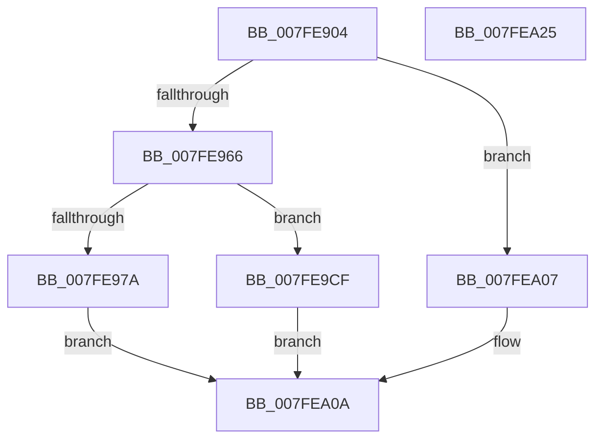

# MmCommitDecommitSecuredMemory

- RVA: `0x007FE904`–`0x007FEA26` (길이 `290` bytes)
- VA: `0x00000001407FE904`
- 실행 섹션: `PAGE`
- PDB 이름 있음: `예`; PDB Function 태그: `아니요`
- unwind 정보 RVA: `0x000D8028`
- 디코드: `79`개 명령, `290/290` bytes 표시
- 미해석 바이트: `0` (있으면 어셈블리에 `.byte`로 보존)

> 이 문서는 커널 이미지의 기계어와 PDB 기호를 분석해 생성했습니다. 4번과 5번은 함수 원형과 자료형을 바이너리 사용 방식에서 추정한 C 해석이며 원본 소스 복구 결과는 아닙니다.

## 1. Dependencies

- 직접 호출 지점: **4**; 고유 호출 대상: **4**
- 직접 호출자로 확인된 함수: **1**
- RIP 상대 이미지 참조: **1**

### Outgoing calls
- `0x007FE953` → [MiObtainReferencedSecureVad](../../text/29/MiObtainReferencedSecureVad_function_00295688.md) (function, `0x00295688`)
- `0x007FE986` → [memset](../../text/6C/memset_function_006C6C40.md) (function, `0x006C6C40`)
- `0x007FE9C8` → [MiAllocateVirtualMemory](../88/MiAllocateVirtualMemory_function_00883B40.md) (function, `0x00883B40`)
- `0x007FEA00` → [MiFreeVirtualMemory](../88/MiFreeVirtualMemory_function_00880268.md) (function, `0x00880268`)

### Direct callers
- [VmpUpdateCommitStateMemoryRange](../../text/64/VmpUpdateCommitStateMemoryRange_function_0064D5D0.md) at `0x0064D733`

### Static image references
- `0x007FE946` → RVA `0x00E2DB80` (`.data`; read)

## 2. Other-region calls and transfers

- 다른 실행 섹션으로 향하는 call: **2**
  - `0x007FE953` → [MiObtainReferencedSecureVad](../../text/29/MiObtainReferencedSecureVad_function_00295688.md) (`PAGE` → `.text`)
  - `0x007FE986` → [memset](../../text/6C/memset_function_006C6C40.md) (`PAGE` → `.text`)
- 별도 외부 분기/꼬리 이동을 확인하지 못했습니다.

## 3. Assembly (complete function range)

```asm
007FE904  48 89 5C 24 10                  mov qword ptr [rsp + 0x10], rbx
007FE909  48 89 4C 24 08                  mov qword ptr [rsp + 8], rcx
007FE90E  55                              push rbp
007FE90F  56                              push rsi
007FE910  57                              push rdi
007FE911  41 54                           push r12
007FE913  41 55                           push r13
007FE915  41 56                           push r14
007FE917  41 57                           push r15
007FE919  48 8D 6C 24 D9                  lea rbp, [rsp - 0x27]
007FE91E  48 81 EC E0 00 00 00            sub rsp, 0xe0
007FE925  65 48 8B 04 25 88 01 00 00      mov rax, qword ptr gs:[0x188]
007FE92E  48 8B FA                        mov rdi, rdx
007FE931  83 65 7F 00                     and dword ptr [rbp + 0x7f], 0
007FE935  48 8D 55 7F                     lea rdx, [rbp + 0x7f]
007FE939  45 8B E8                        mov r13d, r8d
007FE93C  4C 8B B8 B8 00 00 00            mov r15, qword ptr [rax + 0xb8]
007FE943  49 8B DF                        mov rbx, r15
007FE946  48 33 1D 33 F2 62 00            xor rbx, qword ptr [rip + 0x62f233]
007FE94D  49 33 D9                        xor rbx, r9
007FE950  48 8B CB                        mov rcx, rbx
007FE953  E8 30 6D A9 FF                  call 0x140295688
007FE958  4C 8B E0                        mov r12, rax
007FE95B  33 C0                           xor eax, eax
007FE95D  4D 85 E4                        test r12, r12
007FE960  0F 84 A1 00 00 00               je 0x1407fea07
007FE966  48 8B 75 67                     mov rsi, qword ptr [rbp + 0x67]
007FE96A  4C 8D 76 FF                     lea r14, [rsi - 1]
007FE96E  4C 03 F7                        add r14, rdi
007FE971  4C 89 75 7F                     mov qword ptr [rbp + 0x7f], r14
007FE975  45 85 ED                        test r13d, r13d
007FE978  74 55                           je 0x1407fe9cf
007FE97A  33 D2                           xor edx, edx
007FE97C  48 8D 4D A7                     lea rcx, [rbp - 0x59]
007FE980  41 B8 80 00 00 00               mov r8d, 0x80
007FE986  E8 B5 82 EC FF                  call 0x1406c6c40
007FE98B  B8 00 10 00 00                  mov eax, 0x1000
007FE990  4C 89 7D 07                     mov qword ptr [rbp + 7], r15
007FE994  48 89 45 B7                     mov qword ptr [rbp - 0x49], rax
007FE998  48 8D 4D A7                     lea rcx, [rbp - 0x59]
007FE99C  89 45 CF                        mov dword ptr [rbp - 0x31], eax
007FE99F  4C 8B CB                        mov r9, rbx
007FE9A2  48 8D 45 67                     lea rax, [rbp + 0x67]
007FE9A6  4C 89 7D FF                     mov qword ptr [rbp - 1], r15
007FE9AA  4D 8B C4                        mov r8, r12
007FE9AD  48 89 44 24 20                  mov qword ptr [rsp + 0x20], rax
007FE9B2  33 D2                           xor edx, edx
007FE9B4  48 89 75 A7                     mov qword ptr [rbp - 0x59], rsi
007FE9B8  4C 89 75 AF                     mov qword ptr [rbp - 0x51], r14
007FE9BC  48 89 7D BF                     mov qword ptr [rbp - 0x41], rdi
007FE9C0  44 89 6D D3                     mov dword ptr [rbp - 0x2d], r13d
007FE9C4  C6 45 E0 00                     mov byte ptr [rbp - 0x20], 0
007FE9C8  E8 73 51 08 00                  call 0x140883b40
007FE9CD  EB 3B                           jmp 0x1407fea0a
007FE9CF  48 89 5C 24 50                  mov qword ptr [rsp + 0x50], rbx
007FE9D4  4C 8D 4D 7F                     lea r9, [rbp + 0x7f]
007FE9D8  48 89 44 24 48                  mov qword ptr [rsp + 0x48], rax
007FE9DD  4C 8D 45 67                     lea r8, [rbp + 0x67]
007FE9E1  88 44 24 40                     mov byte ptr [rsp + 0x40], al
007FE9E5  49 8B D4                        mov rdx, r12
007FE9E8  89 44 24 38                     mov dword ptr [rsp + 0x38], eax
007FE9EC  49 8B CF                        mov rcx, r15
007FE9EF  89 44 24 30                     mov dword ptr [rsp + 0x30], eax
007FE9F3  C7 44 24 28 00 40 00 00         mov dword ptr [rsp + 0x28], 0x4000
007FE9FB  48 89 7C 24 20                  mov qword ptr [rsp + 0x20], rdi
007FEA00  E8 63 18 08 00                  call 0x140880268
007FEA05  EB 03                           jmp 0x1407fea0a
007FEA07  8B 45 7F                        mov eax, dword ptr [rbp + 0x7f]
007FEA0A  48 8B 9C 24 28 01 00 00         mov rbx, qword ptr [rsp + 0x128]
007FEA12  48 81 C4 E0 00 00 00            add rsp, 0xe0
007FEA19  41 5F                           pop r15
007FEA1B  41 5E                           pop r14
007FEA1D  41 5D                           pop r13
007FEA1F  41 5C                           pop r12
007FEA21  5F                              pop rdi
007FEA22  5E                              pop rsi
007FEA23  5D                              pop rbp
007FEA24  C3                              ret
007FEA25  CC                              int3
```

## 4. C-style interpretation (structured pseudocode)

```c
__int64 __fastcall MmCommitDecommitSecuredMemory(__int64 a1, __int64 a2, int a3, __int64 a4)
{
    __int64 result;
    __int64 v_r14;
    __int64 v_rbx;
    __int64 v_rsp;
    unsigned __int64 v_stack_m58;
    unsigned __int64 v_stack_m5F;
    unsigned __int64 v_stack_m60;
    unsigned __int8 v_stack_m7F;
    unsigned int v_stack_m8C;
    unsigned int v_stack_m90;
    unsigned __int64 v_stack_mA0;
    unsigned __int64 v_stack_mA8;
    unsigned __int64 v_stack_mB0;
    unsigned __int64 v_stack_mB8;
    unsigned __int64 v_stack_mC8;
    unsigned __int64 v_stack_mD0;
    unsigned __int8 v_stack_mD8;
    unsigned int v_stack_mE0;
    unsigned int v_stack_mE8;
    unsigned int v_stack_mF0;
    unsigned __int64 v_stack_mF8;
    unsigned __int64 v_stack_p10;
    unsigned int v_stack_p20;
    unsigned __int64 v_stack_p8;

    v_stack_p10 = v_rbx;
    v_stack_p8 = a1;
    v_rsp = (v_rsp) - (224);
    v_rbx = (*(unsigned __int64 *)(*(unsigned __int64 *)(gs_base + (0 + 392)) + 184)) ^ (*(unsigned __int64 *)(v_rip + 6484531));
    v_rbx = (v_rbx) ^ (a4);
    result = MiObtainReferencedSecureVad(v_rbx, v_stack_p20, a3, a4);
    result = 0;
    if (0 == 0) goto loc_007FEA07;
    v_r14 = (v_stack_p8 - 1) + (a2);
    v_stack_p20 = v_r14;
    if ((unsigned int)((unsigned int)(a3)) == 0) goto loc_007FE9CF;
    a2 = 0;
    result = memset(v_stack_mB8, a2, 128, a4);
    v_stack_m58 = *(unsigned __int64 *)(*(unsigned __int64 *)(gs_base + (0 + 392)) + 184);
    v_stack_mA8 = (unsigned int)(0x1000ULL);
    v_stack_m90 = (unsigned int)((unsigned int)(0x1000ULL));
    v_stack_m60 = *(unsigned __int64 *)(*(unsigned __int64 *)(gs_base + (0 + 392)) + 184);
    v_stack_mF8 = v_stack_p8;
    a2 = 0;
    v_stack_mB8 = v_stack_p8;
    v_stack_mB0 = v_r14;
    v_stack_mA0 = 0;
    v_stack_m8C = (unsigned int)((unsigned int)(a3));
    v_stack_m7F = 0;
    result = MiAllocateVirtualMemory(v_stack_mB8, a2, result, v_rbx);
    goto loc_007FEA0A;
loc_007FE9CF:
    v_stack_mC8 = v_rbx;
    v_stack_mD0 = result;
    v_stack_mD8 = (unsigned __int8)(result);
    v_stack_mE0 = (unsigned int)(result);
    v_stack_mE8 = (unsigned int)(result);
    v_stack_mF0 = 0x4000ULL;
    v_stack_mF8 = 0;
    result = MiFreeVirtualMemory(*(unsigned __int64 *)(*(unsigned __int64 *)(gs_base + (0 + 392)) + 184), result, v_stack_p8, v_stack_p20);
    goto loc_007FEA0A;
loc_007FEA07:
loc_007FEA0A:
    v_rsp = (v_rsp) + (224);
    return (unsigned int)(v_stack_p20);
}
```

## 5. (Beta) C Style

```c
int64_t MmCommitDecommitSecuredMemory(int64_t Arg1, int64_t Arg2, int32_t Arg3, int64_t Arg4)
{
    int64_t result;
    int64_t local_r14;
    int64_t local_rbx;
    int64_t local_rsp;
    uint64_t v_stack_m58;
    uint64_t v_stack_m5F;
    uint64_t v_stack_m60;
    uint8_t v_stack_m7F;
    uint32_t v_stack_m8C;
    uint32_t v_stack_m90;
    uint64_t v_stack_mA0;
    uint64_t v_stack_mA8;
    uint64_t v_stack_mB0;
    uint64_t v_stack_mB8;
    uint64_t v_stack_mC8;
    uint64_t v_stack_mD0;
    uint8_t v_stack_mD8;
    uint32_t v_stack_mE0;
    uint32_t v_stack_mE8;
    uint32_t v_stack_mF0;
    uint64_t v_stack_mF8;
    uint64_t v_stack_p10;
    uint32_t v_stack_p20;
    uint64_t v_stack_p8;

    v_stack_p10 = local_rbx;
    v_stack_p8 = Arg1;
    local_rsp = (local_rsp) - (224);
    local_rbx = (*(uint64_t *)(*(uint64_t *)(gs_base + (0 + 0x188)) + 0xB8)) ^ (*(uint64_t *)(v_rip + 0x62F233));
    local_rbx = (local_rbx) ^ (Arg4);
    result = MiObtainReferencedSecureVad(local_rbx, v_stack_p20, Arg3, Arg4);
    result = 0;
    if (0 == 0) goto loc_007FEA07;
    local_r14 = (v_stack_p8 - 1) + (Arg2);
    v_stack_p20 = local_r14;
    if ((uint32_t)((uint32_t)(Arg3)) == 0) goto loc_007FE9CF;
    Arg2 = 0;
    result = memset(v_stack_mB8, Arg2, 128, Arg4);
    v_stack_m58 = *(uint64_t *)(*(uint64_t *)(gs_base + (0 + 0x188)) + 0xB8);
    v_stack_mA8 = (uint32_t)(0x1000ULL);
    v_stack_m90 = (uint32_t)((uint32_t)(0x1000ULL));
    v_stack_m60 = *(uint64_t *)(*(uint64_t *)(gs_base + (0 + 0x188)) + 0xB8);
    v_stack_mF8 = v_stack_p8;
    Arg2 = 0;
    v_stack_mB8 = v_stack_p8;
    v_stack_mB0 = local_r14;
    v_stack_mA0 = 0;
    v_stack_m8C = (uint32_t)((uint32_t)(Arg3));
    v_stack_m7F = 0;
    result = MiAllocateVirtualMemory(v_stack_mB8, Arg2, result, local_rbx);
    goto loc_007FEA0A;
loc_007FE9CF:
    v_stack_mC8 = local_rbx;
    v_stack_mD0 = result;
    v_stack_mD8 = (uint8_t)(result);
    v_stack_mE0 = (uint32_t)(result);
    v_stack_mE8 = (uint32_t)(result);
    v_stack_mF0 = 0x4000ULL;
    v_stack_mF8 = 0;
    result = MiFreeVirtualMemory(*(uint64_t *)(*(uint64_t *)(gs_base + (0 + 0x188)) + 0xB8), result, v_stack_p8, v_stack_p20);
    goto loc_007FEA0A;
loc_007FEA07:
loc_007FEA0A:
    local_rsp = (local_rsp) + (224);
    return (uint32_t)(v_stack_p20);
}
```

## 6. Execution-region graph

[열기: 2D/3D 그래프와 함수 탐색 컨트롤 패널](../../../control-panel.html?section=page&rva=0x007FE904&view=graph)

- 2D 그래프는 위에서 아래로 흐르고, 3D 그래프는 빈 공간을 드래그해 회전합니다. Shift+드래그는 이동, 휠은 확대·축소, 함수 노드 선택은 대상 보고서 이동입니다.

### Static fallback


