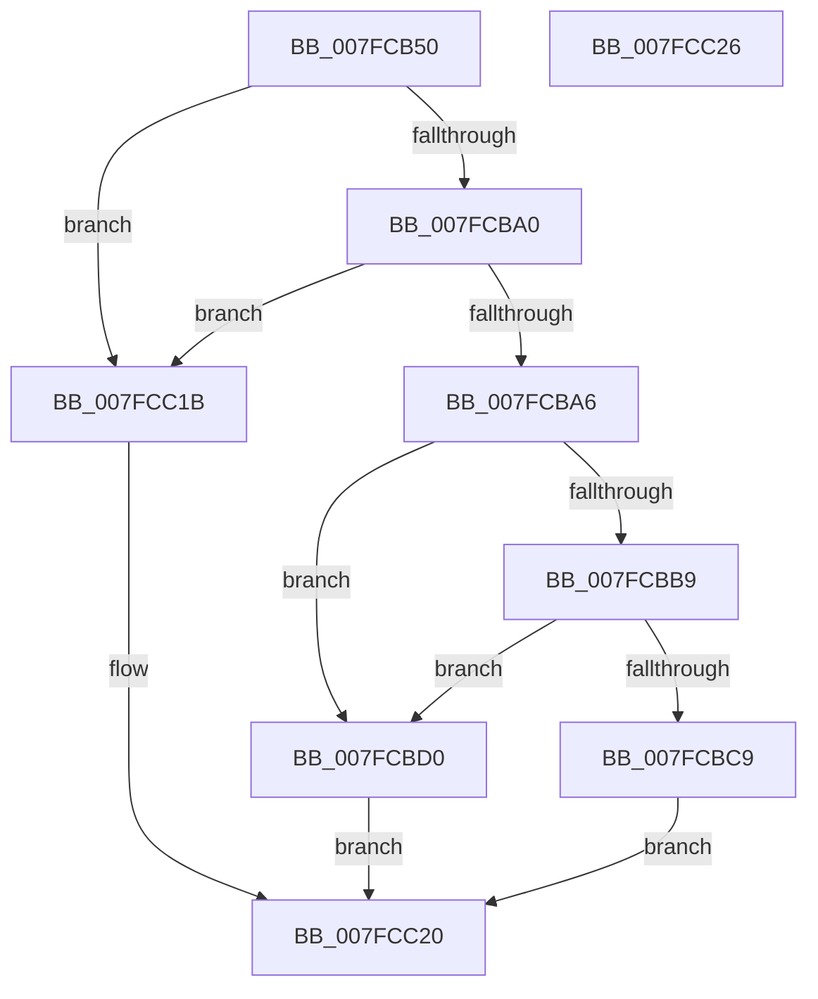

# MmCreateMirror

- RVA: `0x007FCB50`–`0x007FCC27` (길이 `215` bytes)
- VA: `0x00000001407FCB50`
- 실행 섹션: `PAGE`
- PDB 이름 있음: `예`; PDB Function 태그: `아니요`
- unwind 정보 RVA: `0x000C9FE4`
- 디코드: `52`개 명령, `215/215` bytes 표시
- 미해석 바이트: `0` (있으면 어셈블리에 `.byte`로 보존)

> 이 문서는 커널 이미지의 기계어와 PDB 기호를 분석해 생성했습니다. 4번과 5번은 함수 원형과 자료형을 바이너리 사용 방식에서 추정한 C 해석이며 원본 소스 복구 결과는 아닙니다.

## 1. Dependencies

- 직접 호출 지점: **3**; 고유 호출 대상: **3**
- 직접 호출자로 확인된 함수: **1**
- RIP 상대 이미지 참조: **7**

### Outgoing calls
- `0x007FCB97` → [ZwQueryLicenseValue](../../text/6A/ZwQueryLicenseValue_function_006AFCF0.md) (function, `0x006AFCF0`)
- `0x007FCBC0` → [SeSinglePrivilegeCheck](../87/SeSinglePrivilegeCheck_function_00871E20.md) (function, `0x00871E20`)
- `0x007FCC14` → [MmDuplicateMemory](../../pagelk/B7/MmDuplicateMemory_function_00B74158.md) (function, `0x00B74158`)

### Direct callers
- [NtSetSystemInformation](../AF/NtSetSystemInformation_function_00AF4A60.md) at `0x00AF512E`

### Static image references
- `0x007FCB5D` → RVA `0x00B09F20` (` ?? ::NNGAKEGL::`string'`; read)
- `0x007FCBB9` → RVA `0x00FD9B30` (`PAGEDATA`; read)
- `0x007FCBD0` → RVA `0x00E006B0` (`.data`; read)
- `0x007FCBDF` → RVA `0x00E006B8` (`.data`; read)
- `0x007FCBEA` → RVA `0x00E006C0` (`.data`; read)
- `0x007FCBF5` → RVA `0x00FC5204` (`ALMOSTRO`; read)
- `0x007FCC09` → RVA `0x00E006D0` (`.data`; read)

## 2. Other-region calls and transfers

- 다른 실행 섹션으로 향하는 call: **2**
  - `0x007FCB97` → [ZwQueryLicenseValue](../../text/6A/ZwQueryLicenseValue_function_006AFCF0.md) (`PAGE` → `.text`)
  - `0x007FCC14` → [MmDuplicateMemory](../../pagelk/B7/MmDuplicateMemory_function_00B74158.md) (`PAGE` → `PAGELK`)
- 별도 외부 분기/꼬리 이동을 확인하지 못했습니다.

## 3. Assembly (complete function range)

```asm
007FCB50  40 55                           push rbp
007FCB52  48 8B EC                        mov rbp, rsp
007FCB55  48 83 EC 70                     sub rsp, 0x70
007FCB59  83 65 F4 00                     and dword ptr [rbp - 0xc], 0
007FCB5D  48 8D 05 BC D3 30 00            lea rax, [rip + 0x30d3bc]
007FCB64  83 65 20 00                     and dword ptr [rbp + 0x20], 0
007FCB68  4C 8D 45 10                     lea r8, [rbp + 0x10]
007FCB6C  83 65 10 00                     and dword ptr [rbp + 0x10], 0
007FCB70  48 8D 55 20                     lea rdx, [rbp + 0x20]
007FCB74  48 89 45 C8                     mov qword ptr [rbp - 0x38], rax
007FCB78  48 8D 4D C0                     lea rcx, [rbp - 0x40]
007FCB7C  48 8D 45 18                     lea rax, [rbp + 0x18]
007FCB80  48 C7 45 C0 3E 00 40 00         mov qword ptr [rbp - 0x40], 0x40003e
007FCB88  41 B9 04 00 00 00               mov r9d, 4
007FCB8E  48 89 44 24 20                  mov qword ptr [rsp + 0x20], rax
007FCB93  44 89 4D 18                     mov dword ptr [rbp + 0x18], r9d
007FCB97  E8 54 31 EB FF                  call 0x1406afcf0
007FCB9C  85 C0                           test eax, eax
007FCB9E  78 7B                           js 0x1407fcc1b
007FCBA0  83 7D 10 01                     cmp dword ptr [rbp + 0x10], 1
007FCBA4  75 75                           jne 0x1407fcc1b
007FCBA6  65 48 8B 04 25 88 01 00 00      mov rax, qword ptr gs:[0x188]
007FCBAF  8A 90 32 02 00 00               mov dl, byte ptr [rax + 0x232]
007FCBB5  84 D2                           test dl, dl
007FCBB7  74 17                           je 0x1407fcbd0
007FCBB9  48 8B 0D 70 CF 7D 00            mov rcx, qword ptr [rip + 0x7dcf70]
007FCBC0  E8 5B 52 07 00                  call 0x140871e20
007FCBC5  84 C0                           test al, al
007FCBC7  75 07                           jne 0x1407fcbd0
007FCBC9  B8 61 00 00 C0                  mov eax, 0xc0000061
007FCBCE  EB 50                           jmp 0x1407fcc20
007FCBD0  48 8B 05 D9 3A 60 00            mov rax, qword ptr [rip + 0x603ad9]
007FCBD7  48 8D 4D D0                     lea rcx, [rbp - 0x30]
007FCBDB  48 89 45 D0                     mov qword ptr [rbp - 0x30], rax
007FCBDF  48 8B 05 D2 3A 60 00            mov rax, qword ptr [rip + 0x603ad2]
007FCBE6  48 89 45 D8                     mov qword ptr [rbp - 0x28], rax
007FCBEA  48 8B 05 CF 3A 60 00            mov rax, qword ptr [rip + 0x603acf]
007FCBF1  48 89 45 E0                     mov qword ptr [rbp - 0x20], rax
007FCBF5  8A 05 09 86 7C 00               mov al, byte ptr [rip + 0x7c8609]
007FCBFB  24 02                           and al, 2
007FCBFD  C7 45 F0 02 00 00 00            mov dword ptr [rbp - 0x10], 2
007FCC04  F6 D8                           neg al
007FCC06  48 1B C0                        sbb rax, rax
007FCC09  48 23 05 C0 3A 60 00            and rax, qword ptr [rip + 0x603ac0]
007FCC10  48 89 45 E8                     mov qword ptr [rbp - 0x18], rax
007FCC14  E8 3F 75 37 00                  call 0x140b74158
007FCC19  EB 05                           jmp 0x1407fcc20
007FCC1B  B8 6A 02 00 C0                  mov eax, 0xc000026a
007FCC20  48 83 C4 70                     add rsp, 0x70
007FCC24  5D                              pop rbp
007FCC25  C3                              ret
007FCC26  CC                              int3
```

## 4. C-style interpretation (structured pseudocode)

```c
__int64 __fastcall MmCreateMirror(void)
{
    __int64 result;
    __int64 v_rsp;
    unsigned int v_stack_m14;
    unsigned int v_stack_m18;
    unsigned __int64 v_stack_m20;
    unsigned __int64 v_stack_m28;
    unsigned __int64 v_stack_m30;
    unsigned __int64 v_stack_m38;
    unsigned __int64 v_stack_m40;
    unsigned __int64 v_stack_m48;
    unsigned __int64 v_stack_m58;
    unsigned __int64 v_stack_p10;
    unsigned int v_stack_p18;
    unsigned __int64 v_stack_p8;

    v_rsp = (v_rsp) - (112);
    v_stack_m40 = v_rip + 3199932;
    v_stack_m48 = 0x40003EULL;
    v_stack_m58 = v_stack_p10;
    v_stack_p10 = 4;
    result = ZwQueryLicenseValue(v_stack_m48, v_stack_p18, v_stack_p8, 4);
    if (sign_flag) goto loc_007FCC1B;
    if (v_stack_p8 != 1) goto loc_007FCC1B;
    if ((unsigned __int8)(*(unsigned __int8 *)(*(unsigned __int64 *)(gs_base + (0 + 392)) + 562)) == 0) goto loc_007FCBD0;
    result = SeSinglePrivilegeCheck(*(unsigned __int64 *)(v_rip + 8245104), *(unsigned __int8 *)(*(unsigned __int64 *)(gs_base + (0 + 392)) + 562), v_stack_p8, 4);
    if ((unsigned __int8)(result) != 0) goto loc_007FCBD0;
    goto loc_007FCC20;
loc_007FCBD0:
    v_stack_m38 = *(unsigned __int64 *)(v_rip + 6306521);
    v_stack_m30 = *(unsigned __int64 *)(v_rip + 6306514);
    v_stack_m28 = *(unsigned __int64 *)(v_rip + 6306511);
    result = (unsigned __int8)((*(unsigned __int8 *)(v_rip + 8160777)) & (2));
    v_stack_m18 = 2;
    result = (unsigned __int8)(-(result));
    result = (result) & (*(unsigned __int64 *)(v_rip + 6306496));
    v_stack_m20 = result;
    result = MmDuplicateMemory(v_stack_m38, *(unsigned __int8 *)(*(unsigned __int64 *)(gs_base + (0 + 392)) + 562), v_stack_p8, 4);
    goto loc_007FCC20;
loc_007FCC1B:
loc_007FCC20:
    v_rsp = (v_rsp) + (112);
    return (unsigned int)(0xC000026AULL);
}
```

## 5. (Beta) C Style

```c
void MmCreateMirror(void)
{
    int64_t result;
    int64_t local_rsp;
    uint32_t v_stack_m14;
    uint32_t v_stack_m18;
    uint64_t v_stack_m20;
    uint64_t v_stack_m28;
    uint64_t v_stack_m30;
    uint64_t v_stack_m38;
    uint64_t v_stack_m40;
    uint64_t v_stack_m48;
    uint64_t v_stack_m58;
    uint64_t v_stack_p10;
    uint32_t v_stack_p18;
    uint64_t v_stack_p8;

    local_rsp = (local_rsp) - (112);
    v_stack_m40 = v_rip + 3199932;
    v_stack_m48 = 0x40003EULL;
    v_stack_m58 = v_stack_p10;
    v_stack_p10 = 4;
    result = ZwQueryLicenseValue(v_stack_m48, v_stack_p18, v_stack_p8, 4);
    if (sign_flag) goto loc_007FCC1B;
    if (v_stack_p8 != 1) goto loc_007FCC1B;
    if ((uint8_t)(*(uint8_t *)(*(uint64_t *)(gs_base + (0 + 0x188)) + 0x232)) == 0) goto loc_007FCBD0;
    result = SeSinglePrivilegeCheck(*(uint64_t *)(v_rip + 0x7DCF70), *(uint8_t *)(*(uint64_t *)(gs_base + (0 + 0x188)) + 0x232), v_stack_p8, 4);
    if ((uint8_t)(result) != 0) goto loc_007FCBD0;
    goto loc_007FCC20;
loc_007FCBD0:
    v_stack_m38 = *(uint64_t *)(v_rip + 0x603AD9);
    v_stack_m30 = *(uint64_t *)(v_rip + 0x603AD2);
    v_stack_m28 = *(uint64_t *)(v_rip + 0x603ACF);
    result = (uint8_t)((*(uint8_t *)(v_rip + 0x7C8609)) & (2));
    v_stack_m18 = 2;
    result = (uint8_t)(-(result));
    result = (result) & (*(uint64_t *)(v_rip + 0x603AC0));
    v_stack_m20 = result;
    result = MmDuplicateMemory(v_stack_m38, *(uint8_t *)(*(uint64_t *)(gs_base + (0 + 0x188)) + 0x232), v_stack_p8, 4);
    goto loc_007FCC20;
loc_007FCC1B:
loc_007FCC20:
    local_rsp = (local_rsp) + (112);
    return (uint32_t)(0xC000026AULL);
}
```

## 6. Execution-region graph

[열기: 2D/3D 그래프와 함수 탐색 컨트롤 패널](../../../control-panel.html?section=page&rva=0x007FCB50&view=graph)

- 2D 그래프는 위에서 아래로 흐르고, 3D 그래프는 빈 공간을 드래그해 회전합니다. Shift+드래그는 이동, 휠은 확대·축소, 함수 노드 선택은 대상 보고서 이동입니다.

### Static fallback


