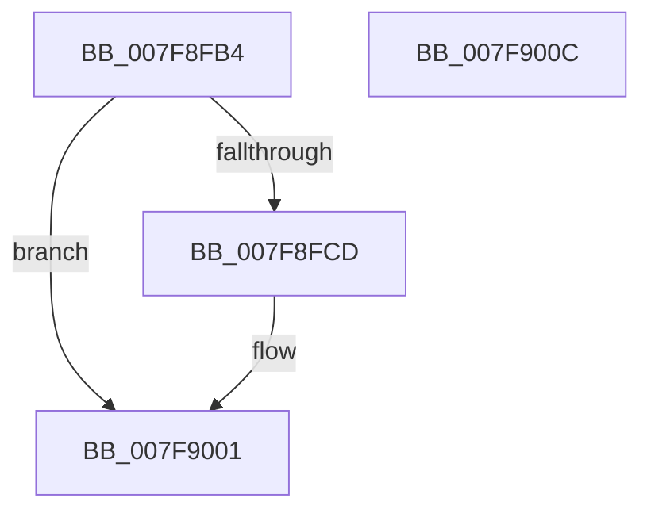

# MmDeleteProcessor

- RVA: `0x007F8FB4`–`0x007F900D` (길이 `89` bytes)
- VA: `0x00000001407F8FB4`
- 실행 섹션: `PAGE`
- PDB 이름 있음: `예`; PDB Function 태그: `아니요`
- unwind 정보 RVA: `0x0005CAAC`
- 디코드: `22`개 명령, `89/89` bytes 표시
- 미해석 바이트: `0` (있으면 어셈블리에 `.byte`로 보존)

> 이 문서는 커널 이미지의 기계어와 PDB 기호를 분석해 생성했습니다. 4번과 5번은 함수 원형과 자료형을 바이너리 사용 방식에서 추정한 C 해석이며 원본 소스 복구 결과는 아닙니다.

## 1. Dependencies

- 직접 호출 지점: **3**; 고유 호출 대상: **3**
- 직접 호출자로 확인된 함수: **2**
- RIP 상대 이미지 참조: **1**

### Outgoing calls
- `0x007F8FE1` → [MiReleasePtes](../../text/24/MiReleasePtes_function_00247240.md) (function, `0x00247240`)
- `0x007F8FEA` → [MiDeleteUltraThreadContext](../../text/32/MiDeleteUltraThreadContext_function_00322C90.md) (function, `0x00322C90`)
- `0x007F8FF4` → [ExFreePoolWithTag](../../poolcode/B8/ExFreePoolWithTag_function_00B82870.md) (function, `0x00B82870`)

### Direct callers
- [KiStartDynamicProcessor](../74/KiStartDynamicProcessor_function_007456C8.md) at `0x00745CA6`
- [KeStartAllProcessors](../../init/C3/KeStartAllProcessors_function_00C36F78.md) at `0x00C37466`

### Static image references
- `0x007F8FD4` → RVA `0x00E37668` (`.data`; read)

## 2. Other-region calls and transfers

- 다른 실행 섹션으로 향하는 call: **3**
  - `0x007F8FE1` → [MiReleasePtes](../../text/24/MiReleasePtes_function_00247240.md) (`PAGE` → `.text`)
  - `0x007F8FEA` → [MiDeleteUltraThreadContext](../../text/32/MiDeleteUltraThreadContext_function_00322C90.md) (`PAGE` → `.text`)
  - `0x007F8FF4` → [ExFreePoolWithTag](../../poolcode/B8/ExFreePoolWithTag_function_00B82870.md) (`PAGE` → `POOLCODE`)
- 별도 외부 분기/꼬리 이동을 확인하지 못했습니다.

## 3. Assembly (complete function range)

```asm
007F8FB4  48 89 5C 24 08                  mov qword ptr [rsp + 8], rbx
007F8FB9  57                              push rdi
007F8FBA  48 83 EC 20                     sub rsp, 0x20
007F8FBE  48 8B 99 38 88 00 00            mov rbx, qword ptr [rcx + 0x8838]
007F8FC5  48 8B F9                        mov rdi, rcx
007F8FC8  48 85 DB                        test rbx, rbx
007F8FCB  74 34                           je 0x1407f9001
007F8FCD  48 8B 93 50 01 00 00            mov rdx, qword ptr [rbx + 0x150]
007F8FD4  48 8D 0D 8D E6 63 00            lea rcx, [rip + 0x63e68d]
007F8FDB  41 B8 01 00 00 00               mov r8d, 1
007F8FE1  E8 5A E2 A4 FF                  call 0x140247240
007F8FE6  48 8D 4B 08                     lea rcx, [rbx + 8]
007F8FEA  E8 A1 9C B2 FF                  call 0x140322c90
007F8FEF  33 D2                           xor edx, edx
007F8FF1  48 8B CB                        mov rcx, rbx
007F8FF4  E8 77 98 38 00                  call 0x140b82870
007F8FF9  48 83 A7 38 88 00 00 00         and qword ptr [rdi + 0x8838], 0
007F9001  48 8B 5C 24 30                  mov rbx, qword ptr [rsp + 0x30]
007F9006  48 83 C4 20                     add rsp, 0x20
007F900A  5F                              pop rdi
007F900B  C3                              ret
007F900C  CC                              int3
```

## 4. C-style interpretation (structured pseudocode)

```c
__int64 __fastcall MmDeleteProcessor(__int64 a1)
{
    __int64 result;
    __int64 v_rsp;
    unsigned __int64 v_stack_p8;

    v_stack_p8 = v_rbx;
    v_rsp = (v_rsp) - (32);
    if (*(unsigned __int64 *)(a1 + 34872) != 0) {
        a2 = *(unsigned __int64 *)(*(unsigned __int64 *)(a1 + 34872) + 336);
        a1 = v_rip + 6547085;
        a3 = 1;
        result = MiReleasePtes(a1, a2, a3, a4);
        a1 = *(unsigned __int64 *)(a1 + 34872) + 8;
        result = MiDeleteUltraThreadContext(a1, a2, a3, a4);
        a2 = 0;
        a1 = *(unsigned __int64 *)(a1 + 34872);
        result = ExFreePoolWithTag(a1, a2, a3, a4);
    }
    v_rsp = (v_rsp) + (32);
    return result;
}
```

## 5. (Beta) C Style

```c
int64_t MmDeleteProcessor(void *Arg1)
{
    uint8_t *arg1 = (uint8_t *)Arg1;

    int64_t result;
    int64_t local_rsp;
    uint64_t v_stack_p8;

    v_stack_p8 = local_rbx;
    local_rsp = (local_rsp) - (32);
    if (*(uint64_t *)(arg1 + 0x8838) != 0) {
        a2 = *(uint64_t *)(*(uint64_t *)(arg1 + 0x8838) + 0x150);
        Arg1 = v_rip + 6547085;
        a3 = 1;
        result = MiReleasePtes(Arg1, a2, a3, a4);
        Arg1 = *(uint64_t *)(arg1 + 0x8838) + 8;
        result = MiDeleteUltraThreadContext(Arg1, a2, a3, a4);
        a2 = 0;
        Arg1 = *(uint64_t *)(arg1 + 0x8838);
        result = ExFreePoolWithTag(Arg1, a2, a3, a4);
    }
    local_rsp = (local_rsp) + (32);
    return result;
}
```

### 관측된 메모리 오프셋

구조체 형식이 확인되지 않은 접근은 인자 기준의 오프셋으로만 기록했습니다.

| 기준 인자 | 오프셋 표현 | 폭 (bit) | 접근 |
|---|---:|---:|---|
| `Arg1` | `+ 0x8838` | `64` | `R` |
| `Arg1` | `+ 0x8838` | `64` | `R/W` |

## 6. Execution-region graph

[열기: 2D/3D 그래프와 함수 탐색 컨트롤 패널](../../../control-panel.html?section=page&rva=0x007F8FB4&view=graph)

- 2D 그래프는 위에서 아래로 흐르고, 3D 그래프는 빈 공간을 드래그해 회전합니다. Shift+드래그는 이동, 휠은 확대·축소, 함수 노드 선택은 대상 보고서 이동입니다.

### Static fallback


