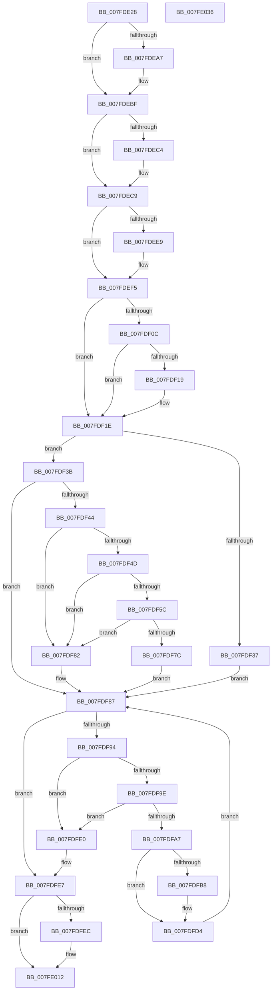

# MmEnumerateBadPages

- RVA: `0x007FDE28`–`0x007FE037` (길이 `527` bytes)
- VA: `0x00000001407FDE28`
- 실행 섹션: `PAGE`
- PDB 이름 있음: `예`; PDB Function 태그: `아니요`
- unwind 정보 RVA: `0x000CA900`
- 디코드: `141`개 명령, `527/527` bytes 표시
- 미해석 바이트: `0` (있으면 어셈블리에 `.byte`로 보존)

> 이 문서는 커널 이미지의 기계어와 PDB 기호를 분석해 생성했습니다. 4번과 5번은 함수 원형과 자료형을 바이너리 사용 방식에서 추정한 C 해석이며 원본 소스 복구 결과는 아닙니다.

## 1. Dependencies

- 직접 호출 지점: **12**; 고유 호출 대상: **12**
- 직접 호출자로 확인된 함수: **1**
- RIP 상대 이미지 참조: **2**

### Outgoing calls
- `0x007FDE8E` → [KeAbPreAcquire](../../text/21/KeAbPreAcquire_function_00210230.md) (function, `0x00210230`)
- `0x007FDEBA` → [ExfAcquirePushLockSharedEx](../../text/21/ExfAcquirePushLockSharedEx_function_0021044C.md) (function, `0x0021044C`)
- `0x007FDED4` → [MiIterateOverPartitions](../../text/47/MiIterateOverPartitions_function_0047FC14.md) (function, `0x0047FC14`)
- `0x007FDEF0` → [ExfReleasePushLockShared](../../text/26/ExfReleasePushLockShared_function_00263440.md) (function, `0x00263440`)
- `0x007FDEFC` → [KeAbPostRelease](../../text/2E/KeAbPostRelease_function_002E1600.md) (function, `0x002E1600`)
- `0x007FDF19` → [KiCheckForKernelApcDelivery](../../text/2E/KiCheckForKernelApcDelivery_function_002E2C80.md) (function, `0x002E2C80`)
- `0x007FDF22` → [MiGetListOfPendingBadPages](../../text/67/MiGetListOfPendingBadPages_function_006799D0.md) (function, `0x006799D0`)
- `0x007FDF2B` → [MiEnumerateQuarantinedBadHugeRangePages](../../text/67/MiEnumerateQuarantinedBadHugeRangePages_function_006798AC.md) (function, `0x006798AC`)
- `0x007FDF6F` → [MiAllocatePool](../../text/35/MiAllocatePool_function_0035B540.md) (function, `0x0035B540`)
- `0x007FDFC7` → [memcpy](../../text/6C/memcpy_function_006C6840.md) (function, `0x006C6840`)
- `0x007FDFD9` → [ExFreePoolWithTag](../../poolcode/B8/ExFreePoolWithTag_function_00B82870.md) (function, `0x00B82870`)
- `0x007FDFF4` → [MiSortPageFramesRemoveDuplicates](../../text/67/MiSortPageFramesRemoveDuplicates_function_0067A67C.md) (function, `0x0067A67C`)

### Direct callers
- [ExpQuerySystemInformation](../A5/ExpQuerySystemInformation_function_00A57858.md) at `0x00A5B516`

### Static image references
- `0x007FDE60` → RVA `0x00E30048` (`.data`; read)
- `0x007FDECD` → RVA `0x00679700` (`MiEnumeratePartitionBadPages`; read)

## 2. Other-region calls and transfers

- 다른 실행 섹션으로 향하는 call: **12**
  - `0x007FDE8E` → [KeAbPreAcquire](../../text/21/KeAbPreAcquire_function_00210230.md) (`PAGE` → `.text`)
  - `0x007FDEBA` → [ExfAcquirePushLockSharedEx](../../text/21/ExfAcquirePushLockSharedEx_function_0021044C.md) (`PAGE` → `.text`)
  - `0x007FDED4` → [MiIterateOverPartitions](../../text/47/MiIterateOverPartitions_function_0047FC14.md) (`PAGE` → `.text`)
  - `0x007FDEF0` → [ExfReleasePushLockShared](../../text/26/ExfReleasePushLockShared_function_00263440.md) (`PAGE` → `.text`)
  - `0x007FDEFC` → [KeAbPostRelease](../../text/2E/KeAbPostRelease_function_002E1600.md) (`PAGE` → `.text`)
  - `0x007FDF19` → [KiCheckForKernelApcDelivery](../../text/2E/KiCheckForKernelApcDelivery_function_002E2C80.md) (`PAGE` → `.text`)
  - `0x007FDF22` → [MiGetListOfPendingBadPages](../../text/67/MiGetListOfPendingBadPages_function_006799D0.md) (`PAGE` → `.text`)
  - `0x007FDF2B` → [MiEnumerateQuarantinedBadHugeRangePages](../../text/67/MiEnumerateQuarantinedBadHugeRangePages_function_006798AC.md) (`PAGE` → `.text`)
  - `0x007FDF6F` → [MiAllocatePool](../../text/35/MiAllocatePool_function_0035B540.md) (`PAGE` → `.text`)
  - `0x007FDFC7` → [memcpy](../../text/6C/memcpy_function_006C6840.md) (`PAGE` → `.text`)
  - `0x007FDFD9` → [ExFreePoolWithTag](../../poolcode/B8/ExFreePoolWithTag_function_00B82870.md) (`PAGE` → `POOLCODE`)
  - `0x007FDFF4` → [MiSortPageFramesRemoveDuplicates](../../text/67/MiSortPageFramesRemoveDuplicates_function_0067A67C.md) (`PAGE` → `.text`)
- 별도 외부 분기/꼬리 이동을 확인하지 못했습니다.

## 3. Assembly (complete function range)

```asm
007FDE28  48 89 5C 24 10                  mov qword ptr [rsp + 0x10], rbx
007FDE2D  48 89 74 24 18                  mov qword ptr [rsp + 0x18], rsi
007FDE32  48 89 7C 24 20                  mov qword ptr [rsp + 0x20], rdi
007FDE37  55                              push rbp
007FDE38  41 54                           push r12
007FDE3A  41 55                           push r13
007FDE3C  41 56                           push r14
007FDE3E  41 57                           push r15
007FDE40  48 8B EC                        mov rbp, rsp
007FDE43  48 83 EC 40                     sub rsp, 0x40
007FDE47  45 33 ED                        xor r13d, r13d
007FDE4A  48 8D 45 E0                     lea rax, [rbp - 0x20]
007FDE4E  48 89 45 E8                     mov qword ptr [rbp - 0x18], rax
007FDE52  4C 8B E1                        mov r12, rcx
007FDE55  4C 89 29                        mov qword ptr [rcx], r13
007FDE58  48 8D 45 E0                     lea rax, [rbp - 0x20]
007FDE5C  48 89 45 E0                     mov qword ptr [rbp - 0x20], rax
007FDE60  48 8D 0D E1 21 63 00            lea rcx, [rip + 0x6321e1]
007FDE67  4C 89 6D F0                     mov qword ptr [rbp - 0x10], r13
007FDE6B  45 33 C0                        xor r8d, r8d
007FDE6E  4C 89 6D F8                     mov qword ptr [rbp - 8], r13
007FDE72  33 D2                           xor edx, edx
007FDE74  65 48 8B 1C 25 88 01 00 00      mov rbx, qword ptr gs:[0x188]
007FDE7D  41 8B FD                        mov edi, r13d
007FDE80  45 8B F5                        mov r14d, r13d
007FDE83  41 8B F5                        mov esi, r13d
007FDE86  66 FF 8B E6 01 00 00            dec word ptr [rbx + 0x1e6]
007FDE8D  90                              nop
007FDE8E  E8 9D 23 A1 FF                  call 0x140210230
007FDE93  4C 8B F8                        mov r15, rax
007FDE96  41 8D 4D 11                     lea ecx, [r13 + 0x11]
007FDE9A  33 C0                           xor eax, eax
007FDE9C  F0 48 0F B1 0D A3 21 63 00      lock cmpxchg qword ptr [rip + 0x6321a3], rcx
007FDEA5  74 18                           je 0x1407fdebf
007FDEA7  4C 8D 0D 9A 21 63 00            lea r9, [rip + 0x63219a]
007FDEAE  4D 8B C7                        mov r8, r15
007FDEB1  33 D2                           xor edx, edx
007FDEB3  48 8D 0D 8E 21 63 00            lea rcx, [rip + 0x63218e]
007FDEBA  E8 8D 25 A1 FF                  call 0x14021044c
007FDEBF  4D 85 FF                        test r15, r15
007FDEC2  74 05                           je 0x1407fdec9
007FDEC4  41 C6 47 0A 01                  mov byte ptr [r15 + 0xa], 1
007FDEC9  48 8D 55 E0                     lea rdx, [rbp - 0x20]
007FDECD  48 8D 0D 2C B8 E7 FF            lea rcx, [rip - 0x1847d4]
007FDED4  E8 3B 1D C8 FF                  call 0x14047fc14
007FDED9  B8 11 00 00 00                  mov eax, 0x11
007FDEDE  F0 4C 0F B1 2D 61 21 63 00      lock cmpxchg qword ptr [rip + 0x632161], r13
007FDEE7  74 0C                           je 0x1407fdef5
007FDEE9  48 8D 0D 58 21 63 00            lea rcx, [rip + 0x632158]
007FDEF0  E8 4B 55 A6 FF                  call 0x140263440
007FDEF5  48 8D 0D 4C 21 63 00            lea rcx, [rip + 0x63214c]
007FDEFC  E8 FF 36 AE FF                  call 0x1402e1600
007FDF01  90                              nop
007FDF02  66 83 83 E6 01 00 00 01         add word ptr [rbx + 0x1e6], 1
007FDF0A  75 12                           jne 0x1407fdf1e
007FDF0C  48 8D 83 98 00 00 00            lea rax, [rbx + 0x98]
007FDF13  90                              nop
007FDF14  48 39 00                        cmp qword ptr [rax], rax
007FDF17  74 05                           je 0x1407fdf1e
007FDF19  E8 62 4D AE FF                  call 0x1402e2c80
007FDF1E  48 8D 4D E0                     lea rcx, [rbp - 0x20]
007FDF22  E8 A9 BA E7 FF                  call 0x1406799d0
007FDF27  48 8D 4D E0                     lea rcx, [rbp - 0x20]
007FDF2B  E8 7C B9 E7 FF                  call 0x1406798ac
007FDF30  8B 45 F0                        mov eax, dword ptr [rbp - 0x10]
007FDF33  85 C0                           test eax, eax
007FDF35  79 04                           jns 0x1407fdf3b
007FDF37  8B F0                           mov esi, eax
007FDF39  EB 4C                           jmp 0x1407fdf87
007FDF3B  48 8B 55 F8                     mov rdx, qword ptr [rbp - 8]
007FDF3F  48 85 D2                        test rdx, rdx
007FDF42  74 43                           je 0x1407fdf87
007FDF44  48 8D 42 01                     lea rax, [rdx + 1]
007FDF48  48 3B C2                        cmp rax, rdx
007FDF4B  72 35                           jb 0x1407fdf82
007FDF4D  48 B9 FF FF FF FF FF FF FF 1F   movabs rcx, 0x1fffffffffffffff
007FDF57  48 3B C1                        cmp rax, rcx
007FDF5A  77 26                           ja 0x1407fdf82
007FDF5C  48 8D 14 D5 08 00 00 00         lea rdx, [rdx*8 + 8]
007FDF64  B9 40 00 00 00                  mov ecx, 0x40
007FDF69  41 B8 4D 6D 42 61               mov r8d, 0x61426d4d
007FDF6F  E8 CC D5 B5 FF                  call 0x14035b540
007FDF74  48 8B F8                        mov rdi, rax
007FDF77  48 85 C0                        test rax, rax
007FDF7A  74 06                           je 0x1407fdf82
007FDF7C  4C 8D 70 08                     lea r14, [rax + 8]
007FDF80  EB 05                           jmp 0x1407fdf87
007FDF82  BE 9A 00 00 C0                  mov esi, 0xc000009a
007FDF87  48 8B 5D E0                     mov rbx, qword ptr [rbp - 0x20]
007FDF8B  48 8D 45 E0                     lea rax, [rbp - 0x20]
007FDF8F  48 3B D8                        cmp rbx, rax
007FDF92  74 53                           je 0x1407fdfe7
007FDF94  48 8D 45 E0                     lea rax, [rbp - 0x20]
007FDF98  48 39 43 08                     cmp qword ptr [rbx + 8], rax
007FDF9C  75 42                           jne 0x1407fdfe0
007FDF9E  48 8B 03                        mov rax, qword ptr [rbx]
007FDFA1  48 39 58 08                     cmp qword ptr [rax + 8], rbx
007FDFA5  75 39                           jne 0x1407fdfe0
007FDFA7  48 89 45 E0                     mov qword ptr [rbp - 0x20], rax
007FDFAB  48 8D 4D E0                     lea rcx, [rbp - 0x20]
007FDFAF  48 89 48 08                     mov qword ptr [rax + 8], rcx
007FDFB3  4D 85 F6                        test r14, r14
007FDFB6  74 1C                           je 0x1407fdfd4
007FDFB8  4C 8B 43 10                     mov r8, qword ptr [rbx + 0x10]
007FDFBC  49 8B CE                        mov rcx, r14
007FDFBF  48 8B 53 18                     mov rdx, qword ptr [rbx + 0x18]
007FDFC3  49 C1 E0 03                     shl r8, 3
007FDFC7  E8 74 88 EC FF                  call 0x1406c6840
007FDFCC  48 8B 43 10                     mov rax, qword ptr [rbx + 0x10]
007FDFD0  4D 8D 34 C6                     lea r14, [r14 + rax*8]
007FDFD4  33 D2                           xor edx, edx
007FDFD6  48 8B CB                        mov rcx, rbx
007FDFD9  E8 92 48 38 00                  call 0x140b82870
007FDFDE  EB A7                           jmp 0x1407fdf87
007FDFE0  B9 03 00 00 00                  mov ecx, 3
007FDFE5  CD 29                           int 0x29
007FDFE7  48 85 FF                        test rdi, rdi
007FDFEA  74 26                           je 0x1407fe012
007FDFEC  48 8B 55 F8                     mov rdx, qword ptr [rbp - 8]
007FDFF0  48 8D 4F 08                     lea rcx, [rdi + 8]
007FDFF4  E8 83 C6 E7 FF                  call 0x14067a67c
007FDFF9  48 8B C8                        mov rcx, rax
007FDFFC  48 BA 00 00 00 00 00 00 F0 FF   movabs rdx, 0xfff0000000000000
007FE006  48 33 0F                        xor rcx, qword ptr [rdi]
007FE009  48 23 CA                        and rcx, rdx
007FE00C  48 33 C8                        xor rcx, rax
007FE00F  48 89 0F                        mov qword ptr [rdi], rcx
007FE012  4C 8D 5C 24 40                  lea r11, [rsp + 0x40]
007FE017  49 89 3C 24                     mov qword ptr [r12], rdi
007FE01B  49 8B 5B 38                     mov rbx, qword ptr [r11 + 0x38]
007FE01F  8B C6                           mov eax, esi
007FE021  49 8B 73 40                     mov rsi, qword ptr [r11 + 0x40]
007FE025  49 8B 7B 48                     mov rdi, qword ptr [r11 + 0x48]
007FE029  49 8B E3                        mov rsp, r11
007FE02C  41 5F                           pop r15
007FE02E  41 5E                           pop r14
007FE030  41 5D                           pop r13
007FE032  41 5C                           pop r12
007FE034  5D                              pop rbp
007FE035  C3                              ret
007FE036  CC                              int3
```

## 4. C-style interpretation (structured pseudocode)

```c
__int64 __fastcall MmEnumerateBadPages(__int64 a1, int a2, int a3)
{
    __int64 result;
    __int64 v_r13;
    __int64 v_r14;
    __int64 v_rsp;
    unsigned __int64 v_stack_m28;
    unsigned __int64 v_stack_m30;
    unsigned __int64 v_stack_m38;
    unsigned __int64 v_stack_m40;
    unsigned __int64 v_stack_m48;
    unsigned __int64 v_stack_p10;
    unsigned __int64 v_stack_p18;
    unsigned __int64 v_stack_p20;

    v_stack_p10 = v_rbx;
    v_stack_p18 = v_rsi;
    v_stack_p20 = v_rdi;
    v_rsp = (v_rsp) - (64);
    v_r13 = 0;
    v_stack_m40 = v_stack_m48;
    *(unsigned __int64 *)(a1) = 0;
    v_stack_m48 = v_stack_m48;
    v_stack_m38 = 0;
    a3 = 0;
    v_stack_m30 = 0;
    a2 = 0;
    result = KeAbPreAcquire(v_rip + 6496737, a2, a3, a4);
    result = 0;
    if (!(condition_is_equal)) {
        a4 = v_rip + 6496666;
        a3 = 0;
        a2 = 0;
        a1 = v_rip + 6496654;
        result = ExfAcquirePushLockSharedEx(a1, a2, a3, a4);
    }
    if (result != 0) {
        *(unsigned __int8 *)(result + 10) = 1;
    }
    result = MiIterateOverPartitions(v_rip - 1591252, v_stack_m48, a3, a4);
    result = 17;
    if (result != 0) {
        a1 = v_rip + 6496600;
        result = ExfReleasePushLockShared(a1, v_stack_m48, a3, a4);
    }
    result = KeAbPostRelease(v_rip + 6496588, v_stack_m48, a3, a4);
    if (result != 0) goto loc_007FDF1E;
    result = *(unsigned __int64 *)(gs_base + (0 + 392)) + 152;
    if ((*(unsigned __int64 *)(*(unsigned __int64 *)(gs_base + (0 + 392)) + 152)) != (*(unsigned __int64 *)(gs_base + (0 + 392)) + 152)) {
        result = KiCheckForKernelApcDelivery(v_rip + 6496588, v_stack_m48, a3, a4);
    }
    result = MiGetListOfPendingBadPages(v_stack_m48, v_stack_m48, a3, a4);
    result = MiEnumerateQuarantinedBadHugeRangePages(v_stack_m48, v_stack_m48, a3, a4);
    if (!sign_flag) goto loc_007FDF3B;
    goto loc_007FDF87;
loc_007FDF3B:
    if (v_stack_m30 == 0) goto loc_007FDF87;
    if ((v_stack_m30 + 1) < v_stack_m30) goto loc_007FDF82;
    if ((v_stack_m30 + 1) > v_stack_m48) goto loc_007FDF82;
    result = MiAllocatePool(64, v_stack_m30 * 8 + 8, (unsigned int)(0x61426D4DULL), a4);
    if (result == 0) goto loc_007FDF82;
    goto loc_007FDF87;
loc_007FDF82:
loc_007FDF87:
    if (v_stack_m48 == v_stack_m48) goto loc_007FDFE7;
    if ((*(unsigned __int64 *)(v_stack_m48 + 8)) != v_stack_m48) goto loc_007FDFE0;
    if ((*(unsigned __int64 *)(*(unsigned __int64 *)(v_stack_m48) + 8)) != v_stack_m48) goto loc_007FDFE0;
    v_stack_m48 = *(unsigned __int64 *)(v_stack_m48);
    *(unsigned __int64 *)(*(unsigned __int64 *)(v_stack_m48) + 8) = v_stack_m48;
    result = *(unsigned __int64 *)(v_stack_m48);
    v_r14 = result + 8;
    if (result + 8 != 0) {
        a3 = *(unsigned __int64 *)(v_stack_m48 + 16);
        a1 = result + 8;
        a2 = *(unsigned __int64 *)(v_stack_m48 + 24);
        a3 = (a3) << (3);
        result = memcpy(a1, a2, a3, a4);
        result = *(unsigned __int64 *)(v_stack_m48 + 16);
        v_r14 = result + 8 + result * 8;
    }
    a2 = 0;
    result = ExFreePoolWithTag(v_stack_m48, a2, a3, a4);
    goto loc_007FDF87;
loc_007FDFE0:
loc_007FDFE7:
    if (result != 0) {
        a2 = v_stack_m30;
        a1 = result + 8;
        result = MiSortPageFramesRemoveDuplicates(a1, a2, a3, a4);
        a1 = result;
        a1 = (a1) ^ (*(unsigned __int64 *)(result));
        a1 = (a1) & (a2);
        a1 = (a1) ^ (result);
        *(unsigned __int64 *)(result) = a1;
    }
    *(unsigned __int64 *)(a1) = result;
    return (unsigned int)((unsigned int)((unsigned int)(0xC000009AULL)));
}
```

## 5. (Beta) C Style

```c
int64_t MmEnumerateBadPages(void *Arg1, int32_t Arg2, int32_t Arg3)
{
    uint8_t *arg1 = (uint8_t *)Arg1;

    int64_t result;
    int64_t local_r13;
    int64_t local_r14;
    int64_t local_rsp;
    uint64_t v_stack_m28;
    uint64_t v_stack_m30;
    uint64_t v_stack_m38;
    uint64_t v_stack_m40;
    uint64_t v_stack_m48;
    uint64_t v_stack_p10;
    uint64_t v_stack_p18;
    uint64_t v_stack_p20;

    v_stack_p10 = local_rbx;
    v_stack_p18 = local_rsi;
    v_stack_p20 = local_rdi;
    local_rsp = (local_rsp) - (64);
    local_r13 = 0;
    v_stack_m40 = v_stack_m48;
    *(uint64_t *)(arg1) = 0;
    v_stack_m48 = v_stack_m48;
    v_stack_m38 = 0;
    Arg3 = 0;
    v_stack_m30 = 0;
    Arg2 = 0;
    result = KeAbPreAcquire(v_rip + 6496737, Arg2, Arg3, a4);
    result = 0;
    if (!(condition_is_equal)) {
        a4 = v_rip + 6496666;
        Arg3 = 0;
        Arg2 = 0;
        Arg1 = v_rip + 6496654;
        result = ExfAcquirePushLockSharedEx(Arg1, Arg2, Arg3, a4);
    }
    if (result != 0) {
        *(uint8_t *)(result + 0xA) = 1;
    }
    result = MiIterateOverPartitions(v_rip - 1591252, v_stack_m48, Arg3, a4);
    result = 17;
    if (result != 0) {
        Arg1 = v_rip + 6496600;
        result = ExfReleasePushLockShared(Arg1, v_stack_m48, Arg3, a4);
    }
    result = KeAbPostRelease(v_rip + 6496588, v_stack_m48, Arg3, a4);
    if (result != 0) goto loc_007FDF1E;
    result = *(uint64_t *)(gs_base + (0 + 0x188)) + 152;
    if ((*(uint64_t *)(*(uint64_t *)(gs_base + (0 + 0x188)) + 0x98)) != (*(uint64_t *)(gs_base + (0 + 0x188)) + 152)) {
        result = KiCheckForKernelApcDelivery(v_rip + 6496588, v_stack_m48, Arg3, a4);
    }
    result = MiGetListOfPendingBadPages(v_stack_m48, v_stack_m48, Arg3, a4);
    result = MiEnumerateQuarantinedBadHugeRangePages(v_stack_m48, v_stack_m48, Arg3, a4);
    if (!sign_flag) goto loc_007FDF3B;
    goto loc_007FDF87;
loc_007FDF3B:
    if (v_stack_m30 == 0) goto loc_007FDF87;
    if ((v_stack_m30 + 1) < v_stack_m30) goto loc_007FDF82;
    if ((v_stack_m30 + 1) > v_stack_m48) goto loc_007FDF82;
    result = MiAllocatePool(64, v_stack_m30 * 8 + 8, (uint32_t)(0x61426D4DULL), a4);
    if (result == 0) goto loc_007FDF82;
    goto loc_007FDF87;
loc_007FDF82:
loc_007FDF87:
    if (v_stack_m48 == v_stack_m48) goto loc_007FDFE7;
    if ((*(uint64_t *)(v_stack_m48 + 0x8)) != v_stack_m48) goto loc_007FDFE0;
    if ((*(uint64_t *)(*(uint64_t *)(v_stack_m48) + 0x8)) != v_stack_m48) goto loc_007FDFE0;
    v_stack_m48 = *(uint64_t *)(v_stack_m48);
    *(uint64_t *)(*(uint64_t *)(v_stack_m48) + 0x8) = v_stack_m48;
    result = *(uint64_t *)(v_stack_m48);
    local_r14 = result + 8;
    if (result + 8 != 0) {
        Arg3 = *(uint64_t *)(v_stack_m48 + 0x10);
        Arg1 = result + 8;
        Arg2 = *(uint64_t *)(v_stack_m48 + 0x18);
        Arg3 = (Arg3) << (3);
        result = memcpy(Arg1, Arg2, Arg3, a4);
        result = *(uint64_t *)(v_stack_m48 + 0x10);
        local_r14 = result + 8 + result * 8;
    }
    Arg2 = 0;
    result = ExFreePoolWithTag(v_stack_m48, Arg2, Arg3, a4);
    goto loc_007FDF87;
loc_007FDFE0:
loc_007FDFE7:
    if (result != 0) {
        Arg2 = v_stack_m30;
        Arg1 = result + 8;
        result = MiSortPageFramesRemoveDuplicates(Arg1, Arg2, Arg3, a4);
        Arg1 = result;
        Arg1 = (Arg1) ^ (*(uint64_t *)(result));
        Arg1 = (Arg1) & (Arg2);
        Arg1 = (Arg1) ^ (result);
        *(void **)(result) = Arg1;
    }
    *(uint64_t *)(arg1) = result;
    return (uint32_t)((uint32_t)((uint32_t)(0xC000009AULL)));
}
```

### 관측된 메모리 오프셋

구조체 형식이 확인되지 않은 접근은 인자 기준의 오프셋으로만 기록했습니다.

| 기준 인자 | 오프셋 표현 | 폭 (bit) | 접근 |
|---|---:|---:|---|
| `Arg1` | `+ 0x0` | `64` | `W` |

## 6. Execution-region graph

[열기: 2D/3D 그래프와 함수 탐색 컨트롤 패널](../../../control-panel.html?section=page&rva=0x007FDE28&view=graph)

- 2D 그래프는 위에서 아래로 흐르고, 3D 그래프는 빈 공간을 드래그해 회전합니다. Shift+드래그는 이동, 휠은 확대·축소, 함수 노드 선택은 대상 보고서 이동입니다.

### Static fallback


