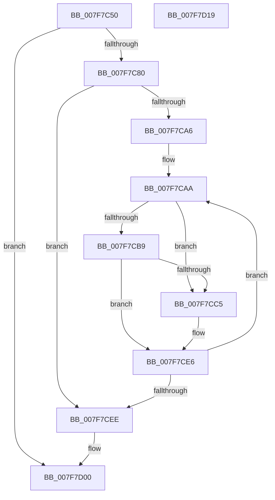

# MmFreeBootRegistry

- RVA: `0x007F7C50`–`0x007F7D1A` (길이 `202` bytes)
- VA: `0x00000001407F7C50`
- 실행 섹션: `PAGE`
- PDB 이름 있음: `예`; PDB Function 태그: `아니요`
- unwind 정보 RVA: `0x00060300`
- 디코드: `55`개 명령, `202/202` bytes 표시
- 미해석 바이트: `0` (있으면 어셈블리에 `.byte`로 보존)

> 이 문서는 커널 이미지의 기계어와 PDB 기호를 분석해 생성했습니다. 4번과 5번은 함수 원형과 자료형을 바이너리 사용 방식에서 추정한 C 해석이며 원본 소스 복구 결과는 아닙니다.

## 1. Dependencies

- 직접 호출 지점: **4**; 고유 호출 대상: **4**
- 직접 호출자로 확인된 함수: **3**
- RIP 상대 이미지 참조: **3**

### Outgoing calls
- `0x007F7C98` → [qsort](../../text/50/qsort_function_005009F0.md) (function, `0x005009F0`)
- `0x007F7CC5` → [MiGetPteAddress](../../text/43/MiGetPteAddress_function_0043E130.md) (function, `0x0043E130`)
- `0x007F7CDF` → [MiDeleteBootRange](../../text/66/MiDeleteBootRange_function_0066E450.md) (function, `0x0066E450`)
- `0x007F7CF3` → [ExFreePoolWithTag](../../poolcode/B8/ExFreePoolWithTag_function_00B82870.md) (function, `0x00B82870`)

### Direct callers
- [CmpFreeBootRegistry](../../text/66/CmpFreeBootRegistry_function_0066DF5C.md) at `0x0066DF60`
- [MiPageBootRegistry](../../text/66/MiPageBootRegistry_function_0066E82C.md) at `0x0066EB4F`
- [HvpDropPagedBins](../9B/HvpDropPagedBins_function_009B7168.md) at `0x009B7301`

### Static image references
- `0x007F7C6E` → RVA `0x00E37608` (`.data`; read)
- `0x007F7C8A` → RVA `0x00AA4CC0` (`MiRegistryVaSort`; read)
- `0x007F7CF8` → RVA `0x00E37608` (`.data`; read/write)

## 2. Other-region calls and transfers

- 다른 실행 섹션으로 향하는 call: **4**
  - `0x007F7C98` → [qsort](../../text/50/qsort_function_005009F0.md) (`PAGE` → `.text`)
  - `0x007F7CC5` → [MiGetPteAddress](../../text/43/MiGetPteAddress_function_0043E130.md) (`PAGE` → `.text`)
  - `0x007F7CDF` → [MiDeleteBootRange](../../text/66/MiDeleteBootRange_function_0066E450.md) (`PAGE` → `.text`)
  - `0x007F7CF3` → [ExFreePoolWithTag](../../poolcode/B8/ExFreePoolWithTag_function_00B82870.md) (`PAGE` → `POOLCODE`)
- 별도 외부 분기/꼬리 이동을 확인하지 못했습니다.

## 3. Assembly (complete function range)

```asm
007F7C50  48 89 5C 24 08                  mov qword ptr [rsp + 8], rbx
007F7C55  48 89 6C 24 10                  mov qword ptr [rsp + 0x10], rbp
007F7C5A  48 89 74 24 18                  mov qword ptr [rsp + 0x18], rsi
007F7C5F  57                              push rdi
007F7C60  41 56                           push r14
007F7C62  41 57                           push r15
007F7C64  48 83 EC 20                     sub rsp, 0x20
007F7C68  33 C0                           xor eax, eax
007F7C6A  44 8D 78 01                     lea r15d, [rax + 1]
007F7C6E  F0 4C 0F B1 3D 91 F9 63 00      lock cmpxchg qword ptr [rip + 0x63f991], r15
007F7C77  4C 8B F0                        mov r14, rax
007F7C7A  0F 84 80 00 00 00               je 0x1407f7d00
007F7C80  48 8B 30                        mov rsi, qword ptr [rax]
007F7C83  48 8D 58 08                     lea rbx, [rax + 8]
007F7C87  48 8B D6                        mov rdx, rsi
007F7C8A  4C 8D 0D 2F D0 2A 00            lea r9, [rip + 0x2ad02f]
007F7C91  48 8B CB                        mov rcx, rbx
007F7C94  45 8D 47 07                     lea r8d, [r15 + 7]
007F7C98  E8 53 8D D0 FF                  call 0x1405009f0
007F7C9D  33 D2                           xor edx, edx
007F7C9F  33 FF                           xor edi, edi
007F7CA1  48 85 F6                        test rsi, rsi
007F7CA4  74 48                           je 0x1407f7cee
007F7CA6  48 8D 6E FF                     lea rbp, [rsi - 1]
007F7CAA  48 8B 0B                        mov rcx, qword ptr [rbx]
007F7CAD  49 03 D7                        add rdx, r15
007F7CB0  48 8D 5B 08                     lea rbx, [rbx + 8]
007F7CB4  48 3B FD                        cmp rdi, rbp
007F7CB7  74 0C                           je 0x1407f7cc5
007F7CB9  48 8D 81 00 10 00 00            lea rax, [rcx + 0x1000]
007F7CC0  48 3B 03                        cmp rax, qword ptr [rbx]
007F7CC3  74 21                           je 0x1407f7ce6
007F7CC5  E8 66 64 C4 FF                  call 0x14043e130
007F7CCA  48 8D 0C D5 00 00 00 00         lea rcx, [rdx*8]
007F7CD2  41 B8 08 00 00 00               mov r8d, 8
007F7CD8  4C 2B C1                        sub r8, rcx
007F7CDB  49 8D 0C 00                     lea rcx, [r8 + rax]
007F7CDF  E8 6C 67 E7 FF                  call 0x14066e450
007F7CE4  33 D2                           xor edx, edx
007F7CE6  49 03 FF                        add rdi, r15
007F7CE9  48 3B FE                        cmp rdi, rsi
007F7CEC  72 BC                           jb 0x1407f7caa
007F7CEE  33 D2                           xor edx, edx
007F7CF0  49 8B CE                        mov rcx, r14
007F7CF3  E8 78 AB 38 00                  call 0x140b82870
007F7CF8  48 83 25 08 F9 63 00 00         and qword ptr [rip + 0x63f908], 0
007F7D00  48 8B 5C 24 40                  mov rbx, qword ptr [rsp + 0x40]
007F7D05  48 8B 6C 24 48                  mov rbp, qword ptr [rsp + 0x48]
007F7D0A  48 8B 74 24 50                  mov rsi, qword ptr [rsp + 0x50]
007F7D0F  48 83 C4 20                     add rsp, 0x20
007F7D13  41 5F                           pop r15
007F7D15  41 5E                           pop r14
007F7D17  5F                              pop rdi
007F7D18  C3                              ret
007F7D19  CC                              int3
```

## 4. C-style interpretation (structured pseudocode)

```c
__int64 __fastcall MmFreeBootRegistry(void)
{
    __int64 result;
    __int64 v_rdi;
    __int64 v_rsp;
    unsigned __int64 v_stack_p10;
    unsigned __int64 v_stack_p18;
    unsigned __int64 v_stack_p8;

    v_stack_p8 = v_rbx;
    v_stack_p10 = v_rbp;
    v_stack_p18 = v_rsi;
    v_rsp = (v_rsp) - (32);
    result = 0;
    if (condition_is_equal) goto loc_007F7D00;
    result = qsort(result + 8, *(unsigned __int64 *)(result), result + 1 + 7, v_rip + 2805807);
    a2 = 0;
    v_rdi = 0;
    if (*(unsigned __int64 *)(result) == 0) goto loc_007F7CEE;
loc_007F7CAA:
    a2 = (a2) + (result + 1);
    if (0 == (*(unsigned __int64 *)(result) - 1)) goto loc_007F7CC5;
    result = *(unsigned __int64 *)(result + 8) + 4096;
    if ((*(unsigned __int64 *)(result + 8) + 4096) != (*(unsigned __int64 *)(result + 8 + 8))) {
        result = MiGetPteAddress(*(unsigned __int64 *)(result + 8), a2, result + 1 + 7, v_rip + 2805807);
        a1 = a2 * 8;
        a3 = 8;
        a3 = (a3) - (a1);
        a1 = a3 + result * 1;
        result = MiDeleteBootRange(a1, a2, a3, v_rip + 2805807);
        a2 = 0;
    }
    v_rdi = (v_rdi) + (result + 1);
    if (v_rdi < (*(unsigned __int64 *)(result))) goto loc_007F7CAA;
loc_007F7CEE:
    a2 = 0;
    result = ExFreePoolWithTag(0, a2, a3, v_rip + 2805807);
loc_007F7D00:
    v_rsp = (v_rsp) + (32);
    return result;
}
```

## 5. (Beta) C Style

```c
void MmFreeBootRegistry(void)
{
    int64_t result;
    int64_t local_rdi;
    int64_t local_rsp;
    uint64_t v_stack_p10;
    uint64_t v_stack_p18;
    uint64_t v_stack_p8;

    v_stack_p8 = local_rbx;
    v_stack_p10 = local_rbp;
    v_stack_p18 = local_rsi;
    local_rsp = (local_rsp) - (32);
    result = 0;
    if (condition_is_equal) goto loc_007F7D00;
    result = qsort(result + 8, *(uint64_t *)(result), result + 1 + 7, v_rip + 2805807);
    a2 = 0;
    local_rdi = 0;
    if (*(uint64_t *)(result) == 0) goto loc_007F7CEE;
loc_007F7CAA:
    a2 = (a2) + (result + 1);
    if (0 == (*(uint64_t *)(result) - 1)) goto loc_007F7CC5;
    result = *(uint64_t *)(result + 0x8) + 4096;
    if ((*(uint64_t *)(result + 0x8) + 4096) != (*(uint64_t *)(result + 0x8 + 0x8))) {
        result = MiGetPteAddress(*(uint64_t *)(result + 0x8), a2, result + 1 + 7, v_rip + 2805807);
        a1 = a2 * 8;
        a3 = 8;
        a3 = (a3) - (a1);
        a1 = a3 + result * 1;
        result = MiDeleteBootRange(a1, a2, a3, v_rip + 2805807);
        a2 = 0;
    }
    local_rdi = (local_rdi) + (result + 1);
    if (local_rdi < (*(uint64_t *)(result))) goto loc_007F7CAA;
loc_007F7CEE:
    a2 = 0;
    result = ExFreePoolWithTag(0, a2, a3, v_rip + 2805807);
loc_007F7D00:
    local_rsp = (local_rsp) + (32);
    return result;
}
```

## 6. Execution-region graph

[열기: 2D/3D 그래프와 함수 탐색 컨트롤 패널](../../../control-panel.html?section=page&rva=0x007F7C50&view=graph)

- 2D 그래프는 위에서 아래로 흐르고, 3D 그래프는 빈 공간을 드래그해 회전합니다. Shift+드래그는 이동, 휠은 확대·축소, 함수 노드 선택은 대상 보고서 이동입니다.

### Static fallback


