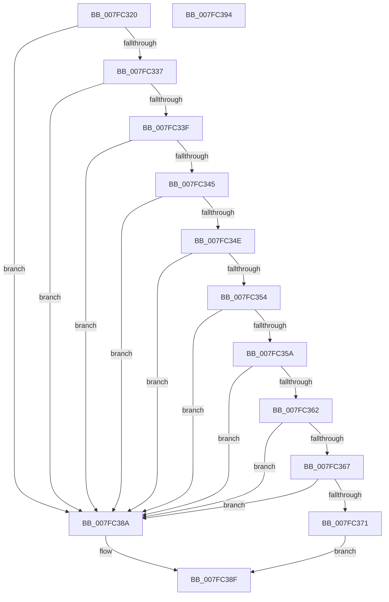

# MmFreeMemoryRanges

- RVA: `0x007FC320`–`0x007FC395` (길이 `117` bytes)
- VA: `0x00000001407FC320`
- 실행 섹션: `PAGE`
- PDB 이름 있음: `예`; PDB Function 태그: `아니요`
- unwind 정보 RVA: `0x00082420`
- 디코드: `37`개 명령, `117/117` bytes 표시
- 미해석 바이트: `0` (있으면 어셈블리에 `.byte`로 보존)

> 이 문서는 커널 이미지의 기계어와 PDB 기호를 분석해 생성했습니다. 4번과 5번은 함수 원형과 자료형을 바이너리 사용 방식에서 추정한 C 해석이며 원본 소스 복구 결과는 아닙니다.

## 1. Dependencies

- 직접 호출 지점: **1**; 고유 호출 대상: **1**
- 직접 호출자로 확인된 함수: **2**
- RIP 상대 이미지 참조: **0**

### Outgoing calls
- `0x007FC381` → [MiReleaseMemoryRuns](../../text/67/MiReleaseMemoryRuns_function_00676EF0.md) (function, `0x00676EF0`)

### Direct callers
- [IopLiveDumpFreeIoSpaceRanges](../../text/59/IopLiveDumpFreeIoSpaceRanges_function_0059BEE4.md) at `0x0059BF95`
- [MiFreePhysicalRange](../../text/68/MiFreePhysicalRange_function_00688CD0.md) at `0x00688D21`

### Static image references
- 디코드된 RIP-relative 메모리 참조가 없습니다.

## 2. Other-region calls and transfers

- 다른 실행 섹션으로 향하는 call: **1**
  - `0x007FC381` → [MiReleaseMemoryRuns](../../text/67/MiReleaseMemoryRuns_function_00676EF0.md) (`PAGE` → `.text`)
- 별도 외부 분기/꼬리 이동을 확인하지 못했습니다.

## 3. Assembly (complete function range)

```asm
007FC320  4C 8B DC                        mov r11, rsp
007FC323  48 83 EC 48                     sub rsp, 0x48
007FC327  45 33 D2                        xor r10d, r10d
007FC32A  4D 89 53 E0                     mov qword ptr [r11 - 0x20], r10
007FC32E  45 8D 42 01                     lea r8d, [r10 + 1]
007FC332  44 39 01                        cmp dword ptr [rcx], r8d
007FC335  75 53                           jne 0x1407fc38a
007FC337  8B 51 04                        mov edx, dword ptr [rcx + 4]
007FC33A  83 FA 02                        cmp edx, 2
007FC33D  73 4B                           jae 0x1407fc38a
007FC33F  4C 39 51 10                     cmp qword ptr [rcx + 0x10], r10
007FC343  75 45                           jne 0x1407fc38a
007FC345  4C 8B 49 28                     mov r9, qword ptr [rcx + 0x28]
007FC349  4D 85 C9                        test r9, r9
007FC34C  74 3C                           je 0x1407fc38a
007FC34E  44 39 51 20                     cmp dword ptr [rcx + 0x20], r10d
007FC352  75 36                           jne 0x1407fc38a
007FC354  4C 39 51 08                     cmp qword ptr [rcx + 8], r10
007FC358  75 30                           jne 0x1407fc38a
007FC35A  44 0F 20 C0                     mov rax, cr8
007FC35E  84 C0                           test al, al
007FC360  75 28                           jne 0x1407fc38a
007FC362  41 84 D0                        test r8b, dl
007FC365  74 23                           je 0x1407fc38a
007FC367  48 81 79 18 00 00 00 40         cmp qword ptr [rcx + 0x18], 0x40000000
007FC36F  75 19                           jne 0x1407fc38a
007FC371  48 8B 41 30                     mov rax, qword ptr [rcx + 0x30]
007FC375  49 8D 53 D8                     lea rdx, [r11 - 0x28]
007FC379  49 89 43 E8                     mov qword ptr [r11 - 0x18], rax
007FC37D  4D 89 4B D8                     mov qword ptr [r11 - 0x28], r9
007FC381  E8 6A AB E7 FF                  call 0x140676ef0
007FC386  33 C0                           xor eax, eax
007FC388  EB 05                           jmp 0x1407fc38f
007FC38A  B8 0D 00 00 C0                  mov eax, 0xc000000d
007FC38F  48 83 C4 48                     add rsp, 0x48
007FC393  C3                              ret
007FC394  CC                              int3
```

## 4. C-style interpretation (structured pseudocode)

```c
__int64 __fastcall MmFreeMemoryRanges(__int64 a1)
{
    __int64 result;
    __int64 v_r10;
    __int64 v_rsp;

    v_rsp = (v_rsp) - (72);
    v_r10 = 0;
    *(unsigned __int64 *)(v_rsp - 32) = 0;
    if ((*(unsigned int *)(a1)) != ((unsigned int)(v_r10 + 1))) goto loc_007FC38A;
    if (((unsigned int)((unsigned int)(*(unsigned int *)(a1 + 4)))) >= 2) goto loc_007FC38A;
    if ((*(unsigned __int64 *)(a1 + 16)) != 0) goto loc_007FC38A;
    if (*(unsigned __int64 *)(a1 + 40) == 0) goto loc_007FC38A;
    if ((*(unsigned int *)(a1 + 32)) != 0) goto loc_007FC38A;
    if ((*(unsigned __int64 *)(a1 + 8)) != 0) goto loc_007FC38A;
    if ((unsigned __int8)(v_cr8) != 0) goto loc_007FC38A;
    if ((((unsigned __int8)(v_r10 + 1)) & ((unsigned __int8)((unsigned int)(*(unsigned int *)(a1 + 4))))) == 0) goto loc_007FC38A;
    if ((*(unsigned __int64 *)(a1 + 24)) != 0x40000000ULL) goto loc_007FC38A;
    *(unsigned __int64 *)(v_rsp - 24) = *(unsigned __int64 *)(a1 + 48);
    *(unsigned __int64 *)(v_rsp - 40) = *(unsigned __int64 *)(a1 + 40);
    result = MiReleaseMemoryRuns(a1, v_rsp - 40, v_r10 + 1, *(unsigned __int64 *)(a1 + 40));
    result = 0;
    goto loc_007FC38F;
loc_007FC38A:
loc_007FC38F:
    v_rsp = (v_rsp) + (72);
    return (unsigned int)(0xC000000DULL);
}
```

## 5. (Beta) C Style

```c
int64_t MmFreeMemoryRanges(void *Arg1)
{
    uint8_t *arg1 = (uint8_t *)Arg1;

    int64_t result;
    int64_t local_r10;
    int64_t local_rsp;

    local_rsp = (local_rsp) - (72);
    local_r10 = 0;
    *(uint64_t *)(local_rsp - 0x20) = 0;
    if ((*(uint32_t *)(arg1)) != ((uint32_t)(local_r10 + 1))) goto loc_007FC38A;
    if (((uint32_t)((uint32_t)(*(uint32_t *)(arg1 + 0x4)))) >= 2) goto loc_007FC38A;
    if ((*(uint64_t *)(arg1 + 0x10)) != 0) goto loc_007FC38A;
    if (*(uint64_t *)(arg1 + 0x28) == 0) goto loc_007FC38A;
    if ((*(uint32_t *)(arg1 + 0x20)) != 0) goto loc_007FC38A;
    if ((*(uint64_t *)(arg1 + 0x8)) != 0) goto loc_007FC38A;
    if ((uint8_t)(v_cr8) != 0) goto loc_007FC38A;
    if ((((uint8_t)(local_r10 + 1)) & ((uint8_t)((uint32_t)(*(uint32_t *)(arg1 + 0x4))))) == 0) goto loc_007FC38A;
    if ((*(uint64_t *)(arg1 + 0x18)) != 0x40000000ULL) goto loc_007FC38A;
    *(uint64_t *)(local_rsp - 0x18) = *(uint64_t *)(arg1 + 0x30);
    *(uint64_t *)(local_rsp - 0x28) = *(uint64_t *)(arg1 + 0x28);
    result = MiReleaseMemoryRuns(Arg1, local_rsp - 40, local_r10 + 1, *(uint64_t *)(arg1 + 0x28));
    result = 0;
    goto loc_007FC38F;
loc_007FC38A:
loc_007FC38F:
    local_rsp = (local_rsp) + (72);
    return (uint32_t)(0xC000000DULL);
}
```

### 관측된 메모리 오프셋

구조체 형식이 확인되지 않은 접근은 인자 기준의 오프셋으로만 기록했습니다.

| 기준 인자 | 오프셋 표현 | 폭 (bit) | 접근 |
|---|---:|---:|---|
| `Arg1` | `+ 0x0` | `32` | `R` |
| `Arg1` | `+ 0x4` | `32` | `R` |
| `Arg1` | `+ 0x8` | `64` | `R` |
| `Arg1` | `+ 0x10` | `64` | `R` |
| `Arg1` | `+ 0x18` | `64` | `R` |
| `Arg1` | `+ 0x20` | `32` | `R` |
| `Arg1` | `+ 0x28` | `64` | `R` |
| `Arg1` | `+ 0x30` | `64` | `R` |

## 6. Execution-region graph

[열기: 2D/3D 그래프와 함수 탐색 컨트롤 패널](../../../control-panel.html?section=page&rva=0x007FC320&view=graph)

- 2D 그래프는 위에서 아래로 흐르고, 3D 그래프는 빈 공간을 드래그해 회전합니다. Shift+드래그는 이동, 휠은 확대·축소, 함수 노드 선택은 대상 보고서 이동입니다.

### Static fallback


