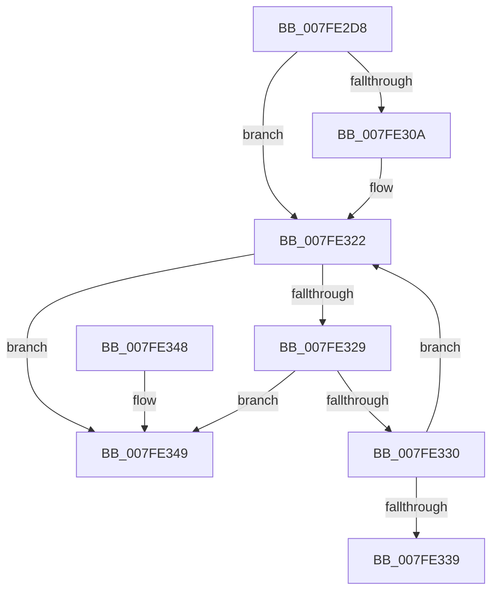

# MmFreeSystemCacheReserveView

- RVA: `0x007FE2D8`–`0x007FE362` (길이 `138` bytes)
- VA: `0x00000001407FE2D8`
- 실행 섹션: `PAGE`
- PDB 이름 있음: `예`; PDB Function 태그: `아니요`
- unwind 정보 RVA: `0x0006886C`
- 디코드: `39`개 명령, `138/138` bytes 표시
- 미해석 바이트: `0` (있으면 어셈블리에 `.byte`로 보존)

> 이 문서는 커널 이미지의 기계어와 PDB 기호를 분석해 생성했습니다. 4번과 5번은 함수 원형과 자료형을 바이너리 사용 방식에서 추정한 C 해석이며 원본 소스 복구 결과는 아닙니다.

## 1. Dependencies

- 직접 호출 지점: **6**; 고유 호출 대상: **5**
- 직접 호출자로 확인된 함수: **1**
- RIP 상대 이미지 참조: **0**

### Outgoing calls
- `0x007FE2DF` → [MiGetPteAddress](../../text/43/MiGetPteAddress_function_0043E130.md) (function, `0x0043E130`)
- `0x007FE2F1` → [MiGetSystemCacheReverseMap](../../text/29/MiGetSystemCacheReverseMap_function_00294BF0.md) (function, `0x00294BF0`)
- `0x007FE2F9` → [MiReadReverseMapAttributes](../../text/4A/MiReadReverseMapAttributes_function_004A32D4.md) (function, `0x004A32D4`)
- `0x007FE31C` → [KeBugCheckEx](../../text/4F/KeBugCheckEx_function_004FD660.md) (function, `0x004FD660`)
- `0x007FE33E` → [MiReleaseSystemCacheView](../../text/29/MiReleaseSystemCacheView_function_00294CE0.md) (function, `0x00294CE0`)
- `0x007FE35C` → [KeBugCheckEx](../../text/4F/KeBugCheckEx_function_004FD660.md) (function, `0x004FD660`)

### Direct callers
- [CcUninitializePartitionVacbs](../../text/57/CcUninitializePartitionVacbs_function_0057EC70.md) at `0x0057ECBB`

### Static image references
- 디코드된 RIP-relative 메모리 참조가 없습니다.

## 2. Other-region calls and transfers

- 다른 실행 섹션으로 향하는 call: **6**
  - `0x007FE2DF` → [MiGetPteAddress](../../text/43/MiGetPteAddress_function_0043E130.md) (`PAGE` → `.text`)
  - `0x007FE2F1` → [MiGetSystemCacheReverseMap](../../text/29/MiGetSystemCacheReverseMap_function_00294BF0.md) (`PAGE` → `.text`)
  - `0x007FE2F9` → [MiReadReverseMapAttributes](../../text/4A/MiReadReverseMapAttributes_function_004A32D4.md) (`PAGE` → `.text`)
  - `0x007FE31C` → [KeBugCheckEx](../../text/4F/KeBugCheckEx_function_004FD660.md) (`PAGE` → `.text`)
  - `0x007FE33E` → [MiReleaseSystemCacheView](../../text/29/MiReleaseSystemCacheView_function_00294CE0.md) (`PAGE` → `.text`)
  - `0x007FE35C` → [KeBugCheckEx](../../text/4F/KeBugCheckEx_function_004FD660.md) (`PAGE` → `.text`)
- 별도 외부 분기/꼬리 이동을 확인하지 못했습니다.

## 3. Assembly (complete function range)

```asm
007FE2D8  48 83 EC 38                     sub rsp, 0x38
007FE2DC  4C 8B C9                        mov r9, rcx
007FE2DF  E8 4C FE C3 FF                  call 0x14043e130
007FE2E4  49 8B C9                        mov rcx, r9
007FE2E7  4C 8B C0                        mov r8, rax
007FE2EA  4C 8D 90 00 02 00 00            lea r10, [rax + 0x200]
007FE2F1  E8 FA 68 A9 FF                  call 0x140294bf0
007FE2F6  48 8B C8                        mov rcx, rax
007FE2F9  E8 D6 4F CA FF                  call 0x1404a32d4
007FE2FE  48 8B D0                        mov rdx, rax
007FE301  48 C1 EA 3E                     shr rdx, 0x3e
007FE305  80 FA 02                        cmp dl, 2
007FE308  73 18                           jae 0x1407fe322
007FE30A  4C 8B C1                        mov r8, rcx
007FE30D  48 89 44 24 20                  mov qword ptr [rsp + 0x20], rax
007FE312  B9 1A 00 00 00                  mov ecx, 0x1a
007FE317  BA 84 07 00 00                  mov edx, 0x784
007FE31C  E8 3F F3 CF FF                  call 0x1404fd660
007FE321  CC                              int3
007FE322  49 8B 00                        mov rax, qword ptr [r8]
007FE325  A8 01                           test al, 1
007FE327  75 20                           jne 0x1407fe349
007FE329  48 0F BA E0 0A                  bt rax, 0xa
007FE32E  72 19                           jb 0x1407fe349
007FE330  49 83 C0 08                     add r8, 8
007FE334  4D 3B C2                        cmp r8, r10
007FE337  72 E9                           jb 0x1407fe322
007FE339  49 8B D1                        mov rdx, r9
007FE33C  33 C9                           xor ecx, ecx
007FE33E  E8 9D 69 A9 FF                  call 0x140294ce0
007FE343  48 83 C4 38                     add rsp, 0x38
007FE347  C3                              ret
007FE348  CC                              int3
007FE349  48 83 64 24 20 00               and qword ptr [rsp + 0x20], 0
007FE34F  4C 8B C1                        mov r8, rcx
007FE352  B9 1A 00 00 00                  mov ecx, 0x1a
007FE357  BA 85 07 00 00                  mov edx, 0x785
007FE35C  E8 FF F2 CF FF                  call 0x1404fd660
007FE361  CC                              int3
```

## 4. C-style interpretation (structured pseudocode)

```c
__int64 __fastcall MmFreeSystemCacheReserveView(__int64 a1)
{
    __int64 result;
    __int64 v_rsp;
    unsigned __int64 v_stack_m18;
    unsigned __int64 v_stack_p20;

    v_rsp = (v_rsp) - (56);
    result = MiGetPteAddress(a1, a2, a3, a1);
    result = MiGetSystemCacheReverseMap(a1, a2, result, a1);
    result = MiReadReverseMapAttributes(result, a2, result, a1);
    a2 = (result) >> (62);
    if (((unsigned __int8)(a2)) < 2) {
        a3 = result;
        v_stack_m18 = result;
        a1 = 26;
        a2 = 0x784ULL;
        result = KeBugCheckEx(a1, a2, a3, a1);
    }
    if ((((unsigned __int8)(*(unsigned __int64 *)(a3))) & (1)) != 0) goto loc_007FE349;
    if (condition_is_below) goto loc_007FE349;
    a3 = (a3) + (8);
    if (a3 < (result + 512)) goto loc_007FE322;
    a1 = 0;
    result = MiReleaseSystemCacheView(a1, a1, a3, a1);
    v_rsp = (v_rsp) + (56);
    return result;
loc_007FE349:
    result = KeBugCheckEx(26, (unsigned int)(0x785ULL), 0, a1);
    return result;
}
```

## 5. (Beta) C Style

```c
int64_t MmFreeSystemCacheReserveView(int64_t Arg1)
{
    int64_t result;
    int64_t local_rsp;
    uint64_t v_stack_m18;
    uint64_t v_stack_p20;

    local_rsp = (local_rsp) - (56);
    result = MiGetPteAddress(Arg1, a2, a3, Arg1);
    result = MiGetSystemCacheReverseMap(Arg1, a2, result, Arg1);
    result = MiReadReverseMapAttributes(result, a2, result, Arg1);
    a2 = (result) >> (62);
    if (((uint8_t)(a2)) < 2) {
        a3 = result;
        v_stack_m18 = result;
        Arg1 = 26;
        a2 = 0x784ULL;
        result = KeBugCheckEx(Arg1, a2, a3, Arg1);
    }
    if ((((uint8_t)(*(uint64_t *)(a3))) & (1)) != 0) goto loc_007FE349;
    if (condition_is_below) goto loc_007FE349;
    a3 = (a3) + (8);
    if (a3 < (result + 512)) goto loc_007FE322;
    Arg1 = 0;
    result = MiReleaseSystemCacheView(Arg1, Arg1, a3, Arg1);
    local_rsp = (local_rsp) + (56);
    return result;
loc_007FE349:
    result = KeBugCheckEx(26, (uint32_t)(0x785ULL), 0, Arg1);
    return result;
}
```

## 6. Execution-region graph

[열기: 2D/3D 그래프와 함수 탐색 컨트롤 패널](../../../control-panel.html?section=page&rva=0x007FE2D8&view=graph)

- 2D 그래프는 위에서 아래로 흐르고, 3D 그래프는 빈 공간을 드래그해 회전합니다. Shift+드래그는 이동, 휠은 확대·축소, 함수 노드 선택은 대상 보고서 이동입니다.

### Static fallback


