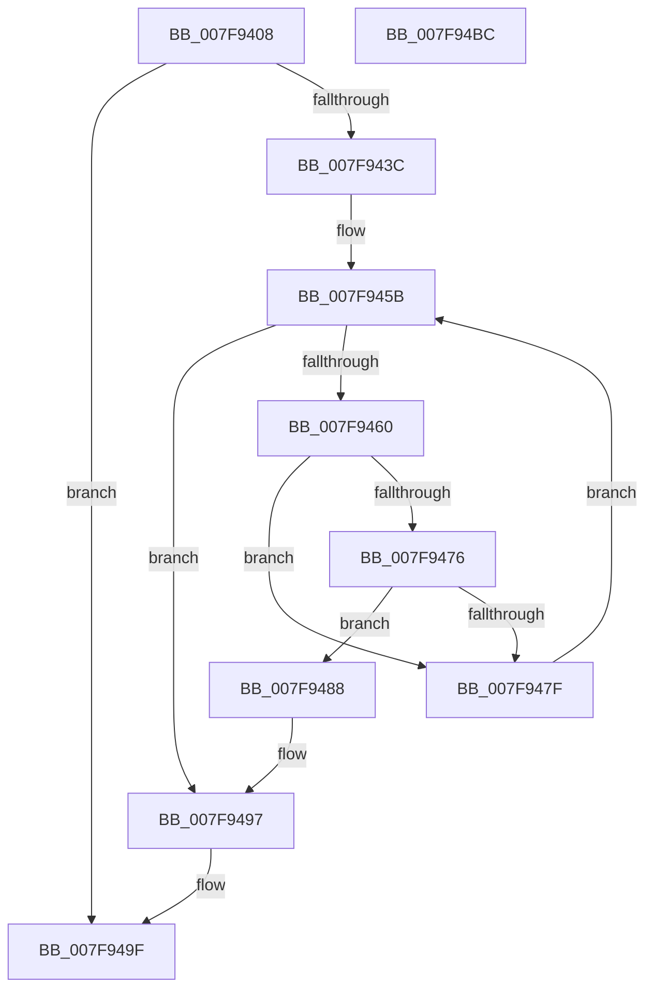

# MmGetSectionRange

- RVA: `0x007F9408`–`0x007F94BD` (길이 `181` bytes)
- VA: `0x00000001407F9408`
- 실행 섹션: `PAGE`
- PDB 이름 있음: `예`; PDB Function 태그: `아니요`
- unwind 정보 RVA: `0x0007F3F8`
- 디코드: `54`개 명령, `181/181` bytes 표시
- 미해석 바이트: `0` (있으면 어셈블리에 `.byte`로 보존)

> 이 문서는 커널 이미지의 기계어와 PDB 기호를 분석해 생성했습니다. 4번과 5번은 함수 원형과 자료형을 바이너리 사용 방식에서 추정한 C 해석이며 원본 소스 복구 결과는 아닙니다.

## 1. Dependencies

- 직접 호출 지점: **3**; 고유 호출 대상: **3**
- 직접 호출자로 확인된 함수: **1**
- RIP 상대 이미지 참조: **0**

### Outgoing calls
- `0x007F942F` → [MmLockLoadedDataTableEntry](../../text/2A/MmLockLoadedDataTableEntry_function_002A437C.md) (function, `0x002A437C`)
- `0x007F9443` → [RtlImageNtHeader](../../text/44/RtlImageNtHeader_function_00443B60.md) (function, `0x00443B60`)
- `0x007F949A` → [MmUnlockLoadedDataTableEntry](../../text/2A/MmUnlockLoadedDataTableEntry_function_002A3C98.md) (function, `0x002A3C98`)

### Direct callers
- [sub_006F4AC2](../../text/6F/Unknown_function_006F4AC2.md) at `0x006F4B29`

### Static image references
- 디코드된 RIP-relative 메모리 참조가 없습니다.

## 2. Other-region calls and transfers

- 다른 실행 섹션으로 향하는 call: **3**
  - `0x007F942F` → [MmLockLoadedDataTableEntry](../../text/2A/MmLockLoadedDataTableEntry_function_002A437C.md) (`PAGE` → `.text`)
  - `0x007F9443` → [RtlImageNtHeader](../../text/44/RtlImageNtHeader_function_00443B60.md) (`PAGE` → `.text`)
  - `0x007F949A` → [MmUnlockLoadedDataTableEntry](../../text/2A/MmUnlockLoadedDataTableEntry_function_002A3C98.md) (`PAGE` → `.text`)
- 별도 외부 분기/꼬리 이동을 확인하지 못했습니다.

## 3. Assembly (complete function range)

```asm
007F9408  48 8B C4                        mov rax, rsp
007F940B  48 89 58 08                     mov qword ptr [rax + 8], rbx
007F940F  48 89 70 10                     mov qword ptr [rax + 0x10], rsi
007F9413  48 89 78 18                     mov qword ptr [rax + 0x18], rdi
007F9417  4C 89 70 20                     mov qword ptr [rax + 0x20], r14
007F941B  41 57                           push r15
007F941D  48 83 EC 20                     sub rsp, 0x20
007F9421  4D 8B F0                        mov r14, r8
007F9424  4C 8B FA                        mov r15, rdx
007F9427  48 8B F9                        mov rdi, rcx
007F942A  BE 25 02 00 C0                  mov esi, 0xc0000225
007F942F  E8 48 AF AA FF                  call 0x1402a437c
007F9434  48 8B D8                        mov rbx, rax
007F9437  48 85 C0                        test rax, rax
007F943A  74 63                           je 0x1407f949f
007F943C  48 8B 48 30                     mov rcx, qword ptr [rax + 0x30]
007F9440  48 2B F9                        sub rdi, rcx
007F9443  E8 18 A7 C4 FF                  call 0x140443b60
007F9448  45 33 C0                        xor r8d, r8d
007F944B  44 0F B7 58 06                  movzx r11d, word ptr [rax + 6]
007F9450  48 8D 50 20                     lea rdx, [rax + 0x20]
007F9454  0F B7 40 14                     movzx eax, word ptr [rax + 0x14]
007F9458  48 03 D0                        add rdx, rax
007F945B  45 3B C3                        cmp r8d, r11d
007F945E  73 37                           jae 0x1407f9497
007F9460  44 8B 4A 08                     mov r9d, dword ptr [rdx + 8]
007F9464  8B 02                           mov eax, dword ptr [rdx]
007F9466  44 3B C8                        cmp r9d, eax
007F9469  44 8B 52 04                     mov r10d, dword ptr [rdx + 4]
007F946D  44 0F 42 C8                     cmovb r9d, eax
007F9471  49 3B FA                        cmp rdi, r10
007F9474  72 09                           jb 0x1407f947f
007F9476  43 8D 0C 11                     lea ecx, [r9 + r10]
007F947A  48 3B F9                        cmp rdi, rcx
007F947D  72 09                           jb 0x1407f9488
007F947F  48 83 C2 28                     add rdx, 0x28
007F9483  41 FF C0                        inc r8d
007F9486  EB D3                           jmp 0x1407f945b
007F9488  48 8B 4B 30                     mov rcx, qword ptr [rbx + 0x30]
007F948C  49 03 CA                        add rcx, r10
007F948F  45 89 0E                        mov dword ptr [r14], r9d
007F9492  49 89 0F                        mov qword ptr [r15], rcx
007F9495  33 F6                           xor esi, esi
007F9497  48 8B CB                        mov rcx, rbx
007F949A  E8 F9 A7 AA FF                  call 0x1402a3c98
007F949F  48 8B 5C 24 30                  mov rbx, qword ptr [rsp + 0x30]
007F94A4  8B C6                           mov eax, esi
007F94A6  48 8B 74 24 38                  mov rsi, qword ptr [rsp + 0x38]
007F94AB  48 8B 7C 24 40                  mov rdi, qword ptr [rsp + 0x40]
007F94B0  4C 8B 74 24 48                  mov r14, qword ptr [rsp + 0x48]
007F94B5  48 83 C4 20                     add rsp, 0x20
007F94B9  41 5F                           pop r15
007F94BB  C3                              ret
007F94BC  CC                              int3
```

## 4. C-style interpretation (structured pseudocode)

```c
__int64 __fastcall MmGetSectionRange(__int64 a1, __int64 a2, __int64 a3)
{
    __int64 result;
    __int64 v_rdi;
    __int64 v_rsi;
    __int64 v_rsp;
    unsigned __int64 v_stack_p10;
    unsigned __int64 v_stack_p18;
    unsigned __int64 v_stack_p20;
    unsigned __int64 v_stack_p8;

    *(unsigned __int64 *)(v_rsp + 8) = v_rbx;
    *(unsigned __int64 *)(v_rsp + 16) = v_rsi;
    *(unsigned __int64 *)(v_rsp + 24) = v_rdi;
    *(unsigned __int64 *)(v_rsp + 32) = v_r14;
    v_rsp = (v_rsp) - (32);
    result = MmLockLoadedDataTableEntry(a1, a2, a3, a4);
    if (result == 0) goto loc_007F949F;
    v_rdi = (a1) - (*(unsigned __int64 *)(result + 48));
    result = RtlImageNtHeader(*(unsigned __int64 *)(result + 48), a2, a3, a4);
    a3 = 0;
    a2 = (result + 32) + (*(unsigned __int16 *)(result + 20));
loc_007F945B:
    if (0 >= ((unsigned int)(*(unsigned __int16 *)(result + 6)))) goto loc_007F9497;
    a4 = (unsigned int)(*(unsigned int *)(a2 + 8));
    if (((unsigned int)((unsigned int)(*(unsigned int *)(a2 + 8)))) < ((unsigned int)((unsigned int)(*(unsigned int *)(a2))))) { a4 = (unsigned int)((unsigned int)(*(unsigned int *)(a2))); }
    if (v_rdi < ((unsigned int)(*(unsigned int *)(a2 + 4)))) goto loc_007F947F;
    if (v_rdi < (a4 + (unsigned int)(*(unsigned int *)(a2 + 4)) * 1)) goto loc_007F9488;
loc_007F947F:
    a2 = (a2) + (40);
    a3 = (unsigned int)((a3) + 1);
    goto loc_007F945B;
loc_007F9488:
    a1 = (*(unsigned __int64 *)(result + 48)) + ((unsigned int)(*(unsigned int *)(a2 + 4)));
    *(unsigned int *)(a3) = (unsigned int)(a4);
    *(unsigned __int64 *)(a2) = a1;
    v_rsi = 0;
loc_007F9497:
    result = MmUnlockLoadedDataTableEntry(result, a2, a3, a4);
loc_007F949F:
    v_rsp = (v_rsp) + (32);
    return 0;
}
```

## 5. (Beta) C Style

```c
int64_t MmGetSectionRange(int64_t Arg1, void *Arg2, void *Arg3)
{
    uint8_t *arg2 = (uint8_t *)Arg2;
    uint8_t *arg3 = (uint8_t *)Arg3;

    int64_t result;
    int64_t local_rdi;
    int64_t local_rsi;
    int64_t local_rsp;
    uint64_t v_stack_p10;
    uint64_t v_stack_p18;
    uint64_t v_stack_p20;
    uint64_t v_stack_p8;

    *(uint64_t *)(local_rsp + 0x8) = local_rbx;
    *(uint64_t *)(local_rsp + 0x10) = local_rsi;
    *(uint64_t *)(local_rsp + 0x18) = local_rdi;
    *(uint64_t *)(local_rsp + 0x20) = local_r14;
    local_rsp = (local_rsp) - (32);
    result = MmLockLoadedDataTableEntry(Arg1, Arg2, Arg3, a4);
    if (result == 0) goto loc_007F949F;
    local_rdi = (Arg1) - (*(uint64_t *)(result + 0x30));
    result = RtlImageNtHeader(*(uint64_t *)(result + 0x30), Arg2, Arg3, a4);
    Arg3 = 0;
    Arg2 = (result + 32) + (*(uint16_t *)(result + 0x14));
loc_007F945B:
    if (0 >= ((uint32_t)(*(uint16_t *)(result + 0x6)))) goto loc_007F9497;
    a4 = (uint32_t)(*(uint32_t *)(arg2 + 0x8));
    if (((uint32_t)((uint32_t)(*(uint32_t *)(arg2 + 0x8)))) < ((uint32_t)((uint32_t)(*(uint32_t *)(arg2))))) { a4 = (uint32_t)((uint32_t)(*(uint32_t *)(arg2))); }
    if (local_rdi < ((uint32_t)(*(uint32_t *)(arg2 + 0x4)))) goto loc_007F947F;
    if (local_rdi < (a4 + (uint32_t)(*(uint32_t *)(arg2 + 0x4)) * 1)) goto loc_007F9488;
loc_007F947F:
    Arg2 = (Arg2) + (40);
    Arg3 = (uint32_t)((Arg3) + 1);
    goto loc_007F945B;
loc_007F9488:
    Arg1 = (*(uint64_t *)(result + 0x30)) + ((uint32_t)(*(uint32_t *)(arg2 + 0x4)));
    *(uint32_t *)(arg3) = (uint32_t)(a4);
    *(uint64_t *)(arg2) = Arg1;
    local_rsi = 0;
loc_007F9497:
    result = MmUnlockLoadedDataTableEntry(result, Arg2, Arg3, a4);
loc_007F949F:
    local_rsp = (local_rsp) + (32);
    return 0;
}
```

### 관측된 메모리 오프셋

구조체 형식이 확인되지 않은 접근은 인자 기준의 오프셋으로만 기록했습니다.

| 기준 인자 | 오프셋 표현 | 폭 (bit) | 접근 |
|---|---:|---:|---|
| `Arg2` | `+ 0x0` | `64` | `W` |
| `Arg3` | `+ 0x0` | `32` | `W` |

## 6. Execution-region graph

[열기: 2D/3D 그래프와 함수 탐색 컨트롤 패널](../../../control-panel.html?section=page&rva=0x007F9408&view=graph)

- 2D 그래프는 위에서 아래로 흐르고, 3D 그래프는 빈 공간을 드래그해 회전합니다. Shift+드래그는 이동, 휠은 확대·축소, 함수 노드 선택은 대상 보고서 이동입니다.

### Static fallback


