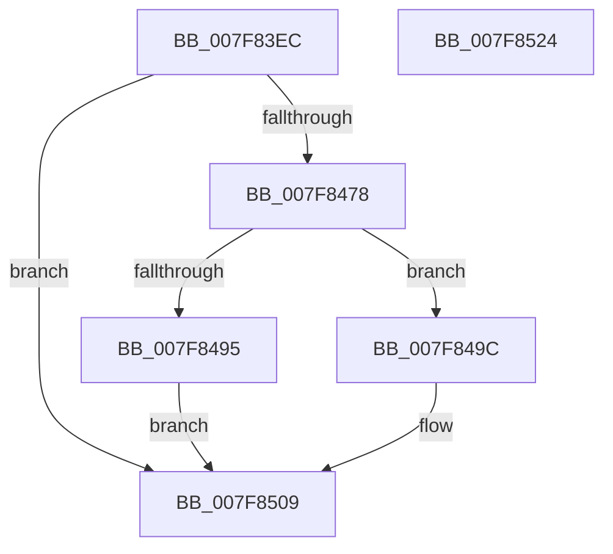

# MmInitializeHandBuiltProcess

- RVA: `0x007F83EC`–`0x007F8525` (길이 `313` bytes)
- VA: `0x00000001407F83EC`
- 실행 섹션: `PAGE`
- PDB 이름 있음: `예`; PDB Function 태그: `아니요`
- unwind 정보 RVA: `0x0005E6B4`
- 디코드: `67`개 명령, `313/313` bytes 표시
- 미해석 바이트: `0` (있으면 어셈블리에 `.byte`로 보존)

> 이 문서는 커널 이미지의 기계어와 PDB 기호를 분석해 생성했습니다. 4번과 5번은 함수 원형과 자료형을 바이너리 사용 방식에서 추정한 C 해석이며 원본 소스 복구 결과는 아닙니다.

## 1. Dependencies

- 직접 호출 지점: **7**; 고유 호출 대상: **7**
- 직접 호출자로 확인된 함수: **1**
- RIP 상대 이미지 참조: **0**

### Outgoing calls
- `0x007F845E` → [MiGetSharedVm](../../text/41/MiGetSharedVm_function_00414A20.md) (function, `0x00414A20`)
- `0x007F846B` → [MiAllocateProcessShadow](../A5/MiAllocateProcessShadow_function_00A5F1A0.md) (function, `0x00A5F1A0`)
- `0x007F8488` → [MiAllocatePool](../../text/35/MiAllocatePool_function_0035B540.md) (function, `0x0035B540`)
- `0x007F84B5` → [ExInitializeAutoExpandPushLock](../../text/44/ExInitializeAutoExpandPushLock_function_004489C0.md) (function, `0x004489C0`)
- `0x007F84DD` → [MiCopyWorkingSetFields](../../text/66/MiCopyWorkingSetFields_function_0066F0F4.md) (function, `0x0066F0F4`)
- `0x007F84FA` → [MiInsertNewProcess](../../text/49/MiInsertNewProcess_function_0049BB40.md) (function, `0x0049BB40`)
- `0x007F8502` → [MiAllowWorkingSetExpansion](../../text/35/MiAllowWorkingSetExpansion_function_00350490.md) (function, `0x00350490`)

### Direct callers
- [PspAllocateProcess](../A1/PspAllocateProcess_function_00A13B3C.md) at `0x00A151D4`

### Static image references
- 디코드된 RIP-relative 메모리 참조가 없습니다.

## 2. Other-region calls and transfers

- 다른 실행 섹션으로 향하는 call: **6**
  - `0x007F845E` → [MiGetSharedVm](../../text/41/MiGetSharedVm_function_00414A20.md) (`PAGE` → `.text`)
  - `0x007F8488` → [MiAllocatePool](../../text/35/MiAllocatePool_function_0035B540.md) (`PAGE` → `.text`)
  - `0x007F84B5` → [ExInitializeAutoExpandPushLock](../../text/44/ExInitializeAutoExpandPushLock_function_004489C0.md) (`PAGE` → `.text`)
  - `0x007F84DD` → [MiCopyWorkingSetFields](../../text/66/MiCopyWorkingSetFields_function_0066F0F4.md) (`PAGE` → `.text`)
  - `0x007F84FA` → [MiInsertNewProcess](../../text/49/MiInsertNewProcess_function_0049BB40.md) (`PAGE` → `.text`)
  - `0x007F8502` → [MiAllowWorkingSetExpansion](../../text/35/MiAllowWorkingSetExpansion_function_00350490.md) (`PAGE` → `.text`)
- 별도 외부 분기/꼬리 이동을 확인하지 못했습니다.

## 3. Assembly (complete function range)

```asm
007F83EC  48 8B C4                        mov rax, rsp
007F83EF  48 89 58 08                     mov qword ptr [rax + 8], rbx
007F83F3  48 89 68 10                     mov qword ptr [rax + 0x10], rbp
007F83F7  48 89 70 18                     mov qword ptr [rax + 0x18], rsi
007F83FB  48 89 78 20                     mov qword ptr [rax + 0x20], rdi
007F83FF  41 56                           push r14
007F8401  48 83 EC 20                     sub rsp, 0x20
007F8405  65 48 8B 04 25 88 01 00 00      mov rax, qword ptr gs:[0x188]
007F840E  48 8D A9 00 04 00 00            lea rbp, [rcx + 0x400]
007F8415  48 8B D9                        mov rbx, rcx
007F8418  48 8B B0 B8 00 00 00            mov rsi, qword ptr [rax + 0xb8]
007F841F  48 8B 46 28                     mov rax, qword ptr [rsi + 0x28]
007F8423  83 89 50 07 00 00 20            or dword ptr [rcx + 0x750], 0x20
007F842A  48 83 A1 58 02 00 00 00         and qword ptr [rcx + 0x258], 0
007F8432  48 83 A1 60 02 00 00 00         and qword ptr [rcx + 0x260], 0
007F843A  48 89 41 28                     mov qword ptr [rcx + 0x28], rax
007F843E  48 8D 81 B8 06 00 00            lea rax, [rcx + 0x6b8]
007F8445  C6 81 EE 06 00 00 FF            mov byte ptr [rcx + 0x6ee], 0xff
007F844C  48 89 40 08                     mov qword ptr [rax + 8], rax
007F8450  48 89 00                        mov qword ptr [rax], rax
007F8453  48 83 A1 B0 06 00 00 00         and qword ptr [rcx + 0x6b0], 0
007F845B  48 8B CD                        mov rcx, rbp
007F845E  E8 BD C5 C1 FF                  call 0x140414a20
007F8463  33 D2                           xor edx, edx
007F8465  48 8B CB                        mov rcx, rbx
007F8468  4C 8B F0                        mov r14, rax
007F846B  E8 30 6D 26 00                  call 0x140a5f1a0
007F8470  85 C0                           test eax, eax
007F8472  0F 88 91 00 00 00               js 0x1407f8509
007F8478  BA 80 05 00 00                  mov edx, 0x580
007F847D  B9 48 00 00 00                  mov ecx, 0x48
007F8482  41 B8 4D 69 50 32               mov r8d, 0x3250694d
007F8488  E8 B3 30 B6 FF                  call 0x14035b540
007F848D  48 8B F8                        mov rdi, rax
007F8490  48 85 C0                        test rax, rax
007F8493  75 07                           jne 0x1407f849c
007F8495  B8 9A 00 00 C0                  mov eax, 0xc000009a
007F849A  EB 6D                           jmp 0x1407f8509
007F849C  48 05 00 01 00 00               add rax, 0x100
007F84A2  48 8D 8F 58 04 00 00            lea rcx, [rdi + 0x458]
007F84A9  49 89 06                        mov qword ptr [r14], rax
007F84AC  41 BE 01 00 00 00               mov r14d, 1
007F84B2  41 8B D6                        mov edx, r14d
007F84B5  E8 06 05 C5 FF                  call 0x1404489c0
007F84BA  48 83 A3 58 05 00 00 00         and qword ptr [rbx + 0x558], 0
007F84C2  48 8D 96 00 04 00 00            lea rdx, [rsi + 0x400]
007F84C9  48 8B 86 68 03 00 00            mov rax, qword ptr [rsi + 0x368]
007F84D0  4C 8B C7                        mov r8, rdi
007F84D3  48 8B CD                        mov rcx, rbp
007F84D6  48 89 83 68 03 00 00            mov qword ptr [rbx + 0x368], rax
007F84DD  E8 12 6C E7 FF                  call 0x14066f0f4
007F84E2  48 8B 86 88 02 00 00            mov rax, qword ptr [rsi + 0x288]
007F84E9  48 8B CB                        mov rcx, rbx
007F84EC  48 89 83 88 02 00 00            mov qword ptr [rbx + 0x288], rax
007F84F3  44 89 B3 A4 07 00 00            mov dword ptr [rbx + 0x7a4], r14d
007F84FA  E8 41 36 CA FF                  call 0x14049bb40
007F84FF  48 8B CD                        mov rcx, rbp
007F8502  E8 89 7F B5 FF                  call 0x140350490
007F8507  33 C0                           xor eax, eax
007F8509  48 8B 5C 24 30                  mov rbx, qword ptr [rsp + 0x30]
007F850E  48 8B 6C 24 38                  mov rbp, qword ptr [rsp + 0x38]
007F8513  48 8B 74 24 40                  mov rsi, qword ptr [rsp + 0x40]
007F8518  48 8B 7C 24 48                  mov rdi, qword ptr [rsp + 0x48]
007F851D  48 83 C4 20                     add rsp, 0x20
007F8521  41 5E                           pop r14
007F8523  C3                              ret
007F8524  CC                              int3
```

## 4. C-style interpretation (structured pseudocode)

```c
__int64 __fastcall MmInitializeHandBuiltProcess(__int64 a1, int a2)
{
    __int64 result;
    __int64 v_rsp;
    unsigned __int64 v_stack_p10;
    unsigned __int64 v_stack_p18;
    unsigned __int64 v_stack_p20;
    unsigned __int64 v_stack_p8;

    *(unsigned __int64 *)(v_rsp + 8) = v_rbx;
    *(unsigned __int64 *)(v_rsp + 16) = v_rbp;
    *(unsigned __int64 *)(v_rsp + 24) = v_rsi;
    *(unsigned __int64 *)(v_rsp + 32) = v_rdi;
    v_rsp = (v_rsp) - (32);
    *(unsigned __int64 *)(a1 + 40) = *(unsigned __int64 *)(*(unsigned __int64 *)(*(unsigned __int64 *)(gs_base + (0 + 392)) + 184) + 40);
    *(unsigned __int8 *)(a1 + 1774) = 255;
    *(unsigned __int64 *)(a1 + 1720 + 8) = a1 + 1720;
    *(unsigned __int64 *)(a1 + 1720) = a1 + 1720;
    result = MiGetSharedVm(a1 + 1024, a2, a3, a4);
    a2 = 0;
    result = MiAllocateProcessShadow(a1, a2, a3, a4);
    if (sign_flag) goto loc_007F8509;
    result = MiAllocatePool(72, (unsigned int)(0x580ULL), (unsigned int)(0x3250694DULL), a4);
    if (result != 0) goto loc_007F849C;
    goto loc_007F8509;
loc_007F849C:
    result = ((unsigned int)(0xC000009AULL)) + (256);
    *(unsigned __int64 *)(result) = result;
    result = ExInitializeAutoExpandPushLock(result + 1112, 1, (unsigned int)(0x3250694DULL), a4);
    *(unsigned __int64 *)(a1 + 872) = *(unsigned __int64 *)(*(unsigned __int64 *)(*(unsigned __int64 *)(gs_base + (0 + 392)) + 184) + 872);
    result = MiCopyWorkingSetFields(a1 + 1024, *(unsigned __int64 *)(*(unsigned __int64 *)(gs_base + (0 + 392)) + 184) + 1024, result, a4);
    *(unsigned __int64 *)(a1 + 648) = *(unsigned __int64 *)(*(unsigned __int64 *)(*(unsigned __int64 *)(gs_base + (0 + 392)) + 184) + 648);
    *(unsigned int *)(a1 + 1956) = 1;
    result = MiInsertNewProcess(a1, *(unsigned __int64 *)(*(unsigned __int64 *)(gs_base + (0 + 392)) + 184) + 1024, result, a4);
    result = MiAllowWorkingSetExpansion(a1 + 1024, *(unsigned __int64 *)(*(unsigned __int64 *)(gs_base + (0 + 392)) + 184) + 1024, result, a4);
    result = 0;
loc_007F8509:
    v_rsp = (v_rsp) + (32);
    return result;
}
```

## 5. (Beta) C Style

```c
int64_t MmInitializeHandBuiltProcess(void *Arg1, int32_t Arg2)
{
    uint8_t *arg1 = (uint8_t *)Arg1;

    int64_t result;
    int64_t local_rsp;
    uint64_t v_stack_p10;
    uint64_t v_stack_p18;
    uint64_t v_stack_p20;
    uint64_t v_stack_p8;

    *(uint64_t *)(local_rsp + 0x8) = local_rbx;
    *(uint64_t *)(local_rsp + 0x10) = local_rbp;
    *(uint64_t *)(local_rsp + 0x18) = local_rsi;
    *(uint64_t *)(local_rsp + 0x20) = local_rdi;
    local_rsp = (local_rsp) - (32);
    *(uint64_t *)(arg1 + 0x28) = *(uint64_t *)(*(uint64_t *)(*(uint64_t *)(gs_base + (0 + 0x188)) + 0xB8) + 0x28);
    *(uint8_t *)(arg1 + 0x6EE) = 255;
    *(void **)(arg1 + 0x6B8 + 0x8) = Arg1 + 1720;
    *(void **)(arg1 + 0x6B8) = Arg1 + 1720;
    result = MiGetSharedVm(Arg1 + 1024, Arg2, a3, a4);
    Arg2 = 0;
    result = MiAllocateProcessShadow(Arg1, Arg2, a3, a4);
    if (sign_flag) goto loc_007F8509;
    result = MiAllocatePool(72, (uint32_t)(0x580ULL), (uint32_t)(0x3250694DULL), a4);
    if (result != 0) goto loc_007F849C;
    goto loc_007F8509;
loc_007F849C:
    result = ((uint32_t)(0xC000009AULL)) + (256);
    *(uint64_t *)(result) = result;
    result = ExInitializeAutoExpandPushLock(result + 1112, 1, (uint32_t)(0x3250694DULL), a4);
    *(uint64_t *)(arg1 + 0x368) = *(uint64_t *)(*(uint64_t *)(*(uint64_t *)(gs_base + (0 + 0x188)) + 0xB8) + 0x368);
    result = MiCopyWorkingSetFields(Arg1 + 1024, *(uint64_t *)(*(uint64_t *)(gs_base + (0 + 0x188)) + 0xB8) + 1024, result, a4);
    *(uint64_t *)(arg1 + 0x288) = *(uint64_t *)(*(uint64_t *)(*(uint64_t *)(gs_base + (0 + 0x188)) + 0xB8) + 0x288);
    *(uint32_t *)(arg1 + 0x7A4) = 1;
    result = MiInsertNewProcess(Arg1, *(uint64_t *)(*(uint64_t *)(gs_base + (0 + 0x188)) + 0xB8) + 1024, result, a4);
    result = MiAllowWorkingSetExpansion(Arg1 + 1024, *(uint64_t *)(*(uint64_t *)(gs_base + (0 + 0x188)) + 0xB8) + 1024, result, a4);
    result = 0;
loc_007F8509:
    local_rsp = (local_rsp) + (32);
    return result;
}
```

### 관측된 메모리 오프셋

구조체 형식이 확인되지 않은 접근은 인자 기준의 오프셋으로만 기록했습니다.

| 기준 인자 | 오프셋 표현 | 폭 (bit) | 접근 |
|---|---:|---:|---|
| `Arg1` | `+ 0x0` | `64` | `W` |
| `Arg1` | `+ 0x8` | `64` | `W` |
| `Arg1` | `+ 0x28` | `64` | `W` |
| `Arg1` | `+ 0x258` | `64` | `R/W` |
| `Arg1` | `+ 0x260` | `64` | `R/W` |
| `Arg1` | `+ 0x288` | `64` | `W` |
| `Arg1` | `+ 0x368` | `64` | `W` |
| `Arg1` | `+ 0x400` | `64` | `R` |
| `Arg1` | `+ 0x558` | `64` | `R/W` |
| `Arg1` | `+ 0x6B0` | `64` | `R/W` |
| `Arg1` | `+ 0x6B8` | `64` | `R` |
| `Arg1` | `+ 0x6EE` | `8` | `W` |
| `Arg1` | `+ 0x750` | `32` | `R/W` |
| `Arg1` | `+ 0x7A4` | `32` | `W` |

## 6. Execution-region graph

[열기: 2D/3D 그래프와 함수 탐색 컨트롤 패널](../../../control-panel.html?section=page&rva=0x007F83EC&view=graph)

- 2D 그래프는 위에서 아래로 흐르고, 3D 그래프는 빈 공간을 드래그해 회전합니다. Shift+드래그는 이동, 휠은 확대·축소, 함수 노드 선택은 대상 보고서 이동입니다.

### Static fallback


