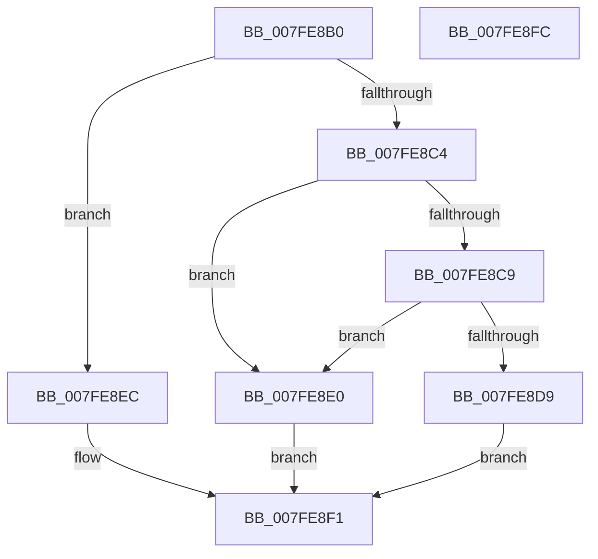

# MmIssueMemoryListCommand

- RVA: `0x007FE8B0`–`0x007FE8FD` (길이 `77` bytes)
- VA: `0x00000001407FE8B0`
- 실행 섹션: `PAGE`
- PDB 이름 있음: `예`; PDB Function 태그: `아니요`
- unwind 정보 RVA: `0x0005CAAC`
- 디코드: `25`개 명령, `77/77` bytes 표시
- 미해석 바이트: `0` (있으면 어셈블리에 `.byte`로 보존)

> 이 문서는 커널 이미지의 기계어와 PDB 기호를 분석해 생성했습니다. 4번과 5번은 함수 원형과 자료형을 바이너리 사용 방식에서 추정한 C 해석이며 원본 소스 복구 결과는 아닙니다.

## 1. Dependencies

- 직접 호출 지점: **2**; 고유 호출 대상: **2**
- 직접 호출자로 확인된 함수: **3**
- RIP 상대 이미지 참조: **1**

### Outgoing calls
- `0x007FE8D0` → [SeSinglePrivilegeCheck](../87/SeSinglePrivilegeCheck_function_00871E20.md) (function, `0x00871E20`)
- `0x007FE8E5` → [MmPerformMemoryListCommand](../../pagelk/B7/MmPerformMemoryListCommand_function_00B7D730.md) (function, `0x00B7D730`)

### Direct callers
- [NtManagePartition](../90/NtManagePartition_function_00902FC0.md) at `0x0090335A`
- [PfpLogEventRequest](../AC/PfpLogEventRequest_function_00AC1278.md) at `0x00AC1358`
- [NtSetSystemInformation](../AF/NtSetSystemInformation_function_00AF4A60.md) at `0x00AF54E2`

### Static image references
- `0x007FE8C9` → RVA `0x00FD9B08` (`PAGEDATA`; read)

## 2. Other-region calls and transfers

- 다른 실행 섹션으로 향하는 call: **1**
  - `0x007FE8E5` → [MmPerformMemoryListCommand](../../pagelk/B7/MmPerformMemoryListCommand_function_00B7D730.md) (`PAGE` → `PAGELK`)
- 별도 외부 분기/꼬리 이동을 확인하지 못했습니다.

## 3. Assembly (complete function range)

```asm
007FE8B0  48 89 5C 24 08                  mov qword ptr [rsp + 8], rbx
007FE8B5  57                              push rdi
007FE8B6  48 83 EC 20                     sub rsp, 0x20
007FE8BA  49 8B F8                        mov rdi, r8
007FE8BD  8B D9                           mov ebx, ecx
007FE8BF  83 F9 05                        cmp ecx, 5
007FE8C2  77 28                           ja 0x1407fe8ec
007FE8C4  83 F9 03                        cmp ecx, 3
007FE8C7  74 17                           je 0x1407fe8e0
007FE8C9  48 8B 0D 38 B2 7D 00            mov rcx, qword ptr [rip + 0x7db238]
007FE8D0  E8 4B 35 07 00                  call 0x140871e20
007FE8D5  84 C0                           test al, al
007FE8D7  75 07                           jne 0x1407fe8e0
007FE8D9  B8 61 00 00 C0                  mov eax, 0xc0000061
007FE8DE  EB 11                           jmp 0x1407fe8f1
007FE8E0  48 8B D7                        mov rdx, rdi
007FE8E3  8B CB                           mov ecx, ebx
007FE8E5  E8 46 EE 37 00                  call 0x140b7d730
007FE8EA  EB 05                           jmp 0x1407fe8f1
007FE8EC  B8 0D 00 00 C0                  mov eax, 0xc000000d
007FE8F1  48 8B 5C 24 30                  mov rbx, qword ptr [rsp + 0x30]
007FE8F6  48 83 C4 20                     add rsp, 0x20
007FE8FA  5F                              pop rdi
007FE8FB  C3                              ret
007FE8FC  CC                              int3
```

## 4. C-style interpretation (structured pseudocode)

```c
__int64 __fastcall MmIssueMemoryListCommand(int a1, __int64 a2, __int64 a3)
{
    __int64 result;
    __int64 v_rsp;
    unsigned __int64 v_stack_p8;

    v_stack_p8 = v_rbx;
    v_rsp = (v_rsp) - (32);
    if (a1 > 5) goto loc_007FE8EC;
    if (a1 == 3) goto loc_007FE8E0;
    result = SeSinglePrivilegeCheck(*(unsigned __int64 *)(v_rip + 8237624), a2, a3, a4);
    if ((unsigned __int8)(result) != 0) goto loc_007FE8E0;
    goto loc_007FE8F1;
loc_007FE8E0:
    result = MmPerformMemoryListCommand((unsigned int)((unsigned int)((unsigned int)(a1))), a3, a3, a4);
    goto loc_007FE8F1;
loc_007FE8EC:
loc_007FE8F1:
    v_rsp = (v_rsp) + (32);
    return (unsigned int)(0xC000000DULL);
}
```

## 5. (Beta) C Style

```c
int64_t MmIssueMemoryListCommand(int32_t Arg1, int64_t Arg2, int64_t Arg3)
{
    int64_t result;
    int64_t local_rsp;
    uint64_t v_stack_p8;

    v_stack_p8 = local_rbx;
    local_rsp = (local_rsp) - (32);
    if (Arg1 > 5) goto loc_007FE8EC;
    if (Arg1 == 3) goto loc_007FE8E0;
    result = SeSinglePrivilegeCheck(*(uint64_t *)(v_rip + 0x7DB238), Arg2, Arg3, a4);
    if ((uint8_t)(result) != 0) goto loc_007FE8E0;
    goto loc_007FE8F1;
loc_007FE8E0:
    result = MmPerformMemoryListCommand((uint32_t)((uint32_t)((uint32_t)(Arg1))), Arg3, Arg3, a4);
    goto loc_007FE8F1;
loc_007FE8EC:
loc_007FE8F1:
    local_rsp = (local_rsp) + (32);
    return (uint32_t)(0xC000000DULL);
}
```

## 6. Execution-region graph

[열기: 2D/3D 그래프와 함수 탐색 컨트롤 패널](../../../control-panel.html?section=page&rva=0x007FE8B0&view=graph)

- 2D 그래프는 위에서 아래로 흐르고, 3D 그래프는 빈 공간을 드래그해 회전합니다. Shift+드래그는 이동, 휠은 확대·축소, 함수 노드 선택은 대상 보고서 이동입니다.

### Static fallback


