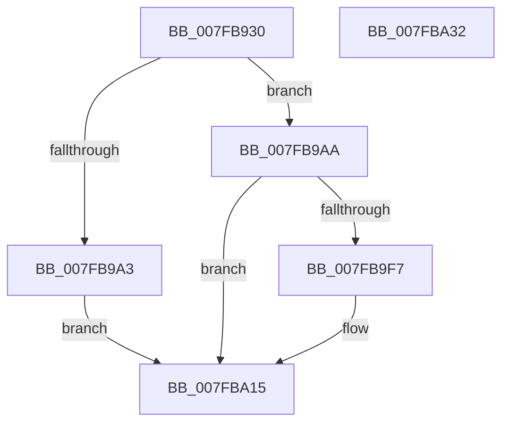

# MmLockPhysicalPagesByVa

- RVA: `0x007FB930`–`0x007FBA33` (길이 `259` bytes)
- VA: `0x00000001407FB930`
- 실행 섹션: `PAGE`
- PDB 이름 있음: `예`; PDB Function 태그: `아니요`
- unwind 정보 RVA: `0x000D7BA4`
- 디코드: `64`개 명령, `259/259` bytes 표시
- 미해석 바이트: `0` (있으면 어셈블리에 `.byte`로 보존)

> 이 문서는 커널 이미지의 기계어와 PDB 기호를 분석해 생성했습니다. 4번과 5번은 함수 원형과 자료형을 바이너리 사용 방식에서 추정한 C 해석이며 원본 소스 복구 결과는 아닙니다.

## 1. Dependencies

- 직접 호출 지점: **5**; 고유 호출 대상: **5**
- 직접 호출자로 확인된 함수: **1**
- RIP 상대 이미지 참조: **0**

### Outgoing calls
- `0x007FB968` → [memset](../../text/6C/memset_function_006C6C40.md) (function, `0x006C6C40`)
- `0x007FB99A` → [MiCheckLockUnlockByVa](../../text/67/MiCheckLockUnlockByVa_function_00673D7C.md) (function, `0x00673D7C`)
- `0x007FB9EE` → [MiProbeAndLockPrepare](../../text/23/MiProbeAndLockPrepare_function_0023BB40.md) (function, `0x0023BB40`)
- `0x007FBA00` → [MiProbeAndLockPacket](../../text/23/MiProbeAndLockPacket_function_0023BE20.md) (function, `0x0023BE20`)
- `0x007FBA10` → [MiProbeAndLockComplete](../../text/49/MiProbeAndLockComplete_function_0049A18C.md) (function, `0x0049A18C`)

### Direct callers
- [VmpPinMemoryRange](../../text/64/VmpPinMemoryRange_function_0064CCD0.md) at `0x0064CF7E`

### Static image references
- 디코드된 RIP-relative 메모리 참조가 없습니다.

## 2. Other-region calls and transfers

- 다른 실행 섹션으로 향하는 call: **5**
  - `0x007FB968` → [memset](../../text/6C/memset_function_006C6C40.md) (`PAGE` → `.text`)
  - `0x007FB99A` → [MiCheckLockUnlockByVa](../../text/67/MiCheckLockUnlockByVa_function_00673D7C.md) (`PAGE` → `.text`)
  - `0x007FB9EE` → [MiProbeAndLockPrepare](../../text/23/MiProbeAndLockPrepare_function_0023BB40.md) (`PAGE` → `.text`)
  - `0x007FBA00` → [MiProbeAndLockPacket](../../text/23/MiProbeAndLockPacket_function_0023BE20.md) (`PAGE` → `.text`)
  - `0x007FBA10` → [MiProbeAndLockComplete](../../text/49/MiProbeAndLockComplete_function_0049A18C.md) (`PAGE` → `.text`)
- 별도 외부 분기/꼬리 이동을 확인하지 못했습니다.

## 3. Assembly (complete function range)

```asm
007FB930  48 8B C4                        mov rax, rsp
007FB933  48 89 58 08                     mov qword ptr [rax + 8], rbx
007FB937  48 89 70 10                     mov qword ptr [rax + 0x10], rsi
007FB93B  48 89 78 18                     mov qword ptr [rax + 0x18], rdi
007FB93F  55                              push rbp
007FB940  41 56                           push r14
007FB942  41 57                           push r15
007FB944  48 8D 68 C8                     lea rbp, [rax - 0x38]
007FB948  48 81 EC 20 01 00 00            sub rsp, 0x120
007FB94F  49 8B F0                        mov rsi, r8
007FB952  48 8B DA                        mov rbx, rdx
007FB955  48 8B F9                        mov rdi, rcx
007FB958  33 D2                           xor edx, edx
007FB95A  41 B8 B0 00 00 00               mov r8d, 0xb0
007FB960  48 8D 4C 24 70                  lea rcx, [rsp + 0x70]
007FB965  45 8B F1                        mov r14d, r9d
007FB968  E8 D3 B2 EC FF                  call 0x1406c6c40
007FB96D  48 8B C7                        mov rax, rdi
007FB970  0F 57 C0                        xorps xmm0, xmm0
007FB973  25 FF 0F 00 00                  and eax, 0xfff
007FB978  45 33 FF                        xor r15d, r15d
007FB97B  48 81 C3 FF 0F 00 00            add rbx, 0xfff
007FB982  44 89 7C 24 5C                  mov dword ptr [rsp + 0x5c], r15d
007FB987  4C 8B C6                        mov r8, rsi
007FB98A  48 03 D8                        add rbx, rax
007FB98D  F3 0F 7F 44 24 4C               movdqu xmmword ptr [rsp + 0x4c], xmm0
007FB993  48 81 E7 00 F0 FF FF            and rdi, 0xfffffffffffff000
007FB99A  E8 DD 83 E7 FF                  call 0x140673d7c
007FB99F  85 C0                           test eax, eax
007FB9A1  75 07                           jne 0x1407fb9aa
007FB9A3  B8 BB 00 00 C0                  mov eax, 0xc00000bb
007FB9A8  EB 6B                           jmp 0x1407fba15
007FB9AA  C7 44 24 30 03 00 00 00         mov dword ptr [rsp + 0x30], 3
007FB9B2  48 8D 54 24 40                  lea rdx, [rsp + 0x40]
007FB9B7  48 81 E3 00 F0 FF FF            and rbx, 0xfffffffffffff000
007FB9BE  44 89 74 24 28                  mov dword ptr [rsp + 0x28], r14d
007FB9C3  4C 8B CB                        mov r9, rbx
007FB9C6  4C 89 7C 24 40                  mov qword ptr [rsp + 0x40], r15
007FB9CB  4C 8B C7                        mov r8, rdi
007FB9CE  C7 44 24 48 38 00 00 00         mov dword ptr [rsp + 0x48], 0x38
007FB9D6  48 8D 4C 24 70                  lea rcx, [rsp + 0x70]
007FB9DB  48 89 7C 24 60                  mov qword ptr [rsp + 0x60], rdi
007FB9E0  48 C7 44 24 68 01 00 00 00      mov qword ptr [rsp + 0x68], 1
007FB9E9  C6 44 24 20 01                  mov byte ptr [rsp + 0x20], 1
007FB9EE  E8 4D 01 A4 FF                  call 0x14023bb40
007FB9F3  85 C0                           test eax, eax
007FB9F5  78 1E                           js 0x1407fba15
007FB9F7  48 8D 4C 24 70                  lea rcx, [rsp + 0x70]
007FB9FC  48 89 75 F0                     mov qword ptr [rbp - 0x10], rsi
007FBA00  E8 1B 04 A4 FF                  call 0x14023be20
007FBA05  41 83 C8 FF                     or r8d, 0xffffffff
007FBA09  48 8D 4C 24 70                  lea rcx, [rsp + 0x70]
007FBA0E  8B D0                           mov edx, eax
007FBA10  E8 77 E7 C9 FF                  call 0x14049a18c
007FBA15  4C 8D 9C 24 20 01 00 00         lea r11, [rsp + 0x120]
007FBA1D  49 8B 5B 20                     mov rbx, qword ptr [r11 + 0x20]
007FBA21  49 8B 73 28                     mov rsi, qword ptr [r11 + 0x28]
007FBA25  49 8B 7B 30                     mov rdi, qword ptr [r11 + 0x30]
007FBA29  49 8B E3                        mov rsp, r11
007FBA2C  41 5F                           pop r15
007FBA2E  41 5E                           pop r14
007FBA30  5D                              pop rbp
007FBA31  C3                              ret
007FBA32  CC                              int3
```

## 4. C-style interpretation (structured pseudocode)

```c
__int64 __fastcall MmLockPhysicalPagesByVa(__int64 a1, __int64 a2, __int64 a3, int a4)
{
    __int64 result;
    __int64 v_r15;
    __int64 v_rbx;
    __int64 v_rdi;
    __int64 v_rsp;
    unsigned int v_stack_m108;
    unsigned int v_stack_m110;
    unsigned __int8 v_stack_m118;
    unsigned __int64 v_stack_m18;
    unsigned __int64 v_stack_mC8;
    unsigned __int64 v_stack_mD0;
    unsigned __int64 v_stack_mD8;
    unsigned int v_stack_mDC;
    unsigned __int64 v_stack_mEC;
    unsigned int v_stack_mF0;
    unsigned __int64 v_stack_mF8;

    *(unsigned __int64 *)(v_rsp + 8) = v_rbx;
    *(unsigned __int64 *)(v_rsp + 16) = v_rsi;
    *(unsigned __int64 *)(v_rsp + 24) = v_rdi;
    v_rsp = (v_rsp) - (288);
    a2 = 0;
    result = memset(v_stack_mC8, a2, 176, a4);
    result = (unsigned int)((a1) & (0xFFFULL));
    v_r15 = 0;
    v_rbx = (a2) + (0xFFFULL);
    v_stack_mDC = 0;
    v_rbx = (v_rbx) + (result);
    v_stack_mEC = v_xmm0;
    v_rdi = (a1) & (0xFFFFFFFFFFFFF000ULL);
    result = MiCheckLockUnlockByVa(v_stack_mC8, a2, a3, a4);
    if ((unsigned int)(result) != 0) goto loc_007FB9AA;
    goto loc_007FBA15;
loc_007FB9AA:
    v_stack_m108 = 3;
    v_rbx = (v_rbx) & (0xFFFFFFFFFFFFF000ULL);
    v_stack_m110 = (unsigned int)((unsigned int)(a4));
    v_stack_mF8 = 0;
    v_stack_mF0 = 56;
    v_stack_mD8 = v_rdi;
    v_stack_mD0 = 1;
    v_stack_m118 = 1;
    result = MiProbeAndLockPrepare(v_stack_mC8, v_stack_mF8, v_rdi, v_rbx);
    if (!(sign_flag)) {
        a1 = v_stack_mC8;
        *(unsigned __int64 *)(v_rsp - 56 - 16) = a3;
        result = MiProbeAndLockPacket(a1, v_stack_mF8, v_rdi, v_rbx);
        a3 = (unsigned int)((v_rdi) | (0xFFFFFFFFULL));
        a1 = v_stack_mC8;
        a2 = (unsigned int)(result);
        result = MiProbeAndLockComplete(a1, a2, a3, v_rbx);
    }
    return result;
}
```

## 5. (Beta) C Style

```c
int64_t MmLockPhysicalPagesByVa(int64_t Arg1, int64_t Arg2, int64_t Arg3, int32_t Arg4)
{
    int64_t result;
    int64_t local_r15;
    int64_t local_rbx;
    int64_t local_rdi;
    int64_t local_rsp;
    uint32_t v_stack_m108;
    uint32_t v_stack_m110;
    uint8_t v_stack_m118;
    uint64_t v_stack_m18;
    uint64_t v_stack_mC8;
    uint64_t v_stack_mD0;
    uint64_t v_stack_mD8;
    uint32_t v_stack_mDC;
    uint64_t v_stack_mEC;
    uint32_t v_stack_mF0;
    uint64_t v_stack_mF8;

    *(uint64_t *)(local_rsp + 0x8) = local_rbx;
    *(uint64_t *)(local_rsp + 0x10) = local_rsi;
    *(uint64_t *)(local_rsp + 0x18) = local_rdi;
    local_rsp = (local_rsp) - (288);
    Arg2 = 0;
    result = memset(v_stack_mC8, Arg2, 176, Arg4);
    result = (uint32_t)((Arg1) & (0xFFFULL));
    local_r15 = 0;
    local_rbx = (Arg2) + (0xFFFULL);
    v_stack_mDC = 0;
    local_rbx = (local_rbx) + (result);
    v_stack_mEC = v_xmm0;
    local_rdi = (Arg1) & (0xFFFFFFFFFFFFF000ULL);
    result = MiCheckLockUnlockByVa(v_stack_mC8, Arg2, Arg3, Arg4);
    if ((uint32_t)(result) != 0) goto loc_007FB9AA;
    goto loc_007FBA15;
loc_007FB9AA:
    v_stack_m108 = 3;
    local_rbx = (local_rbx) & (0xFFFFFFFFFFFFF000ULL);
    v_stack_m110 = (uint32_t)((uint32_t)(Arg4));
    v_stack_mF8 = 0;
    v_stack_mF0 = 56;
    v_stack_mD8 = local_rdi;
    v_stack_mD0 = 1;
    v_stack_m118 = 1;
    result = MiProbeAndLockPrepare(v_stack_mC8, v_stack_mF8, local_rdi, local_rbx);
    if (!(sign_flag)) {
        Arg1 = v_stack_mC8;
        *(uint64_t *)(local_rsp - 0x38 - 0x10) = Arg3;
        result = MiProbeAndLockPacket(Arg1, v_stack_mF8, local_rdi, local_rbx);
        Arg3 = (uint32_t)((local_rdi) | (0xFFFFFFFFULL));
        Arg1 = v_stack_mC8;
        Arg2 = (uint32_t)(result);
        result = MiProbeAndLockComplete(Arg1, Arg2, Arg3, local_rbx);
    }
    return result;
}
```

## 6. Execution-region graph

[열기: 2D/3D 그래프와 함수 탐색 컨트롤 패널](../../../control-panel.html?section=page&rva=0x007FB930&view=graph)

- 2D 그래프는 위에서 아래로 흐르고, 3D 그래프는 빈 공간을 드래그해 회전합니다. Shift+드래그는 이동, 휠은 확대·축소, 함수 노드 선택은 대상 보고서 이동입니다.

### Static fallback


