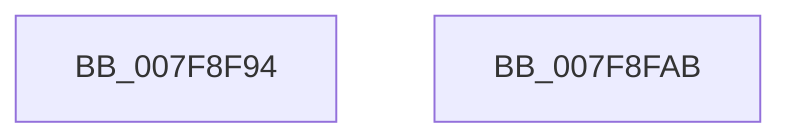

# MmLockRegistryRecoverySections

- RVA: `0x007F8F94`–`0x007F8FAC` (길이 `24` bytes)
- VA: `0x00000001407F8F94`
- 실행 섹션: `PAGE`
- PDB 이름 있음: `예`; PDB Function 태그: `아니요`
- unwind 정보 RVA: `0x0005C788`
- 디코드: `7`개 명령, `24/24` bytes 표시
- 미해석 바이트: `0` (있으면 어셈블리에 `.byte`로 보존)

> 이 문서는 커널 이미지의 기계어와 PDB 기호를 분석해 생성했습니다. 4번과 5번은 함수 원형과 자료형을 바이너리 사용 방식에서 추정한 C 해석이며 원본 소스 복구 결과는 아닙니다.

## 1. Dependencies

- 직접 호출 지점: **1**; 고유 호출 대상: **1**
- 직접 호출자로 확인된 함수: **1**
- RIP 상대 이미지 참조: **1**

### Outgoing calls
- `0x007F8FA1` → [MmEnumerateSystemImages](../../text/4F/MmEnumerateSystemImages_function_004FC7B0.md) (function, `0x004FC7B0`)

### Direct callers
- [CmInitSystem2](../../init/C6/CmInitSystem2_function_00C6FDD8.md) at `0x00C6FE37`

### Static image references
- `0x007F8F9A` → RVA `0x007F8C10` (`MiLockRegistryRecoverySection`; read)

## 2. Other-region calls and transfers

- 다른 실행 섹션으로 향하는 call: **1**
  - `0x007F8FA1` → [MmEnumerateSystemImages](../../text/4F/MmEnumerateSystemImages_function_004FC7B0.md) (`PAGE` → `.text`)
- 별도 외부 분기/꼬리 이동을 확인하지 못했습니다.

## 3. Assembly (complete function range)

```asm
007F8F94  48 83 EC 28                     sub rsp, 0x28
007F8F98  33 D2                           xor edx, edx
007F8F9A  48 8D 0D 6F FC FF FF            lea rcx, [rip - 0x391]
007F8FA1  E8 0A 38 D0 FF                  call 0x1404fc7b0
007F8FA6  48 83 C4 28                     add rsp, 0x28
007F8FAA  C3                              ret
007F8FAB  CC                              int3
```

## 4. C-style interpretation (structured pseudocode)

```c
__int64 __fastcall MmLockRegistryRecoverySections(__int64 a1, int a2)
{
    __int64 result;
    __int64 v_rsp;

    v_rsp = (v_rsp) - (40);
    a2 = 0;
    result = MmEnumerateSystemImages(v_rip - 913, a2, a3, a4);
    v_rsp = (v_rsp) + (40);
    return result;
}
```

## 5. (Beta) C Style

```c
int64_t MmLockRegistryRecoverySections(int64_t Arg1, int32_t Arg2)
{
    int64_t result;
    int64_t local_rsp;

    local_rsp = (local_rsp) - (40);
    Arg2 = 0;
    result = MmEnumerateSystemImages(v_rip - 913, Arg2, a3, a4);
    local_rsp = (local_rsp) + (40);
    return result;
}
```

## 6. Execution-region graph

[열기: 2D/3D 그래프와 함수 탐색 컨트롤 패널](../../../control-panel.html?section=page&rva=0x007F8F94&view=graph)

- 2D 그래프는 위에서 아래로 흐르고, 3D 그래프는 빈 공간을 드래그해 회전합니다. Shift+드래그는 이동, 휠은 확대·축소, 함수 노드 선택은 대상 보고서 이동입니다.

### Static fallback


