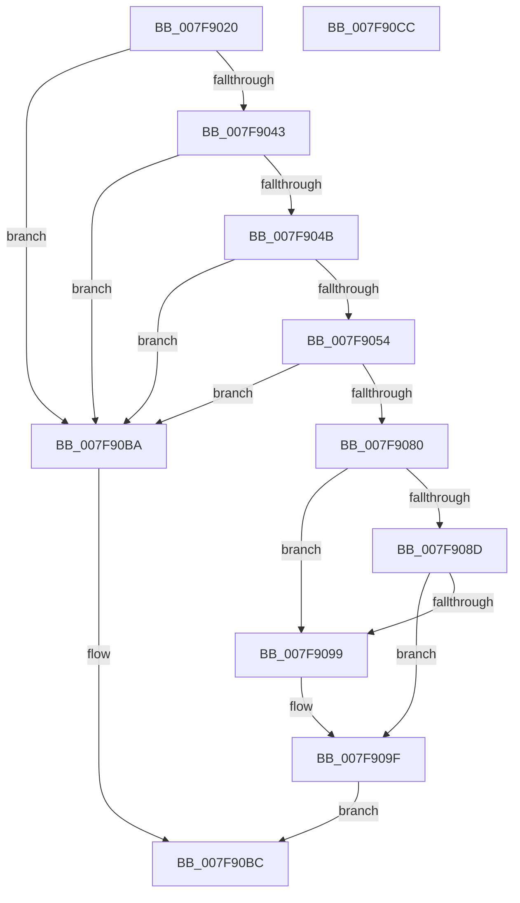

# MmMapLockedRestartPages

- RVA: `0x007F9020`–`0x007F90CD` (길이 `173` bytes)
- VA: `0x00000001407F9020`
- 실행 섹션: `PAGE`
- PDB 이름 있음: `예`; PDB Function 태그: `아니요`
- unwind 정보 RVA: `0x000794E0`
- 디코드: `47`개 명령, `173/173` bytes 표시
- 미해석 바이트: `0` (있으면 어셈블리에 `.byte`로 보존)

> 이 문서는 커널 이미지의 기계어와 PDB 기호를 분석해 생성했습니다. 4번과 5번은 함수 원형과 자료형을 바이너리 사용 방식에서 추정한 C 해석이며 원본 소스 복구 결과는 아닙니다.

## 1. Dependencies

- 직접 호출 지점: **4**; 고유 호출 대상: **4**
- 직접 호출자로 확인된 함수: **0**
- RIP 상대 이미지 참조: **1**

### Outgoing calls
- `0x007F9037` → [MiTranslateCacheType](../../text/3E/MiTranslateCacheType_function_003EAAD0.md) (function, `0x003EAAD0`)
- `0x007F9073` → [MiReserveDriverPtes](../A7/MiReserveDriverPtes_function_00A75150.md) (function, `0x00A75150`)
- `0x007F90A4` → [MiGetAnyMultiplexedVm](../../text/44/MiGetAnyMultiplexedVm_function_00448BD0.md) (function, `0x00448BD0`)
- `0x007F90B3` → [MiMapMdlCommon](../../text/67/MiMapMdlCommon_function_00674524.md) (function, `0x00674524`)

### Direct callers
- 이 함수 시작 RVA로 연결되는 직접 call은 확인되지 않았습니다. 간접 호출은 완전히 역산할 수 없습니다.

### Static image references
- `0x007F9080` → RVA `0x00FC6A88` (`ALMOSTRO`; read)

## 2. Other-region calls and transfers

- 다른 실행 섹션으로 향하는 call: **3**
  - `0x007F9037` → [MiTranslateCacheType](../../text/3E/MiTranslateCacheType_function_003EAAD0.md) (`PAGE` → `.text`)
  - `0x007F90A4` → [MiGetAnyMultiplexedVm](../../text/44/MiGetAnyMultiplexedVm_function_00448BD0.md) (`PAGE` → `.text`)
  - `0x007F90B3` → [MiMapMdlCommon](../../text/67/MiMapMdlCommon_function_00674524.md) (`PAGE` → `.text`)
- 별도 외부 분기/꼬리 이동을 확인하지 못했습니다.

## 3. Assembly (complete function range)

```asm
007F9020  48 89 5C 24 08                  mov qword ptr [rsp + 8], rbx
007F9025  48 89 74 24 10                  mov qword ptr [rsp + 0x10], rsi
007F902A  57                              push rdi
007F902B  48 83 EC 30                     sub rsp, 0x30
007F902F  48 8B F9                        mov rdi, rcx
007F9032  41 8B D8                        mov ebx, r8d
007F9035  8B CA                           mov ecx, edx
007F9037  E8 94 1A BF FF                  call 0x1403eaad0
007F903C  8B F0                           mov esi, eax
007F903E  83 F8 03                        cmp eax, 3
007F9041  74 77                           je 0x1407f90ba
007F9043  F7 C3 FF FF FF BF               test ebx, 0xbfffffff
007F9049  75 6F                           jne 0x1407f90ba
007F904B  49 F7 C1 FF FF DF FF            test r9, -0x200001
007F9052  75 66                           jne 0x1407f90ba
007F9054  8B 4F 2C                        mov ecx, dword ptr [rdi + 0x2c]
007F9057  49 8B D1                        mov rdx, r9
007F905A  03 4F 20                        add ecx, dword ptr [rdi + 0x20]
007F905D  8B 47 28                        mov eax, dword ptr [rdi + 0x28]
007F9060  81 E1 FF 0F 00 00               and ecx, 0xfff
007F9066  48 05 FF 0F 00 00               add rax, 0xfff
007F906C  48 03 C8                        add rcx, rax
007F906F  48 C1 E9 0C                     shr rcx, 0xc
007F9073  E8 D8 C0 27 00                  call 0x140a75150
007F9078  48 8B D0                        mov rdx, rax
007F907B  48 85 C0                        test rax, rax
007F907E  74 3A                           je 0x1407f90ba
007F9080  48 F7 05 FD D9 7C 00 00 80 00 00  test qword ptr [rip + 0x7cd9fd], 0x8000
007F908B  75 0C                           jne 0x1407f9099
007F908D  41 B9 06 00 00 00               mov r9d, 6
007F9093  0F BA E3 1E                     bt ebx, 0x1e
007F9097  73 06                           jae 0x1407f909f
007F9099  41 B9 04 00 00 00               mov r9d, 4
007F909F  B9 01 00 00 00                  mov ecx, 1
007F90A4  E8 27 FB C4 FF                  call 0x140448bd0
007F90A9  4C 8B C0                        mov r8, rax
007F90AC  89 74 24 20                     mov dword ptr [rsp + 0x20], esi
007F90B0  48 8B CF                        mov rcx, rdi
007F90B3  E8 6C B4 E7 FF                  call 0x140674524
007F90B8  EB 02                           jmp 0x1407f90bc
007F90BA  33 C0                           xor eax, eax
007F90BC  48 8B 5C 24 40                  mov rbx, qword ptr [rsp + 0x40]
007F90C1  48 8B 74 24 48                  mov rsi, qword ptr [rsp + 0x48]
007F90C6  48 83 C4 30                     add rsp, 0x30
007F90CA  5F                              pop rdi
007F90CB  C3                              ret
007F90CC  CC                              int3
```

## 4. C-style interpretation (structured pseudocode)

```c
__int64 __fastcall MmMapLockedRestartPages(__int64 a1, int a2, int a3, __int64 a4)
{
    __int64 result;
    __int64 v_rsp;
    unsigned int v_stack_m18;
    unsigned __int64 v_stack_p10;
    unsigned __int64 v_stack_p8;

    v_stack_p8 = v_rbx;
    v_stack_p10 = v_rsi;
    v_rsp = (v_rsp) - (48);
    result = MiTranslateCacheType((unsigned int)(a2), a2, a3, a4);
    if (((unsigned int)(result)) == 3) goto loc_007F90BA;
    if ((((unsigned int)((unsigned int)(a3))) & (0xBFFFFFFFULL)) != 0) goto loc_007F90BA;
    if (((a4) & (0xFFFFFFFFFFDFFFFFULL)) != 0) goto loc_007F90BA;
    a1 = (unsigned int)(((unsigned int)(*(unsigned int *)(a1 + 44))) + (*(unsigned int *)(a1 + 32)));
    a1 = (unsigned int)((a1) & (0xFFFULL));
    result = ((unsigned int)(*(unsigned int *)(a1 + 40))) + (0xFFFULL);
    a1 = (a1) + (result);
    a1 = (a1) >> (12);
    result = MiReserveDriverPtes(a1, a4, a3, a4);
    if (result == 0) goto loc_007F90BA;
    if (((*(unsigned __int64 *)(v_rip + 8182269)) & (0x8000ULL)) != 0) goto loc_007F9099;
    if (!(condition_is_above_or_equal)) {
        a4 = 4;
    }
    result = MiGetAnyMultiplexedVm(1, result, a3, a4);
    v_stack_m18 = (unsigned int)((unsigned int)((unsigned int)(result)));
    result = MiMapMdlCommon(a1, result, result, a4);
    goto loc_007F90BC;
loc_007F90BA:
    result = 0;
loc_007F90BC:
    v_rsp = (v_rsp) + (48);
    return result;
}
```

## 5. (Beta) C Style

```c
int64_t MmMapLockedRestartPages(void *Arg1, int32_t Arg2, int32_t Arg3, int64_t Arg4)
{
    uint8_t *arg1 = (uint8_t *)Arg1;

    int64_t result;
    int64_t local_rsp;
    uint32_t v_stack_m18;
    uint64_t v_stack_p10;
    uint64_t v_stack_p8;

    v_stack_p8 = local_rbx;
    v_stack_p10 = local_rsi;
    local_rsp = (local_rsp) - (48);
    result = MiTranslateCacheType((uint32_t)(Arg2), Arg2, Arg3, Arg4);
    if (((uint32_t)(result)) == 3) goto loc_007F90BA;
    if ((((uint32_t)((uint32_t)(Arg3))) & (0xBFFFFFFFULL)) != 0) goto loc_007F90BA;
    if (((Arg4) & (0xFFFFFFFFFFDFFFFFULL)) != 0) goto loc_007F90BA;
    Arg1 = (uint32_t)(((uint32_t)(*(uint32_t *)(arg1 + 0x2C))) + (*(uint32_t *)(arg1 + 0x20)));
    Arg1 = (uint32_t)((Arg1) & (0xFFFULL));
    result = ((uint32_t)(*(uint32_t *)(arg1 + 0x28))) + (0xFFFULL);
    Arg1 = (Arg1) + (result);
    Arg1 = (Arg1) >> (12);
    result = MiReserveDriverPtes(Arg1, Arg4, Arg3, Arg4);
    if (result == 0) goto loc_007F90BA;
    if (((*(uint64_t *)(v_rip + 0x7CD9FD)) & (0x8000ULL)) != 0) goto loc_007F9099;
    if (!(condition_is_above_or_equal)) {
        Arg4 = 4;
    }
    result = MiGetAnyMultiplexedVm(1, result, Arg3, Arg4);
    v_stack_m18 = (uint32_t)((uint32_t)((uint32_t)(result)));
    result = MiMapMdlCommon(Arg1, result, result, Arg4);
    goto loc_007F90BC;
loc_007F90BA:
    result = 0;
loc_007F90BC:
    local_rsp = (local_rsp) + (48);
    return result;
}
```

### 관측된 메모리 오프셋

구조체 형식이 확인되지 않은 접근은 인자 기준의 오프셋으로만 기록했습니다.

| 기준 인자 | 오프셋 표현 | 폭 (bit) | 접근 |
|---|---:|---:|---|
| `Arg1` | `+ 0x20` | `32` | `R` |
| `Arg1` | `+ 0x28` | `32` | `R` |
| `Arg1` | `+ 0x2C` | `32` | `R` |

## 6. Execution-region graph

[열기: 2D/3D 그래프와 함수 탐색 컨트롤 패널](../../../control-panel.html?section=page&rva=0x007F9020&view=graph)

- 2D 그래프는 위에서 아래로 흐르고, 3D 그래프는 빈 공간을 드래그해 회전합니다. Shift+드래그는 이동, 휠은 확대·축소, 함수 노드 선택은 대상 보고서 이동입니다.

### Static fallback


