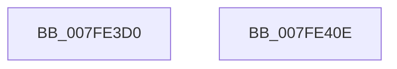

# MmMarkHiberRange

- RVA: `0x007FE3D0`–`0x007FE40F` (길이 `63` bytes)
- VA: `0x00000001407FE3D0`
- 실행 섹션: `PAGE`
- PDB 이름 있음: `예`; PDB Function 태그: `아니요`
- unwind 정보 RVA: `0x0005D2F4`
- 디코드: `17`개 명령, `63/63` bytes 표시
- 미해석 바이트: `0` (있으면 어셈블리에 `.byte`로 보존)

> 이 문서는 커널 이미지의 기계어와 PDB 기호를 분석해 생성했습니다. 4번과 5번은 함수 원형과 자료형을 바이너리 사용 방식에서 추정한 C 해석이며 원본 소스 복구 결과는 아닙니다.

## 1. Dependencies

- 직접 호출 지점: **3**; 고유 호출 대상: **2**
- 직접 호출자로 확인된 함수: **2**
- RIP 상대 이미지 참조: **0**

### Outgoing calls
- `0x007FE3DA` → [MiGetPteAddress](../../text/43/MiGetPteAddress_function_0043E130.md) (function, `0x0043E130`)
- `0x007FE3E6` → [MiGetPteAddress](../../text/43/MiGetPteAddress_function_0043E130.md) (function, `0x0043E130`)
- `0x007FE404` → [PoSetHiberRange](../../text/47/PoSetHiberRange_function_0047C580.md) (function, `0x0047C580`)

### Direct callers
- [PopHiberInitializeResources](../75/PopHiberInitializeResources_function_0075D5FC.md) at `0x0075D921`
- [PopAllocateHiberContext](../AD/PopAllocateHiberContext_function_00ADC05C.md) at `0x00ADC415`

### Static image references
- 디코드된 RIP-relative 메모리 참조가 없습니다.

## 2. Other-region calls and transfers

- 다른 실행 섹션으로 향하는 call: **3**
  - `0x007FE3DA` → [MiGetPteAddress](../../text/43/MiGetPteAddress_function_0043E130.md) (`PAGE` → `.text`)
  - `0x007FE3E6` → [MiGetPteAddress](../../text/43/MiGetPteAddress_function_0043E130.md) (`PAGE` → `.text`)
  - `0x007FE404` → [PoSetHiberRange](../../text/47/PoSetHiberRange_function_0047C580.md) (`PAGE` → `.text`)
- 별도 외부 분기/꼬리 이동을 확인하지 못했습니다.

## 3. Assembly (complete function range)

```asm
007FE3D0  48 83 EC 38                     sub rsp, 0x38
007FE3D4  4C 8B D9                        mov r11, rcx
007FE3D7  48 8B CA                        mov rcx, rdx
007FE3DA  E8 51 FD C3 FF                  call 0x14043e130
007FE3DF  4A 8D 0C 02                     lea rcx, [rdx + r8]
007FE3E3  4C 8B D0                        mov r10, rax
007FE3E6  E8 45 FD C3 FF                  call 0x14043e130
007FE3EB  49 2B C2                        sub rax, r10
007FE3EE  C7 44 24 20 50 74 65 20         mov dword ptr [rsp + 0x20], 0x20657450
007FE3F6  4C 8B C8                        mov r9, rax
007FE3F9  4D 8B C2                        mov r8, r10
007FE3FC  BA 02 00 00 00                  mov edx, 2
007FE401  49 8B CB                        mov rcx, r11
007FE404  E8 77 E1 C7 FF                  call 0x14047c580
007FE409  48 83 C4 38                     add rsp, 0x38
007FE40D  C3                              ret
007FE40E  CC                              int3
```

## 4. C-style interpretation (structured pseudocode)

```c
__int64 __fastcall MmMarkHiberRange(__int64 a1, __int64 a2, __int64 a3)
{
    __int64 result;
    __int64 v_rsp;
    unsigned int v_stack_m18;

    v_rsp = (v_rsp) - (56);
    result = MiGetPteAddress(a2, a2, a3, a4);
    result = MiGetPteAddress(a2 + a3 * 1, a2, a3, a4);
    result = (result) - (result);
    v_stack_m18 = 0x20657450ULL;
    result = PoSetHiberRange(a1, 2, result, result);
    v_rsp = (v_rsp) + (56);
    return result;
}
```

## 5. (Beta) C Style

```c
int64_t MmMarkHiberRange(int64_t Arg1, int64_t Arg2, int64_t Arg3)
{
    int64_t result;
    int64_t local_rsp;
    uint32_t v_stack_m18;

    local_rsp = (local_rsp) - (56);
    result = MiGetPteAddress(Arg2, Arg2, Arg3, a4);
    result = MiGetPteAddress(Arg2 + Arg3 * 1, Arg2, Arg3, a4);
    result = (result) - (result);
    v_stack_m18 = 0x20657450ULL;
    result = PoSetHiberRange(Arg1, 2, result, result);
    local_rsp = (local_rsp) + (56);
    return result;
}
```

## 6. Execution-region graph

[열기: 2D/3D 그래프와 함수 탐색 컨트롤 패널](../../../control-panel.html?section=page&rva=0x007FE3D0&view=graph)

- 2D 그래프는 위에서 아래로 흐르고, 3D 그래프는 빈 공간을 드래그해 회전합니다. Shift+드래그는 이동, 휠은 확대·축소, 함수 노드 선택은 대상 보고서 이동입니다.

### Static fallback


