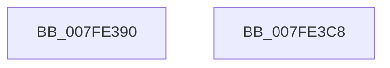

# MmObtainChargesToLockPagedPool

- RVA: `0x007FE390`–`0x007FE3C9` (길이 `57` bytes)
- VA: `0x00000001407FE390`
- 실행 섹션: `PAGE`
- PDB 이름 있음: `예`; PDB Function 태그: `아니요`
- unwind 정보 RVA: `0x0005C788`
- 디코드: `15`개 명령, `57/57` bytes 표시
- 미해석 바이트: `0` (있으면 어셈블리에 `.byte`로 보존)

> 이 문서는 커널 이미지의 기계어와 PDB 기호를 분석해 생성했습니다. 4번과 5번은 함수 원형과 자료형을 바이너리 사용 방식에서 추정한 C 해석이며 원본 소스 복구 결과는 아닙니다.

## 1. Dependencies

- 직접 호출 지점: **1**; 고유 호출 대상: **1**
- 직접 호출자로 확인된 함수: **3**
- RIP 상대 이미지 참조: **1**

### Outgoing calls
- `0x007FE3B5` → [MiChargeResident](../../text/28/MiChargeResident_function_0028A0F0.md) (function, `0x0028A0F0`)

### Direct callers
- [HalpMcExportAndChargeNeededData](../70/HalpMcExportAndChargeNeededData_function_0070B524.md) at `0x0070B59B`
- [PopPreallocateHibernateMemory](../75/PopPreallocateHibernateMemory_function_0075DB98.md) at `0x0075DCCB`
- [MiCreatePagingFileMap](../98/MiCreatePagingFileMap_function_009852F8.md) at `0x00985AF3`

### Static image references
- `0x007FE3AE` → RVA `0x00E38D00` (`.data`; read)

## 2. Other-region calls and transfers

- 다른 실행 섹션으로 향하는 call: **1**
  - `0x007FE3B5` → [MiChargeResident](../../text/28/MiChargeResident_function_0028A0F0.md) (`PAGE` → `.text`)
- 별도 외부 분기/꼬리 이동을 확인하지 못했습니다.

## 3. Assembly (complete function range)

```asm
007FE390  48 83 EC 28                     sub rsp, 0x28
007FE394  81 E1 FF 0F 00 00               and ecx, 0xfff
007FE39A  48 81 C2 FF 0F 00 00            add rdx, 0xfff
007FE3A1  48 03 D1                        add rdx, rcx
007FE3A4  41 B8 00 04 00 00               mov r8d, 0x400
007FE3AA  48 C1 EA 0C                     shr rdx, 0xc
007FE3AE  48 8D 0D 4B A9 63 00            lea rcx, [rip + 0x63a94b]
007FE3B5  E8 36 BD A8 FF                  call 0x14028a0f0
007FE3BA  33 C9                           xor ecx, ecx
007FE3BC  85 C0                           test eax, eax
007FE3BE  0F 95 C1                        setne cl
007FE3C1  8B C1                           mov eax, ecx
007FE3C3  48 83 C4 28                     add rsp, 0x28
007FE3C7  C3                              ret
007FE3C8  CC                              int3
```

## 4. C-style interpretation (structured pseudocode)

```c
__int64 __fastcall MmObtainChargesToLockPagedPool(int a1, __int64 a2)
{
    __int64 result;
    __int64 v_rsp;

    v_rsp = (v_rsp) - (40);
    a1 = (unsigned int)((a1) & (0xFFFULL));
    a2 = (a2) + (0xFFFULL);
    a2 = (a2) + (a1);
    a2 = (a2) >> (12);
    result = MiChargeResident(v_rip + 6531403, a2, (unsigned int)(0x400ULL), a4);
    a1 = 0;
    a1 = ((unsigned int)(result) != 0) ? 1 : 0;
    v_rsp = (v_rsp) + (40);
    return (unsigned int)(a1);
}
```

## 5. (Beta) C Style

```c
int64_t MmObtainChargesToLockPagedPool(int32_t Arg1, int64_t Arg2)
{
    int64_t result;
    int64_t local_rsp;

    local_rsp = (local_rsp) - (40);
    Arg1 = (uint32_t)((Arg1) & (0xFFFULL));
    Arg2 = (Arg2) + (0xFFFULL);
    Arg2 = (Arg2) + (Arg1);
    Arg2 = (Arg2) >> (12);
    result = MiChargeResident(v_rip + 6531403, Arg2, (uint32_t)(0x400ULL), a4);
    Arg1 = 0;
    Arg1 = ((uint32_t)(result) != 0) ? 1 : 0;
    local_rsp = (local_rsp) + (40);
    return (uint32_t)(Arg1);
}
```

## 6. Execution-region graph

[열기: 2D/3D 그래프와 함수 탐색 컨트롤 패널](../../../control-panel.html?section=page&rva=0x007FE390&view=graph)

- 2D 그래프는 위에서 아래로 흐르고, 3D 그래프는 빈 공간을 드래그해 회전합니다. Shift+드래그는 이동, 휠은 확대·축소, 함수 노드 선택은 대상 보고서 이동입니다.

### Static fallback


