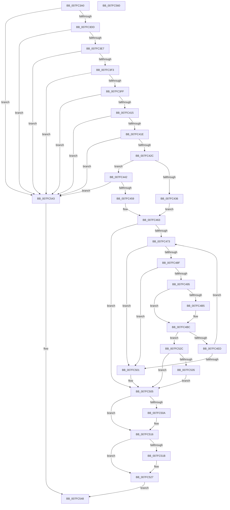

# MmQueryMemoryRanges

- RVA: `0x007FC3A0`–`0x007FC561` (길이 `449` bytes)
- VA: `0x00000001407FC3A0`
- 실행 섹션: `PAGE`
- PDB 이름 있음: `예`; PDB Function 태그: `아니요`
- unwind 정보 RVA: `0x0009D0F0`
- 디코드: `124`개 명령, `449/449` bytes 표시
- 미해석 바이트: `0` (있으면 어셈블리에 `.byte`로 보존)

> 이 문서는 커널 이미지의 기계어와 PDB 기호를 분석해 생성했습니다. 4번과 5번은 함수 원형과 자료형을 바이너리 사용 방식에서 추정한 C 해석이며 원본 소스 복구 결과는 아닙니다.

## 1. Dependencies

- 직접 호출 지점: **6**; 고유 호출 대상: **6**
- 직접 호출자로 확인된 함수: **2**
- RIP 상대 이미지 참조: **3**

### Outgoing calls
- `0x007FC448` → [MiPartitionObjectToPartition](../../text/3E/MiPartitionObjectToPartition_function_003EAB0C.md) (function, `0x003EAB0C`)
- `0x007FC482` → [RtlFindSetBitsEx](../../text/40/RtlFindSetBitsEx_function_0040B880.md) (function, `0x0040B880`)
- `0x007FC4A3` → [RtlFindNextForwardRunClearEx](../../text/43/RtlFindNextForwardRunClearEx_function_0043CCA0.md) (function, `0x0043CCA0`)
- `0x007FC4E1` → [MiAddRuns](MiAddRuns_function_007FBE1C.md) (function, `0x007FBE1C`)
- `0x007FC511` → [PsDereferencePartition](../../text/34/PsDereferencePartition_function_00342E70.md) (function, `0x00342E70`)
- `0x007FC53A` → [ExFreePoolWithTag](../../poolcode/B8/ExFreePoolWithTag_function_00B82870.md) (function, `0x00B82870`)

### Direct callers
- [IoInitializeLiveDump](../../text/59/IoInitializeLiveDump_function_00598B14.md) at `0x00598BF8`
- [IopLiveDumpQueryIOSpaceRanges](../../text/59/IopLiveDumpQueryIOSpaceRanges_function_0059DD60.md) at `0x0059DDB0`

### Static image references
- `0x007FC402` → RVA `0x00FC5000` (`ALMOSTRO`; read)
- `0x007FC466` → RVA `0x00E300C0` (`.data`; read)
- `0x007FC476` → RVA `0x00E300B0` (`.data`; read)

## 2. Other-region calls and transfers

- 다른 실행 섹션으로 향하는 call: **5**
  - `0x007FC448` → [MiPartitionObjectToPartition](../../text/3E/MiPartitionObjectToPartition_function_003EAB0C.md) (`PAGE` → `.text`)
  - `0x007FC482` → [RtlFindSetBitsEx](../../text/40/RtlFindSetBitsEx_function_0040B880.md) (`PAGE` → `.text`)
  - `0x007FC4A3` → [RtlFindNextForwardRunClearEx](../../text/43/RtlFindNextForwardRunClearEx_function_0043CCA0.md) (`PAGE` → `.text`)
  - `0x007FC511` → [PsDereferencePartition](../../text/34/PsDereferencePartition_function_00342E70.md) (`PAGE` → `.text`)
  - `0x007FC53A` → [ExFreePoolWithTag](../../poolcode/B8/ExFreePoolWithTag_function_00B82870.md) (`PAGE` → `POOLCODE`)
- 별도 외부 분기/꼬리 이동을 확인하지 못했습니다.

## 3. Assembly (complete function range)

```asm
007FC3A0  48 89 5C 24 20                  mov qword ptr [rsp + 0x20], rbx
007FC3A5  55                              push rbp
007FC3A6  56                              push rsi
007FC3A7  57                              push rdi
007FC3A8  41 54                           push r12
007FC3AA  41 55                           push r13
007FC3AC  41 56                           push r14
007FC3AE  41 57                           push r15
007FC3B0  48 8B EC                        mov rbp, rsp
007FC3B3  48 83 EC 50                     sub rsp, 0x50
007FC3B7  33 DB                           xor ebx, ebx
007FC3B9  45 32 ED                        xor r13b, r13b
007FC3BC  48 21 5D 50                     and qword ptr [rbp + 0x50], rbx
007FC3C0  33 F6                           xor esi, esi
007FC3C2  83 39 01                        cmp dword ptr [rcx], 1
007FC3C5  0F 57 C0                        xorps xmm0, xmm0
007FC3C8  48 8B F9                        mov rdi, rcx
007FC3CB  44 88 6D 40                     mov byte ptr [rbp + 0x40], r13b
007FC3CF  0F 11 45 E0                     movups xmmword ptr [rbp - 0x20], xmm0
007FC3D3  48 89 75 F0                     mov qword ptr [rbp - 0x10], rsi
007FC3D7  0F 85 66 01 00 00               jne 0x1407fc543
007FC3DD  48 39 59 28                     cmp qword ptr [rcx + 0x28], rbx
007FC3E1  0F 85 5C 01 00 00               jne 0x1407fc543
007FC3E7  8B 51 04                        mov edx, dword ptr [rcx + 4]
007FC3EA  83 FA 40                        cmp edx, 0x40
007FC3ED  0F 83 50 01 00 00               jae 0x1407fc543
007FC3F3  44 0F 20 C0                     mov rax, cr8
007FC3F7  84 C0                           test al, al
007FC3F9  0F 85 44 01 00 00               jne 0x1407fc543
007FC3FF  8B 49 20                        mov ecx, dword ptr [rcx + 0x20]
007FC402  0F B7 05 F7 8B 7C 00            movzx eax, word ptr [rip + 0x7c8bf7]
007FC409  0F BA F1 1F                     btr ecx, 0x1f
007FC40D  3B C8                           cmp ecx, eax
007FC40F  0F 83 2E 01 00 00               jae 0x1407fc543
007FC415  F6 C2 01                        test dl, 1
007FC418  0F 84 25 01 00 00               je 0x1407fc543
007FC41E  48 81 7F 18 00 00 00 40         cmp qword ptr [rdi + 0x18], 0x40000000
007FC426  0F 85 17 01 00 00               jne 0x1407fc543
007FC42C  48 8B 4F 08                     mov rcx, qword ptr [rdi + 8]
007FC430  48 83 F9 FE                     cmp rcx, -2
007FC434  75 0C                           jne 0x1407fc442
007FC436  45 33 FF                        xor r15d, r15d
007FC439  C7 45 48 01 04 00 00            mov dword ptr [rbp + 0x48], 0x401
007FC440  EB 21                           jmp 0x1407fc463
007FC442  4C 8D 45 40                     lea r8, [rbp + 0x40]
007FC446  33 D2                           xor edx, edx
007FC448  E8 BF E6 BE FF                  call 0x1403eab0c
007FC44D  4C 8B F8                        mov r15, rax
007FC450  48 85 C0                        test rax, rax
007FC453  0F 84 EA 00 00 00               je 0x1407fc543
007FC459  0F B7 00                        movzx eax, word ptr [rax]
007FC45C  44 8A 6D 40                     mov r13b, byte ptr [rbp + 0x40]
007FC460  89 45 48                        mov dword ptr [rbp + 0x48], eax
007FC463  45 33 E4                        xor r12d, r12d
007FC466  48 39 1D 53 3C 63 00            cmp qword ptr [rip + 0x633c53], rbx
007FC46D  0F 84 92 00 00 00               je 0x1407fc505
007FC473  4C 8B C6                        mov r8, rsi
007FC476  48 8D 0D 33 3C 63 00            lea rcx, [rip + 0x633c33]
007FC47D  BA 01 00 00 00                  mov edx, 1
007FC482  E8 F9 F3 C0 FF                  call 0x14040b880
007FC487  4C 8B F0                        mov r14, rax
007FC48A  48 3B C6                        cmp rax, rsi
007FC48D  72 72                           jb 0x1407fc501
007FC48F  48 83 F8 FF                     cmp rax, -1
007FC493  74 6C                           je 0x1407fc501
007FC495  4C 8D 45 50                     lea r8, [rbp + 0x50]
007FC499  48 8B D0                        mov rdx, rax
007FC49C  48 8D 0D 0D 3C 63 00            lea rcx, [rip + 0x633c0d]
007FC4A3  E8 F8 07 C4 FF                  call 0x14043cca0
007FC4A8  48 8B 75 50                     mov rsi, qword ptr [rbp + 0x50]
007FC4AC  48 89 45 40                     mov qword ptr [rbp + 0x40], rax
007FC4B0  48 85 C0                        test rax, rax
007FC4B3  75 07                           jne 0x1407fc4bc
007FC4B5  48 8B 35 F4 3B 63 00            mov rsi, qword ptr [rip + 0x633bf4]
007FC4BC  8B 45 48                        mov eax, dword ptr [rbp + 0x48]
007FC4BF  48 8D 55 E0                     lea rdx, [rbp - 0x20]
007FC4C3  49 33 DE                        xor rbx, r14
007FC4C6  66 89 44 24 20                  mov word ptr [rsp + 0x20], ax
007FC4CB  48 81 E3 00 00 C0 FF            and rbx, 0xffffffffffc00000
007FC4D2  49 2B F6                        sub rsi, r14
007FC4D5  49 33 DE                        xor rbx, r14
007FC4D8  4C 8B CE                        mov r9, rsi
007FC4DB  4C 8B C3                        mov r8, rbx
007FC4DE  48 8B CF                        mov rcx, rdi
007FC4E1  E8 36 F9 FF FF                  call 0x1407fbe1c
007FC4E6  44 8B E0                        mov r12d, eax
007FC4E9  85 C0                           test eax, eax
007FC4EB  78 3F                           js 0x1407fc52c
007FC4ED  49 03 F6                        add rsi, r14
007FC4F0  48 03 75 40                     add rsi, qword ptr [rbp + 0x40]
007FC4F4  48 3B 35 B5 3B 63 00            cmp rsi, qword ptr [rip + 0x633bb5]
007FC4FB  0F 82 72 FF FF FF               jb 0x1407fc473
007FC501  48 8B 75 F0                     mov rsi, qword ptr [rbp - 0x10]
007FC505  45 84 ED                        test r13b, r13b
007FC508  74 0C                           je 0x1407fc516
007FC50A  49 8B 8F B8 00 00 00            mov rcx, qword ptr [r15 + 0xb8]
007FC511  E8 5A 69 B4 FF                  call 0x140342e70
007FC516  45 85 E4                        test r12d, r12d
007FC519  78 0C                           js 0x1407fc527
007FC51B  48 8B 45 E0                     mov rax, qword ptr [rbp - 0x20]
007FC51F  48 89 47 28                     mov qword ptr [rdi + 0x28], rax
007FC523  48 89 77 30                     mov qword ptr [rdi + 0x30], rsi
007FC527  41 8B C4                        mov eax, r12d
007FC52A  EB 1C                           jmp 0x1407fc548
007FC52C  48 8B 75 F0                     mov rsi, qword ptr [rbp - 0x10]
007FC530  48 85 F6                        test rsi, rsi
007FC533  74 D0                           je 0x1407fc505
007FC535  33 D2                           xor edx, edx
007FC537  48 8B CE                        mov rcx, rsi
007FC53A  E8 31 63 38 00                  call 0x140b82870
007FC53F  33 F6                           xor esi, esi
007FC541  EB C2                           jmp 0x1407fc505
007FC543  B8 0D 00 00 C0                  mov eax, 0xc000000d
007FC548  48 8B 9C 24 A8 00 00 00         mov rbx, qword ptr [rsp + 0xa8]
007FC550  48 83 C4 50                     add rsp, 0x50
007FC554  41 5F                           pop r15
007FC556  41 5E                           pop r14
007FC558  41 5D                           pop r13
007FC55A  41 5C                           pop r12
007FC55C  5F                              pop rdi
007FC55D  5E                              pop rsi
007FC55E  5D                              pop rbp
007FC55F  C3                              ret
007FC560  CC                              int3
```

## 4. C-style interpretation (structured pseudocode)

```c
__int64 __fastcall MmQueryMemoryRanges(__int64 a1)
{
    __int64 result;
    __int64 v_r12;
    __int64 v_r13;
    __int64 v_r15;
    __int64 v_rbx;
    __int64 v_rsi;
    __int64 v_rsp;
    unsigned __int64 v_stack_m48;
    unsigned __int64 v_stack_m58;
    unsigned __int16 v_stack_m68;
    unsigned int v_stack_p10;
    unsigned __int64 v_stack_p18;
    unsigned __int64 v_stack_p20;
    unsigned __int8 v_stack_p8;

    v_stack_p20 = v_rbx;
    v_rsp = (v_rsp) - (80);
    v_rbx = 0;
    v_r13 = 0;
    v_rsi = 0;
    v_stack_p8 = 0;
    v_stack_m58 = v_xmm0;
    v_stack_m48 = 0;
    if ((*(unsigned int *)(a1)) != 1) goto loc_007FC543;
    if ((*(unsigned __int64 *)(a1 + 40)) != 0) goto loc_007FC543;
    if (((unsigned int)((unsigned int)(*(unsigned int *)(a1 + 4)))) >= 64) goto loc_007FC543;
    if ((unsigned __int8)(v_cr8) != 0) goto loc_007FC543;
    if (((unsigned int)((unsigned int)(*(unsigned int *)(a1 + 32)))) >= ((unsigned int)(*(unsigned __int16 *)(v_rip + 8162295)))) goto loc_007FC543;
    if ((((unsigned __int8)((unsigned int)(*(unsigned int *)(a1 + 4)))) & (1)) == 0) goto loc_007FC543;
    if ((*(unsigned __int64 *)(a1 + 24)) != 0x40000000ULL) goto loc_007FC543;
    if ((*(unsigned __int64 *)(a1 + 8)) != -2) goto loc_007FC442;
    v_r15 = 0;
    v_stack_p10 = 0x401ULL;
    goto loc_007FC463;
loc_007FC442:
    a2 = 0;
    result = MiPartitionObjectToPartition(*(unsigned __int64 *)(a1 + 8), a2, v_stack_p8, a4);
    if (result == 0) goto loc_007FC543;
    v_stack_p10 = (unsigned int)(*(unsigned __int16 *)(result));
loc_007FC463:
    v_r12 = 0;
    if ((*(unsigned __int64 *)(v_rip + 6503507)) == 0) goto loc_007FC505;
loc_007FC473:
    result = RtlFindSetBitsEx(v_rip + 6503475, 1, 0, a4);
    if (result < 0) goto loc_007FC501;
    if (result == -1) goto loc_007FC501;
    result = RtlFindNextForwardRunClearEx(v_rip + 6503437, result, v_stack_p18, a4);
    v_stack_p8 = result;
    v_rsi = v_stack_p18;
    if (result == 0) {
        v_rsi = *(unsigned __int64 *)(v_rip + 6503412);
    }
    v_rbx = (v_rbx) ^ (result);
    v_stack_m68 = (unsigned __int16)((unsigned int)(v_stack_p10));
    v_rbx = (v_rbx) & (0xFFFFFFFFFFC00000ULL);
    v_rsi = (v_rsi) - (result);
    v_rbx = (v_rbx) ^ (result);
    result = MiAddRuns(a1, v_stack_m58, v_rbx, v_rsi);
    if (sign_flag) goto loc_007FC52C;
    v_rsi = (v_rsi) + (result);
    v_rsi = (v_rsi) + (v_stack_p8);
    if (v_rsi < (*(unsigned __int64 *)(v_rip + 6503349))) goto loc_007FC473;
loc_007FC501:
loc_007FC505:
    if ((unsigned __int8)(v_stack_p8) != 0) {
        a1 = *(unsigned __int64 *)(result + 184);
        result = PsDereferencePartition(a1, v_stack_m58, v_rbx, v_rsi);
    }
    if (!(sign_flag)) {
        result = v_stack_m58;
        *(unsigned __int64 *)(a1 + 40) = result;
        *(unsigned __int64 *)(a1 + 48) = v_stack_m48;
    }
    goto loc_007FC548;
loc_007FC52C:
    if (v_stack_m48 == 0) goto loc_007FC505;
    a2 = 0;
    result = ExFreePoolWithTag(v_stack_m48, a2, v_rbx, v_rsi);
    v_rsi = 0;
    goto loc_007FC505;
loc_007FC543:
loc_007FC548:
    v_rsp = (v_rsp) + (80);
    return (unsigned int)(0xC000000DULL);
}
```

## 5. (Beta) C Style

```c
int64_t MmQueryMemoryRanges(void *Arg1)
{
    uint8_t *arg1 = (uint8_t *)Arg1;

    int64_t result;
    int64_t local_r12;
    int64_t local_r13;
    int64_t local_r15;
    int64_t local_rbx;
    int64_t local_rsi;
    int64_t local_rsp;
    uint64_t v_stack_m48;
    uint64_t v_stack_m58;
    uint16_t v_stack_m68;
    uint32_t v_stack_p10;
    uint64_t v_stack_p18;
    uint64_t v_stack_p20;
    uint8_t v_stack_p8;

    v_stack_p20 = local_rbx;
    local_rsp = (local_rsp) - (80);
    local_rbx = 0;
    local_r13 = 0;
    local_rsi = 0;
    v_stack_p8 = 0;
    v_stack_m58 = v_xmm0;
    v_stack_m48 = 0;
    if ((*(uint32_t *)(arg1)) != 1) goto loc_007FC543;
    if ((*(uint64_t *)(arg1 + 0x28)) != 0) goto loc_007FC543;
    if (((uint32_t)((uint32_t)(*(uint32_t *)(arg1 + 0x4)))) >= 64) goto loc_007FC543;
    if ((uint8_t)(v_cr8) != 0) goto loc_007FC543;
    if (((uint32_t)((uint32_t)(*(uint32_t *)(arg1 + 0x20)))) >= ((uint32_t)(*(uint16_t *)(v_rip + 0x7C8BF7)))) goto loc_007FC543;
    if ((((uint8_t)((uint32_t)(*(uint32_t *)(arg1 + 0x4)))) & (1)) == 0) goto loc_007FC543;
    if ((*(uint64_t *)(arg1 + 0x18)) != 0x40000000ULL) goto loc_007FC543;
    if ((*(uint64_t *)(arg1 + 0x8)) != -2) goto loc_007FC442;
    local_r15 = 0;
    v_stack_p10 = 0x401ULL;
    goto loc_007FC463;
loc_007FC442:
    a2 = 0;
    result = MiPartitionObjectToPartition(*(uint64_t *)(arg1 + 0x8), a2, v_stack_p8, a4);
    if (result == 0) goto loc_007FC543;
    v_stack_p10 = (uint32_t)(*(uint16_t *)(result));
loc_007FC463:
    local_r12 = 0;
    if ((*(uint64_t *)(v_rip + 0x633C53)) == 0) goto loc_007FC505;
loc_007FC473:
    result = RtlFindSetBitsEx(v_rip + 6503475, 1, 0, a4);
    if (result < 0) goto loc_007FC501;
    if (result == -1) goto loc_007FC501;
    result = RtlFindNextForwardRunClearEx(v_rip + 6503437, result, v_stack_p18, a4);
    v_stack_p8 = result;
    local_rsi = v_stack_p18;
    if (result == 0) {
        local_rsi = *(uint64_t *)(v_rip + 0x633BF4);
    }
    local_rbx = (local_rbx) ^ (result);
    v_stack_m68 = (uint16_t)((uint32_t)(v_stack_p10));
    local_rbx = (local_rbx) & (0xFFFFFFFFFFC00000ULL);
    local_rsi = (local_rsi) - (result);
    local_rbx = (local_rbx) ^ (result);
    result = MiAddRuns(Arg1, v_stack_m58, local_rbx, local_rsi);
    if (sign_flag) goto loc_007FC52C;
    local_rsi = (local_rsi) + (result);
    local_rsi = (local_rsi) + (v_stack_p8);
    if (local_rsi < (*(uint64_t *)(v_rip + 0x633BB5))) goto loc_007FC473;
loc_007FC501:
loc_007FC505:
    if ((uint8_t)(v_stack_p8) != 0) {
        Arg1 = *(uint64_t *)(result + 0xB8);
        result = PsDereferencePartition(Arg1, v_stack_m58, local_rbx, local_rsi);
    }
    if (!(sign_flag)) {
        result = v_stack_m58;
        *(uint64_t *)(arg1 + 0x28) = result;
        *(uint64_t *)(arg1 + 0x30) = v_stack_m48;
    }
    goto loc_007FC548;
loc_007FC52C:
    if (v_stack_m48 == 0) goto loc_007FC505;
    a2 = 0;
    result = ExFreePoolWithTag(v_stack_m48, a2, local_rbx, local_rsi);
    local_rsi = 0;
    goto loc_007FC505;
loc_007FC543:
loc_007FC548:
    local_rsp = (local_rsp) + (80);
    return (uint32_t)(0xC000000DULL);
}
```

### 관측된 메모리 오프셋

구조체 형식이 확인되지 않은 접근은 인자 기준의 오프셋으로만 기록했습니다.

| 기준 인자 | 오프셋 표현 | 폭 (bit) | 접근 |
|---|---:|---:|---|
| `Arg1` | `+ 0x0` | `32` | `R` |
| `Arg1` | `+ 0x4` | `32` | `R` |
| `Arg1` | `+ 0x8` | `64` | `R` |
| `Arg1` | `+ 0x18` | `64` | `R` |
| `Arg1` | `+ 0x20` | `32` | `R` |
| `Arg1` | `+ 0x28` | `64` | `R` |
| `Arg1` | `+ 0x28` | `64` | `W` |
| `Arg1` | `+ 0x30` | `64` | `W` |

## 6. Execution-region graph

[열기: 2D/3D 그래프와 함수 탐색 컨트롤 패널](../../../control-panel.html?section=page&rva=0x007FC3A0&view=graph)

- 2D 그래프는 위에서 아래로 흐르고, 3D 그래프는 빈 공간을 드래그해 회전합니다. Shift+드래그는 이동, 휠은 확대·축소, 함수 노드 선택은 대상 보고서 이동입니다.

### Static fallback


