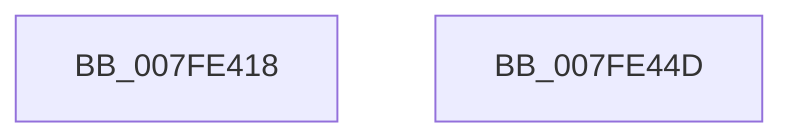

# MmReleaseDumpHibernateResources

- RVA: `0x007FE418`–`0x007FE44E` (길이 `54` bytes)
- VA: `0x00000001407FE418`
- 실행 섹션: `PAGE`
- PDB 이름 있음: `예`; PDB Function 태그: `아니요`
- unwind 정보 RVA: `0x0005C788`
- 디코드: `13`개 명령, `54/54` bytes 표시
- 미해석 바이트: `0` (있으면 어셈블리에 `.byte`로 보존)

> 이 문서는 커널 이미지의 기계어와 PDB 기호를 분석해 생성했습니다. 4번과 5번은 함수 원형과 자료형을 바이너리 사용 방식에서 추정한 C 해석이며 원본 소스 복구 결과는 아닙니다.

## 1. Dependencies

- 직접 호출 지점: **2**; 고유 호출 대상: **2**
- 직접 호출자로 확인된 함수: **3**
- RIP 상대 이미지 참조: **1**

### Outgoing calls
- `0x007FE434` → [MiGetPteAddress](../../text/43/MiGetPteAddress_function_0043E130.md) (function, `0x0043E130`)
- `0x007FE443` → [MiReleasePtes](../../text/24/MiReleasePtes_function_00247240.md) (function, `0x00247240`)

### Direct callers
- [IopLiveDumpFreeMappingResources](../../text/59/IopLiveDumpFreeMappingResources_function_0059BFE0.md) at `0x0059C020`
- [PopFreeHiberContext](../70/PopFreeHiberContext_function_00704F1C.md) at `0x007050C9`
- [PopEnableHiberFile](../90/PopEnableHiberFile_function_0090F850.md) at `0x0090FD2F`

### Static image references
- `0x007FE43C` → RVA `0x00E37668` (`.data`; read)

## 2. Other-region calls and transfers

- 다른 실행 섹션으로 향하는 call: **2**
  - `0x007FE434` → [MiGetPteAddress](../../text/43/MiGetPteAddress_function_0043E130.md) (`PAGE` → `.text`)
  - `0x007FE443` → [MiReleasePtes](../../text/24/MiReleasePtes_function_00247240.md) (`PAGE` → `.text`)
- 별도 외부 분기/꼬리 이동을 확인하지 못했습니다.

## 3. Assembly (complete function range)

```asm
007FE418  48 83 EC 28                     sub rsp, 0x28
007FE41C  48 F7 C2 FF 0F 00 00            test rdx, 0xfff
007FE423  41 B8 00 00 00 00               mov r8d, 0
007FE429  41 0F 95 C0                     setne r8b
007FE42D  48 C1 EA 0C                     shr rdx, 0xc
007FE431  44 03 C2                        add r8d, edx
007FE434  E8 F7 FC C3 FF                  call 0x14043e130
007FE439  48 8B D0                        mov rdx, rax
007FE43C  48 8D 0D 25 92 63 00            lea rcx, [rip + 0x639225]
007FE443  E8 F8 8D A4 FF                  call 0x140247240
007FE448  48 83 C4 28                     add rsp, 0x28
007FE44C  C3                              ret
007FE44D  CC                              int3
```

## 4. C-style interpretation (structured pseudocode)

```c
__int64 __fastcall MmReleaseDumpHibernateResources(__int64 a1, __int64 a2)
{
    __int64 result;
    __int64 v_rsp;

    v_rsp = (v_rsp) - (40);
    a3 = (((a2) & (0xFFFULL)) != 0) ? 1 : 0;
    a2 = (a2) >> (12);
    a3 = (unsigned int)((a3) + ((unsigned int)(a2)));
    result = MiGetPteAddress(a1, a2, a3, a4);
    result = MiReleasePtes(v_rip + 6525477, result, a3, a4);
    v_rsp = (v_rsp) + (40);
    return result;
}
```

## 5. (Beta) C Style

```c
int64_t MmReleaseDumpHibernateResources(int64_t Arg1, int64_t Arg2)
{
    int64_t result;
    int64_t local_rsp;

    local_rsp = (local_rsp) - (40);
    a3 = (((Arg2) & (0xFFFULL)) != 0) ? 1 : 0;
    Arg2 = (Arg2) >> (12);
    a3 = (uint32_t)((a3) + ((uint32_t)(Arg2)));
    result = MiGetPteAddress(Arg1, Arg2, a3, a4);
    result = MiReleasePtes(v_rip + 6525477, result, a3, a4);
    local_rsp = (local_rsp) + (40);
    return result;
}
```

## 6. Execution-region graph

[열기: 2D/3D 그래프와 함수 탐색 컨트롤 패널](../../../control-panel.html?section=page&rva=0x007FE418&view=graph)

- 2D 그래프는 위에서 아래로 흐르고, 3D 그래프는 빈 공간을 드래그해 회전합니다. Shift+드래그는 이동, 휠은 확대·축소, 함수 노드 선택은 대상 보고서 이동입니다.

### Static fallback


