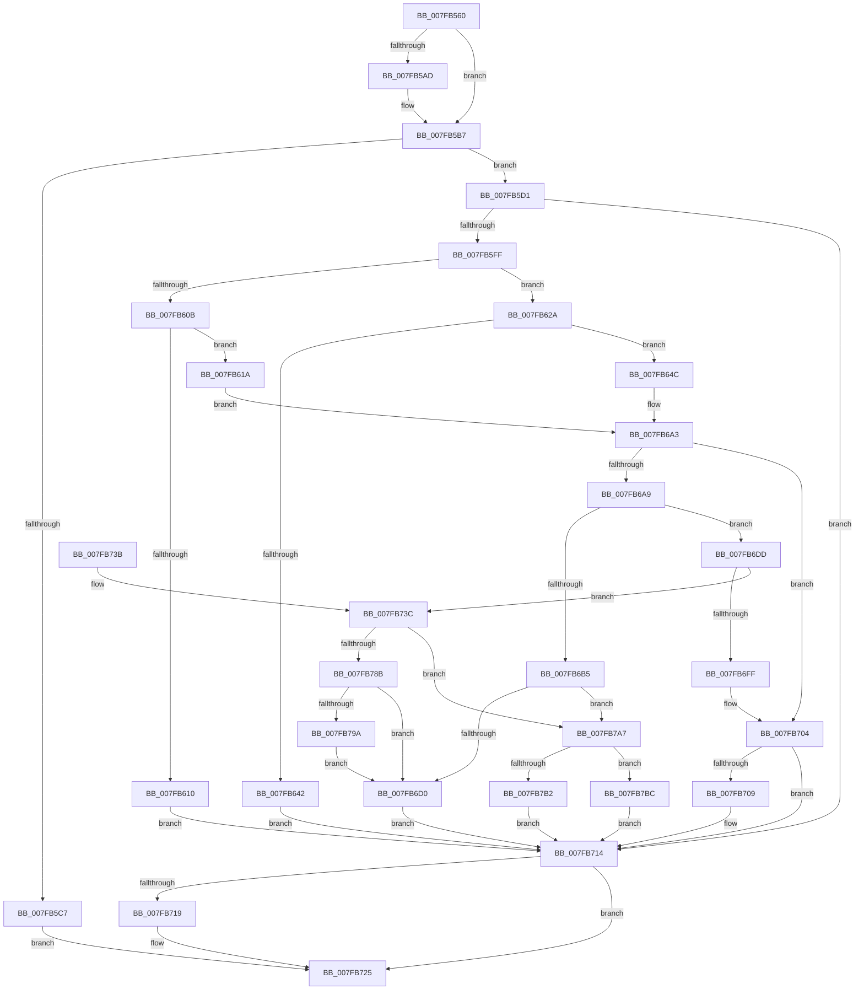

# MmRemovePhysicalMemory

- RVA: `0x007FB560`–`0x007FB7CC` (길이 `620` bytes)
- VA: `0x00000001407FB560`
- 실행 섹션: `PAGE`
- PDB 이름 있음: `예`; PDB Function 태그: `아니요`
- unwind 정보 RVA: `0x000D7B08`
- 디코드: `170`개 명령, `620/620` bytes 표시
- 미해석 바이트: `0` (있으면 어셈블리에 `.byte`로 보존)

> 이 문서는 커널 이미지의 기계어와 PDB 기호를 분석해 생성했습니다. 4번과 5번은 함수 원형과 자료형을 바이너리 사용 방식에서 추정한 C 해석이며 원본 소스 복구 결과는 아닙니다.

## 1. Dependencies

- 직접 호출 지점: **13**; 고유 호출 대상: **13**
- 직접 호출자로 확인된 함수: **1**
- RIP 상대 이미지 참조: **1**

### Outgoing calls
- `0x007FB5EC` → [MiReferencePagePartition](../../text/67/MiReferencePagePartition_function_00679304.md) (function, `0x00679304`)
- `0x007FB623` → [MiRemoveBadPages](../../text/67/MiRemoveBadPages_function_00679F6C.md) (function, `0x00679F6C`)
- `0x007FB639` → [MiAcquireNonPagedResources](../../text/28/MiAcquireNonPagedResources_function_00286C60.md) (function, `0x00286C60`)
- `0x007FB69E` → [MiFindContiguousPagesEx](../../text/28/MiFindContiguousPagesEx_function_0028BDE0.md) (function, `0x0028BDE0`)
- `0x007FB6C1` → [MiRemovePhysicalMemory](MiRemovePhysicalMemory_function_007FAD3C.md) (function, `0x007FAD3C`)
- `0x007FB6F6` → [MiAddRangeToPartitionTree](../../text/69/MiAddRangeToPartitionTree_function_0069020C.md) (function, `0x0069020C`)
- `0x007FB70F` → [MiReleaseNonPagedResourcesNotExposed](../../text/3F/MiReleaseNonPagedResourcesNotExposed_function_003F8258.md) (function, `0x003F8258`)
- `0x007FB720` → [PsDereferencePartition](../../text/34/PsDereferencePartition_function_00342E70.md) (function, `0x00342E70`)
- `0x007FB777` → [MiInsertPartitionPages](../../text/69/MiInsertPartitionPages_function_006911A0.md) (function, `0x006911A0`)
- `0x007FB782` → [MiDeletePartitionPageNodes](../../text/69/MiDeletePartitionPageNodes_function_006908F0.md) (function, `0x006908F0`)
- `0x007FB79D` → [MiSpecialPurposeMemoryRemoved](../80/MiSpecialPurposeMemoryRemoved_function_0080FFD8.md) (function, `0x0080FFD8`)
- `0x007FB7B2` → [MiReturnBadPagesToBadList](../../text/67/MiReturnBadPagesToBadList_function_0067A374.md) (function, `0x0067A374`)
- `0x007FB7C2` → [MiFreeContiguousPages](../../text/3F/MiFreeContiguousPages_function_003F7178.md) (function, `0x003F7178`)

### Direct callers
- [WheapClearPoison](../7D/WheapClearPoison_function_007D7DFC.md) at `0x007D7E3A`

### Static image references
- `0x007FB5FF` → RVA `0x00E38D00` (`.data`; read)

## 2. Other-region calls and transfers

- 다른 실행 섹션으로 향하는 call: **11**
  - `0x007FB5EC` → [MiReferencePagePartition](../../text/67/MiReferencePagePartition_function_00679304.md) (`PAGE` → `.text`)
  - `0x007FB623` → [MiRemoveBadPages](../../text/67/MiRemoveBadPages_function_00679F6C.md) (`PAGE` → `.text`)
  - `0x007FB639` → [MiAcquireNonPagedResources](../../text/28/MiAcquireNonPagedResources_function_00286C60.md) (`PAGE` → `.text`)
  - `0x007FB69E` → [MiFindContiguousPagesEx](../../text/28/MiFindContiguousPagesEx_function_0028BDE0.md) (`PAGE` → `.text`)
  - `0x007FB6F6` → [MiAddRangeToPartitionTree](../../text/69/MiAddRangeToPartitionTree_function_0069020C.md) (`PAGE` → `.text`)
  - `0x007FB70F` → [MiReleaseNonPagedResourcesNotExposed](../../text/3F/MiReleaseNonPagedResourcesNotExposed_function_003F8258.md) (`PAGE` → `.text`)
  - `0x007FB720` → [PsDereferencePartition](../../text/34/PsDereferencePartition_function_00342E70.md) (`PAGE` → `.text`)
  - `0x007FB777` → [MiInsertPartitionPages](../../text/69/MiInsertPartitionPages_function_006911A0.md) (`PAGE` → `.text`)
  - `0x007FB782` → [MiDeletePartitionPageNodes](../../text/69/MiDeletePartitionPageNodes_function_006908F0.md) (`PAGE` → `.text`)
  - `0x007FB7B2` → [MiReturnBadPagesToBadList](../../text/67/MiReturnBadPagesToBadList_function_0067A374.md) (`PAGE` → `.text`)
  - `0x007FB7C2` → [MiFreeContiguousPages](../../text/3F/MiFreeContiguousPages_function_003F7178.md) (`PAGE` → `.text`)
- 별도 외부 분기/꼬리 이동을 확인하지 못했습니다.

## 3. Assembly (complete function range)

```asm
007FB560  48 89 54 24 10                  mov qword ptr [rsp + 0x10], rdx
007FB565  55                              push rbp
007FB566  53                              push rbx
007FB567  56                              push rsi
007FB568  57                              push rdi
007FB569  41 54                           push r12
007FB56B  41 55                           push r13
007FB56D  41 56                           push r14
007FB56F  41 57                           push r15
007FB571  48 8D 6C 24 E1                  lea rbp, [rsp - 0x1f]
007FB576  48 81 EC 98 00 00 00            sub rsp, 0x98
007FB57D  48 83 65 7F 00                  and qword ptr [rbp + 0x7f], 0
007FB582  48 83 65 67 00                  and qword ptr [rbp + 0x67], 0
007FB587  4C 8B 31                        mov r14, qword ptr [rcx]
007FB58A  48 8B 32                        mov rsi, qword ptr [rdx]
007FB58D  48 C1 EE 0C                     shr rsi, 0xc
007FB591  4C 89 75 77                     mov qword ptr [rbp + 0x77], r14
007FB595  8B 4D 77                        mov ecx, dword ptr [rbp + 0x77]
007FB598  F7 C1 FF 0F 00 00               test ecx, 0xfff
007FB59E  41 0F 95 C7                     setne r15b
007FB5A2  F6 C1 01                        test cl, 1
007FB5A5  0F 95 C0                        setne al
007FB5A8  44 22 F8                        and r15b, al
007FB5AB  74 0A                           je 0x1407fb5b7
007FB5AD  83 E1 FE                        and ecx, 0xfffffffe
007FB5B0  89 4D 77                        mov dword ptr [rbp + 0x77], ecx
007FB5B3  4C 8B 75 77                     mov r14, qword ptr [rbp + 0x77]
007FB5B7  49 C1 EE 0C                     shr r14, 0xc
007FB5BB  45 33 E4                        xor r12d, r12d
007FB5BE  4E 8D 2C 36                     lea r13, [rsi + r14]
007FB5C2  4D 3B F5                        cmp r14, r13
007FB5C5  72 0A                           jb 0x1407fb5d1
007FB5C7  BF EF 00 00 C0                  mov edi, 0xc00000ef
007FB5CC  E9 54 01 00 00                  jmp 0x1407fb725
007FB5D1  4B 8D 0C 76                     lea rcx, [r14 + r14*2]
007FB5D5  48 C1 E1 04                     shl rcx, 4
007FB5D9  48 B8 00 00 00 00 00 DE FF FF   movabs rax, 0xffffde0000000000
007FB5E3  48 03 C8                        add rcx, rax
007FB5E6  4C 8D 45 67                     lea r8, [rbp + 0x67]
007FB5EA  33 D2                           xor edx, edx
007FB5EC  E8 13 DD E7 FF                  call 0x140679304
007FB5F1  48 8B 5D 67                     mov rbx, qword ptr [rbp + 0x67]
007FB5F5  8B F8                           mov edi, eax
007FB5F7  85 C0                           test eax, eax
007FB5F9  0F 88 15 01 00 00               js 0x1407fb714
007FB5FF  48 8D 05 FA D6 63 00            lea rax, [rip + 0x63d6fa]
007FB606  45 84 FF                        test r15b, r15b
007FB609  74 1F                           je 0x1407fb62a
007FB60B  48 3B D8                        cmp rbx, rax
007FB60E  74 0A                           je 0x1407fb61a
007FB610  BF BB 00 00 C0                  mov edi, 0xc00000bb
007FB615  E9 FA 00 00 00                  jmp 0x1407fb714
007FB61A  4C 8B C6                        mov r8, rsi
007FB61D  49 8B D6                        mov rdx, r14
007FB620  48 8B CB                        mov rcx, rbx
007FB623  E8 44 E9 E7 FF                  call 0x140679f6c
007FB628  EB 79                           jmp 0x1407fb6a3
007FB62A  41 B9 08 00 00 00               mov r9d, 8
007FB630  45 33 C0                        xor r8d, r8d
007FB633  48 8B D6                        mov rdx, rsi
007FB636  48 8B CB                        mov rcx, rbx
007FB639  E8 22 B6 A8 FF                  call 0x140286c60
007FB63E  85 C0                           test eax, eax
007FB640  79 0A                           jns 0x1407fb64c
007FB642  BF 9A 00 00 C0                  mov edi, 0xc000009a
007FB647  E9 C8 00 00 00                  jmp 0x1407fb714
007FB64C  B9 01 00 00 00                  mov ecx, 1
007FB651  48 8D 45 7F                     lea rax, [rbp + 0x7f]
007FB655  48 89 44 24 68                  mov qword ptr [rsp + 0x68], rax
007FB65A  4D 8D 45 FF                     lea r8, [r13 - 1]
007FB65E  48 83 64 24 60 00               and qword ptr [rsp + 0x60], 0
007FB664  44 8B E1                        mov r12d, ecx
007FB667  48 83 64 24 58 00               and qword ptr [rsp + 0x58], 0
007FB66D  45 33 C9                        xor r9d, r9d
007FB670  89 4C 24 50                     mov dword ptr [rsp + 0x50], ecx
007FB674  49 8B D6                        mov rdx, r14
007FB677  C7 44 24 48 00 00 10 2C         mov dword ptr [rsp + 0x48], 0x2c100000
007FB67F  C6 44 24 40 FF                  mov byte ptr [rsp + 0x40], 0xff
007FB684  C7 44 24 38 00 00 00 80         mov dword ptr [rsp + 0x38], 0x80000000
007FB68C  89 4C 24 30                     mov dword ptr [rsp + 0x30], ecx
007FB690  48 8B CB                        mov rcx, rbx
007FB693  48 89 74 24 28                  mov qword ptr [rsp + 0x28], rsi
007FB698  48 83 64 24 20 00               and qword ptr [rsp + 0x20], 0
007FB69E  E8 3D 07 A9 FF                  call 0x14028bde0
007FB6A3  8B F8                           mov edi, eax
007FB6A5  85 C0                           test eax, eax
007FB6A7  78 5B                           js 0x1407fb704
007FB6A9  48 8D 3D 50 D6 63 00            lea rdi, [rip + 0x63d650]
007FB6B0  48 3B DF                        cmp rbx, rdi
007FB6B3  75 28                           jne 0x1407fb6dd
007FB6B5  41 B8 20 00 40 00               mov r8d, 0x400020
007FB6BB  48 8B D6                        mov rdx, rsi
007FB6BE  49 8B CE                        mov rcx, r14
007FB6C1  E8 76 F6 FF FF                  call 0x1407fad3c
007FB6C6  8B F8                           mov edi, eax
007FB6C8  85 C0                           test eax, eax
007FB6CA  0F 88 D7 00 00 00               js 0x1407fb7a7
007FB6D0  48 8B 45 6F                     mov rax, qword ptr [rbp + 0x6f]
007FB6D4  48 C1 E6 0C                     shl rsi, 0xc
007FB6D8  48 89 30                        mov qword ptr [rax], rsi
007FB6DB  EB 37                           jmp 0x1407fb714
007FB6DD  83 65 13 00                     and dword ptr [rbp + 0x13], 0
007FB6E1  48 8D 4D 77                     lea rcx, [rbp + 0x77]
007FB6E5  48 83 65 77 00                  and qword ptr [rbp + 0x77], 0
007FB6EA  41 B9 02 00 00 00               mov r9d, 2
007FB6F0  4C 8B C6                        mov r8, rsi
007FB6F3  49 8B D6                        mov rdx, r14
007FB6F6  E8 11 4B E9 FF                  call 0x14069020c
007FB6FB  85 C0                           test eax, eax
007FB6FD  75 3D                           jne 0x1407fb73c
007FB6FF  BF 9A 00 00 C0                  mov edi, 0xc000009a
007FB704  45 85 E4                        test r12d, r12d
007FB707  74 0B                           je 0x1407fb714
007FB709  48 8B D6                        mov rdx, rsi
007FB70C  48 8B CB                        mov rcx, rbx
007FB70F  E8 44 CB BF FF                  call 0x1403f8258
007FB714  48 85 DB                        test rbx, rbx
007FB717  74 0C                           je 0x1407fb725
007FB719  48 8B 8B B8 00 00 00            mov rcx, qword ptr [rbx + 0xb8]
007FB720  E8 4B 77 B4 FF                  call 0x140342e70
007FB725  8B C7                           mov eax, edi
007FB727  48 81 C4 98 00 00 00            add rsp, 0x98
007FB72E  41 5F                           pop r15
007FB730  41 5E                           pop r14
007FB732  41 5D                           pop r13
007FB734  41 5C                           pop r12
007FB736  5F                              pop rdi
007FB737  5E                              pop rsi
007FB738  5B                              pop rbx
007FB739  5D                              pop rbp
007FB73A  C3                              ret
007FB73B  CC                              int3
007FB73C  48 8D 45 77                     lea rax, [rbp + 0x77]
007FB740  C7 45 0F 07 04 00 00            mov dword ptr [rbp + 0xf], 0x407
007FB747  48 89 45 F7                     mov qword ptr [rbp - 9], rax
007FB74B  4C 8D 45 F7                     lea r8, [rbp - 9]
007FB74F  8B 43 04                        mov eax, dword ptr [rbx + 4]
007FB752  B9 07 06 00 00                  mov ecx, 0x607
007FB757  48 8B 5D 67                     mov rbx, qword ptr [rbp + 0x67]
007FB75B  A8 80                           test al, 0x80
007FB75D  8B 45 0F                        mov eax, dword ptr [rbp + 0xf]
007FB760  0F 57 C0                        xorps xmm0, xmm0
007FB763  0F 45 C1                        cmovne eax, ecx
007FB766  4C 8B CE                        mov r9, rsi
007FB769  48 8B CB                        mov rcx, rbx
007FB76C  89 45 0F                        mov dword ptr [rbp + 0xf], eax
007FB76F  48 8B D7                        mov rdx, rdi
007FB772  F3 0F 7F 45 FF                  movdqu xmmword ptr [rbp - 1], xmm0
007FB777  E8 24 5A E9 FF                  call 0x1406911a0
007FB77C  48 8D 4D 77                     lea rcx, [rbp + 0x77]
007FB780  8B F8                           mov edi, eax
007FB782  E8 69 51 E9 FF                  call 0x1406908f0
007FB787  85 FF                           test edi, edi
007FB789  78 1C                           js 0x1407fb7a7
007FB78B  8B 43 04                        mov eax, dword ptr [rbx + 4]
007FB78E  48 8B 5D 67                     mov rbx, qword ptr [rbp + 0x67]
007FB792  84 C0                           test al, al
007FB794  0F 89 36 FF FF FF               jns 0x1407fb6d0
007FB79A  48 8B CB                        mov rcx, rbx
007FB79D  E8 36 48 01 00                  call 0x14080ffd8
007FB7A2  E9 29 FF FF FF                  jmp 0x1407fb6d0
007FB7A7  48 8B D6                        mov rdx, rsi
007FB7AA  49 8B CE                        mov rcx, r14
007FB7AD  45 84 FF                        test r15b, r15b
007FB7B0  74 0A                           je 0x1407fb7bc
007FB7B2  E8 BD EB E7 FF                  call 0x14067a374
007FB7B7  E9 58 FF FF FF                  jmp 0x1407fb714
007FB7BC  41 B8 20 00 00 00               mov r8d, 0x20
007FB7C2  E8 B1 B9 BF FF                  call 0x1403f7178
007FB7C7  E9 48 FF FF FF                  jmp 0x1407fb714
```

## 4. C-style interpretation (structured pseudocode)

```c
__int64 __fastcall MmRemovePhysicalMemory(__int64 a1, __int64 a2)
{
    __int64 result;
    __int64 v_r12;
    __int64 v_r14;
    __int64 v_r15;
    __int64 v_rsi;
    __int64 v_rsp;
    unsigned int v_stack_m4C;
    unsigned int v_stack_m50;
    unsigned __int64 v_stack_m5F;
    unsigned __int64 v_stack_m60;
    unsigned __int64 v_stack_m68;
    unsigned __int64 v_stack_m70;
    unsigned __int64 v_stack_m78;
    unsigned __int64 v_stack_m80;
    unsigned int v_stack_m88;
    unsigned int v_stack_m90;
    unsigned __int8 v_stack_m98;
    unsigned int v_stack_mA0;
    unsigned int v_stack_mA8;
    unsigned __int64 v_stack_mB0;
    unsigned __int64 v_stack_mB8;
    unsigned __int64 v_stack_p10;
    unsigned __int64 v_stack_p18;
    unsigned __int64 v_stack_p20;
    unsigned __int64 v_stack_p8;

    v_stack_p10 = a2;
    v_rsp = (v_rsp) - (152);
    v_rsi = (*(unsigned __int64 *)(a2)) >> (12);
    v_stack_p18 = *(unsigned __int64 *)(a1);
    v_r15 = ((((unsigned int)((unsigned int)(v_stack_p18))) & (0xFFFULL)) != 0) ? 1 : 0;
    result = ((((unsigned __int8)((unsigned int)(v_stack_p18))) & (1)) != 0) ? 1 : 0;
    v_r15 = (unsigned __int8)((v_r15) & ((unsigned __int8)(result)));
    v_r14 = *(unsigned __int64 *)(a1);
    if (!(condition_is_equal)) {
        a1 = (unsigned int)(((unsigned int)(v_stack_p18)) & (0xFFFFFFFEULL));
        v_stack_p18 = (unsigned int)(a1);
        v_r14 = v_stack_p18;
    }
    v_r14 = (v_r14) >> (12);
    v_r12 = 0;
    if (v_r14 < (v_rsi + v_r14 * 1)) goto loc_007FB5D1;
    goto loc_007FB725;
loc_007FB5D1:
    a1 = (v_r14 + v_r14 * 2) << (4);
    a1 = (a1) + (result);
    a2 = 0;
    result = MiReferencePagePartition(a1, a2, v_stack_p8, a4);
    if (sign_flag) goto loc_007FB714;
    if ((unsigned __int8)(v_r15) == 0) goto loc_007FB62A;
    if (v_stack_p8 == (v_rip + 6543098)) goto loc_007FB61A;
    goto loc_007FB714;
loc_007FB61A:
    result = MiRemoveBadPages(v_stack_p8, v_r14, v_rsi, a4);
    goto loc_007FB6A3;
loc_007FB62A:
    a3 = 0;
    result = MiAcquireNonPagedResources(v_stack_p8, v_rsi, a3, 8);
    if (!sign_flag) goto loc_007FB64C;
    goto loc_007FB714;
loc_007FB64C:
    v_stack_m70 = v_stack_p20;
    a4 = 0;
    v_stack_m88 = 1;
    v_stack_m90 = 0x2C100000ULL;
    v_stack_m98 = 255;
    v_stack_mA0 = 0x80000000ULL;
    v_stack_mA8 = 1;
    v_stack_mB0 = v_rsi;
    result = MiFindContiguousPagesEx(v_stack_p8, v_r14, v_rsi + v_r14 * 1 - 1, a4);
loc_007FB6A3:
    if (sign_flag) goto loc_007FB704;
    if (v_stack_p8 != (v_rip + 6542928)) goto loc_007FB6DD;
    result = MiRemovePhysicalMemory(v_r14, v_rsi, (unsigned int)(0x400020ULL), a4);
    if (sign_flag) goto loc_007FB7A7;
loc_007FB6D0:
    v_rsi = (v_rsi) << (12);
    *(unsigned __int64 *)(v_stack_p10) = v_rsi;
    goto loc_007FB714;
loc_007FB6DD:
    result = MiAddRangeToPartitionTree(v_stack_p18, v_r14, v_rsi, 2);
    if ((unsigned int)(result) != 0) goto loc_007FB73C;
loc_007FB704:
    if (1 != 0) {
        a2 = v_rsi;
        a1 = v_stack_p8;
        result = MiReleaseNonPagedResourcesNotExposed(a1, a2, v_rsi, 2);
    }
    if (v_stack_p8 != 0) {
        a1 = *(unsigned __int64 *)(v_stack_p8 + 184);
        result = PsDereferencePartition(a1, a2, v_rsi, 2);
    }
    v_rsp = (v_rsp) + (152);
    return (unsigned int)((unsigned int)((unsigned int)(0xC000009AULL)));
loc_007FB73C:
    v_stack_m50 = 0x407ULL;
    v_stack_m68 = v_stack_p18;
    result = (unsigned int)(v_stack_m50);
    if ((((unsigned __int8)((unsigned int)(*(unsigned int *)(v_stack_p8 + 4)))) & (128)) != 0) { result = (unsigned int)((unsigned int)(0x607ULL)); }
    v_stack_m50 = (unsigned int)(result);
    v_stack_m60 = v_xmm0;
    result = MiInsertPartitionPages(v_stack_p8, (unsigned int)(0xC000009AULL), v_stack_m68, v_rsi);
    result = MiDeletePartitionPageNodes(v_stack_p18, (unsigned int)(0xC000009AULL), v_stack_m68, v_rsi);
    if (sign_flag) goto loc_007FB7A7;
    if (!sign_flag) goto loc_007FB6D0;
    result = MiSpecialPurposeMemoryRemoved(v_stack_p8, (unsigned int)(0xC000009AULL), v_stack_m68, v_rsi);
    goto loc_007FB6D0;
loc_007FB7A7:
    if ((unsigned __int8)(v_r15) == 0) goto loc_007FB7BC;
    result = MiReturnBadPagesToBadList(v_r14, v_rsi, v_stack_m68, v_rsi);
    goto loc_007FB714;
loc_007FB7BC:
    result = MiFreeContiguousPages(v_r14, v_rsi, 32, v_rsi);
    goto loc_007FB714;
}
```

## 5. (Beta) C Style

```c
int64_t MmRemovePhysicalMemory(void *Arg1, void *Arg2)
{
    uint8_t *arg1 = (uint8_t *)Arg1;
    uint8_t *arg2 = (uint8_t *)Arg2;

    int64_t result;
    int64_t local_r12;
    int64_t local_r14;
    int64_t local_r15;
    int64_t local_rsi;
    int64_t local_rsp;
    uint32_t v_stack_m4C;
    uint32_t v_stack_m50;
    uint64_t v_stack_m5F;
    uint64_t v_stack_m60;
    uint64_t v_stack_m68;
    uint64_t v_stack_m70;
    uint64_t v_stack_m78;
    uint64_t v_stack_m80;
    uint32_t v_stack_m88;
    uint32_t v_stack_m90;
    uint8_t v_stack_m98;
    uint32_t v_stack_mA0;
    uint32_t v_stack_mA8;
    uint64_t v_stack_mB0;
    uint64_t v_stack_mB8;
    uint64_t v_stack_p10;
    uint64_t v_stack_p18;
    uint64_t v_stack_p20;
    uint64_t v_stack_p8;

    v_stack_p10 = Arg2;
    local_rsp = (local_rsp) - (152);
    local_rsi = (*(uint64_t *)(arg2)) >> (12);
    v_stack_p18 = *(uint64_t *)(arg1);
    local_r15 = ((((uint32_t)((uint32_t)(v_stack_p18))) & (0xFFFULL)) != 0) ? 1 : 0;
    result = ((((uint8_t)((uint32_t)(v_stack_p18))) & (1)) != 0) ? 1 : 0;
    local_r15 = (uint8_t)((local_r15) & ((uint8_t)(result)));
    local_r14 = *(uint64_t *)(arg1);
    if (!(condition_is_equal)) {
        Arg1 = (uint32_t)(((uint32_t)(v_stack_p18)) & (0xFFFFFFFEULL));
        v_stack_p18 = (uint32_t)(Arg1);
        local_r14 = v_stack_p18;
    }
    local_r14 = (local_r14) >> (12);
    local_r12 = 0;
    if (local_r14 < (local_rsi + local_r14 * 1)) goto loc_007FB5D1;
    goto loc_007FB725;
loc_007FB5D1:
    Arg1 = (local_r14 + local_r14 * 2) << (4);
    Arg1 = (Arg1) + (result);
    Arg2 = 0;
    result = MiReferencePagePartition(Arg1, Arg2, v_stack_p8, a4);
    if (sign_flag) goto loc_007FB714;
    if ((uint8_t)(local_r15) == 0) goto loc_007FB62A;
    if (v_stack_p8 == (v_rip + 6543098)) goto loc_007FB61A;
    goto loc_007FB714;
loc_007FB61A:
    result = MiRemoveBadPages(v_stack_p8, local_r14, local_rsi, a4);
    goto loc_007FB6A3;
loc_007FB62A:
    a3 = 0;
    result = MiAcquireNonPagedResources(v_stack_p8, local_rsi, a3, 8);
    if (!sign_flag) goto loc_007FB64C;
    goto loc_007FB714;
loc_007FB64C:
    v_stack_m70 = v_stack_p20;
    a4 = 0;
    v_stack_m88 = 1;
    v_stack_m90 = 0x2C100000ULL;
    v_stack_m98 = 255;
    v_stack_mA0 = 0x80000000ULL;
    v_stack_mA8 = 1;
    v_stack_mB0 = local_rsi;
    result = MiFindContiguousPagesEx(v_stack_p8, local_r14, local_rsi + local_r14 * 1 - 1, a4);
loc_007FB6A3:
    if (sign_flag) goto loc_007FB704;
    if (v_stack_p8 != (v_rip + 6542928)) goto loc_007FB6DD;
    result = MiRemovePhysicalMemory(local_r14, local_rsi, (uint32_t)(0x400020ULL), a4);
    if (sign_flag) goto loc_007FB7A7;
loc_007FB6D0:
    local_rsi = (local_rsi) << (12);
    *(uint64_t *)(v_stack_p10) = local_rsi;
    goto loc_007FB714;
loc_007FB6DD:
    result = MiAddRangeToPartitionTree(v_stack_p18, local_r14, local_rsi, 2);
    if ((uint32_t)(result) != 0) goto loc_007FB73C;
loc_007FB704:
    if (1 != 0) {
        Arg2 = local_rsi;
        Arg1 = v_stack_p8;
        result = MiReleaseNonPagedResourcesNotExposed(Arg1, Arg2, local_rsi, 2);
    }
    if (v_stack_p8 != 0) {
        Arg1 = *(uint64_t *)(v_stack_p8 + 0xB8);
        result = PsDereferencePartition(Arg1, Arg2, local_rsi, 2);
    }
    local_rsp = (local_rsp) + (152);
    return (uint32_t)((uint32_t)((uint32_t)(0xC000009AULL)));
loc_007FB73C:
    v_stack_m50 = 0x407ULL;
    v_stack_m68 = v_stack_p18;
    result = (uint32_t)(v_stack_m50);
    if ((((uint8_t)((uint32_t)(*(uint32_t *)(v_stack_p8 + 0x4)))) & (128)) != 0) { result = (uint32_t)((uint32_t)(0x607ULL)); }
    v_stack_m50 = (uint32_t)(result);
    v_stack_m60 = v_xmm0;
    result = MiInsertPartitionPages(v_stack_p8, (uint32_t)(0xC000009AULL), v_stack_m68, local_rsi);
    result = MiDeletePartitionPageNodes(v_stack_p18, (uint32_t)(0xC000009AULL), v_stack_m68, local_rsi);
    if (sign_flag) goto loc_007FB7A7;
    if (!sign_flag) goto loc_007FB6D0;
    result = MiSpecialPurposeMemoryRemoved(v_stack_p8, (uint32_t)(0xC000009AULL), v_stack_m68, local_rsi);
    goto loc_007FB6D0;
loc_007FB7A7:
    if ((uint8_t)(local_r15) == 0) goto loc_007FB7BC;
    result = MiReturnBadPagesToBadList(local_r14, local_rsi, v_stack_m68, local_rsi);
    goto loc_007FB714;
loc_007FB7BC:
    result = MiFreeContiguousPages(local_r14, local_rsi, 32, local_rsi);
    goto loc_007FB714;
}
```

### 관측된 메모리 오프셋

구조체 형식이 확인되지 않은 접근은 인자 기준의 오프셋으로만 기록했습니다.

| 기준 인자 | 오프셋 표현 | 폭 (bit) | 접근 |
|---|---:|---:|---|
| `Arg1` | `+ 0x0` | `64` | `R` |
| `Arg2` | `+ 0x0` | `64` | `R` |

## 6. Execution-region graph

[열기: 2D/3D 그래프와 함수 탐색 컨트롤 패널](../../../control-panel.html?section=page&rva=0x007FB560&view=graph)

- 2D 그래프는 위에서 아래로 흐르고, 3D 그래프는 빈 공간을 드래그해 회전합니다. Shift+드래그는 이동, 휠은 확대·축소, 함수 노드 선택은 대상 보고서 이동입니다.

### Static fallback


