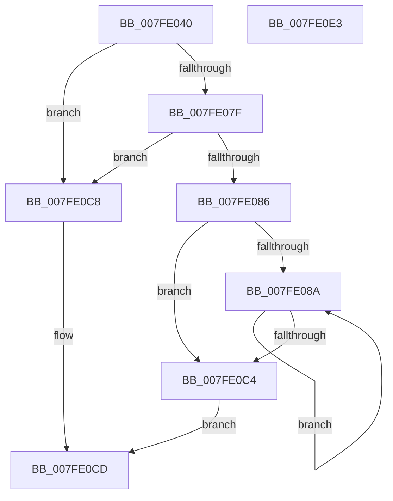

# MmReplaceImportEntriesForVerifier

- RVA: `0x007FE040`–`0x007FE0E4` (길이 `164` bytes)
- VA: `0x00000001407FE040`
- 실행 섹션: `PAGE`
- PDB 이름 있음: `예`; PDB Function 태그: `아니요`
- unwind 정보 RVA: `0x000A85B0`
- 디코드: `47`개 명령, `164/164` bytes 표시
- 미해석 바이트: `0` (있으면 어셈블리에 `.byte`로 보존)

> 이 문서는 커널 이미지의 기계어와 PDB 기호를 분석해 생성했습니다. 4번과 5번은 함수 원형과 자료형을 바이너리 사용 방식에서 추정한 C 해석이며 원본 소스 복구 결과는 아닙니다.

## 1. Dependencies

- 직접 호출 지점: **3**; 고유 호출 대상: **3**
- 직접 호출자로 확인된 함수: **1**
- RIP 상대 이미지 참조: **1**

### Outgoing calls
- `0x007FE072` → [RtlImageDirectoryEntryToData](../../text/43/RtlImageDirectoryEntryToData_function_004328D0.md) (function, `0x004328D0`)
- `0x007FE0A2` → [MiEnumerateBasePatches](../../pagelk/B7/MiEnumerateBasePatches_function_00B74B38.md) (function, `0x00B74B38`)
- `0x007FE0B5` → [MiReplaceImportEntry](../../text/67/MiReplaceImportEntry_function_00671440.md) (function, `0x00671440`)

### Direct callers
- [MmApplyVerifierToRunningImage](../../pagevrfy/BB/MmApplyVerifierToRunningImage_function_00BB4780.md) at `0x00BB47CC`

### Static image references
- `0x007FE08D` → RVA `0x00683D80` (`MiReplacePatchImportEntry`; read)

## 2. Other-region calls and transfers

- 다른 실행 섹션으로 향하는 call: **3**
  - `0x007FE072` → [RtlImageDirectoryEntryToData](../../text/43/RtlImageDirectoryEntryToData_function_004328D0.md) (`PAGE` → `.text`)
  - `0x007FE0A2` → [MiEnumerateBasePatches](../../pagelk/B7/MiEnumerateBasePatches_function_00B74B38.md) (`PAGE` → `PAGELK`)
  - `0x007FE0B5` → [MiReplaceImportEntry](../../text/67/MiReplaceImportEntry_function_00671440.md) (`PAGE` → `.text`)
- 별도 외부 분기/꼬리 이동을 확인하지 못했습니다.

## 3. Assembly (complete function range)

```asm
007FE040  48 8B C4                        mov rax, rsp
007FE043  48 89 58 10                     mov qword ptr [rax + 0x10], rbx
007FE047  48 89 70 18                     mov qword ptr [rax + 0x18], rsi
007FE04B  48 89 78 20                     mov qword ptr [rax + 0x20], rdi
007FE04F  41 56                           push r14
007FE051  48 83 EC 20                     sub rsp, 0x20
007FE055  83 60 08 00                     and dword ptr [rax + 8], 0
007FE059  4C 8D 48 08                     lea r9, [rax + 8]
007FE05D  41 8B F8                        mov edi, r8d
007FE060  48 8B DA                        mov rbx, rdx
007FE063  48 8B F1                        mov rsi, rcx
007FE066  41 B8 0C 00 00 00               mov r8d, 0xc
007FE06C  48 8B 49 30                     mov rcx, qword ptr [rcx + 0x30]
007FE070  B2 01                           mov dl, 1
007FE072  E8 59 48 C3 FF                  call 0x1404328d0
007FE077  4C 8B F0                        mov r14, rax
007FE07A  48 85 C0                        test rax, rax
007FE07D  74 49                           je 0x1407fe0c8
007FE07F  83 7C 24 30 08                  cmp dword ptr [rsp + 0x30], 8
007FE084  72 42                           jb 0x1407fe0c8
007FE086  85 FF                           test edi, edi
007FE088  74 3A                           je 0x1407fe0c4
007FE08A  48 63 03                        movsxd rax, dword ptr [rbx]
007FE08D  48 8D 15 EC 5C E8 FF            lea rdx, [rip - 0x17a314]
007FE094  4C 8B C3                        mov r8, rbx
007FE097  49 8B 0C C6                     mov rcx, qword ptr [r14 + rax*8]
007FE09B  48 89 4B 10                     mov qword ptr [rbx + 0x10], rcx
007FE09F  48 8B CE                        mov rcx, rsi
007FE0A2  E8 91 6A 37 00                  call 0x140b74b38
007FE0A7  48 63 03                        movsxd rax, dword ptr [rbx]
007FE0AA  48 8B CE                        mov rcx, rsi
007FE0AD  4C 8B 43 08                     mov r8, qword ptr [rbx + 8]
007FE0B1  49 8D 14 C6                     lea rdx, [r14 + rax*8]
007FE0B5  E8 86 33 E7 FF                  call 0x140671440
007FE0BA  48 83 C3 18                     add rbx, 0x18
007FE0BE  48 83 EF 01                     sub rdi, 1
007FE0C2  75 C6                           jne 0x1407fe08a
007FE0C4  33 C0                           xor eax, eax
007FE0C6  EB 05                           jmp 0x1407fe0cd
007FE0C8  B8 BB 00 00 C0                  mov eax, 0xc00000bb
007FE0CD  48 8B 5C 24 38                  mov rbx, qword ptr [rsp + 0x38]
007FE0D2  48 8B 74 24 40                  mov rsi, qword ptr [rsp + 0x40]
007FE0D7  48 8B 7C 24 48                  mov rdi, qword ptr [rsp + 0x48]
007FE0DC  48 83 C4 20                     add rsp, 0x20
007FE0E0  41 5E                           pop r14
007FE0E2  C3                              ret
007FE0E3  CC                              int3
```

## 4. C-style interpretation (structured pseudocode)

```c
__int64 __fastcall MmReplaceImportEntriesForVerifier(__int64 a1, __int64 a2, int a3)
{
    __int64 result;
    __int64 v_rbx;
    __int64 v_rdi;
    __int64 v_rsp;
    unsigned __int64 v_stack_p10;
    unsigned __int64 v_stack_p18;
    unsigned __int64 v_stack_p20;
    unsigned int v_stack_p8;

    *(unsigned __int64 *)(v_rsp + 16) = v_rbx;
    *(unsigned __int64 *)(v_rsp + 24) = v_rsi;
    *(unsigned __int64 *)(v_rsp + 32) = v_rdi;
    v_rsp = (v_rsp) - (32);
    result = RtlImageDirectoryEntryToData(*(unsigned __int64 *)(a1 + 48), 1, 12, v_rsp + 8);
    if (result == 0) goto loc_007FE0C8;
    if (v_stack_p8 < 8) goto loc_007FE0C8;
    if ((unsigned int)((unsigned int)(a3)) == 0) goto loc_007FE0C4;
loc_007FE08A:
    *(unsigned __int64 *)(a2 + 16) = *(unsigned __int64 *)(result + (int)(*(unsigned int *)(a2)) * 8);
    result = MiEnumerateBasePatches(a1, v_rip - 1549076, a2, v_rsp + 8);
    result = MiReplaceImportEntry(a1, result + (int)(*(unsigned int *)(a2)) * 8, *(unsigned __int64 *)(a2 + 8), v_rsp + 8);
    v_rbx = (a2) + (24);
    v_rdi = ((unsigned int)(a3)) - (1);
    if (condition_is_not_equal) goto loc_007FE08A;
loc_007FE0C4:
    result = 0;
    goto loc_007FE0CD;
loc_007FE0C8:
loc_007FE0CD:
    v_rsp = (v_rsp) + (32);
    return (unsigned int)(0xC00000BBULL);
}
```

## 5. (Beta) C Style

```c
int64_t MmReplaceImportEntriesForVerifier(void *Arg1, void *Arg2, int32_t Arg3)
{
    uint8_t *arg1 = (uint8_t *)Arg1;
    uint8_t *arg2 = (uint8_t *)Arg2;

    int64_t result;
    int64_t local_rbx;
    int64_t local_rdi;
    int64_t local_rsp;
    uint64_t v_stack_p10;
    uint64_t v_stack_p18;
    uint64_t v_stack_p20;
    uint32_t v_stack_p8;

    *(uint64_t *)(local_rsp + 0x10) = local_rbx;
    *(uint64_t *)(local_rsp + 0x18) = local_rsi;
    *(uint64_t *)(local_rsp + 0x20) = local_rdi;
    local_rsp = (local_rsp) - (32);
    result = RtlImageDirectoryEntryToData(*(uint64_t *)(arg1 + 0x30), 1, 12, local_rsp + 8);
    if (result == 0) goto loc_007FE0C8;
    if (v_stack_p8 < 8) goto loc_007FE0C8;
    if ((uint32_t)((uint32_t)(Arg3)) == 0) goto loc_007FE0C4;
loc_007FE08A:
    *(uint64_t *)(arg2 + 0x10) = *(uint64_t *)(result + (int32_t)(*(uint32_t *)(arg2)) * 8);
    result = MiEnumerateBasePatches(Arg1, v_rip - 1549076, Arg2, local_rsp + 8);
    result = MiReplaceImportEntry(Arg1, result + (int32_t)(*(uint32_t *)(arg2)) * 8, *(uint64_t *)(arg2 + 0x8), local_rsp + 8);
    local_rbx = (Arg2) + (24);
    local_rdi = ((uint32_t)(Arg3)) - (1);
    if (condition_is_not_equal) goto loc_007FE08A;
loc_007FE0C4:
    result = 0;
    goto loc_007FE0CD;
loc_007FE0C8:
loc_007FE0CD:
    local_rsp = (local_rsp) + (32);
    return (uint32_t)(0xC00000BBULL);
}
```

### 관측된 메모리 오프셋

구조체 형식이 확인되지 않은 접근은 인자 기준의 오프셋으로만 기록했습니다.

| 기준 인자 | 오프셋 표현 | 폭 (bit) | 접근 |
|---|---:|---:|---|
| `Arg1` | `+ 0x30` | `64` | `R` |
| `Arg2` | `+ 0x0` | `32` | `R` |
| `Arg2` | `+ 0x8` | `64` | `R` |
| `Arg2` | `+ 0x10` | `64` | `W` |

## 6. Execution-region graph

[열기: 2D/3D 그래프와 함수 탐색 컨트롤 패널](../../../control-panel.html?section=page&rva=0x007FE040&view=graph)

- 2D 그래프는 위에서 아래로 흐르고, 3D 그래프는 빈 공간을 드래그해 회전합니다. Shift+드래그는 이동, 휠은 확대·축소, 함수 노드 선택은 대상 보고서 이동입니다.

### Static fallback


