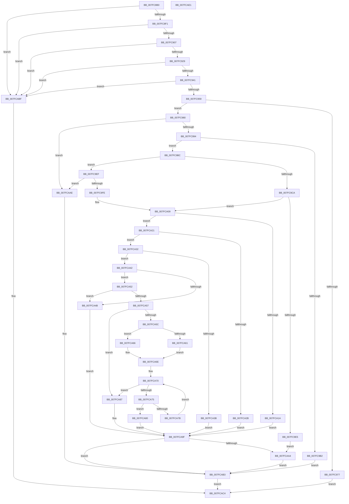

# MmSetGraphicsPtes

- RVA: `0x007FC8B0`–`0x007FCAE2` (길이 `562` bytes)
- VA: `0x00000001407FC8B0`
- 실행 섹션: `PAGE`
- PDB 이름 있음: `예`; PDB Function 태그: `아니요`
- unwind 정보 RVA: `0x0008C2BC`
- 디코드: `164`개 명령, `562/562` bytes 표시
- 미해석 바이트: `0` (있으면 어셈블리에 `.byte`로 보존)

> 이 문서는 커널 이미지의 기계어와 PDB 기호를 분석해 생성했습니다. 4번과 5번은 함수 원형과 자료형을 바이너리 사용 방식에서 추정한 C 해석이며 원본 소스 복구 결과는 아닙니다.

## 1. Dependencies

- 직접 호출 지점: **7**; 고유 호출 대상: **7**
- 직접 호출자로 확인된 함수: **0**
- RIP 상대 이미지 참조: **0**

### Outgoing calls
- `0x007FC96A` → [MiObtainReferencedVadEx](../../text/31/MiObtainReferencedVadEx_function_00316690.md) (function, `0x00316690`)
- `0x007FC9D0` → [MiLockAweVadsExclusive](../../text/4B/MiLockAweVadsExclusive_function_004BDEE4.md) (function, `0x004BDEE4`)
- `0x007FC9D8` → [MiGetAwePageSizeFromVa](../../text/68/MiGetAwePageSizeFromVa_function_00688D74.md) (function, `0x00688D74`)
- `0x007FCA01` → [MiGetVadPageSize](../../text/42/MiGetVadPageSize_function_0042F0E0.md) (function, `0x0042F0E0`)
- `0x007FCA98` → [MiSetGraphicsPtes](../../text/67/MiSetGraphicsPtes_function_00678554.md) (function, `0x00678554`)
- `0x007FCAA7` → [MiUnlockAweVadsExclusive](../../text/4B/MiUnlockAweVadsExclusive_function_004BDF1C.md) (function, `0x004BDF1C`)
- `0x007FCAB6` → [MiUnlockAndDereferenceVad](../../text/31/MiUnlockAndDereferenceVad_function_00316E60.md) (function, `0x00316E60`)

### Direct callers
- 이 함수 시작 RVA로 연결되는 직접 call은 확인되지 않았습니다. 간접 호출은 완전히 역산할 수 없습니다.

### Static image references
- 디코드된 RIP-relative 메모리 참조가 없습니다.

## 2. Other-region calls and transfers

- 다른 실행 섹션으로 향하는 call: **7**
  - `0x007FC96A` → [MiObtainReferencedVadEx](../../text/31/MiObtainReferencedVadEx_function_00316690.md) (`PAGE` → `.text`)
  - `0x007FC9D0` → [MiLockAweVadsExclusive](../../text/4B/MiLockAweVadsExclusive_function_004BDEE4.md) (`PAGE` → `.text`)
  - `0x007FC9D8` → [MiGetAwePageSizeFromVa](../../text/68/MiGetAwePageSizeFromVa_function_00688D74.md) (`PAGE` → `.text`)
  - `0x007FCA01` → [MiGetVadPageSize](../../text/42/MiGetVadPageSize_function_0042F0E0.md) (`PAGE` → `.text`)
  - `0x007FCA98` → [MiSetGraphicsPtes](../../text/67/MiSetGraphicsPtes_function_00678554.md) (`PAGE` → `.text`)
  - `0x007FCAA7` → [MiUnlockAweVadsExclusive](../../text/4B/MiUnlockAweVadsExclusive_function_004BDF1C.md) (`PAGE` → `.text`)
  - `0x007FCAB6` → [MiUnlockAndDereferenceVad](../../text/31/MiUnlockAndDereferenceVad_function_00316E60.md) (`PAGE` → `.text`)
- 별도 외부 분기/꼬리 이동을 확인하지 못했습니다.

## 3. Assembly (complete function range)

```asm
007FC8B0  4C 8B DC                        mov r11, rsp
007FC8B3  49 89 5B 10                     mov qword ptr [r11 + 0x10], rbx
007FC8B7  49 89 6B 18                     mov qword ptr [r11 + 0x18], rbp
007FC8BB  49 89 73 20                     mov qword ptr [r11 + 0x20], rsi
007FC8BF  57                              push rdi
007FC8C0  41 54                           push r12
007FC8C2  41 55                           push r13
007FC8C4  41 56                           push r14
007FC8C6  41 57                           push r15
007FC8C8  48 83 EC 30                     sub rsp, 0x30
007FC8CC  65 4C 8B 24 25 88 01 00 00      mov r12, qword ptr gs:[0x188]
007FC8D5  48 8D 5A FF                     lea rbx, [rdx - 1]
007FC8D9  48 03 D9                        add rbx, rcx
007FC8DC  4D 8B E9                        mov r13, r9
007FC8DF  4D 8B F8                        mov r15, r8
007FC8E2  48 8B FA                        mov rdi, rdx
007FC8E5  48 8B F1                        mov rsi, rcx
007FC8E8  48 3B D9                        cmp rbx, rcx
007FC8EB  0F 86 CE 01 00 00               jbe 0x1407fcabf
007FC8F1  48 FF CA                        dec rdx
007FC8F4  48 8B C3                        mov rax, rbx
007FC8F7  48 85 FF                        test rdi, rdi
007FC8FA  48 0F 44 C1                     cmove rax, rcx
007FC8FE  48 3B C1                        cmp rax, rcx
007FC901  0F 82 B8 01 00 00               jb 0x1407fcabf
007FC907  48 8B C7                        mov rax, rdi
007FC90A  49 B8 FF FF FE FF FF 7F 00 00   movabs r8, 0x7ffffffeffff
007FC914  48 F7 D8                        neg rax
007FC917  48 1B C9                        sbb rcx, rcx
007FC91A  48 23 CA                        and rcx, rdx
007FC91D  48 03 CE                        add rcx, rsi
007FC920  49 3B C8                        cmp rcx, r8
007FC923  0F 87 96 01 00 00               ja 0x1407fcabf
007FC929  48 8B C7                        mov rax, rdi
007FC92C  48 F7 D8                        neg rax
007FC92F  48 1B C9                        sbb rcx, rcx
007FC932  48 23 CA                        and rcx, rdx
007FC935  48 03 CB                        add rcx, rbx
007FC938  48 3B CB                        cmp rcx, rbx
007FC93B  0F 82 7E 01 00 00               jb 0x1407fcabf
007FC941  48 8B C7                        mov rax, rdi
007FC944  48 F7 D8                        neg rax
007FC947  48 1B C9                        sbb rcx, rcx
007FC94A  48 23 CA                        and rcx, rdx
007FC94D  48 03 CB                        add rcx, rbx
007FC950  49 3B C8                        cmp rcx, r8
007FC953  0F 87 66 01 00 00               ja 0x1407fcabf
007FC959  83 64 24 60 00                  and dword ptr [rsp + 0x60], 0
007FC95E  4D 8D 43 08                     lea r8, [r11 + 8]
007FC962  33 D2                           xor edx, edx
007FC964  48 8B CE                        mov rcx, rsi
007FC967  45 33 F6                        xor r14d, r14d
007FC96A  E8 21 9D B1 FF                  call 0x140316690
007FC96F  48 8B E8                        mov rbp, rax
007FC972  48 85 C0                        test rax, rax
007FC975  75 09                           jne 0x1407fc980
007FC977  8B 44 24 60                     mov eax, dword ptr [rsp + 0x60]
007FC97B  E9 44 01 00 00                  jmp 0x1407fcac4
007FC980  8B 50 30                        mov edx, dword ptr [rax + 0x30]
007FC983  B9 00 00 20 04                  mov ecx, 0x4200000
007FC988  8B C2                           mov eax, edx
007FC98A  23 C1                           and eax, ecx
007FC98C  3B C1                           cmp eax, ecx
007FC98E  0F 85 1A 01 00 00               jne 0x1407fcaae
007FC994  0F B6 4D 21                     movzx ecx, byte ptr [rbp + 0x21]
007FC998  8B 45 1C                        mov eax, dword ptr [rbp + 0x1c]
007FC99B  48 C1 E1 20                     shl rcx, 0x20
007FC99F  48 0B C8                        or rcx, rax
007FC9A2  48 C1 E1 0C                     shl rcx, 0xc
007FC9A6  48 81 C9 FF 0F 00 00            or rcx, 0xfff
007FC9AD  48 3B D9                        cmp rbx, rcx
007FC9B0  76 0A                           jbe 0x1407fc9bc
007FC9B2  BB F0 00 00 C0                  mov ebx, 0xc00000f0
007FC9B7  E9 F7 00 00 00                  jmp 0x1407fcab3
007FC9BC  8B C2                           mov eax, edx
007FC9BE  BB 01 00 00 00                  mov ebx, 1
007FC9C3  83 E0 70                        and eax, 0x70
007FC9C6  3C 30                           cmp al, 0x30
007FC9C8  75 25                           jne 0x1407fc9ef
007FC9CA  49 8B CC                        mov rcx, r12
007FC9CD  44 8B F3                        mov r14d, ebx
007FC9D0  E8 0F 15 CC FF                  call 0x1404bdee4
007FC9D5  48 8B CE                        mov rcx, rsi
007FC9D8  E8 97 C3 E8 FF                  call 0x140688d74
007FC9DD  48 8B C8                        mov rcx, rax
007FC9E0  48 85 C0                        test rax, rax
007FC9E3  75 24                           jne 0x1407fca09
007FC9E5  BB EF 00 00 C0                  mov ebx, 0xc00000ef
007FC9EA  E9 B5 00 00 00                  jmp 0x1407fcaa4
007FC9EF  B8 00 00 A0 00                  mov eax, 0xa00000
007FC9F4  23 D0                           and edx, eax
007FC9F6  3B D0                           cmp edx, eax
007FC9F8  0F 85 B0 00 00 00               jne 0x1407fcaae
007FC9FE  48 8B CD                        mov rcx, rbp
007FCA01  E8 DA 26 C3 FF                  call 0x14042f0e0
007FCA06  48 8B C8                        mov rcx, rax
007FCA09  44 8B 8C 24 88 00 00 00         mov r9d, dword ptr [rsp + 0x88]
007FCA11  41 F7 C1 FE FF FF FF            test r9d, 0xfffffffe
007FCA18  74 07                           je 0x1407fca21
007FCA1A  BB F4 00 00 C0                  mov ebx, 0xc00000f4
007FCA1F  EB 7E                           jmp 0x1407fca9f
007FCA21  83 BC 24 80 00 00 00 00         cmp dword ptr [rsp + 0x80], 0
007FCA29  74 07                           je 0x1407fca32
007FCA2B  BB F3 00 00 C0                  mov ebx, 0xc00000f3
007FCA30  EB 6D                           jmp 0x1407fca9f
007FCA32  48 C1 E1 0C                     shl rcx, 0xc
007FCA36  4C 3B E9                        cmp r13, rcx
007FCA39  74 07                           je 0x1407fca42
007FCA3B  BB F2 00 00 C0                  mov ebx, 0xc00000f2
007FCA40  EB 5D                           jmp 0x1407fca9f
007FCA42  4C 8D 41 FF                     lea r8, [rcx - 1]
007FCA46  4C 85 C6                        test rsi, r8
007FCA49  74 07                           je 0x1407fca52
007FCA4B  BB EF 00 00 C0                  mov ebx, 0xc00000ef
007FCA50  EB 4D                           jmp 0x1407fca9f
007FCA52  4C 85 C7                        test rdi, r8
007FCA55  75 F4                           jne 0x1407fca4b
007FCA57  4D 85 FF                        test r15, r15
007FCA5A  74 2B                           je 0x1407fca87
007FCA5C  44 84 CB                        test bl, r9b
007FCA5F  74 05                           je 0x1407fca66
007FCA61  48 8B C3                        mov rax, rbx
007FCA64  EB 08                           jmp 0x1407fca6e
007FCA66  33 D2                           xor edx, edx
007FCA68  48 8B C7                        mov rax, rdi
007FCA6B  48 F7 F1                        div rcx
007FCA6E  33 D2                           xor edx, edx
007FCA70  48 3B D0                        cmp rdx, rax
007FCA73  73 12                           jae 0x1407fca87
007FCA75  4D 85 04 D7                     test qword ptr [r15 + rdx*8], r8
007FCA79  75 05                           jne 0x1407fca80
007FCA7B  48 03 D3                        add rdx, rbx
007FCA7E  EB F0                           jmp 0x1407fca70
007FCA80  BB F1 00 00 C0                  mov ebx, 0xc00000f1
007FCA85  EB 18                           jmp 0x1407fca9f
007FCA87  44 89 4C 24 28                  mov dword ptr [rsp + 0x28], r9d
007FCA8C  4D 8B C7                        mov r8, r15
007FCA8F  4D 8B CD                        mov r9, r13
007FCA92  48 8B D7                        mov rdx, rdi
007FCA95  48 8B CE                        mov rcx, rsi
007FCA98  E8 B7 BA E7 FF                  call 0x140678554
007FCA9D  8B D8                           mov ebx, eax
007FCA9F  45 85 F6                        test r14d, r14d
007FCAA2  74 0F                           je 0x1407fcab3
007FCAA4  49 8B CC                        mov rcx, r12
007FCAA7  E8 70 14 CC FF                  call 0x1404bdf1c
007FCAAC  EB 05                           jmp 0x1407fcab3
007FCAAE  BB EF 00 00 C0                  mov ebx, 0xc00000ef
007FCAB3  48 8B CD                        mov rcx, rbp
007FCAB6  E8 A5 A3 B1 FF                  call 0x140316e60
007FCABB  8B C3                           mov eax, ebx
007FCABD  EB 05                           jmp 0x1407fcac4
007FCABF  B8 0D 00 00 C0                  mov eax, 0xc000000d
007FCAC4  48 8B 5C 24 68                  mov rbx, qword ptr [rsp + 0x68]
007FCAC9  48 8B 6C 24 70                  mov rbp, qword ptr [rsp + 0x70]
007FCACE  48 8B 74 24 78                  mov rsi, qword ptr [rsp + 0x78]
007FCAD3  48 83 C4 30                     add rsp, 0x30
007FCAD7  41 5F                           pop r15
007FCAD9  41 5E                           pop r14
007FCADB  41 5D                           pop r13
007FCADD  41 5C                           pop r12
007FCADF  5F                              pop rdi
007FCAE0  C3                              ret
007FCAE1  CC                              int3
```

## 4. C-style interpretation (structured pseudocode)

```c
__int64 __fastcall MmSetGraphicsPtes(__int64 a1, __int64 a2, __int64 a3, __int64 a4, unsigned int a5, unsigned int a6)
{
    __int64 result;
    __int64 v_r14;
    __int64 v_rbx;
    __int64 v_rsp;
    unsigned int v_stack_m30;
    unsigned __int64 v_stack_p10;
    unsigned __int64 v_stack_p18;
    unsigned __int64 v_stack_p20;
    unsigned int v_stack_p8;

    *(unsigned __int64 *)(v_rsp + 16) = v_rbx;
    *(unsigned __int64 *)(v_rsp + 24) = v_rbp;
    *(unsigned __int64 *)(v_rsp + 32) = v_rsi;
    v_rsp = (v_rsp) - (48);
    v_rbx = (a2 - 1) + (a1);
    if (v_rbx <= a1) goto loc_007FCABF;
    a2 = (a2) - 1;
    result = v_rbx;
    if (a2 == 0) { result = a1; }
    if (result < a1) goto loc_007FCABF;
    result = -(a2);
    a1 = (a1) & (a2);
    a1 = (a1) + (a1);
    if (a1 > a3) goto loc_007FCABF;
    result = -(a2);
    a1 = (a1) & (a2);
    a1 = (a1) + (v_rbx);
    if (a1 < v_rbx) goto loc_007FCABF;
    result = -(a2);
    a1 = (a1) & (a2);
    a1 = (a1) + (v_rbx);
    if (a1 > a3) goto loc_007FCABF;
    a2 = 0;
    v_r14 = 0;
    result = MiObtainReferencedVadEx(a1, a2, v_rsp + 8, a4);
    if (result != 0) goto loc_007FC980;
    goto loc_007FCAC4;
loc_007FC980:
    result = (unsigned int)(((unsigned int)((unsigned int)((unsigned int)(*(unsigned int *)((unsigned int)(v_stack_p8) + 48))))) & ((unsigned int)((unsigned int)(0x4200000ULL))));
    if (((unsigned int)(result)) != ((unsigned int)((unsigned int)(0x4200000ULL)))) goto loc_007FCAAE;
    a1 = (*(unsigned __int8 *)(result + 33)) << (32);
    a1 = (a1) | ((unsigned int)(*(unsigned int *)(result + 28)));
    a1 = (a1) << (12);
    a1 = (a1) | (0xFFFULL);
    if (v_rbx <= a1) goto loc_007FC9BC;
    goto loc_007FCAB3;
loc_007FC9BC:
    result = (unsigned int)(((unsigned int)((unsigned int)((unsigned int)(*(unsigned int *)((unsigned int)(v_stack_p8) + 48))))) & (112));
    if (((unsigned __int8)(result)) != 48) goto loc_007FC9EF;
    result = MiLockAweVadsExclusive(*(unsigned __int64 *)(gs_base + (0 + 392)), (unsigned int)(*(unsigned int *)((unsigned int)(v_stack_p8) + 48)), v_rsp + 8, a4);
    result = MiGetAwePageSizeFromVa(a1, (unsigned int)(*(unsigned int *)((unsigned int)(v_stack_p8) + 48)), v_rsp + 8, a4);
    if (result != 0) goto loc_007FCA09;
    goto loc_007FCAA4;
loc_007FC9EF:
    a2 = (unsigned int)(((unsigned int)(*(unsigned int *)((unsigned int)(v_stack_p8) + 48))) & ((unsigned int)((unsigned int)(0xA00000ULL))));
    if (((unsigned int)(a2)) != ((unsigned int)((unsigned int)(0xA00000ULL)))) goto loc_007FCAAE;
    result = MiGetVadPageSize(result, a2, v_rsp + 8, a4);
loc_007FCA09:
    if ((((unsigned int)((unsigned int)(a6))) & (0xFFFFFFFEULL)) == 0) goto loc_007FCA21;
    goto loc_007FCA9F;
loc_007FCA21:
    if (a5 == 0) goto loc_007FCA32;
    goto loc_007FCA9F;
loc_007FCA32:
    a1 = (result) << (12);
    if (a4 == a1) goto loc_007FCA42;
    goto loc_007FCA9F;
loc_007FCA42:
    if (((a1) & (a1 - 1)) == 0) goto loc_007FCA52;
loc_007FCA4B:
    goto loc_007FCA9F;
loc_007FCA52:
    if (((a2) & (a1 - 1)) != 0) goto loc_007FCA4B;
    if (a3 == 0) goto loc_007FCA87;
    if ((((unsigned __int8)((unsigned int)(0xC00000EFULL))) & ((unsigned __int8)((unsigned int)(a6)))) == 0) goto loc_007FCA66;
    goto loc_007FCA6E;
loc_007FCA66:
    a2 = 0;
loc_007FCA6E:
    a2 = 0;
loc_007FCA70:
    if (0 >= 0) goto loc_007FCA87;
    if (((*(unsigned __int64 *)(a3 + a2 * 8)) & (a1 - 1)) != 0) goto loc_007FCA80;
    a2 = (a2) + ((unsigned int)(0xC00000EFULL));
    goto loc_007FCA70;
loc_007FCA80:
    goto loc_007FCA9F;
loc_007FCA87:
    v_stack_m30 = (unsigned int)((unsigned int)(a6));
    result = MiSetGraphicsPtes(a1, a2, a3, a4);
loc_007FCA9F:
    if (1 == 0) goto loc_007FCAB3;
loc_007FCAA4:
    result = MiUnlockAweVadsExclusive(*(unsigned __int64 *)(gs_base + (0 + 392)), a2, a3, a4);
    goto loc_007FCAB3;
loc_007FCAAE:
loc_007FCAB3:
    result = MiUnlockAndDereferenceVad(result, a2, a3, a4);
    goto loc_007FCAC4;
loc_007FCABF:
loc_007FCAC4:
    v_rsp = (v_rsp) + (48);
    return (unsigned int)(0xC000000DULL);
}
```

## 5. (Beta) C Style

```c
int64_t MmSetGraphicsPtes(int64_t Arg1, void *Arg2, int64_t Arg3, int64_t Arg4, uint32_t Arg5, uint32_t Arg6)
{
    uint8_t *arg2 = (uint8_t *)Arg2;

    int64_t result;
    int64_t local_r14;
    int64_t local_rbx;
    int64_t local_rsp;
    uint32_t v_stack_m30;
    uint64_t v_stack_p10;
    uint64_t v_stack_p18;
    uint64_t v_stack_p20;
    uint32_t v_stack_p8;

    *(uint64_t *)(local_rsp + 0x10) = local_rbx;
    *(uint64_t *)(local_rsp + 0x18) = local_rbp;
    *(uint64_t *)(local_rsp + 0x20) = local_rsi;
    local_rsp = (local_rsp) - (48);
    local_rbx = (Arg2 - 1) + (Arg1);
    if (local_rbx <= Arg1) goto loc_007FCABF;
    Arg2 = (Arg2) - 1;
    result = local_rbx;
    if (Arg2 == NULL) { result = Arg1; }
    if (result < Arg1) goto loc_007FCABF;
    result = -(Arg2);
    Arg1 = (Arg1) & (Arg2);
    Arg1 = (Arg1) + (Arg1);
    if (Arg1 > Arg3) goto loc_007FCABF;
    result = -(Arg2);
    Arg1 = (Arg1) & (Arg2);
    Arg1 = (Arg1) + (local_rbx);
    if (Arg1 < local_rbx) goto loc_007FCABF;
    result = -(Arg2);
    Arg1 = (Arg1) & (Arg2);
    Arg1 = (Arg1) + (local_rbx);
    if (Arg1 > Arg3) goto loc_007FCABF;
    Arg2 = 0;
    local_r14 = 0;
    result = MiObtainReferencedVadEx(Arg1, Arg2, local_rsp + 8, Arg4);
    if (result != 0) goto loc_007FC980;
    goto loc_007FCAC4;
loc_007FC980:
    result = (uint32_t)(((uint32_t)((uint32_t)((uint32_t)(*(uint32_t *)((uint32_t)(v_stack_p8) + 0x30))))) & ((uint32_t)((uint32_t)(0x4200000ULL))));
    if (((uint32_t)(result)) != ((uint32_t)((uint32_t)(0x4200000ULL)))) goto loc_007FCAAE;
    Arg1 = (*(uint8_t *)(result + 0x21)) << (32);
    Arg1 = (Arg1) | ((uint32_t)(*(uint32_t *)(result + 0x1C)));
    Arg1 = (Arg1) << (12);
    Arg1 = (Arg1) | (0xFFFULL);
    if (local_rbx <= Arg1) goto loc_007FC9BC;
    goto loc_007FCAB3;
loc_007FC9BC:
    result = (uint32_t)(((uint32_t)((uint32_t)((uint32_t)(*(uint32_t *)((uint32_t)(v_stack_p8) + 0x30))))) & (112));
    if (((uint8_t)(result)) != 48) goto loc_007FC9EF;
    result = MiLockAweVadsExclusive(*(uint64_t *)(gs_base + (0 + 0x188)), (uint32_t)(*(uint32_t *)((uint32_t)(v_stack_p8) + 0x30)), local_rsp + 8, Arg4);
    result = MiGetAwePageSizeFromVa(Arg1, (uint32_t)(*(uint32_t *)((uint32_t)(v_stack_p8) + 0x30)), local_rsp + 8, Arg4);
    if (result != 0) goto loc_007FCA09;
    goto loc_007FCAA4;
loc_007FC9EF:
    Arg2 = (uint32_t)(((uint32_t)(*(uint32_t *)((uint32_t)(v_stack_p8) + 0x30))) & ((uint32_t)((uint32_t)(0xA00000ULL))));
    if (((uint32_t)(Arg2)) != ((uint32_t)((uint32_t)(0xA00000ULL)))) goto loc_007FCAAE;
    result = MiGetVadPageSize(result, Arg2, local_rsp + 8, Arg4);
loc_007FCA09:
    if ((((uint32_t)((uint32_t)(Arg6))) & (0xFFFFFFFEULL)) == 0) goto loc_007FCA21;
    goto loc_007FCA9F;
loc_007FCA21:
    if (Arg5 == 0) goto loc_007FCA32;
    goto loc_007FCA9F;
loc_007FCA32:
    Arg1 = (result) << (12);
    if (Arg4 == Arg1) goto loc_007FCA42;
    goto loc_007FCA9F;
loc_007FCA42:
    if (((Arg1) & (Arg1 - 1)) == 0) goto loc_007FCA52;
loc_007FCA4B:
    goto loc_007FCA9F;
loc_007FCA52:
    if (((Arg2) & (Arg1 - 1)) != 0) goto loc_007FCA4B;
    if (Arg3 == 0) goto loc_007FCA87;
    if ((((uint8_t)((uint32_t)(0xC00000EFULL))) & ((uint8_t)((uint32_t)(Arg6)))) == 0) goto loc_007FCA66;
    goto loc_007FCA6E;
loc_007FCA66:
    Arg2 = 0;
loc_007FCA6E:
    Arg2 = 0;
loc_007FCA70:
    if (0 >= 0) goto loc_007FCA87;
    if (((*(uint64_t *)(Arg3 + arg2 * 8)) & (Arg1 - 1)) != 0) goto loc_007FCA80;
    Arg2 = (Arg2) + ((uint32_t)(0xC00000EFULL));
    goto loc_007FCA70;
loc_007FCA80:
    goto loc_007FCA9F;
loc_007FCA87:
    v_stack_m30 = (uint32_t)((uint32_t)(Arg6));
    result = MiSetGraphicsPtes(Arg1, Arg2, Arg3, Arg4);
loc_007FCA9F:
    if (1 == 0) goto loc_007FCAB3;
loc_007FCAA4:
    result = MiUnlockAweVadsExclusive(*(uint64_t *)(gs_base + (0 + 0x188)), Arg2, Arg3, Arg4);
    goto loc_007FCAB3;
loc_007FCAAE:
loc_007FCAB3:
    result = MiUnlockAndDereferenceVad(result, Arg2, Arg3, Arg4);
    goto loc_007FCAC4;
loc_007FCABF:
loc_007FCAC4:
    local_rsp = (local_rsp) + (48);
    return (uint32_t)(0xC000000DULL);
}
```

### 관측된 메모리 오프셋

구조체 형식이 확인되지 않은 접근은 인자 기준의 오프셋으로만 기록했습니다.

| 기준 인자 | 오프셋 표현 | 폭 (bit) | 접근 |
|---|---:|---:|---|
| `Arg2` | `- 0x1` | `64` | `R` |

## 6. Execution-region graph

[열기: 2D/3D 그래프와 함수 탐색 컨트롤 패널](../../../control-panel.html?section=page&rva=0x007FC8B0&view=graph)

- 2D 그래프는 위에서 아래로 흐르고, 3D 그래프는 빈 공간을 드래그해 회전합니다. Shift+드래그는 이동, 휠은 확대·축소, 함수 노드 선택은 대상 보고서 이동입니다.

### Static fallback


