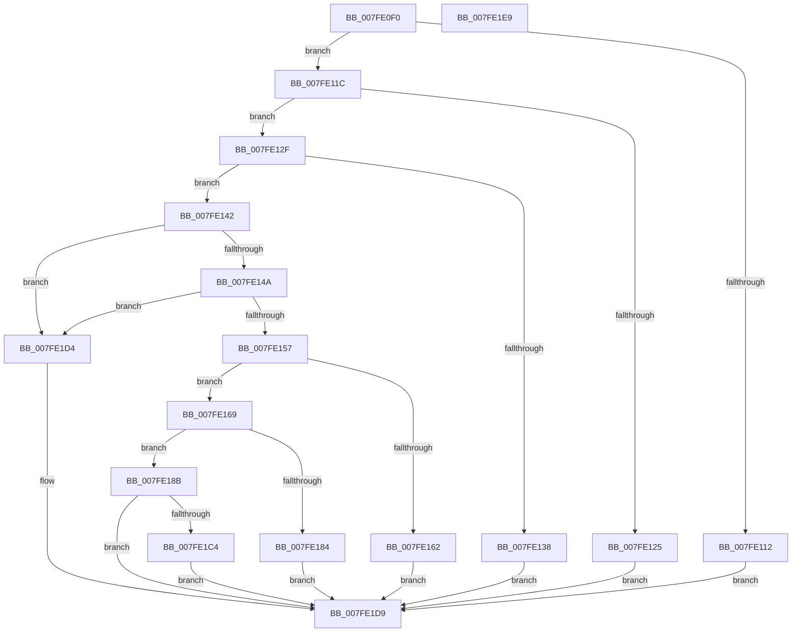

# MmSetPermanentCacheAttribute

- RVA: `0x007FE0F0`–`0x007FE1EA` (길이 `250` bytes)
- VA: `0x00000001407FE0F0`
- 실행 섹션: `PAGE`
- PDB 이름 있음: `예`; PDB Function 태그: `아니요`
- unwind 정보 RVA: `0x000794E0`
- 디코드: `66`개 명령, `250/250` bytes 표시
- 미해석 바이트: `0` (있으면 어셈블리에 `.byte`로 보존)

> 이 문서는 커널 이미지의 기계어와 PDB 기호를 분석해 생성했습니다. 4번과 5번은 함수 원형과 자료형을 바이너리 사용 방식에서 추정한 C 해석이며 원본 소스 복구 결과는 아닙니다.

## 1. Dependencies

- 직접 호출 지점: **3**; 고유 호출 대상: **3**
- 직접 호출자로 확인된 함수: **0**
- RIP 상대 이미지 참조: **1**

### Outgoing calls
- `0x007FE177` → [MiAllocatePool](../../text/35/MiAllocatePool_function_0035B540.md) (function, `0x0035B540`)
- `0x007FE1B7` → [KeGenericCallDpcEx](../../text/2C/KeGenericCallDpcEx_function_002C99F4.md) (function, `0x002C99F4`)
- `0x007FE1C9` → [ExFreePoolWithTag](../../poolcode/B8/ExFreePoolWithTag_function_00B82870.md) (function, `0x00B82870`)

### Direct callers
- 이 함수 시작 RVA로 연결되는 직접 call은 확인되지 않았습니다. 간접 호출은 완전히 역산할 수 없습니다.

### Static image references
- `0x007FE1A2` → RVA `0x0067C540` (`MiMakeIoRangePermanentDpc`; read)

## 2. Other-region calls and transfers

- 다른 실행 섹션으로 향하는 call: **3**
  - `0x007FE177` → [MiAllocatePool](../../text/35/MiAllocatePool_function_0035B540.md) (`PAGE` → `.text`)
  - `0x007FE1B7` → [KeGenericCallDpcEx](../../text/2C/KeGenericCallDpcEx_function_002C99F4.md) (`PAGE` → `.text`)
  - `0x007FE1C9` → [ExFreePoolWithTag](../../poolcode/B8/ExFreePoolWithTag_function_00B82870.md) (`PAGE` → `POOLCODE`)
- 별도 외부 분기/꼬리 이동을 확인하지 못했습니다.

## 3. Assembly (complete function range)

```asm
007FE0F0  48 89 5C 24 08                  mov qword ptr [rsp + 8], rbx
007FE0F5  48 89 74 24 10                  mov qword ptr [rsp + 0x10], rsi
007FE0FA  57                              push rdi
007FE0FB  48 83 EC 30                     sub rsp, 0x30
007FE0FF  83 64 24 2C 00                  and dword ptr [rsp + 0x2c], 0
007FE104  48 8B F2                        mov rsi, rdx
007FE107  48 8B F9                        mov rdi, rcx
007FE10A  44 0F 20 C0                     mov rax, cr8
007FE10E  84 C0                           test al, al
007FE110  74 0A                           je 0x1407fe11c
007FE112  B8 0D 00 00 C0                  mov eax, 0xc000000d
007FE117  E9 BD 00 00 00                  jmp 0x1407fe1d9
007FE11C  41 F7 C1 FE FF FF FF            test r9d, 0xfffffffe
007FE123  74 0A                           je 0x1407fe12f
007FE125  B8 F2 00 00 C0                  mov eax, 0xc00000f2
007FE12A  E9 AA 00 00 00                  jmp 0x1407fe1d9
007FE12F  B8 FF 0F 00 00                  mov eax, 0xfff
007FE134  85 F8                           test eax, edi
007FE136  74 0A                           je 0x1407fe142
007FE138  B8 EF 00 00 C0                  mov eax, 0xc00000ef
007FE13D  E9 97 00 00 00                  jmp 0x1407fe1d9
007FE142  85 F0                           test eax, esi
007FE144  0F 85 8A 00 00 00               jne 0x1407fe1d4
007FE14A  48 C1 EF 0C                     shr rdi, 0xc
007FE14E  48 C1 EE 0C                     shr rsi, 0xc
007FE152  48 85 F6                        test rsi, rsi
007FE155  74 7D                           je 0x1407fe1d4
007FE157  41 8D 40 FF                     lea eax, [r8 - 1]
007FE15B  A9 FD FF FF FF                  test eax, 0xfffffffd
007FE160  74 07                           je 0x1407fe169
007FE162  B8 F1 00 00 C0                  mov eax, 0xc00000f1
007FE167  EB 70                           jmp 0x1407fe1d9
007FE169  BA 30 00 00 00                  mov edx, 0x30
007FE16E  41 B8 4D 69 49 6F               mov r8d, 0x6f49694d
007FE174  8D 4A 10                        lea ecx, [rdx + 0x10]
007FE177  E8 C4 D3 B5 FF                  call 0x14035b540
007FE17C  48 8B D8                        mov rbx, rax
007FE17F  48 85 C0                        test rax, rax
007FE182  75 07                           jne 0x1407fe18b
007FE184  B8 9A 00 00 C0                  mov eax, 0xc000009a
007FE189  EB 4E                           jmp 0x1407fe1d9
007FE18B  48 89 78 18                     mov qword ptr [rax + 0x18], rdi
007FE18F  48 8D 54 24 20                  lea rdx, [rsp + 0x20]
007FE194  C7 43 28 01 00 00 00            mov dword ptr [rbx + 0x28], 1
007FE19B  48 8D 46 FF                     lea rax, [rsi - 1]
007FE19F  48 03 C7                        add rax, rdi
007FE1A2  48 8D 0D 97 E3 E7 FF            lea rcx, [rip - 0x181c69]
007FE1A9  48 89 43 20                     mov qword ptr [rbx + 0x20], rax
007FE1AD  83 64 24 28 00                  and dword ptr [rsp + 0x28], 0
007FE1B2  48 89 5C 24 20                  mov qword ptr [rsp + 0x20], rbx
007FE1B7  E8 38 B8 AC FF                  call 0x1402c99f4
007FE1BC  8B 44 24 28                     mov eax, dword ptr [rsp + 0x28]
007FE1C0  85 C0                           test eax, eax
007FE1C2  79 15                           jns 0x1407fe1d9
007FE1C4  33 D2                           xor edx, edx
007FE1C6  48 8B CB                        mov rcx, rbx
007FE1C9  E8 A2 46 38 00                  call 0x140b82870
007FE1CE  8B 44 24 28                     mov eax, dword ptr [rsp + 0x28]
007FE1D2  EB 05                           jmp 0x1407fe1d9
007FE1D4  B8 F0 00 00 C0                  mov eax, 0xc00000f0
007FE1D9  48 8B 5C 24 40                  mov rbx, qword ptr [rsp + 0x40]
007FE1DE  48 8B 74 24 48                  mov rsi, qword ptr [rsp + 0x48]
007FE1E3  48 83 C4 30                     add rsp, 0x30
007FE1E7  5F                              pop rdi
007FE1E8  C3                              ret
007FE1E9  CC                              int3
```

## 4. C-style interpretation (structured pseudocode)

```c
__int64 __fastcall MmSetPermanentCacheAttribute(__int64 a1, __int64 a2, __int64 a3, int a4)
{
    __int64 result;
    __int64 v_rdi;
    __int64 v_rsi;
    __int64 v_rsp;
    unsigned int v_stack_m10;
    unsigned __int64 v_stack_m18;
    unsigned int v_stack_mC;
    unsigned __int64 v_stack_p10;
    unsigned __int64 v_stack_p8;

    v_stack_p8 = v_rbx;
    v_stack_p10 = v_rsi;
    v_rsp = (v_rsp) - (48);
    if ((unsigned __int8)(v_cr8) == 0) goto loc_007FE11C;
    goto loc_007FE1D9;
loc_007FE11C:
    if (((a4) & (0xFFFFFFFEULL)) == 0) goto loc_007FE12F;
    goto loc_007FE1D9;
loc_007FE12F:
    if ((((unsigned int)((unsigned int)(0xFFFULL))) & ((unsigned int)(a1))) == 0) goto loc_007FE142;
    goto loc_007FE1D9;
loc_007FE142:
    if ((((unsigned int)((unsigned int)(0xC00000EFULL))) & ((unsigned int)(a2))) != 0) goto loc_007FE1D4;
    v_rdi = (a1) >> (12);
    v_rsi = (a2) >> (12);
    if (v_rsi == 0) goto loc_007FE1D4;
    if ((((unsigned int)(a3 - 1)) & (0xFFFFFFFDULL)) == 0) goto loc_007FE169;
    goto loc_007FE1D9;
loc_007FE169:
    result = MiAllocatePool(48 + 16, 48, (unsigned int)(0x6F49694DULL), a4);
    if (result != 0) goto loc_007FE18B;
    goto loc_007FE1D9;
loc_007FE18B:
    *(unsigned __int64 *)((unsigned int)(0xC000009AULL) + 24) = v_rdi;
    *(unsigned int *)(result + 40) = 1;
    result = (v_rsi - 1) + (v_rdi);
    *(unsigned __int64 *)(result + 32) = result;
    v_stack_m18 = result;
    result = KeGenericCallDpcEx(v_rip - 1580137, v_stack_m18, (unsigned int)(0x6F49694DULL), a4);
    if (!sign_flag) goto loc_007FE1D9;
    a2 = 0;
    result = ExFreePoolWithTag(result, a2, (unsigned int)(0x6F49694DULL), a4);
    goto loc_007FE1D9;
loc_007FE1D4:
loc_007FE1D9:
    v_rsp = (v_rsp) + (48);
    return (unsigned int)(0xC00000F0ULL);
}
```

## 5. (Beta) C Style

```c
int64_t MmSetPermanentCacheAttribute(int64_t Arg1, int64_t Arg2, void *Arg3, int32_t Arg4)
{
    uint8_t *arg3 = (uint8_t *)Arg3;

    int64_t result;
    int64_t local_rdi;
    int64_t local_rsi;
    int64_t local_rsp;
    uint32_t v_stack_m10;
    uint64_t v_stack_m18;
    uint32_t v_stack_mC;
    uint64_t v_stack_p10;
    uint64_t v_stack_p8;

    v_stack_p8 = local_rbx;
    v_stack_p10 = local_rsi;
    local_rsp = (local_rsp) - (48);
    if ((uint8_t)(v_cr8) == 0) goto loc_007FE11C;
    goto loc_007FE1D9;
loc_007FE11C:
    if (((Arg4) & (0xFFFFFFFEULL)) == 0) goto loc_007FE12F;
    goto loc_007FE1D9;
loc_007FE12F:
    if ((((uint32_t)((uint32_t)(0xFFFULL))) & ((uint32_t)(Arg1))) == 0) goto loc_007FE142;
    goto loc_007FE1D9;
loc_007FE142:
    if ((((uint32_t)((uint32_t)(0xC00000EFULL))) & ((uint32_t)(Arg2))) != 0) goto loc_007FE1D4;
    local_rdi = (Arg1) >> (12);
    local_rsi = (Arg2) >> (12);
    if (local_rsi == 0) goto loc_007FE1D4;
    if ((((uint32_t)(Arg3 - 1)) & (0xFFFFFFFDULL)) == 0) goto loc_007FE169;
    goto loc_007FE1D9;
loc_007FE169:
    result = MiAllocatePool(48 + 16, 48, (uint32_t)(0x6F49694DULL), Arg4);
    if (result != 0) goto loc_007FE18B;
    goto loc_007FE1D9;
loc_007FE18B:
    *(uint64_t *)((uint32_t)(0xC000009AULL) + 0x18) = local_rdi;
    *(uint32_t *)(result + 0x28) = 1;
    result = (local_rsi - 1) + (local_rdi);
    *(uint64_t *)(result + 0x20) = result;
    v_stack_m18 = result;
    result = KeGenericCallDpcEx(v_rip - 1580137, v_stack_m18, (uint32_t)(0x6F49694DULL), Arg4);
    if (!sign_flag) goto loc_007FE1D9;
    Arg2 = 0;
    result = ExFreePoolWithTag(result, Arg2, (uint32_t)(0x6F49694DULL), Arg4);
    goto loc_007FE1D9;
loc_007FE1D4:
loc_007FE1D9:
    local_rsp = (local_rsp) + (48);
    return (uint32_t)(0xC00000F0ULL);
}
```

### 관측된 메모리 오프셋

구조체 형식이 확인되지 않은 접근은 인자 기준의 오프셋으로만 기록했습니다.

| 기준 인자 | 오프셋 표현 | 폭 (bit) | 접근 |
|---|---:|---:|---|
| `Arg3` | `- 0x1` | `32` | `R` |

## 6. Execution-region graph

[열기: 2D/3D 그래프와 함수 탐색 컨트롤 패널](../../../control-panel.html?section=page&rva=0x007FE0F0&view=graph)

- 2D 그래프는 위에서 아래로 흐르고, 3D 그래프는 빈 공간을 드래그해 회전합니다. Shift+드래그는 이동, 휠은 확대·축소, 함수 노드 선택은 대상 보고서 이동입니다.

### Static fallback


