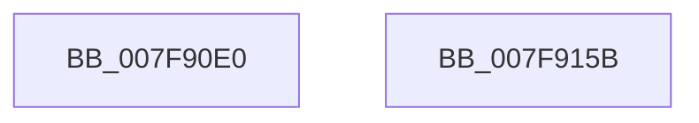

# MmUnmapLockedRestartPages

- RVA: `0x007F90E0`–`0x007F915C` (길이 `124` bytes)
- VA: `0x00000001407F90E0`
- 실행 섹션: `PAGE`
- PDB 이름 있음: `예`; PDB Function 태그: `아니요`
- unwind 정보 RVA: `0x000794E0`
- 디코드: `33`개 명령, `124/124` bytes 표시
- 미해석 바이트: `0` (있으면 어셈블리에 `.byte`로 보존)

> 이 문서는 커널 이미지의 기계어와 PDB 기호를 분석해 생성했습니다. 4번과 5번은 함수 원형과 자료형을 바이너리 사용 방식에서 추정한 C 해석이며 원본 소스 복구 결과는 아닙니다.

## 1. Dependencies

- 직접 호출 지점: **4**; 고유 호출 대상: **4**
- 직접 호출자로 확인된 함수: **0**
- RIP 상대 이미지 참조: **0**

### Outgoing calls
- `0x007F9118` → [MiGetAnyMultiplexedVm](../../text/44/MiGetAnyMultiplexedVm_function_00448BD0.md) (function, `0x00448BD0`)
- `0x007F912E` → [MiUnmapMdlCommon](../../text/3E/MiUnmapMdlCommon_function_003E7DF0.md) (function, `0x003E7DF0`)
- `0x007F913B` → [MiGetPteAddress](../../text/43/MiGetPteAddress_function_0043E130.md) (function, `0x0043E130`)
- `0x007F9146` → [MiReleaseDriverPtes](../A7/MiReleaseDriverPtes_function_00A7F1B4.md) (function, `0x00A7F1B4`)

### Direct callers
- 이 함수 시작 RVA로 연결되는 직접 call은 확인되지 않았습니다. 간접 호출은 완전히 역산할 수 없습니다.

### Static image references
- 디코드된 RIP-relative 메모리 참조가 없습니다.

## 2. Other-region calls and transfers

- 다른 실행 섹션으로 향하는 call: **3**
  - `0x007F9118` → [MiGetAnyMultiplexedVm](../../text/44/MiGetAnyMultiplexedVm_function_00448BD0.md) (`PAGE` → `.text`)
  - `0x007F912E` → [MiUnmapMdlCommon](../../text/3E/MiUnmapMdlCommon_function_003E7DF0.md) (`PAGE` → `.text`)
  - `0x007F913B` → [MiGetPteAddress](../../text/43/MiGetPteAddress_function_0043E130.md) (`PAGE` → `.text`)
- 별도 외부 분기/꼬리 이동을 확인하지 못했습니다.

## 3. Assembly (complete function range)

```asm
007F90E0  48 89 5C 24 08                  mov qword ptr [rsp + 8], rbx
007F90E5  48 89 74 24 10                  mov qword ptr [rsp + 0x10], rsi
007F90EA  57                              push rdi
007F90EB  48 83 EC 30                     sub rsp, 0x30
007F90EF  8B 51 2C                        mov edx, dword ptr [rcx + 0x2c]
007F90F2  48 8B F1                        mov rsi, rcx
007F90F5  03 51 20                        add edx, dword ptr [rcx + 0x20]
007F90F8  8B 59 28                        mov ebx, dword ptr [rcx + 0x28]
007F90FB  81 E2 FF 0F 00 00               and edx, 0xfff
007F9101  48 8B 79 18                     mov rdi, qword ptr [rcx + 0x18]
007F9105  48 81 C3 FF 0F 00 00            add rbx, 0xfff
007F910C  48 03 DA                        add rbx, rdx
007F910F  B9 01 00 00 00                  mov ecx, 1
007F9114  48 C1 EB 0C                     shr rbx, 0xc
007F9118  E8 B3 FA C4 FF                  call 0x140448bd0
007F911D  48 8B D0                        mov rdx, rax
007F9120  48 89 5C 24 20                  mov qword ptr [rsp + 0x20], rbx
007F9125  48 8B CF                        mov rcx, rdi
007F9128  4C 8B CE                        mov r9, rsi
007F912B  45 33 C0                        xor r8d, r8d
007F912E  E8 BD EC BE FF                  call 0x1403e7df0
007F9133  66 83 66 0A DE                  and word ptr [rsi + 0xa], 0xffde
007F9138  48 8B CF                        mov rcx, rdi
007F913B  E8 F0 4F C4 FF                  call 0x14043e130
007F9140  48 8B C8                        mov rcx, rax
007F9143  48 8B D3                        mov rdx, rbx
007F9146  E8 69 60 28 00                  call 0x140a7f1b4
007F914B  48 8B 5C 24 40                  mov rbx, qword ptr [rsp + 0x40]
007F9150  48 8B 74 24 48                  mov rsi, qword ptr [rsp + 0x48]
007F9155  48 83 C4 30                     add rsp, 0x30
007F9159  5F                              pop rdi
007F915A  C3                              ret
007F915B  CC                              int3
```

## 4. C-style interpretation (structured pseudocode)

```c
__int64 __fastcall MmUnmapLockedRestartPages(__int64 a1, __int64 a2, int a3)
{
    __int64 result;
    __int64 v_rbx;
    __int64 v_rsp;
    unsigned __int64 v_stack_m18;
    unsigned __int64 v_stack_p10;
    unsigned __int64 v_stack_p8;

    v_stack_p8 = v_rbx;
    v_stack_p10 = v_rsi;
    v_rsp = (v_rsp) - (48);
    a2 = (unsigned int)(((unsigned int)(*(unsigned int *)(a1 + 44))) + (*(unsigned int *)(a1 + 32)));
    a2 = (unsigned int)((a2) & (0xFFFULL));
    v_rbx = ((unsigned int)(*(unsigned int *)(a1 + 40))) + (0xFFFULL);
    v_rbx = (v_rbx) + (a2);
    v_rbx = (v_rbx) >> (12);
    result = MiGetAnyMultiplexedVm(1, a2, a3, a4);
    v_stack_m18 = v_rbx;
    a3 = 0;
    result = MiUnmapMdlCommon(*(unsigned __int64 *)(a1 + 24), result, a3, a1);
    result = MiGetPteAddress(*(unsigned __int64 *)(a1 + 24), result, a3, a1);
    result = MiReleaseDriverPtes(result, v_rbx, a3, a1);
    v_rsp = (v_rsp) + (48);
    return result;
}
```

## 5. (Beta) C Style

```c
int64_t MmUnmapLockedRestartPages(void *Arg1, int64_t Arg2, int32_t Arg3)
{
    uint8_t *arg1 = (uint8_t *)Arg1;

    int64_t result;
    int64_t local_rbx;
    int64_t local_rsp;
    uint64_t v_stack_m18;
    uint64_t v_stack_p10;
    uint64_t v_stack_p8;

    v_stack_p8 = local_rbx;
    v_stack_p10 = local_rsi;
    local_rsp = (local_rsp) - (48);
    Arg2 = (uint32_t)(((uint32_t)(*(uint32_t *)(arg1 + 0x2C))) + (*(uint32_t *)(arg1 + 0x20)));
    Arg2 = (uint32_t)((Arg2) & (0xFFFULL));
    local_rbx = ((uint32_t)(*(uint32_t *)(arg1 + 0x28))) + (0xFFFULL);
    local_rbx = (local_rbx) + (Arg2);
    local_rbx = (local_rbx) >> (12);
    result = MiGetAnyMultiplexedVm(1, Arg2, Arg3, a4);
    v_stack_m18 = local_rbx;
    Arg3 = 0;
    result = MiUnmapMdlCommon(*(uint64_t *)(arg1 + 0x18), result, Arg3, Arg1);
    result = MiGetPteAddress(*(uint64_t *)(arg1 + 0x18), result, Arg3, Arg1);
    result = MiReleaseDriverPtes(result, local_rbx, Arg3, Arg1);
    local_rsp = (local_rsp) + (48);
    return result;
}
```

### 관측된 메모리 오프셋

구조체 형식이 확인되지 않은 접근은 인자 기준의 오프셋으로만 기록했습니다.

| 기준 인자 | 오프셋 표현 | 폭 (bit) | 접근 |
|---|---:|---:|---|
| `Arg1` | `+ 0xA` | `16` | `R/W` |
| `Arg1` | `+ 0x18` | `64` | `R` |
| `Arg1` | `+ 0x20` | `32` | `R` |
| `Arg1` | `+ 0x28` | `32` | `R` |
| `Arg1` | `+ 0x2C` | `32` | `R` |

## 6. Execution-region graph

[열기: 2D/3D 그래프와 함수 탐색 컨트롤 패널](../../../control-panel.html?section=page&rva=0x007F90E0&view=graph)

- 2D 그래프는 위에서 아래로 흐르고, 3D 그래프는 빈 공간을 드래그해 회전합니다. Shift+드래그는 이동, 휠은 확대·축소, 함수 노드 선택은 대상 보고서 이동입니다.

### Static fallback


