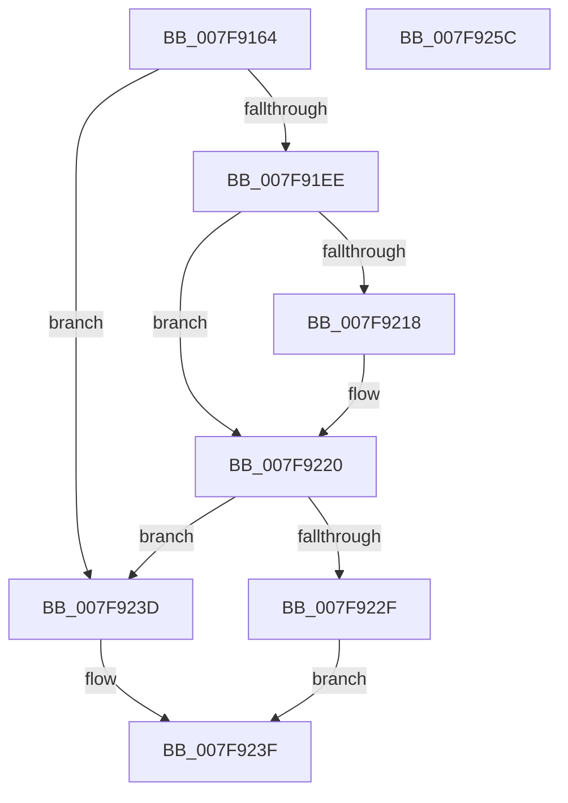

# MmZeroPageFileAtShutdown

- RVA: `0x007F9164`–`0x007F925D` (길이 `249` bytes)
- VA: `0x00000001407F9164`
- 실행 섹션: `PAGE`
- PDB 이름 있음: `예`; PDB Function 태그: `아니요`
- unwind 정보 RVA: `0x000D155C`
- 디코드: `60`개 명령, `249/249` bytes 표시
- 미해석 바이트: `0` (있으면 어셈블리에 `.byte`로 보존)

> 이 문서는 커널 이미지의 기계어와 PDB 기호를 분석해 생성했습니다. 4번과 5번은 함수 원형과 자료형을 바이너리 사용 방식에서 추정한 C 해석이며 원본 소스 복구 결과는 아닙니다.

## 1. Dependencies

- 직접 호출 지점: **4**; 고유 호출 대상: **4**
- 직접 호출자로 확인된 함수: **3**
- RIP 상대 이미지 참조: **4**

### Outgoing calls
- `0x007F91E5` → [ZwOpenKey](../../text/6A/ZwOpenKey_function_006AD310.md) (function, `0x006AD310`)
- `0x007F920F` → [ZwQueryValueKey](../../text/6A/ZwQueryValueKey_function_006AD3B0.md) (function, `0x006AD3B0`)
- `0x007F9226` → [ObCloseHandle](../8A/ObCloseHandle_function_008A1870.md) (function, `0x008A1870`)
- `0x007F9246` → [_security_check_cookie](../../text/6A/_security_check_cookie_function_006AC640.md) (function, `0x006AC640`)

### Direct callers
- [PopEnableHiberFile](../90/PopEnableHiberFile_function_0090F850.md) at `0x0090F993`
- [PopGracefulShutdown](../../pagelk/B6/PopGracefulShutdown_function_00B6BEC8.md) at `0x00B6BF05`
- [PopTransitionSystemPowerStateEx](../../pagelk/B7/PopTransitionSystemPowerStateEx_function_00B7E8C0.md) at `0x00B7EB45`

### Static image references
- `0x007F9176` → RVA `0x00E0A740` (`.data`; read)
- `0x007F91B7` → RVA `0x00B09DB0` (` ?? ::NNGAKEGL::`string'`; read)
- `0x007F91C2` → RVA `0x00FD9FB8` (`PAGEDATA`; read)
- `0x007F922F` → RVA `0x00E30142` (`.data`; write)

## 2. Other-region calls and transfers

- 다른 실행 섹션으로 향하는 call: **3**
  - `0x007F91E5` → [ZwOpenKey](../../text/6A/ZwOpenKey_function_006AD310.md) (`PAGE` → `.text`)
  - `0x007F920F` → [ZwQueryValueKey](../../text/6A/ZwQueryValueKey_function_006AD3B0.md) (`PAGE` → `.text`)
  - `0x007F9246` → [_security_check_cookie](../../text/6A/_security_check_cookie_function_006AC640.md) (`PAGE` → `.text`)
- 별도 외부 분기/꼬리 이동을 확인하지 못했습니다.

## 3. Assembly (complete function range)

```asm
007F9164  48 89 5C 24 08                  mov qword ptr [rsp + 8], rbx
007F9169  55                              push rbp
007F916A  48 8D 6C 24 A9                  lea rbp, [rsp - 0x57]
007F916F  48 81 EC A0 00 00 00            sub rsp, 0xa0
007F9176  48 8B 05 C3 15 61 00            mov rax, qword ptr [rip + 0x6115c3]
007F917D  48 33 C4                        xor rax, rsp
007F9180  48 89 45 4F                     mov qword ptr [rbp + 0x4f], rax
007F9184  48 83 65 EF 00                  and qword ptr [rbp - 0x11], 0
007F9189  4C 8D 45 07                     lea r8, [rbp + 7]
007F918D  83 65 23 00                     and dword ptr [rbp + 0x23], 0
007F9191  48 8D 4D EF                     lea rcx, [rbp - 0x11]
007F9195  33 C0                           xor eax, eax
007F9197  48 C7 45 07 30 00 00 00         mov qword ptr [rbp + 7], 0x30
007F919F  21 45 E7                        and dword ptr [rbp - 0x19], eax
007F91A2  0F 57 C0                        xorps xmm0, xmm0
007F91A5  83 65 0B 00                     and dword ptr [rbp + 0xb], 0
007F91A9  33 DB                           xor ebx, ebx
007F91AB  48 21 5D 0F                     and qword ptr [rbp + 0xf], rbx
007F91AF  BA 19 00 02 00                  mov edx, 0x20019
007F91B4  89 45 47                        mov dword ptr [rbp + 0x47], eax
007F91B7  48 8D 05 F2 0B 31 00            lea rax, [rip + 0x310bf2]
007F91BE  48 89 45 FF                     mov qword ptr [rbp - 1], rax
007F91C2  48 8D 05 EF 0D 7E 00            lea rax, [rip + 0x7e0def]
007F91C9  48 89 45 17                     mov qword ptr [rbp + 0x17], rax
007F91CD  0F 11 45 37                     movups xmmword ptr [rbp + 0x37], xmm0
007F91D1  48 C7 45 F7 2E 00 30 00         mov qword ptr [rbp - 9], 0x30002e
007F91D9  C7 45 1F 40 02 00 00            mov dword ptr [rbp + 0x1f], 0x240
007F91E0  F3 0F 7F 45 27                  movdqu xmmword ptr [rbp + 0x27], xmm0
007F91E5  E8 26 41 EB FF                  call 0x1406ad310
007F91EA  85 C0                           test eax, eax
007F91EC  78 4F                           js 0x1407f923d
007F91EE  48 8B 4D EF                     mov rcx, qword ptr [rbp - 0x11]
007F91F2  48 8D 45 E7                     lea rax, [rbp - 0x19]
007F91F6  48 89 44 24 28                  mov qword ptr [rsp + 0x28], rax
007F91FB  4C 8D 4D 37                     lea r9, [rbp + 0x37]
007F91FF  44 8D 43 02                     lea r8d, [rbx + 2]
007F9203  C7 44 24 20 14 00 00 00         mov dword ptr [rsp + 0x20], 0x14
007F920B  48 8D 55 F7                     lea rdx, [rbp - 9]
007F920F  E8 9C 41 EB FF                  call 0x1406ad3b0
007F9214  85 C0                           test eax, eax
007F9216  78 08                           js 0x1407f9220
007F9218  83 7D 3B 04                     cmp dword ptr [rbp + 0x3b], 4
007F921C  0F 44 5D 43                     cmove ebx, dword ptr [rbp + 0x43]
007F9220  48 8B 4D EF                     mov rcx, qword ptr [rbp - 0x11]
007F9224  33 D2                           xor edx, edx
007F9226  E8 45 86 0A 00                  call 0x1408a1870
007F922B  85 DB                           test ebx, ebx
007F922D  74 0E                           je 0x1407f923d
007F922F  C6 05 0C 6F 63 00 01            mov byte ptr [rip + 0x636f0c], 1
007F9236  B8 01 00 00 00                  mov eax, 1
007F923B  EB 02                           jmp 0x1407f923f
007F923D  33 C0                           xor eax, eax
007F923F  48 8B 4D 4F                     mov rcx, qword ptr [rbp + 0x4f]
007F9243  48 33 CC                        xor rcx, rsp
007F9246  E8 F5 33 EB FF                  call 0x1406ac640
007F924B  48 8B 9C 24 B0 00 00 00         mov rbx, qword ptr [rsp + 0xb0]
007F9253  48 81 C4 A0 00 00 00            add rsp, 0xa0
007F925A  5D                              pop rbp
007F925B  C3                              ret
007F925C  CC                              int3
```

## 4. C-style interpretation (structured pseudocode)

```c
__int64 __fastcall MmZeroPageFileAtShutdown(void)
{
    __int64 result;
    __int64 v_rbx;
    __int64 v_rsp;
    unsigned __int64 v_stack_m10;
    unsigned int v_stack_m18;
    unsigned int v_stack_m1C;
    unsigned int v_stack_m24;
    unsigned __int64 v_stack_m28;
    unsigned __int64 v_stack_m38;
    unsigned int v_stack_m3C;
    unsigned int v_stack_m40;
    unsigned __int64 v_stack_m48;
    unsigned __int64 v_stack_m50;
    unsigned int v_stack_m54;
    unsigned __int64 v_stack_m58;
    unsigned __int64 v_stack_m5F;
    unsigned __int64 v_stack_m60;
    unsigned __int64 v_stack_m68;
    unsigned __int64 v_stack_m70;
    unsigned int v_stack_m78;
    unsigned __int64 v_stack_m80;
    unsigned int v_stack_m88;
    unsigned __int64 v_stack_p8;

    v_stack_p8 = v_rbx;
    v_rsp = (v_rsp) - (160);
    result = (*(unsigned __int64 *)(v_rip + 6362563)) ^ (v_rsp);
    v_stack_m10 = result;
    result = 0;
    v_stack_m58 = 48;
    v_rbx = 0;
    v_stack_m18 = 0;
    v_stack_m60 = v_rip + 3214322;
    v_stack_m48 = v_rip + 8261103;
    v_stack_m28 = v_xmm0;
    v_stack_m68 = 0x30002EULL;
    v_stack_m40 = 576;
    v_stack_m38 = v_xmm0;
    result = ZwOpenKey(v_stack_m70, (unsigned int)(0x20019ULL), v_stack_m58, a4);
    if (sign_flag) goto loc_007F923D;
    v_stack_m80 = v_stack_m78;
    v_stack_m88 = 20;
    result = ZwQueryValueKey(v_stack_m70, v_stack_m68, v_rbx + 2, v_stack_m28);
    if (!(sign_flag)) {
        if (v_stack_m24 == 4) { v_rbx = v_stack_m1C; }
    }
    a2 = 0;
    result = ObCloseHandle(v_stack_m70, a2, v_rbx + 2, v_stack_m28);
    if ((unsigned int)(v_rbx) == 0) goto loc_007F923D;
    *(unsigned __int8 *)(v_rip + 6516492) = 1;
    goto loc_007F923F;
loc_007F923D:
    result = 0;
loc_007F923F:
    a1 = (v_stack_m10) ^ (v_rsp);
    result = _security_check_cookie(a1, a2, v_rbx + 2, v_stack_m28);
    v_rsp = (v_rsp) + (160);
    return result;
}
```

## 5. (Beta) C Style

```c
void MmZeroPageFileAtShutdown(void)
{
    int64_t result;
    int64_t local_rbx;
    int64_t local_rsp;
    uint64_t v_stack_m10;
    uint32_t v_stack_m18;
    uint32_t v_stack_m1C;
    uint32_t v_stack_m24;
    uint64_t v_stack_m28;
    uint64_t v_stack_m38;
    uint32_t v_stack_m3C;
    uint32_t v_stack_m40;
    uint64_t v_stack_m48;
    uint64_t v_stack_m50;
    uint32_t v_stack_m54;
    uint64_t v_stack_m58;
    uint64_t v_stack_m5F;
    uint64_t v_stack_m60;
    uint64_t v_stack_m68;
    uint64_t v_stack_m70;
    uint32_t v_stack_m78;
    uint64_t v_stack_m80;
    uint32_t v_stack_m88;
    uint64_t v_stack_p8;

    v_stack_p8 = local_rbx;
    local_rsp = (local_rsp) - (160);
    result = (*(uint64_t *)(v_rip + 0x6115C3)) ^ (local_rsp);
    v_stack_m10 = result;
    result = 0;
    v_stack_m58 = 48;
    local_rbx = 0;
    v_stack_m18 = 0;
    v_stack_m60 = v_rip + 3214322;
    v_stack_m48 = v_rip + 8261103;
    v_stack_m28 = v_xmm0;
    v_stack_m68 = 0x30002EULL;
    v_stack_m40 = 576;
    v_stack_m38 = v_xmm0;
    result = ZwOpenKey(v_stack_m70, (uint32_t)(0x20019ULL), v_stack_m58, a4);
    if (sign_flag) goto loc_007F923D;
    v_stack_m80 = v_stack_m78;
    v_stack_m88 = 20;
    result = ZwQueryValueKey(v_stack_m70, v_stack_m68, local_rbx + 2, v_stack_m28);
    if (!(sign_flag)) {
        if (v_stack_m24 == 4) { local_rbx = v_stack_m1C; }
    }
    a2 = 0;
    result = ObCloseHandle(v_stack_m70, a2, local_rbx + 2, v_stack_m28);
    if ((uint32_t)(local_rbx) == 0) goto loc_007F923D;
    *(uint8_t *)(v_rip + 0x636F0C) = 1;
    goto loc_007F923F;
loc_007F923D:
    result = 0;
loc_007F923F:
    a1 = (v_stack_m10) ^ (local_rsp);
    result = _security_check_cookie(a1, a2, local_rbx + 2, v_stack_m28);
    local_rsp = (local_rsp) + (160);
    return result;
}
```

## 6. Execution-region graph

[열기: 2D/3D 그래프와 함수 탐색 컨트롤 패널](../../../control-panel.html?section=page&rva=0x007F9164&view=graph)

- 2D 그래프는 위에서 아래로 흐르고, 3D 그래프는 빈 공간을 드래그해 회전합니다. Shift+드래그는 이동, 휠은 확대·축소, 함수 노드 선택은 대상 보고서 이동입니다.

### Static fallback


