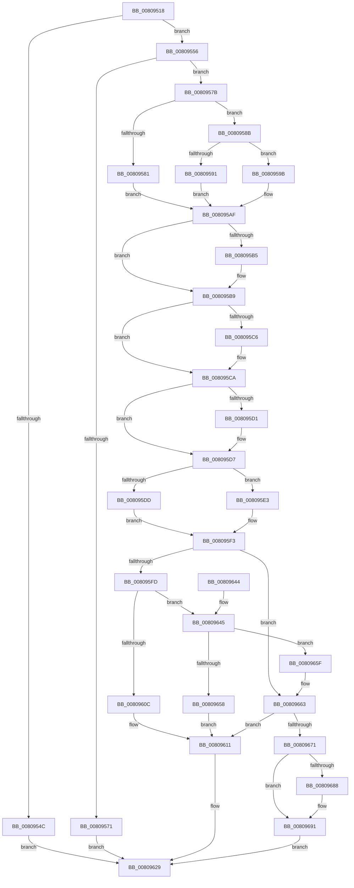

# MiAllocateAweInfo

- RVA: `0x00809518`–`0x00809696` (길이 `382` bytes)
- VA: `0x0000000140809518`
- 실행 섹션: `PAGE`
- PDB 이름 있음: `예`; PDB Function 태그: `아니요`
- unwind 정보 RVA: `0x00081DB4`
- 디코드: `110`개 명령, `382/382` bytes 표시
- 미해석 바이트: `0` (있으면 어셈블리에 `.byte`로 보존)

> 이 문서는 커널 이미지의 기계어와 PDB 기호를 분석해 생성했습니다. 4번과 5번은 함수 원형과 자료형을 바이너리 사용 방식에서 추정한 C 해석이며 원본 소스 복구 결과는 아닙니다.

## 1. Dependencies

- 직접 호출 지점: **6**; 고유 호출 대상: **6**
- 직접 호출자로 확인된 함수: **2**
- RIP 상대 이미지 참조: **1**

### Outgoing calls
- `0x00809564` → [MiAllocatePool](../../text/35/MiAllocatePool_function_0035B540.md) (function, `0x0035B540`)
- `0x00809600` → [MiGetAweInfoPartition](../../text/2A/MiGetAweInfoPartition_function_002AA2CC.md) (function, `0x002AA2CC`)
- `0x00809624` → [MiDeleteAweInfo](MiDeleteAweInfo_function_0080A9F8.md) (function, `0x0080A9F8`)
- `0x0080964F` → [SeSinglePrivilegeCheck](../87/SeSinglePrivilegeCheck_function_00871E20.md) (function, `0x00871E20`)
- `0x00809666` → [MiCreateAweInfoBitMap](MiCreateAweInfoBitMap_function_0080A770.md) (function, `0x0080A770`)
- `0x0080967A` → [ExInitializeAutoExpandPushLock](../../text/44/ExInitializeAutoExpandPushLock_function_004489C0.md) (function, `0x004489C0`)

### Direct callers
- [MiCreateProcessDefaultAweInfo](MiCreateProcessDefaultAweInfo_function_0080A8C0.md) at `0x0080A919`
- [sub_00B2AD32](../B2/Unknown_function_00B2AD32.md) at `0x00B2AE85`

### Static image references
- `0x00809645` → RVA `0x00FD9A78` (`PAGEDATA`; read)

## 2. Other-region calls and transfers

- 다른 실행 섹션으로 향하는 call: **3**
  - `0x00809564` → [MiAllocatePool](../../text/35/MiAllocatePool_function_0035B540.md) (`PAGE` → `.text`)
  - `0x00809600` → [MiGetAweInfoPartition](../../text/2A/MiGetAweInfoPartition_function_002AA2CC.md) (`PAGE` → `.text`)
  - `0x0080967A` → [ExInitializeAutoExpandPushLock](../../text/44/ExInitializeAutoExpandPushLock_function_004489C0.md) (`PAGE` → `.text`)
- 별도 외부 분기/꼬리 이동을 확인하지 못했습니다.

## 3. Assembly (complete function range)

```asm
00809518  48 89 5C 24 08                  mov qword ptr [rsp + 8], rbx
0080951D  48 89 6C 24 10                  mov qword ptr [rsp + 0x10], rbp
00809522  48 89 74 24 18                  mov qword ptr [rsp + 0x18], rsi
00809527  57                              push rdi
00809528  41 56                           push r14
0080952A  41 57                           push r15
0080952C  48 83 EC 20                     sub rsp, 0x20
00809530  4C 8B 74 24 60                  mov r14, qword ptr [rsp + 0x60]
00809535  45 8A F9                        mov r15b, r9b
00809538  41 8B F8                        mov edi, r8d
0080953B  8B EA                           mov ebp, edx
0080953D  48 8B F1                        mov rsi, rcx
00809540  49 83 26 00                     and qword ptr [r14], 0
00809544  F7 C2 FE FF FF FF               test edx, 0xfffffffe
0080954A  74 0A                           je 0x140809556
0080954C  BF EF 00 00 C0                  mov edi, 0xc00000ef
00809551  E9 D3 00 00 00                  jmp 0x140809629
00809556  BA 80 00 00 00                  mov edx, 0x80
0080955B  41 B8 4D 6D 41 77               mov r8d, 0x77416d4d
00809561  8D 4A C8                        lea ecx, [rdx - 0x38]
00809564  E8 D7 1F B5 FF                  call 0x14035b540
00809569  48 8B D8                        mov rbx, rax
0080956C  48 85 C0                        test rax, rax
0080956F  75 0A                           jne 0x14080957b
00809571  BF 9A 00 00 C0                  mov edi, 0xc000009a
00809576  E9 AE 00 00 00                  jmp 0x140809629
0080957B  40 F6 C7 02                     test dil, 2
0080957F  74 0A                           je 0x14080958b
00809581  48 C7 40 10 00 02 00 00         mov qword ptr [rax + 0x10], 0x200
00809589  EB 24                           jmp 0x1408095af
0080958B  40 F6 C7 04                     test dil, 4
0080958F  74 0A                           je 0x14080959b
00809591  48 C7 40 10 00 00 04 00         mov qword ptr [rax + 0x10], 0x40000
00809599  EB 14                           jmp 0x1408095af
0080959B  40 8A C7                        mov al, dil
0080959E  24 01                           and al, 1
008095A0  F6 D8                           neg al
008095A2  48 1B C9                        sbb rcx, rcx
008095A5  83 E1 0F                        and ecx, 0xf
008095A8  48 FF C1                        inc rcx
008095AB  48 89 4B 10                     mov qword ptr [rbx + 0x10], rcx
008095AF  40 F6 C7 40                     test dil, 0x40
008095B3  74 04                           je 0x1408095b9
008095B5  83 4B 08 08                     or dword ptr [rbx + 8], 8
008095B9  48 C7 03 40 19 06 00            mov qword ptr [rbx], 0x61940
008095C0  40 F6 C5 01                     test bpl, 1
008095C4  74 04                           je 0x1408095ca
008095C6  83 4B 08 01                     or dword ptr [rbx + 8], 1
008095CA  8B 43 08                        mov eax, dword ptr [rbx + 8]
008095CD  A8 08                           test al, 8
008095CF  75 06                           jne 0x1408095d7
008095D1  83 C8 10                        or eax, 0x10
008095D4  89 43 08                        mov dword ptr [rbx + 8], eax
008095D7  40 F6 C7 20                     test dil, 0x20
008095DB  74 06                           je 0x1408095e3
008095DD  83 63 34 00                     and dword ptr [rbx + 0x34], 0
008095E1  EB 10                           jmp 0x1408095f3
008095E3  40 8A C7                        mov al, dil
008095E6  24 10                           and al, 0x10
008095E8  F6 D8                           neg al
008095EA  1B C9                           sbb ecx, ecx
008095EC  F7 D9                           neg ecx
008095EE  FF C1                           inc ecx
008095F0  89 4B 34                        mov dword ptr [rbx + 0x34], ecx
008095F3  48 89 73 28                     mov qword ptr [rbx + 0x28], rsi
008095F7  40 F6 C7 08                     test dil, 8
008095FB  74 66                           je 0x140809663
008095FD  48 8B CB                        mov rcx, rbx
00809600  E8 C7 0C AA FF                  call 0x1402aa2cc
00809605  8B 40 04                        mov eax, dword ptr [rax + 4]
00809608  A8 20                           test al, 0x20
0080960A  75 39                           jne 0x140809645
0080960C  BF BB 00 00 C0                  mov edi, 0xc00000bb
00809611  65 48 8B 0C 25 88 01 00 00      mov rcx, qword ptr gs:[0x188]
0080961A  48 8B D3                        mov rdx, rbx
0080961D  48 8B 89 B8 00 00 00            mov rcx, qword ptr [rcx + 0xb8]
00809624  E8 CF 13 00 00                  call 0x14080a9f8
00809629  48 8B 5C 24 40                  mov rbx, qword ptr [rsp + 0x40]
0080962E  8B C7                           mov eax, edi
00809630  48 8B 6C 24 48                  mov rbp, qword ptr [rsp + 0x48]
00809635  48 8B 74 24 50                  mov rsi, qword ptr [rsp + 0x50]
0080963A  48 83 C4 20                     add rsp, 0x20
0080963E  41 5F                           pop r15
00809640  41 5E                           pop r14
00809642  5F                              pop rdi
00809643  C3                              ret
00809644  CC                              int3
00809645  48 8B 0D 2C 04 7D 00            mov rcx, qword ptr [rip + 0x7d042c]
0080964C  41 8A D7                        mov dl, r15b
0080964F  E8 CC 87 06 00                  call 0x140871e20
00809654  84 C0                           test al, al
00809656  75 07                           jne 0x14080965f
00809658  BF 61 00 00 C0                  mov edi, 0xc0000061
0080965D  EB B2                           jmp 0x140809611
0080965F  83 4B 08 04                     or dword ptr [rbx + 8], 4
00809663  48 8B CB                        mov rcx, rbx
00809666  E8 05 11 00 00                  call 0x14080a770
0080966B  8B F8                           mov edi, eax
0080966D  85 C0                           test eax, eax
0080966F  78 A0                           js 0x140809611
00809671  48 8D 4B 40                     lea rcx, [rbx + 0x40]
00809675  BA 01 00 00 00                  mov edx, 1
0080967A  E8 41 F3 C3 FF                  call 0x1404489c0
0080967F  83 4B 08 02                     or dword ptr [rbx + 8], 2
00809683  48 85 F6                        test rsi, rsi
00809686  74 09                           je 0x140809691
00809688  0F BA 6E 5C 11                  bts dword ptr [rsi + 0x5c], 0x11
0080968D  48 89 5E 08                     mov qword ptr [rsi + 8], rbx
00809691  49 89 1E                        mov qword ptr [r14], rbx
00809694  EB 93                           jmp 0x140809629
```

## 4. C-style interpretation (structured pseudocode)

```c
__int64 __fastcall MiAllocateAweInfo(__int64 a1, int a2, int a3, unsigned __int8 a4, __int64 a5)
{
    __int64 result;
    __int64 v_rsp;
    unsigned __int64 v_stack_p10;
    unsigned __int64 v_stack_p18;
    unsigned __int64 v_stack_p8;

    v_stack_p8 = v_rbx;
    v_stack_p10 = v_rbp;
    v_stack_p18 = v_rsi;
    v_rsp = (v_rsp) - (32);
    if (((a2) & (0xFFFFFFFEULL)) == 0) goto loc_00809556;
    goto loc_00809629;
loc_00809556:
    result = MiAllocatePool(128 - 56, 128, (unsigned int)(0x77416D4DULL), a4);
    if (result != 0) goto loc_0080957B;
    goto loc_00809629;
loc_0080957B:
    if ((((unsigned __int8)((unsigned int)(0xC000009AULL))) & (2)) == 0) goto loc_0080958B;
    *(unsigned __int64 *)(result + 16) = 512;
    goto loc_008095AF;
loc_0080958B:
    if ((((unsigned __int8)((unsigned int)(0xC000009AULL))) & (4)) == 0) goto loc_0080959B;
    *(unsigned __int64 *)(result + 16) = 0x40000ULL;
    goto loc_008095AF;
loc_0080959B:
    result = (unsigned __int8)(((unsigned __int8)((unsigned int)(0xC000009AULL))) & (1));
    result = (unsigned __int8)(-(result));
    a1 = (unsigned int)((128 - 56) & (15));
    a1 = (a1) + 1;
    *(unsigned __int64 *)(result + 16) = a1;
loc_008095AF:
    if ((((unsigned __int8)((unsigned int)(0xC000009AULL))) & (64)) != 0) {
    }
    *(unsigned __int64 *)(result) = 0x61940ULL;
    if ((((unsigned __int8)((unsigned int)(a2))) & (1)) != 0) {
    }
    result = (unsigned int)(*(unsigned int *)(result + 8));
    if ((((unsigned __int8)((unsigned int)(*(unsigned int *)(result + 8)))) & (8)) == 0) {
        result = (unsigned int)(((unsigned int)(*(unsigned int *)(result + 8))) | (16));
        *(unsigned int *)(result + 8) = (unsigned int)(result);
    }
    if ((((unsigned __int8)((unsigned int)(0xC000009AULL))) & (32)) == 0) goto loc_008095E3;
    goto loc_008095F3;
loc_008095E3:
    result = (unsigned __int8)(((unsigned __int8)((unsigned int)(0xC000009AULL))) & (16));
    result = (unsigned __int8)(-(result));
    a1 = (unsigned int)(-(a1));
    a1 = (unsigned int)((a1) + 1);
    *(unsigned int *)(result + 52) = (unsigned int)(a1);
loc_008095F3:
    *(unsigned __int64 *)(result + 40) = a1;
    if ((((unsigned __int8)((unsigned int)(0xC000009AULL))) & (8)) == 0) goto loc_00809663;
    result = MiGetAweInfoPartition(result, 128, (unsigned int)(0x77416D4DULL), a4);
    if ((((unsigned __int8)((unsigned int)(*(unsigned int *)(result + 4)))) & (32)) != 0) goto loc_00809645;
loc_00809611:
    result = MiDeleteAweInfo(*(unsigned __int64 *)(*(unsigned __int64 *)(gs_base + (0 + 392)) + 184), result, (unsigned int)(0x77416D4DULL), a4);
loc_00809629:
    v_rsp = (v_rsp) + (32);
    return (unsigned int)((unsigned int)((unsigned int)(0xC00000BBULL)));
loc_00809645:
    result = SeSinglePrivilegeCheck(*(unsigned __int64 *)(v_rip + 8193068), a4, (unsigned int)(0x77416D4DULL), a4);
    if ((unsigned __int8)(result) != 0) goto loc_0080965F;
    goto loc_00809611;
loc_0080965F:
loc_00809663:
    result = MiCreateAweInfoBitMap(v_stack_p8, a4, (unsigned int)(0x77416D4DULL), a4);
    if (sign_flag) goto loc_00809611;
    result = ExInitializeAutoExpandPushLock(v_stack_p8 + 64, 1, (unsigned int)(0x77416D4DULL), a4);
    if (v_stack_p18 != 0) {
        *(unsigned __int64 *)(v_stack_p18 + 8) = v_stack_p8;
    }
    *(unsigned __int64 *)(a5) = v_stack_p8;
    goto loc_00809629;
}
```

## 5. (Beta) C Style

```c
int64_t MiAllocateAweInfo(int64_t Arg1, int32_t Arg2, int32_t Arg3, uint8_t Arg4, void *Arg5)
{
    uint8_t *arg5 = (uint8_t *)Arg5;

    int64_t result;
    int64_t local_rsp;
    uint64_t v_stack_p10;
    uint64_t v_stack_p18;
    uint64_t v_stack_p8;

    v_stack_p8 = local_rbx;
    v_stack_p10 = local_rbp;
    v_stack_p18 = local_rsi;
    local_rsp = (local_rsp) - (32);
    if (((Arg2) & (0xFFFFFFFEULL)) == 0) goto loc_00809556;
    goto loc_00809629;
loc_00809556:
    result = MiAllocatePool(128 - 56, 128, (uint32_t)(0x77416D4DULL), Arg4);
    if (result != 0) goto loc_0080957B;
    goto loc_00809629;
loc_0080957B:
    if ((((uint8_t)((uint32_t)(0xC000009AULL))) & (2)) == 0) goto loc_0080958B;
    *(uint64_t *)(result + 0x10) = 512;
    goto loc_008095AF;
loc_0080958B:
    if ((((uint8_t)((uint32_t)(0xC000009AULL))) & (4)) == 0) goto loc_0080959B;
    *(uint64_t *)(result + 0x10) = 0x40000ULL;
    goto loc_008095AF;
loc_0080959B:
    result = (uint8_t)(((uint8_t)((uint32_t)(0xC000009AULL))) & (1));
    result = (uint8_t)(-(result));
    Arg1 = (uint32_t)((128 - 56) & (15));
    Arg1 = (Arg1) + 1;
    *(uint64_t *)(result + 0x10) = Arg1;
loc_008095AF:
    if ((((uint8_t)((uint32_t)(0xC000009AULL))) & (64)) != 0) {
    }
    *(uint64_t *)(result) = 0x61940ULL;
    if ((((uint8_t)((uint32_t)(Arg2))) & (1)) != 0) {
    }
    result = (uint32_t)(*(uint32_t *)(result + 0x8));
    if ((((uint8_t)((uint32_t)(*(uint32_t *)(result + 0x8)))) & (8)) == 0) {
        result = (uint32_t)(((uint32_t)(*(uint32_t *)(result + 0x8))) | (16));
        *(uint32_t *)(result + 0x8) = (uint32_t)(result);
    }
    if ((((uint8_t)((uint32_t)(0xC000009AULL))) & (32)) == 0) goto loc_008095E3;
    goto loc_008095F3;
loc_008095E3:
    result = (uint8_t)(((uint8_t)((uint32_t)(0xC000009AULL))) & (16));
    result = (uint8_t)(-(result));
    Arg1 = (uint32_t)(-(Arg1));
    Arg1 = (uint32_t)((Arg1) + 1);
    *(uint32_t *)(result + 0x34) = (uint32_t)(Arg1);
loc_008095F3:
    *(uint64_t *)(result + 0x28) = Arg1;
    if ((((uint8_t)((uint32_t)(0xC000009AULL))) & (8)) == 0) goto loc_00809663;
    result = MiGetAweInfoPartition(result, 128, (uint32_t)(0x77416D4DULL), Arg4);
    if ((((uint8_t)((uint32_t)(*(uint32_t *)(result + 0x4)))) & (32)) != 0) goto loc_00809645;
loc_00809611:
    result = MiDeleteAweInfo(*(uint64_t *)(*(uint64_t *)(gs_base + (0 + 0x188)) + 0xB8), result, (uint32_t)(0x77416D4DULL), Arg4);
loc_00809629:
    local_rsp = (local_rsp) + (32);
    return (uint32_t)((uint32_t)((uint32_t)(0xC00000BBULL)));
loc_00809645:
    result = SeSinglePrivilegeCheck(*(uint64_t *)(v_rip + 0x7D042C), Arg4, (uint32_t)(0x77416D4DULL), Arg4);
    if ((uint8_t)(result) != 0) goto loc_0080965F;
    goto loc_00809611;
loc_0080965F:
loc_00809663:
    result = MiCreateAweInfoBitMap(v_stack_p8, Arg4, (uint32_t)(0x77416D4DULL), Arg4);
    if (sign_flag) goto loc_00809611;
    result = ExInitializeAutoExpandPushLock(v_stack_p8 + 64, 1, (uint32_t)(0x77416D4DULL), Arg4);
    if (v_stack_p18 != 0) {
        *(uint64_t *)(v_stack_p18 + 0x8) = v_stack_p8;
    }
    *(uint64_t *)(arg5) = v_stack_p8;
    goto loc_00809629;
}
```

### 관측된 메모리 오프셋

구조체 형식이 확인되지 않은 접근은 인자 기준의 오프셋으로만 기록했습니다.

| 기준 인자 | 오프셋 표현 | 폭 (bit) | 접근 |
|---|---:|---:|---|
| `Arg5` | `+ 0x0` | `64` | `R/W` |
| `Arg5` | `+ 0x0` | `64` | `W` |

## 6. Execution-region graph

[열기: 2D/3D 그래프와 함수 탐색 컨트롤 패널](../../../control-panel.html?section=page&rva=0x00809518&view=graph)

- 2D 그래프는 위에서 아래로 흐르고, 3D 그래프는 빈 공간을 드래그해 회전합니다. Shift+드래그는 이동, 휠은 확대·축소, 함수 노드 선택은 대상 보고서 이동입니다.

### Static fallback


