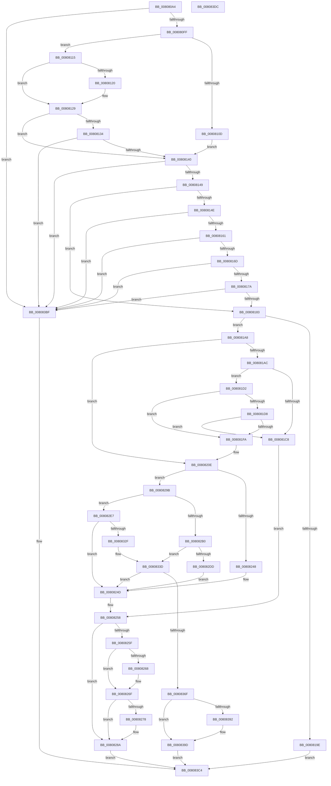

# MiAllocateEnclaveVad

- RVA: `0x008080A4`–`0x008083DD` (길이 `825` bytes)
- VA: `0x00000001408080A4`
- 실행 섹션: `PAGE`
- PDB 이름 있음: `예`; PDB Function 태그: `아니요`
- unwind 정보 RVA: `0x00071578`
- 디코드: `217`개 명령, `825/825` bytes 표시
- 미해석 바이트: `0` (있으면 어셈블리에 `.byte`로 보존)

> 이 문서는 커널 이미지의 기계어와 PDB 기호를 분석해 생성했습니다. 4번과 5번은 함수 원형과 자료형을 바이너리 사용 방식에서 추정한 C 해석이며 원본 소스 복구 결과는 아닙니다.

## 1. Dependencies

- 직접 호출 지점: **18**; 고유 호출 대상: **15**
- 직접 호출자로 확인된 함수: **1**
- RIP 상대 이미지 참조: **1**

### Outgoing calls
- `0x00808191` → [MiAllocatePool](../../text/35/MiAllocatePool_function_0035B540.md) (function, `0x0035B540`)
- `0x008081BA` → [MiReservePtes](../../text/31/MiReservePtes_function_00318D20.md) (function, `0x00318D20`)
- `0x008081EC` → [MiAllocatePool](../../text/35/MiAllocatePool_function_0035B540.md) (function, `0x0035B540`)
- `0x00808238` → [LOCK_ADDRESS_SPACE](../../text/2A/LOCK_ADDRESS_SPACE_function_002A4944.md) (function, `0x002A4944`)
- `0x00808253` → [UNLOCK_ADDRESS_SPACE](../../text/2A/UNLOCK_ADDRESS_SPACE_function_002A4844.md) (function, `0x002A4844`)
- `0x0080826A` → [ExFreePoolWithTag](../../poolcode/B8/ExFreePoolWithTag_function_00B82870.md) (function, `0x00B82870`)
- `0x00808285` → [MiReleasePtes](../../text/24/MiReleasePtes_function_00247240.md) (function, `0x00247240`)
- `0x0080828F` → [ExFreePoolWithTag](../../poolcode/B8/ExFreePoolWithTag_function_00B82870.md) (function, `0x00B82870`)
- `0x008082A6` → [MiGetUserReservationHighestAddress](../98/MiGetUserReservationHighestAddress_function_00982430.md) (function, `0x00982430`)
- `0x008082D4` → [MiIsVaRangeAvailable](../97/MiIsVaRangeAvailable_function_0097FD90.md) (function, `0x0097FD90`)
- `0x00808320` → [MiSelectUserAddress](../88/MiSelectUserAddress_function_00885C40.md) (function, `0x00885C40`)
- `0x0080834B` → [MiUpdateVadStartVpn](../../text/45/MiUpdateVadStartVpn_function_00450ED4.md) (function, `0x00450ED4`)
- `0x00808360` → [MiInsertVadCharges](../88/MiInsertVadCharges_function_00886AA8.md) (function, `0x00886AA8`)
- `0x00808375` → [MiLockVad](../../text/29/MiLockVad_function_00295810.md) (function, `0x00295810`)
- `0x00808383` → [MiInsertVad](../../text/26/MiInsertVad_function_00265540.md) (function, `0x00265540`)
- `0x00808398` → [MiAdvanceVadHint](../88/MiAdvanceVadHint_function_00886C40.md) (function, `0x00886C40`)
- `0x008083A0` → [MiReferenceVad](../../text/29/MiReferenceVad_function_00295890.md) (function, `0x00295890`)
- `0x008083AB` → [UNLOCK_ADDRESS_SPACE](../../text/2A/UNLOCK_ADDRESS_SPACE_function_002A4844.md) (function, `0x002A4844`)

### Direct callers
- [MiCreateEnclave](MiCreateEnclave_function_008083E4.md) at `0x00808422`

### Static image references
- `0x008081B3` → RVA `0x00E37668` (`.data`; read)

## 2. Other-region calls and transfers

- 다른 실행 섹션으로 향하는 call: **13**
  - `0x00808191` → [MiAllocatePool](../../text/35/MiAllocatePool_function_0035B540.md) (`PAGE` → `.text`)
  - `0x008081BA` → [MiReservePtes](../../text/31/MiReservePtes_function_00318D20.md) (`PAGE` → `.text`)
  - `0x008081EC` → [MiAllocatePool](../../text/35/MiAllocatePool_function_0035B540.md) (`PAGE` → `.text`)
  - `0x00808238` → [LOCK_ADDRESS_SPACE](../../text/2A/LOCK_ADDRESS_SPACE_function_002A4944.md) (`PAGE` → `.text`)
  - `0x00808253` → [UNLOCK_ADDRESS_SPACE](../../text/2A/UNLOCK_ADDRESS_SPACE_function_002A4844.md) (`PAGE` → `.text`)
  - `0x0080826A` → [ExFreePoolWithTag](../../poolcode/B8/ExFreePoolWithTag_function_00B82870.md) (`PAGE` → `POOLCODE`)
  - `0x00808285` → [MiReleasePtes](../../text/24/MiReleasePtes_function_00247240.md) (`PAGE` → `.text`)
  - `0x0080828F` → [ExFreePoolWithTag](../../poolcode/B8/ExFreePoolWithTag_function_00B82870.md) (`PAGE` → `POOLCODE`)
  - `0x0080834B` → [MiUpdateVadStartVpn](../../text/45/MiUpdateVadStartVpn_function_00450ED4.md) (`PAGE` → `.text`)
  - `0x00808375` → [MiLockVad](../../text/29/MiLockVad_function_00295810.md) (`PAGE` → `.text`)
  - `0x00808383` → [MiInsertVad](../../text/26/MiInsertVad_function_00265540.md) (`PAGE` → `.text`)
  - `0x008083A0` → [MiReferenceVad](../../text/29/MiReferenceVad_function_00295890.md) (`PAGE` → `.text`)
  - `0x008083AB` → [UNLOCK_ADDRESS_SPACE](../../text/2A/UNLOCK_ADDRESS_SPACE_function_002A4844.md) (`PAGE` → `.text`)
- 별도 외부 분기/꼬리 이동을 확인하지 못했습니다.

## 3. Assembly (complete function range)

```asm
008080A4  48 8B C4                        mov rax, rsp
008080A7  48 89 58 08                     mov qword ptr [rax + 8], rbx
008080AB  4C 89 48 20                     mov qword ptr [rax + 0x20], r9
008080AF  55                              push rbp
008080B0  56                              push rsi
008080B1  57                              push rdi
008080B2  41 54                           push r12
008080B4  41 55                           push r13
008080B6  41 56                           push r14
008080B8  41 57                           push r15
008080BA  48 83 EC 60                     sub rsp, 0x60
008080BE  48 83 60 10 00                  and qword ptr [rax + 0x10], 0
008080C3  33 DB                           xor ebx, ebx
008080C5  48 83 60 B8 00                  and qword ptr [rax - 0x48], 0
008080CA  49 8B F0                        mov rsi, r8
008080CD  65 4C 8B 2C 25 88 01 00 00      mov r13, qword ptr gs:[0x188]
008080D6  8D 41 F0                        lea eax, [rcx - 0x10]
008080D9  83 F8 01                        cmp eax, 1
008080DC  48 8B EA                        mov rbp, rdx
008080DF  48 8D 82 00 10 00 00            lea rax, [rdx + 0x1000]
008080E6  44 8B E1                        mov r12d, ecx
008080E9  0F 96 C3                        setbe bl
008080EC  4D 8B B5 B8 00 00 00            mov r14, qword ptr [r13 + 0xb8]
008080F3  48 3D 00 10 00 00               cmp rax, 0x1000
008080F9  0F 86 C0 02 00 00               jbe 0x1408083bf
008080FF  48 B9 00 00 FF FF FF 7F 00 00   movabs rcx, 0x7fffffff0000
00808109  85 DB                           test ebx, ebx
0080810B  74 08                           je 0x140808115
0080810D  41 BF 00 00 20 00               mov r15d, 0x200000
00808113  EB 2B                           jmp 0x140808140
00808115  48 FF CA                        dec rdx
00808118  48 8B C5                        mov rax, rbp
0080811B  48 85 D5                        test rbp, rdx
0080811E  74 09                           je 0x140808129
00808120  48 8B C2                        mov rax, rdx
00808123  48 F7 D0                        not rax
00808126  48 23 C5                        and rax, rbp
00808129  41 BF 00 00 01 00               mov r15d, 0x10000
0080812F  49 3B C7                        cmp rax, r15
00808132  72 0C                           jb 0x140808140
00808134  4C 8B F8                        mov r15, rax
00808137  48 3B C1                        cmp rax, rcx
0080813A  0F 83 7F 02 00 00               jae 0x1408083bf
00808140  48 3B E9                        cmp rbp, rcx
00808143  0F 83 76 02 00 00               jae 0x1408083bf
00808149  48 85 F6                        test rsi, rsi
0080814C  74 35                           je 0x140808183
0080814E  48 B8 FF FF FE FF FF 7F 00 00   movabs rax, 0x7ffffffeffff
00808158  48 3B F0                        cmp rsi, rax
0080815B  0F 87 5E 02 00 00               ja 0x1408083bf
00808161  48 2B CE                        sub rcx, rsi
00808164  48 3B CD                        cmp rcx, rbp
00808167  0F 82 52 02 00 00               jb 0x1408083bf
0080816D  49 8D 47 FF                     lea rax, [r15 - 1]
00808171  48 85 C6                        test rsi, rax
00808174  0F 85 45 02 00 00               jne 0x1408083bf
0080817A  4D 85 C9                        test r9, r9
0080817D  0F 85 3C 02 00 00               jne 0x1408083bf
00808183  BA 90 00 00 00                  mov edx, 0x90
00808188  41 B8 56 61 64 45               mov r8d, 0x45646156
0080818E  8D 4A B0                        lea ecx, [rdx - 0x50]
00808191  E8 AA 33 B5 FF                  call 0x14035b540
00808196  48 8B F8                        mov rdi, rax
00808199  48 85 C0                        test rax, rax
0080819C  75 0A                           jne 0x1408081a8
0080819E  B8 9A 00 00 C0                  mov eax, 0xc000009a
008081A3  E9 1C 02 00 00                  jmp 0x1408083c4
008081A8  85 DB                           test ebx, ebx
008081AA  75 62                           jne 0x14080820e
008081AC  83 48 40 01                     or dword ptr [rax + 0x40], 1
008081B0  8D 53 01                        lea edx, [rbx + 1]
008081B3  48 8D 0D AE F4 62 00            lea rcx, [rip + 0x62f4ae]
008081BA  E8 61 0B B1 FF                  call 0x140318d20
008081BF  48 89 47 50                     mov qword ptr [rdi + 0x50], rax
008081C3  48 85 C0                        test rax, rax
008081C6  75 0A                           jne 0x1408081d2
008081C8  BB 9A 00 00 C0                  mov ebx, 0xc000009a
008081CD  E9 86 00 00 00                  jmp 0x140808258
008081D2  41 83 FC 02                     cmp r12d, 2
008081D6  75 22                           jne 0x1408081fa
008081D8  83 4F 48 01                     or dword ptr [rdi + 0x48], 1
008081DC  41 8D 4C 24 3E                  lea ecx, [r12 + 0x3e]
008081E1  BA 00 10 00 00                  mov edx, 0x1000
008081E6  41 B8 4D 69 45 6E               mov r8d, 0x6e45694d
008081EC  E8 4F 33 B5 FF                  call 0x14035b540
008081F1  48 89 47 58                     mov qword ptr [rdi + 0x58], rax
008081F5  48 85 C0                        test rax, rax
008081F8  74 CE                           je 0x1408081c8
008081FA  8B 47 30                        mov eax, dword ptr [rdi + 0x30]
008081FD  83 E0 BF                        and eax, 0xffffffbf
00808200  83 C8 30                        or eax, 0x30
00808203  89 47 30                        mov dword ptr [rdi + 0x30], eax
00808206  48 83 A7 80 00 00 00 00         and qword ptr [rdi + 0x80], 0
0080820E  8B 47 30                        mov eax, dword ptr [rdi + 0x30]
00808211  49 8B D6                        mov rdx, r14
00808214  48 83 67 28 00                  and qword ptr [rdi + 0x28], 0
00808219  25 7F F2 FF FF                  and eax, 0xfffff27f
0080821E  0F BA E8 09                     bts eax, 9
00808222  48 C7 47 10 FE FF FF FF         mov qword ptr [rdi + 0x10], 0xfffffffffffffffe
0080822A  0F BA E8 15                     bts eax, 0x15
0080822E  49 8B CD                        mov rcx, r13
00808231  0F BA E8 1B                     bts eax, 0x1b
00808235  89 47 30                        mov dword ptr [rdi + 0x30], eax
00808238  E8 07 C7 A9 FF                  call 0x1402a4944
0080823D  41 8B 86 F4 01 00 00            mov eax, dword ptr [r14 + 0x1f4]
00808244  A8 20                           test al, 0x20
00808246  74 53                           je 0x14080829b
00808248  BB 0A 01 00 C0                  mov ebx, 0xc000010a
0080824D  49 8B D6                        mov rdx, r14
00808250  49 8B CD                        mov rcx, r13
00808253  E8 EC C5 A9 FF                  call 0x1402a4844
00808258  8B 47 40                        mov eax, dword ptr [rdi + 0x40]
0080825B  A8 01                           test al, 1
0080825D  74 2B                           je 0x14080828a
0080825F  48 8B 4F 58                     mov rcx, qword ptr [rdi + 0x58]
00808263  48 85 C9                        test rcx, rcx
00808266  74 07                           je 0x14080826f
00808268  33 D2                           xor edx, edx
0080826A  E8 01 A6 37 00                  call 0x140b82870
0080826F  48 8B 57 50                     mov rdx, qword ptr [rdi + 0x50]
00808273  48 85 D2                        test rdx, rdx
00808276  74 12                           je 0x14080828a
00808278  41 B8 01 00 00 00               mov r8d, 1
0080827E  48 8D 0D E3 F3 62 00            lea rcx, [rip + 0x62f3e3]
00808285  E8 B6 EF A3 FF                  call 0x140247240
0080828A  33 D2                           xor edx, edx
0080828C  48 8B CF                        mov rcx, rdi
0080828F  E8 DC A5 37 00                  call 0x140b82870
00808294  8B C3                           mov eax, ebx
00808296  E9 29 01 00 00                  jmp 0x1408083c4
0080829B  48 8B 94 24 B8 00 00 00         mov rdx, qword ptr [rsp + 0xb8]
008082A3  49 8B CE                        mov rcx, r14
008082A6  E8 85 A1 17 00                  call 0x140982430
008082AB  48 85 F6                        test rsi, rsi
008082AE  74 37                           je 0x1408082e7
008082B0  48 FF CD                        dec rbp
008082B3  48 89 44 24 20                  mov qword ptr [rsp + 0x20], rax
008082B8  48 03 EE                        add rbp, rsi
008082BB  45 33 C9                        xor r9d, r9d
008082BE  48 81 CD FF 0F 00 00            or rbp, 0xfff
008082C5  48 8B D6                        mov rdx, rsi
008082C8  4C 8B C5                        mov r8, rbp
008082CB  49 8B CE                        mov rcx, r14
008082CE  4C 2B C6                        sub r8, rsi
008082D1  49 FF C0                        inc r8
008082D4  E8 B7 7A 17 00                  call 0x14097fd90
008082D9  85 C0                           test eax, eax
008082DB  75 60                           jne 0x14080833d
008082DD  BB 18 00 00 C0                  mov ebx, 0xc0000018
008082E2  E9 66 FF FF FF                  jmp 0x14080824d
008082E7  48 8D 8C 24 A8 00 00 00         lea rcx, [rsp + 0xa8]
008082EF  4C 8B CD                        mov r9, rbp
008082F2  48 89 4C 24 48                  mov qword ptr [rsp + 0x48], rcx
008082F7  4C 8B C0                        mov r8, rax
008082FA  48 8D 4C 24 50                  lea rcx, [rsp + 0x50]
008082FF  33 D2                           xor edx, edx
00808301  48 89 4C 24 40                  mov qword ptr [rsp + 0x40], rcx
00808306  33 C9                           xor ecx, ecx
00808308  83 64 24 38 00                  and dword ptr [rsp + 0x38], 0
0080830D  C7 44 24 30 06 00 00 00         mov dword ptr [rsp + 0x30], 6
00808315  48 83 64 24 28 00               and qword ptr [rsp + 0x28], 0
0080831B  4C 89 7C 24 20                  mov qword ptr [rsp + 0x20], r15
00808320  E8 1B D9 07 00                  call 0x140885c40
00808325  8B D8                           mov ebx, eax
00808327  85 C0                           test eax, eax
00808329  0F 88 1E FF FF FF               js 0x14080824d
0080832F  48 8B B4 24 A8 00 00 00         mov rsi, qword ptr [rsp + 0xa8]
00808337  48 FF CD                        dec rbp
0080833A  48 03 EE                        add rbp, rsi
0080833D  48 C1 EE 0C                     shr rsi, 0xc
00808341  48 8B CF                        mov rcx, rdi
00808344  48 8B D6                        mov rdx, rsi
00808347  48 C1 ED 0C                     shr rbp, 0xc
0080834B  E8 84 8B C4 FF                  call 0x140450ed4
00808350  48 8B C5                        mov rax, rbp
00808353  89 6F 1C                        mov dword ptr [rdi + 0x1c], ebp
00808356  48 C1 E8 20                     shr rax, 0x20
0080835A  49 8B D6                        mov rdx, r14
0080835D  88 47 21                        mov byte ptr [rdi + 0x21], al
00808360  E8 43 E7 07 00                  call 0x140886aa8
00808365  8B D8                           mov ebx, eax
00808367  85 C0                           test eax, eax
00808369  0F 88 DE FE FF FF               js 0x14080824d
0080836F  48 8B D7                        mov rdx, rdi
00808372  49 8B CD                        mov rcx, r13
00808375  E8 96 D4 A8 FF                  call 0x140295810
0080837A  45 33 C0                        xor r8d, r8d
0080837D  49 8B D6                        mov rdx, r14
00808380  48 8B CF                        mov rcx, rdi
00808383  E8 B8 D1 A5 FF                  call 0x140265540
00808388  4C 8B 44 24 50                  mov r8, qword ptr [rsp + 0x50]
0080838D  4D 85 C0                        test r8, r8
00808390  74 0B                           je 0x14080839d
00808392  48 8B D5                        mov rdx, rbp
00808395  48 8B CE                        mov rcx, rsi
00808398  E8 A3 E8 07 00                  call 0x140886c40
0080839D  48 8B CF                        mov rcx, rdi
008083A0  E8 EB D4 A8 FF                  call 0x140295890
008083A5  49 8B CD                        mov rcx, r13
008083A8  49 8B D6                        mov rdx, r14
008083AB  E8 94 C4 A9 FF                  call 0x1402a4844
008083B0  48 8B 84 24 C0 00 00 00         mov rax, qword ptr [rsp + 0xc0]
008083B8  48 89 38                        mov qword ptr [rax], rdi
008083BB  33 C0                           xor eax, eax
008083BD  EB 05                           jmp 0x1408083c4
008083BF  B8 0D 00 00 C0                  mov eax, 0xc000000d
008083C4  48 8B 9C 24 A0 00 00 00         mov rbx, qword ptr [rsp + 0xa0]
008083CC  48 83 C4 60                     add rsp, 0x60
008083D0  41 5F                           pop r15
008083D2  41 5E                           pop r14
008083D4  41 5D                           pop r13
008083D6  41 5C                           pop r12
008083D8  5F                              pop rdi
008083D9  5E                              pop rsi
008083DA  5D                              pop rbp
008083DB  C3                              ret
008083DC  CC                              int3
```

## 4. C-style interpretation (structured pseudocode)

```c
__int64 __fastcall MiAllocateEnclaveVad(__int64 a1, __int64 a2, __int64 a3, __int64 a4, __int64 a5)
{
    __int64 result;
    __int64 v_rbp;
    __int64 v_rbx;
    __int64 v_rsi;
    __int64 v_rsp;
    unsigned __int64 v_stack_m48;
    unsigned __int64 v_stack_m50;
    unsigned __int64 v_stack_m58;
    unsigned int v_stack_m60;
    unsigned int v_stack_m68;
    unsigned __int64 v_stack_m70;
    unsigned __int64 v_stack_m78;
    unsigned __int64 v_stack_p10;
    unsigned __int64 v_stack_p20;
    unsigned __int64 v_stack_p8;

    *(unsigned __int64 *)(v_rsp + 8) = v_rbx;
    *(unsigned __int64 *)(v_rsp + 32) = a4;
    v_rsp = (v_rsp) - (96);
    v_rbx = 0;
    v_rbx = (((unsigned int)(a1 - 16)) <= 1) ? 1 : 0;
    if ((a2 + 4096) <= 0x1000ULL) goto loc_008083BF;
    if ((unsigned int)(v_rbx) == 0) goto loc_00808115;
    goto loc_00808140;
loc_00808115:
    a2 = (a2) - 1;
    result = a2;
    if (a2 != 0) {
        result = a2;
        result = ~(result);
        result = (result) & (a2);
    }
    if (result < ((unsigned int)(0x10000ULL))) goto loc_00808140;
    if (result >= a1) goto loc_008083BF;
loc_00808140:
    if (a2 >= a1) goto loc_008083BF;
    if (a3 == 0) goto loc_00808183;
    if (a3 > result) goto loc_008083BF;
    a1 = (a1) - (a3);
    if (a1 < a2) goto loc_008083BF;
    if (((a3) & (result - 1)) != 0) goto loc_008083BF;
    if (a4 != 0) goto loc_008083BF;
loc_00808183:
    result = MiAllocatePool(144 - 80, 144, (unsigned int)(0x45646156ULL), a4);
    if (result != 0) goto loc_008081A8;
    goto loc_008083C4;
loc_008081A8:
    if ((unsigned int)(v_rbx) != 0) goto loc_0080820E;
    result = MiReservePtes(v_rip + 6485166, v_rbx + 1, (unsigned int)(0x45646156ULL), a4);
    *(unsigned __int64 *)(result + 80) = result;
    if (result != 0) goto loc_008081D2;
loc_008081C8:
    goto loc_00808258;
loc_008081D2:
    if (((unsigned int)((unsigned int)((unsigned int)(a1)))) != 2) goto loc_008081FA;
    result = MiAllocatePool((unsigned int)((unsigned int)(a1)) + 62, (unsigned int)(0x1000ULL), (unsigned int)(0x6E45694DULL), a4);
    *(unsigned __int64 *)(result + 88) = result;
    if (result == 0) goto loc_008081C8;
loc_008081FA:
    result = (unsigned int)(((unsigned int)(*(unsigned int *)(result + 48))) & (0xFFFFFFBFULL));
    result = (unsigned int)((result) | (48));
    *(unsigned int *)(result + 48) = (unsigned int)(result);
loc_0080820E:
    result = (unsigned int)(((unsigned int)(*(unsigned int *)(result + 48))) & (0xFFFFF27FULL));
    *(unsigned __int64 *)(result + 16) = -2;
    *(unsigned int *)(result + 48) = (unsigned int)(result);
    result = LOCK_ADDRESS_SPACE(*(unsigned __int64 *)(gs_base + (0 + 392)), *(unsigned __int64 *)(*(unsigned __int64 *)(gs_base + (0 + 392)) + 184), (unsigned int)(0x6E45694DULL), a4);
    if ((((unsigned __int8)((unsigned int)(*(unsigned int *)(*(unsigned __int64 *)(*(unsigned __int64 *)(gs_base + (0 + 392)) + 184) + 500)))) & (32)) == 0) goto loc_0080829B;
loc_0080824D:
    result = UNLOCK_ADDRESS_SPACE(*(unsigned __int64 *)(gs_base + (0 + 392)), *(unsigned __int64 *)(*(unsigned __int64 *)(gs_base + (0 + 392)) + 184), (unsigned int)(0x6E45694DULL), a4);
loc_00808258:
    if ((((unsigned __int8)((unsigned int)(*(unsigned int *)(result + 64)))) & (1)) == 0) goto loc_0080828A;
    result = (unsigned int)(*(unsigned int *)(result + 64));
    if (*(unsigned __int64 *)(result + 88) != 0) {
        a2 = 0;
        result = ExFreePoolWithTag(*(unsigned __int64 *)(result + 88), a2, (unsigned int)(0x6E45694DULL), a4);
    }
    if (*(unsigned __int64 *)(result + 80) != 0) {
        a3 = 1;
        a1 = v_rip + 6484963;
        result = MiReleasePtes(a1, *(unsigned __int64 *)(result + 80), a3, a4);
    }
    a2 = 0;
    result = ExFreePoolWithTag(result, a2, a3, a4);
    goto loc_008083C4;
loc_0080829B:
    result = MiGetUserReservationHighestAddress(*(unsigned __int64 *)(*(unsigned __int64 *)(gs_base + (0 + 392)) + 184), v_stack_p20, a3, a4);
    if (a3 == 0) goto loc_008082E7;
    v_rbp = (a2) - 1;
    v_stack_m78 = result;
    v_rbp = (v_rbp) + (a3);
    a4 = 0;
    v_rbp = (v_rbp) | (0xFFFULL);
    a3 = (v_rbp) - (a3);
    a3 = (a3) + 1;
    result = MiIsVaRangeAvailable(*(unsigned __int64 *)(*(unsigned __int64 *)(gs_base + (0 + 392)) + 184), a3, a3, a4);
    if ((unsigned int)(result) != 0) goto loc_0080833D;
    goto loc_0080824D;
loc_008082E7:
    v_stack_m50 = v_stack_p10;
    a2 = 0;
    v_stack_m58 = v_stack_m48;
    a1 = 0;
    v_stack_m68 = 6;
    v_stack_m78 = result;
    result = MiSelectUserAddress(a1, a2, result, v_rbp);
    if (sign_flag) goto loc_0080824D;
    v_rbp = (v_rbp) - 1;
    v_rbp = (v_rbp) + (v_stack_p10);
loc_0080833D:
    v_rsi = (v_stack_p10) >> (12);
    v_rbp = (v_rbp) >> (12);
    result = MiUpdateVadStartVpn(result, v_rsi, result, v_rbp);
    *(unsigned int *)(result + 28) = (unsigned int)(v_rbp);
    result = (v_rbp) >> (32);
    *(unsigned __int8 *)(result + 33) = (unsigned __int8)(result);
    result = MiInsertVadCharges(result, *(unsigned __int64 *)(*(unsigned __int64 *)(gs_base + (0 + 392)) + 184), result, v_rbp);
    if (sign_flag) goto loc_0080824D;
    result = MiLockVad(*(unsigned __int64 *)(gs_base + (0 + 392)), result, result, v_rbp);
    a3 = 0;
    result = MiInsertVad(result, *(unsigned __int64 *)(*(unsigned __int64 *)(gs_base + (0 + 392)) + 184), a3, v_rbp);
    if (v_stack_m48 != 0) {
        a2 = v_rbp;
        a1 = v_rsi;
        result = MiAdvanceVadHint(a1, a2, v_stack_m48, v_rbp);
    }
    result = MiReferenceVad(result, a2, v_stack_m48, v_rbp);
    result = UNLOCK_ADDRESS_SPACE(*(unsigned __int64 *)(gs_base + (0 + 392)), *(unsigned __int64 *)(*(unsigned __int64 *)(gs_base + (0 + 392)) + 184), v_stack_m48, v_rbp);
    *(unsigned __int64 *)(a5) = result;
    result = 0;
    goto loc_008083C4;
loc_008083BF:
loc_008083C4:
    v_rsp = (v_rsp) + (96);
    return (unsigned int)(0xC000000DULL);
}
```

## 5. (Beta) C Style

```c
int64_t MiAllocateEnclaveVad(void *Arg1, void *Arg2, int64_t Arg3, int64_t Arg4, void *Arg5)
{
    uint8_t *arg1 = (uint8_t *)Arg1;
    uint8_t *arg2 = (uint8_t *)Arg2;
    uint8_t *arg5 = (uint8_t *)Arg5;

    int64_t result;
    int64_t local_rbp;
    int64_t local_rbx;
    int64_t local_rsi;
    int64_t local_rsp;
    uint64_t v_stack_m48;
    uint64_t v_stack_m50;
    uint64_t v_stack_m58;
    uint32_t v_stack_m60;
    uint32_t v_stack_m68;
    uint64_t v_stack_m70;
    uint64_t v_stack_m78;
    uint64_t v_stack_p10;
    uint64_t v_stack_p20;
    uint64_t v_stack_p8;

    *(uint64_t *)(local_rsp + 0x8) = local_rbx;
    *(uint64_t *)(local_rsp + 0x20) = Arg4;
    local_rsp = (local_rsp) - (96);
    local_rbx = 0;
    local_rbx = (((uint32_t)(Arg1 - 16)) <= 1) ? 1 : 0;
    if ((Arg2 + 4096) <= 0x1000ULL) goto loc_008083BF;
    if ((uint32_t)(local_rbx) == 0) goto loc_00808115;
    goto loc_00808140;
loc_00808115:
    Arg2 = (Arg2) - 1;
    result = Arg2;
    if (Arg2 != NULL) {
        result = Arg2;
        result = ~(result);
        result = (result) & (Arg2);
    }
    if (result < ((uint32_t)(0x10000ULL))) goto loc_00808140;
    if (result >= Arg1) goto loc_008083BF;
loc_00808140:
    if (Arg2 >= Arg1) goto loc_008083BF;
    if (Arg3 == 0) goto loc_00808183;
    if (Arg3 > result) goto loc_008083BF;
    Arg1 = (Arg1) - (Arg3);
    if (Arg1 < Arg2) goto loc_008083BF;
    if (((Arg3) & (result - 1)) != 0) goto loc_008083BF;
    if (Arg4 != 0) goto loc_008083BF;
loc_00808183:
    result = MiAllocatePool(144 - 80, 144, (uint32_t)(0x45646156ULL), Arg4);
    if (result != 0) goto loc_008081A8;
    goto loc_008083C4;
loc_008081A8:
    if ((uint32_t)(local_rbx) != 0) goto loc_0080820E;
    result = MiReservePtes(v_rip + 6485166, local_rbx + 1, (uint32_t)(0x45646156ULL), Arg4);
    *(uint64_t *)(result + 0x50) = result;
    if (result != 0) goto loc_008081D2;
loc_008081C8:
    goto loc_00808258;
loc_008081D2:
    if (((uint32_t)((uint32_t)((uint32_t)(Arg1)))) != 2) goto loc_008081FA;
    result = MiAllocatePool((uint32_t)((uint32_t)(Arg1)) + 62, (uint32_t)(0x1000ULL), (uint32_t)(0x6E45694DULL), Arg4);
    *(uint64_t *)(result + 0x58) = result;
    if (result == 0) goto loc_008081C8;
loc_008081FA:
    result = (uint32_t)(((uint32_t)(*(uint32_t *)(result + 0x30))) & (0xFFFFFFBFULL));
    result = (uint32_t)((result) | (48));
    *(uint32_t *)(result + 0x30) = (uint32_t)(result);
loc_0080820E:
    result = (uint32_t)(((uint32_t)(*(uint32_t *)(result + 0x30))) & (0xFFFFF27FULL));
    *(uint64_t *)(result + 0x10) = -2;
    *(uint32_t *)(result + 0x30) = (uint32_t)(result);
    result = LOCK_ADDRESS_SPACE(*(uint64_t *)(gs_base + (0 + 0x188)), *(uint64_t *)(*(uint64_t *)(gs_base + (0 + 0x188)) + 0xB8), (uint32_t)(0x6E45694DULL), Arg4);
    if ((((uint8_t)((uint32_t)(*(uint32_t *)(*(uint64_t *)(*(uint64_t *)(gs_base + (0 + 0x188)) + 0xB8) + 0x1F4)))) & (32)) == 0) goto loc_0080829B;
loc_0080824D:
    result = UNLOCK_ADDRESS_SPACE(*(uint64_t *)(gs_base + (0 + 0x188)), *(uint64_t *)(*(uint64_t *)(gs_base + (0 + 0x188)) + 0xB8), (uint32_t)(0x6E45694DULL), Arg4);
loc_00808258:
    if ((((uint8_t)((uint32_t)(*(uint32_t *)(result + 0x40)))) & (1)) == 0) goto loc_0080828A;
    result = (uint32_t)(*(uint32_t *)(result + 0x40));
    if (*(uint64_t *)(result + 0x58) != 0) {
        Arg2 = 0;
        result = ExFreePoolWithTag(*(uint64_t *)(result + 0x58), Arg2, (uint32_t)(0x6E45694DULL), Arg4);
    }
    if (*(uint64_t *)(result + 0x50) != 0) {
        Arg3 = 1;
        Arg1 = v_rip + 6484963;
        result = MiReleasePtes(Arg1, *(uint64_t *)(result + 0x50), Arg3, Arg4);
    }
    Arg2 = 0;
    result = ExFreePoolWithTag(result, Arg2, Arg3, Arg4);
    goto loc_008083C4;
loc_0080829B:
    result = MiGetUserReservationHighestAddress(*(uint64_t *)(*(uint64_t *)(gs_base + (0 + 0x188)) + 0xB8), v_stack_p20, Arg3, Arg4);
    if (Arg3 == 0) goto loc_008082E7;
    local_rbp = (Arg2) - 1;
    v_stack_m78 = result;
    local_rbp = (local_rbp) + (Arg3);
    Arg4 = 0;
    local_rbp = (local_rbp) | (0xFFFULL);
    Arg3 = (local_rbp) - (Arg3);
    Arg3 = (Arg3) + 1;
    result = MiIsVaRangeAvailable(*(uint64_t *)(*(uint64_t *)(gs_base + (0 + 0x188)) + 0xB8), Arg3, Arg3, Arg4);
    if ((uint32_t)(result) != 0) goto loc_0080833D;
    goto loc_0080824D;
loc_008082E7:
    v_stack_m50 = v_stack_p10;
    Arg2 = 0;
    v_stack_m58 = v_stack_m48;
    Arg1 = 0;
    v_stack_m68 = 6;
    v_stack_m78 = result;
    result = MiSelectUserAddress(Arg1, Arg2, result, local_rbp);
    if (sign_flag) goto loc_0080824D;
    local_rbp = (local_rbp) - 1;
    local_rbp = (local_rbp) + (v_stack_p10);
loc_0080833D:
    local_rsi = (v_stack_p10) >> (12);
    local_rbp = (local_rbp) >> (12);
    result = MiUpdateVadStartVpn(result, local_rsi, result, local_rbp);
    *(uint32_t *)(result + 0x1C) = (uint32_t)(local_rbp);
    result = (local_rbp) >> (32);
    *(uint8_t *)(result + 0x21) = (uint8_t)(result);
    result = MiInsertVadCharges(result, *(uint64_t *)(*(uint64_t *)(gs_base + (0 + 0x188)) + 0xB8), result, local_rbp);
    if (sign_flag) goto loc_0080824D;
    result = MiLockVad(*(uint64_t *)(gs_base + (0 + 0x188)), result, result, local_rbp);
    Arg3 = 0;
    result = MiInsertVad(result, *(uint64_t *)(*(uint64_t *)(gs_base + (0 + 0x188)) + 0xB8), Arg3, local_rbp);
    if (v_stack_m48 != 0) {
        Arg2 = local_rbp;
        Arg1 = local_rsi;
        result = MiAdvanceVadHint(Arg1, Arg2, v_stack_m48, local_rbp);
    }
    result = MiReferenceVad(result, Arg2, v_stack_m48, local_rbp);
    result = UNLOCK_ADDRESS_SPACE(*(uint64_t *)(gs_base + (0 + 0x188)), *(uint64_t *)(*(uint64_t *)(gs_base + (0 + 0x188)) + 0xB8), v_stack_m48, local_rbp);
    *(uint64_t *)(arg5) = result;
    result = 0;
    goto loc_008083C4;
loc_008083BF:
loc_008083C4:
    local_rsp = (local_rsp) + (96);
    return (uint32_t)(0xC000000DULL);
}
```

### 관측된 메모리 오프셋

구조체 형식이 확인되지 않은 접근은 인자 기준의 오프셋으로만 기록했습니다.

| 기준 인자 | 오프셋 표현 | 폭 (bit) | 접근 |
|---|---:|---:|---|
| `Arg1` | `- 0x10` | `32` | `R` |
| `Arg2` | `+ 0x1000` | `64` | `R` |
| `Arg5` | `+ 0x0` | `64` | `W` |

## 6. Execution-region graph

[열기: 2D/3D 그래프와 함수 탐색 컨트롤 패널](../../../control-panel.html?section=page&rva=0x008080A4&view=graph)

- 2D 그래프는 위에서 아래로 흐르고, 3D 그래프는 빈 공간을 드래그해 회전합니다. Shift+드래그는 이동, 휠은 확대·축소, 함수 노드 선택은 대상 보고서 이동입니다.

### Static fallback


