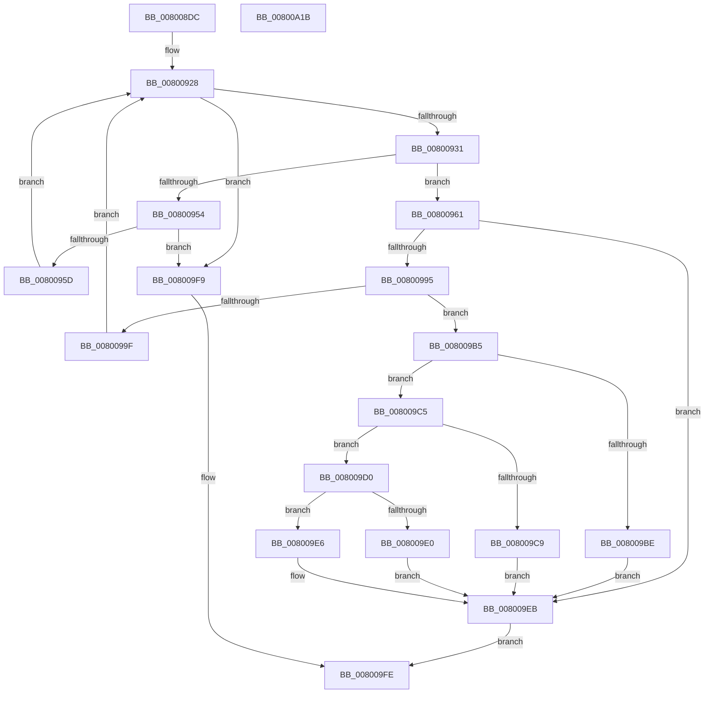

# MiAllocateEntireImageFileExtents

- RVA: `0x008008DC`–`0x00800A1C` (길이 `320` bytes)
- VA: `0x00000001408008DC`
- 실행 섹션: `PAGE`
- PDB 이름 있음: `예`; PDB Function 태그: `아니요`
- unwind 정보 RVA: `0x000C4928`
- 디코드: `97`개 명령, `320/320` bytes 표시
- 미해석 바이트: `0` (있으면 어셈블리에 `.byte`로 보존)

> 이 문서는 커널 이미지의 기계어와 PDB 기호를 분석해 생성했습니다. 4번과 5번은 함수 원형과 자료형을 바이너리 사용 방식에서 추정한 C 해석이며 원본 소스 복구 결과는 아닙니다.

## 1. Dependencies

- 직접 호출 지점: **6**; 고유 호출 대상: **5**
- 직접 호출자로 확인된 함수: **3**
- RIP 상대 이미지 참조: **0**

### Outgoing calls
- `0x00800947` → [MiAllocatePool](../../text/35/MiAllocatePool_function_0035B540.md) (function, `0x0035B540`)
- `0x0080098A` → [FsRtlGetFileExtents](../../text/58/FsRtlGetFileExtents_function_00580F40.md) (function, `0x00580F40`)
- `0x008009A4` → [ExFreePoolWithTag](../../poolcode/B8/ExFreePoolWithTag_function_00B82870.md) (function, `0x00B82870`)
- `0x008009B5` → [MiNewPfnsSuitable](../7F/MiNewPfnsSuitable_function_007FAC24.md) (function, `0x007FAC24`)
- `0x008009D6` → [MiInsertCopyExtents](../../text/68/MiInsertCopyExtents_function_00681440.md) (function, `0x00681440`)
- `0x008009F0` → [ExFreePoolWithTag](../../poolcode/B8/ExFreePoolWithTag_function_00B82870.md) (function, `0x00B82870`)

### Direct callers
- [MiEnableImageDirectMap](../../text/68/MiEnableImageDirectMap_function_00680A78.md) at `0x00680B85`
- [MiCreateImageFileMap](../98/MiCreateImageFileMap_function_00986830.md) at `0x00986ECB`
- [sub_00B2B0A8](../B2/Unknown_function_00B2B0A8.md) at `0x00B2B15C`
- [sub_00B2B0A8](../B2/Unknown_function_00B2B0A8.md) at `0x00B2B297`

### Static image references
- 디코드된 RIP-relative 메모리 참조가 없습니다.

## 2. Other-region calls and transfers

- 다른 실행 섹션으로 향하는 call: **5**
  - `0x00800947` → [MiAllocatePool](../../text/35/MiAllocatePool_function_0035B540.md) (`PAGE` → `.text`)
  - `0x0080098A` → [FsRtlGetFileExtents](../../text/58/FsRtlGetFileExtents_function_00580F40.md) (`PAGE` → `.text`)
  - `0x008009A4` → [ExFreePoolWithTag](../../poolcode/B8/ExFreePoolWithTag_function_00B82870.md) (`PAGE` → `POOLCODE`)
  - `0x008009D6` → [MiInsertCopyExtents](../../text/68/MiInsertCopyExtents_function_00681440.md) (`PAGE` → `.text`)
  - `0x008009F0` → [ExFreePoolWithTag](../../poolcode/B8/ExFreePoolWithTag_function_00B82870.md) (`PAGE` → `POOLCODE`)
- 별도 외부 분기/꼬리 이동을 확인하지 못했습니다.

## 3. Assembly (complete function range)

```asm
008008DC  48 8B C4                        mov rax, rsp
008008DF  48 89 58 10                     mov qword ptr [rax + 0x10], rbx
008008E3  48 89 68 18                     mov qword ptr [rax + 0x18], rbp
008008E7  48 89 70 20                     mov qword ptr [rax + 0x20], rsi
008008EB  48 89 48 08                     mov qword ptr [rax + 8], rcx
008008EF  57                              push rdi
008008F0  41 54                           push r12
008008F2  41 55                           push r13
008008F4  41 56                           push r14
008008F6  41 57                           push r15
008008F8  48 83 EC 30                     sub rsp, 0x30
008008FC  49 83 21 00                     and qword ptr [r9], 0
00800900  4D 8B E1                        mov r12, r9
00800903  4D 8B E8                        mov r13, r8
00800906  4C 8B F2                        mov r14, rdx
00800909  48 8B D9                        mov rbx, rcx
0080090C  0F 31                           rdtsc
0080090E  48 C1 E2 20                     shl rdx, 0x20
00800912  41 BF 01 00 00 00               mov r15d, 1
00800918  48 0B C2                        or rax, rdx
0080091B  48 8B F0                        mov rsi, rax
0080091E  48 C1 EE 04                     shr rsi, 4
00800922  83 E6 07                        and esi, 7
00800925  83 C6 08                        add esi, 8
00800928  83 FE 01                        cmp esi, 1
0080092B  0F 82 C8 00 00 00               jb 0x1408009f9
00800931  8D 56 FF                        lea edx, [rsi - 1]
00800934  B9 40 00 00 00                  mov ecx, 0x40
00800939  48 C1 E2 04                     shl rdx, 4
0080093D  41 B8 4D 69 46 35               mov r8d, 0x3546694d
00800943  48 83 C2 18                     add rdx, 0x18
00800947  E8 F4 AB B5 FF                  call 0x14035b540
0080094C  48 8B F8                        mov rdi, rax
0080094F  48 85 C0                        test rax, rax
00800952  75 0D                           jne 0x140800961
00800954  45 85 FF                        test r15d, r15d
00800957  0F 84 9C 00 00 00               je 0x1408009f9
0080095D  D1 EE                           shr esi, 1
0080095F  EB C7                           jmp 0x140800928
00800961  83 60 04 00                     and dword ptr [rax + 4], 0
00800965  45 33 FF                        xor r15d, r15d
00800968  49 81 C6 FF 0F 00 00            add r14, 0xfff
0080096F  89 30                           mov dword ptr [rax], esi
00800971  49 81 E6 00 F0 FF FF            and r14, 0xfffffffffffff000
00800978  48 89 7C 24 20                  mov qword ptr [rsp + 0x20], rdi
0080097D  4D 8B CE                        mov r9, r14
00800980  45 33 C0                        xor r8d, r8d
00800983  41 8D 57 01                     lea edx, [r15 + 1]
00800987  48 8B CB                        mov rcx, rbx
0080098A  E8 B1 05 D8 FF                  call 0x140580f40
0080098F  8B D8                           mov ebx, eax
00800991  85 C0                           test eax, eax
00800993  78 56                           js 0x1408009eb
00800995  8B 6F 04                        mov ebp, dword ptr [rdi + 4]
00800998  48 8B CF                        mov rcx, rdi
0080099B  3B EE                           cmp ebp, esi
0080099D  76 16                           jbe 0x1408009b5
0080099F  33 D2                           xor edx, edx
008009A1  89 77 04                        mov dword ptr [rdi + 4], esi
008009A4  E8 C7 1E 38 00                  call 0x140b82870
008009A9  48 8B 5C 24 60                  mov rbx, qword ptr [rsp + 0x60]
008009AE  8B F5                           mov esi, ebp
008009B0  E9 73 FF FF FF                  jmp 0x140800928
008009B5  E8 6A A2 FF FF                  call 0x1407fac24
008009BA  85 C0                           test eax, eax
008009BC  75 07                           jne 0x1408009c5
008009BE  BB 27 04 00 C0                  mov ebx, 0xc0000427
008009C3  EB 26                           jmp 0x1408009eb
008009C5  85 ED                           test ebp, ebp
008009C7  75 07                           jne 0x1408009d0
008009C9  BB 01 00 00 C0                  mov ebx, 0xc0000001
008009CE  EB 1B                           jmp 0x1408009eb
008009D0  45 33 C0                        xor r8d, r8d
008009D3  49 8B D5                        mov rdx, r13
008009D6  E8 65 0A E8 FF                  call 0x140681440
008009DB  48 85 C0                        test rax, rax
008009DE  74 06                           je 0x1408009e6
008009E0  49 89 04 24                     mov qword ptr [r12], rax
008009E4  EB 05                           jmp 0x1408009eb
008009E6  BB 9A 00 00 C0                  mov ebx, 0xc000009a
008009EB  33 D2                           xor edx, edx
008009ED  48 8B CF                        mov rcx, rdi
008009F0  E8 7B 1E 38 00                  call 0x140b82870
008009F5  8B C3                           mov eax, ebx
008009F7  EB 05                           jmp 0x1408009fe
008009F9  B8 9A 00 00 C0                  mov eax, 0xc000009a
008009FE  48 8B 5C 24 68                  mov rbx, qword ptr [rsp + 0x68]
00800A03  48 8B 6C 24 70                  mov rbp, qword ptr [rsp + 0x70]
00800A08  48 8B 74 24 78                  mov rsi, qword ptr [rsp + 0x78]
00800A0D  48 83 C4 30                     add rsp, 0x30
00800A11  41 5F                           pop r15
00800A13  41 5E                           pop r14
00800A15  41 5D                           pop r13
00800A17  41 5C                           pop r12
00800A19  5F                              pop rdi
00800A1A  C3                              ret
00800A1B  CC                              int3
```

## 4. C-style interpretation (structured pseudocode)

```c
__int64 __fastcall MiAllocateEntireImageFileExtents(__int64 a1, __int64 a2, __int64 a3, __int64 a4)
{
    __int64 result;
    __int64 v_r14;
    __int64 v_r15;
    __int64 v_rsi;
    __int64 v_rsp;
    unsigned __int64 v_stack_m38;
    unsigned __int64 v_stack_p10;
    unsigned __int64 v_stack_p18;
    unsigned __int64 v_stack_p20;
    unsigned __int64 v_stack_p8;

    *(unsigned __int64 *)(v_rsp + 16) = v_rbx;
    *(unsigned __int64 *)(v_rsp + 24) = v_rbp;
    *(unsigned __int64 *)(v_rsp + 32) = v_rsi;
    *(unsigned __int64 *)(v_rsp + 8) = a1;
    v_rsp = (v_rsp) - (48);
    a2 = (a2) << (32);
    result = (v_rsp) | (a2);
    v_rsi = (result) >> (4);
    v_rsi = (unsigned int)((v_rsi) & (7));
    v_rsi = (unsigned int)((v_rsi) + (8));
loc_00800928:
    if (((unsigned int)(v_rsi)) < 1) goto loc_008009F9;
    a2 = (v_rsi - 1) << (4);
    a2 = (a2) + (24);
    result = MiAllocatePool(64, a2, (unsigned int)(0x3546694DULL), a4);
    if (result != 0) goto loc_00800961;
    if (1 == 0) goto loc_008009F9;
    v_rsi = (unsigned int)((v_rsi) >> (1));
    goto loc_00800928;
loc_00800961:
    v_r15 = 0;
    v_r14 = (a2) + (0xFFFULL);
    *(unsigned int *)(result) = (unsigned int)(v_rsi);
    v_r14 = (v_r14) & (0xFFFFFFFFFFFFF000ULL);
    v_stack_m38 = result;
    a3 = 0;
    result = FsRtlGetFileExtents(a1, v_r15 + 1, a3, v_r14);
    if (sign_flag) goto loc_008009EB;
    if (((unsigned int)((unsigned int)(*(unsigned int *)(result + 4)))) <= ((unsigned int)(v_rsi))) goto loc_008009B5;
    a2 = 0;
    *(unsigned int *)(result + 4) = (unsigned int)(v_rsi);
    result = ExFreePoolWithTag(result, a2, a3, v_r14);
    goto loc_00800928;
loc_008009B5:
    result = MiNewPfnsSuitable(result, a2, a3, v_r14);
    if ((unsigned int)(result) != 0) goto loc_008009C5;
    goto loc_008009EB;
loc_008009C5:
    if ((unsigned int)((unsigned int)(*(unsigned int *)(result + 4))) != 0) goto loc_008009D0;
    goto loc_008009EB;
loc_008009D0:
    a3 = 0;
    result = MiInsertCopyExtents(result, 0, a3, v_r14);
    if (result == 0) goto loc_008009E6;
    *(unsigned __int64 *)(a4) = result;
    goto loc_008009EB;
loc_008009E6:
loc_008009EB:
    a2 = 0;
    result = ExFreePoolWithTag(result, a2, a3, v_r14);
    goto loc_008009FE;
loc_008009F9:
loc_008009FE:
    v_rsp = (v_rsp) + (48);
    return (unsigned int)(0xC000009AULL);
}
```

## 5. (Beta) C Style

```c
int64_t MiAllocateEntireImageFileExtents(int64_t Arg1, int64_t Arg2, int64_t Arg3, void *Arg4)
{
    uint8_t *arg4 = (uint8_t *)Arg4;

    int64_t result;
    int64_t local_r14;
    int64_t local_r15;
    int64_t local_rsi;
    int64_t local_rsp;
    uint64_t v_stack_m38;
    uint64_t v_stack_p10;
    uint64_t v_stack_p18;
    uint64_t v_stack_p20;
    uint64_t v_stack_p8;

    *(uint64_t *)(local_rsp + 0x10) = local_rbx;
    *(uint64_t *)(local_rsp + 0x18) = local_rbp;
    *(uint64_t *)(local_rsp + 0x20) = local_rsi;
    *(uint64_t *)(local_rsp + 0x8) = Arg1;
    local_rsp = (local_rsp) - (48);
    Arg2 = (Arg2) << (32);
    result = (local_rsp) | (Arg2);
    local_rsi = (result) >> (4);
    local_rsi = (uint32_t)((local_rsi) & (7));
    local_rsi = (uint32_t)((local_rsi) + (8));
loc_00800928:
    if (((uint32_t)(local_rsi)) < 1) goto loc_008009F9;
    Arg2 = (local_rsi - 1) << (4);
    Arg2 = (Arg2) + (24);
    result = MiAllocatePool(64, Arg2, (uint32_t)(0x3546694DULL), Arg4);
    if (result != 0) goto loc_00800961;
    if (1 == 0) goto loc_008009F9;
    local_rsi = (uint32_t)((local_rsi) >> (1));
    goto loc_00800928;
loc_00800961:
    local_r15 = 0;
    local_r14 = (Arg2) + (0xFFFULL);
    *(uint32_t *)(result) = (uint32_t)(local_rsi);
    local_r14 = (local_r14) & (0xFFFFFFFFFFFFF000ULL);
    v_stack_m38 = result;
    Arg3 = 0;
    result = FsRtlGetFileExtents(Arg1, local_r15 + 1, Arg3, local_r14);
    if (sign_flag) goto loc_008009EB;
    if (((uint32_t)((uint32_t)(*(uint32_t *)(result + 0x4)))) <= ((uint32_t)(local_rsi))) goto loc_008009B5;
    Arg2 = 0;
    *(uint32_t *)(result + 0x4) = (uint32_t)(local_rsi);
    result = ExFreePoolWithTag(result, Arg2, Arg3, local_r14);
    goto loc_00800928;
loc_008009B5:
    result = MiNewPfnsSuitable(result, Arg2, Arg3, local_r14);
    if ((uint32_t)(result) != 0) goto loc_008009C5;
    goto loc_008009EB;
loc_008009C5:
    if ((uint32_t)((uint32_t)(*(uint32_t *)(result + 0x4))) != 0) goto loc_008009D0;
    goto loc_008009EB;
loc_008009D0:
    Arg3 = 0;
    result = MiInsertCopyExtents(result, 0, Arg3, local_r14);
    if (result == 0) goto loc_008009E6;
    *(uint64_t *)(arg4) = result;
    goto loc_008009EB;
loc_008009E6:
loc_008009EB:
    Arg2 = 0;
    result = ExFreePoolWithTag(result, Arg2, Arg3, local_r14);
    goto loc_008009FE;
loc_008009F9:
loc_008009FE:
    local_rsp = (local_rsp) + (48);
    return (uint32_t)(0xC000009AULL);
}
```

### 관측된 메모리 오프셋

구조체 형식이 확인되지 않은 접근은 인자 기준의 오프셋으로만 기록했습니다.

| 기준 인자 | 오프셋 표현 | 폭 (bit) | 접근 |
|---|---:|---:|---|
| `Arg4` | `+ 0x0` | `64` | `R/W` |
| `Arg4` | `+ 0x0` | `64` | `W` |

## 6. Execution-region graph

[열기: 2D/3D 그래프와 함수 탐색 컨트롤 패널](../../../control-panel.html?section=page&rva=0x008008DC&view=graph)

- 2D 그래프는 위에서 아래로 흐르고, 3D 그래프는 빈 공간을 드래그해 회전합니다. Shift+드래그는 이동, 휠은 확대·축소, 함수 노드 선택은 대상 보고서 이동입니다.

### Static fallback


