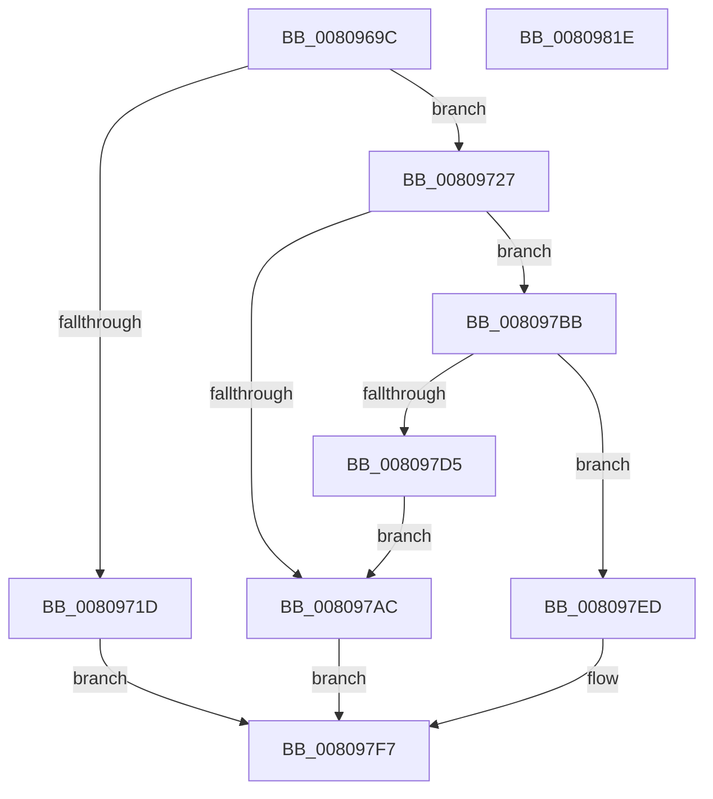

# MiAllocateFastAwePages

- RVA: `0x0080969C`–`0x0080981F` (길이 `387` bytes)
- VA: `0x000000014080969C`
- 실행 섹션: `PAGE`
- PDB 이름 있음: `예`; PDB Function 태그: `아니요`
- unwind 정보 RVA: `0x000BD158`
- 디코드: `112`개 명령, `387/387` bytes 표시
- 미해석 바이트: `0` (있으면 어셈블리에 `.byte`로 보존)

> 이 문서는 커널 이미지의 기계어와 PDB 기호를 분석해 생성했습니다. 4번과 5번은 함수 원형과 자료형을 바이너리 사용 방식에서 추정한 C 해석이며 원본 소스 복구 결과는 아닙니다.

## 1. Dependencies

- 직접 호출 지점: **11**; 고유 호출 대상: **11**
- 직접 호출자로 확인된 함수: **1**
- RIP 상대 이미지 참조: **1**

### Outgoing calls
- `0x008096DC` → [memset](../../text/6C/memset_function_006C6C40.md) (function, `0x006C6C40`)
- `0x008096E9` → [MiGetAwePageSize](../../text/46/MiGetAwePageSize_function_0046CFA8.md) (function, `0x0046CFA8`)
- `0x008096FF` → [MiGetAweInfoPartition](../../text/2A/MiGetAweInfoPartition_function_002AA2CC.md) (function, `0x002AA2CC`)
- `0x00809714` → [MiAcquireNonPagedResources](../../text/28/MiAcquireNonPagedResources_function_00286C60.md) (function, `0x00286C60`)
- `0x00809740` → [MiUpdateProtectionMask](../../text/28/MiUpdateProtectionMask_function_002845DC.md) (function, `0x002845DC`)
- `0x00809764` → [MiInitializeLargePfnList](../../text/43/MiInitializeLargePfnList_function_00432E70.md) (function, `0x00432E70`)
- `0x008097A1` → [MiCreateLargePfnList](../../text/3D/MiCreateLargePfnList_function_003D2DA8.md) (function, `0x003D2DA8`)
- `0x008097B2` → [MiReleaseNonPagedResources](../../text/32/MiReleaseNonPagedResources_function_0032299C.md) (function, `0x0032299C`)
- `0x008097CA` → [MiFillUserPhysicalMdl](../../text/68/MiFillUserPhysicalMdl_function_006887D4.md) (function, `0x006887D4`)
- `0x008097E6` → [MiFreeLargeZeroPages](../../text/3B/MiFreeLargeZeroPages_function_003B5F0C.md) (function, `0x003B5F0C`)
- `0x008097FE` → [_security_check_cookie](../../text/6A/_security_check_cookie_function_006AC640.md) (function, `0x006AC640`)

### Direct callers
- [MiAllocateUserPhysicalPages](MiAllocateUserPhysicalPages_function_00809828.md) at `0x00809F3F`

### Static image references
- `0x008096B8` → RVA `0x00E0A740` (`.data`; read)

## 2. Other-region calls and transfers

- 다른 실행 섹션으로 향하는 call: **11**
  - `0x008096DC` → [memset](../../text/6C/memset_function_006C6C40.md) (`PAGE` → `.text`)
  - `0x008096E9` → [MiGetAwePageSize](../../text/46/MiGetAwePageSize_function_0046CFA8.md) (`PAGE` → `.text`)
  - `0x008096FF` → [MiGetAweInfoPartition](../../text/2A/MiGetAweInfoPartition_function_002AA2CC.md) (`PAGE` → `.text`)
  - `0x00809714` → [MiAcquireNonPagedResources](../../text/28/MiAcquireNonPagedResources_function_00286C60.md) (`PAGE` → `.text`)
  - `0x00809740` → [MiUpdateProtectionMask](../../text/28/MiUpdateProtectionMask_function_002845DC.md) (`PAGE` → `.text`)
  - `0x00809764` → [MiInitializeLargePfnList](../../text/43/MiInitializeLargePfnList_function_00432E70.md) (`PAGE` → `.text`)
  - `0x008097A1` → [MiCreateLargePfnList](../../text/3D/MiCreateLargePfnList_function_003D2DA8.md) (`PAGE` → `.text`)
  - `0x008097B2` → [MiReleaseNonPagedResources](../../text/32/MiReleaseNonPagedResources_function_0032299C.md) (`PAGE` → `.text`)
  - `0x008097CA` → [MiFillUserPhysicalMdl](../../text/68/MiFillUserPhysicalMdl_function_006887D4.md) (`PAGE` → `.text`)
  - `0x008097E6` → [MiFreeLargeZeroPages](../../text/3B/MiFreeLargeZeroPages_function_003B5F0C.md) (`PAGE` → `.text`)
  - `0x008097FE` → [_security_check_cookie](../../text/6A/_security_check_cookie_function_006AC640.md) (`PAGE` → `.text`)
- 별도 외부 분기/꼬리 이동을 확인하지 못했습니다.

## 3. Assembly (complete function range)

```asm
0080969C  48 89 5C 24 20                  mov qword ptr [rsp + 0x20], rbx
008096A1  55                              push rbp
008096A2  56                              push rsi
008096A3  57                              push rdi
008096A4  41 54                           push r12
008096A6  41 55                           push r13
008096A8  41 56                           push r14
008096AA  41 57                           push r15
008096AC  48 8D 6C 24 E9                  lea rbp, [rsp - 0x17]
008096B1  48 81 EC E0 00 00 00            sub rsp, 0xe0
008096B8  48 8B 05 81 10 60 00            mov rax, qword ptr [rip + 0x601081]
008096BF  48 33 C4                        xor rax, rsp
008096C2  48 89 45 07                     mov qword ptr [rbp + 7], rax
008096C6  4C 8B FA                        mov r15, rdx
008096C9  41 8B D8                        mov ebx, r8d
008096CC  33 D2                           xor edx, edx
008096CE  4C 8B E1                        mov r12, rcx
008096D1  48 8D 4D A7                     lea rcx, [rbp - 0x59]
008096D5  45 8B E9                        mov r13d, r9d
008096D8  44 8D 42 60                     lea r8d, [rdx + 0x60]
008096DC  E8 5F D5 EB FF                  call 0x1406c6c40
008096E1  33 F6                           xor esi, esi
008096E3  49 8B CF                        mov rcx, r15
008096E6  89 75 97                        mov dword ptr [rbp - 0x69], esi
008096E9  E8 BA 38 C6 FF                  call 0x14046cfa8
008096EE  45 8B 74 24 28                  mov r14d, dword ptr [r12 + 0x28]
008096F3  49 C1 EE 0C                     shr r14, 0xc
008096F7  4C 0F AF F0                     imul r14, rax
008096FB  48 89 45 9F                     mov qword ptr [rbp - 0x61], rax
008096FF  E8 C8 0B AA FF                  call 0x1402aa2cc
00809704  49 8B D6                        mov rdx, r14
00809707  44 8D 4E 02                     lea r9d, [rsi + 2]
0080970B  48 8B C8                        mov rcx, rax
0080970E  45 33 C0                        xor r8d, r8d
00809711  48 8B F8                        mov rdi, rax
00809714  E8 47 D5 A7 FF                  call 0x140286c60
00809719  85 C0                           test eax, eax
0080971B  79 0A                           jns 0x140809727
0080971D  B8 2D 01 00 C0                  mov eax, 0xc000012d
00809722  E9 D0 00 00 00                  jmp 0x1408097f7
00809727  4C 8B 4D 9F                     mov r9, qword ptr [rbp - 0x61]
0080972B  44 8D 43 01                     lea r8d, [rbx + 1]
0080972F  41 8B 57 34                     mov edx, dword ptr [r15 + 0x34]
00809733  B9 04 00 00 00                  mov ecx, 4
00809738  4C 89 4D 8F                     mov qword ptr [rbp - 0x71], r9
0080973C  48 89 75 87                     mov qword ptr [rbp - 0x79], rsi
00809740  E8 97 AE A7 FF                  call 0x1402845dc
00809745  45 8B 7F 08                     mov r15d, dword ptr [r15 + 8]
00809749  48 8D 4D A7                     lea rcx, [rbp - 0x59]
0080974D  89 45 9B                        mov dword ptr [rbp - 0x65], eax
00809750  41 83 E7 04                     and r15d, 4
00809754  8B 45 97                        mov eax, dword ptr [rbp - 0x69]
00809757  41 BA 01 00 00 00               mov r10d, 1
0080975D  41 0F 45 C2                     cmovne eax, r10d
00809761  89 45 97                        mov dword ptr [rbp - 0x69], eax
00809764  E8 07 97 C2 FF                  call 0x140432e70
00809769  41 8B CF                        mov ecx, r15d
0080976C  F7 D9                           neg ecx
0080976E  48 8D 4D A7                     lea rcx, [rbp - 0x59]
00809772  1B C0                           sbb eax, eax
00809774  48 89 4C 24 40                  mov qword ptr [rsp + 0x40], rcx
00809779  83 E0 02                        and eax, 2
0080977C  41 D1 ED                        shr r13d, 1
0080977F  83 C0 02                        add eax, 2
00809782  48 8D 4D 87                     lea rcx, [rbp - 0x79]
00809786  89 44 24 38                     mov dword ptr [rsp + 0x38], eax
0080978A  45 22 EA                        and r13b, r10b
0080978D  48 89 74 24 30                  mov qword ptr [rsp + 0x30], rsi
00809792  33 D2                           xor edx, edx
00809794  44 88 6C 24 28                  mov byte ptr [rsp + 0x28], r13b
00809799  44 89 44 24 20                  mov dword ptr [rsp + 0x20], r8d
0080979E  4D 8B C6                        mov r8, r14
008097A1  E8 02 96 BC FF                  call 0x1403d2da8
008097A6  8B D8                           mov ebx, eax
008097A8  85 C0                           test eax, eax
008097AA  79 0F                           jns 0x1408097bb
008097AC  49 8B D6                        mov rdx, r14
008097AF  48 8B CF                        mov rcx, rdi
008097B2  E8 E5 91 B1 FF                  call 0x14032299c
008097B7  8B C3                           mov eax, ebx
008097B9  EB 3C                           jmp 0x1408097f7
008097BB  4C 8B 4D 7F                     mov r9, qword ptr [rbp + 0x7f]
008097BF  48 8D 55 A7                     lea rdx, [rbp - 0x59]
008097C3  4C 8B 45 77                     mov r8, qword ptr [rbp + 0x77]
008097C7  49 8B CC                        mov rcx, r12
008097CA  E8 05 F0 E7 FF                  call 0x1406887d4
008097CF  8B D8                           mov ebx, eax
008097D1  85 C0                           test eax, eax
008097D3  79 18                           jns 0x1408097ed
008097D5  45 85 FF                        test r15d, r15d
008097D8  48 8D 55 A7                     lea rdx, [rbp - 0x59]
008097DC  48 8B CF                        mov rcx, rdi
008097DF  40 0F 95 C6                     setne sil
008097E3  44 8B C6                        mov r8d, esi
008097E6  E8 21 C7 BA FF                  call 0x1403b5f0c
008097EB  EB BF                           jmp 0x1408097ac
008097ED  F0 4C 01 B7 C0 4C 00 00         lock add qword ptr [rdi + 0x4cc0], r14
008097F5  33 C0                           xor eax, eax
008097F7  48 8B 4D 07                     mov rcx, qword ptr [rbp + 7]
008097FB  48 33 CC                        xor rcx, rsp
008097FE  E8 3D 2E EA FF                  call 0x1406ac640
00809803  48 8B 9C 24 38 01 00 00         mov rbx, qword ptr [rsp + 0x138]
0080980B  48 81 C4 E0 00 00 00            add rsp, 0xe0
00809812  41 5F                           pop r15
00809814  41 5E                           pop r14
00809816  41 5D                           pop r13
00809818  41 5C                           pop r12
0080981A  5F                              pop rdi
0080981B  5E                              pop rsi
0080981C  5D                              pop rbp
0080981D  C3                              ret
0080981E  CC                              int3
```

## 4. C-style interpretation (structured pseudocode)

```c
__int64 __fastcall MiAllocateFastAwePages(__int64 a1, __int64 a2, int a3, int a4, __int64 a5, __int64 a6)
{
    __int64 result;
    __int64 v_r13;
    __int64 v_r14;
    __int64 v_r15;
    __int64 v_rsi;
    __int64 v_rsp;
    unsigned __int64 v_stack_m48;
    unsigned __int64 v_stack_m4F;
    unsigned __int64 v_stack_mA8;
    unsigned __int64 v_stack_mB0;
    unsigned int v_stack_mB4;
    unsigned int v_stack_mB8;
    unsigned __int64 v_stack_mC0;
    unsigned __int64 v_stack_mC8;
    unsigned __int64 v_stack_mD8;
    unsigned int v_stack_mE0;
    unsigned __int64 v_stack_mE8;
    unsigned __int8 v_stack_mF0;
    unsigned int v_stack_mF8;
    unsigned __int64 v_stack_p20;

    v_stack_p20 = v_rbx;
    v_rsp = (v_rsp) - (224);
    result = (*(unsigned __int64 *)(v_rip + 6295681)) ^ (v_rsp);
    v_stack_m48 = result;
    a2 = 0;
    result = memset(v_stack_mA8, a2, a2 + 96, a4);
    v_rsi = 0;
    v_stack_mB8 = 0;
    result = MiGetAwePageSize(0, a2, a2 + 96, a4);
    v_r14 = ((unsigned int)(*(unsigned int *)(a1 + 40))) >> (12);
    v_r14 = (v_r14) * (result);
    v_stack_mB0 = result;
    result = MiGetAweInfoPartition(0, a2, a2 + 96, a4);
    a3 = 0;
    result = MiAcquireNonPagedResources(result, v_r14, a3, v_rsi + 2);
    if (!sign_flag) goto loc_00809727;
    goto loc_008097F7;
loc_00809727:
    v_stack_mC0 = v_stack_mB0;
    v_stack_mC8 = 0;
    result = MiUpdateProtectionMask(4, (unsigned int)(*(unsigned int *)(a2 + 52)), (unsigned int)(a3) + 1, v_stack_mB0);
    v_stack_mB4 = (unsigned int)(result);
    v_r15 = (unsigned int)(((unsigned int)(*(unsigned int *)(a2 + 8))) & (4));
    result = (unsigned int)(v_stack_mB8);
    if (condition_is_not_equal) { result = 1; }
    v_stack_mB8 = (unsigned int)(result);
    result = MiInitializeLargePfnList(v_stack_mA8, (unsigned int)(*(unsigned int *)(a2 + 52)), (unsigned int)(a3) + 1, v_stack_mB0);
    a1 = (unsigned int)(-((unsigned int)((unsigned int)(v_r15))));
    v_stack_mD8 = v_stack_mA8;
    result = (unsigned int)((result) & (2));
    v_r13 = (unsigned int)(((unsigned int)(a4)) >> (1));
    result = (unsigned int)((result) + (2));
    v_stack_mE0 = (unsigned int)(result);
    v_r13 = (unsigned __int8)((v_r13) & (1));
    v_stack_mE8 = 0;
    a2 = 0;
    v_stack_mF0 = (unsigned __int8)(v_r13);
    v_stack_mF8 = (unsigned int)((unsigned int)(a3) + 1);
    result = MiCreateLargePfnList(v_stack_mC8, a2, v_r14, v_stack_mB0);
    if (!sign_flag) goto loc_008097BB;
loc_008097AC:
    result = MiReleaseNonPagedResources(result, v_r14, v_r14, v_stack_mB0);
    goto loc_008097F7;
loc_008097BB:
    result = MiFillUserPhysicalMdl(a1, v_stack_mA8, a5, a6);
    if (!sign_flag) goto loc_008097ED;
    v_rsi = ((unsigned int)(v_r15) != 0) ? 1 : 0;
    result = MiFreeLargeZeroPages(result, v_stack_mA8, (unsigned int)((unsigned int)(v_rsi)), a6);
    goto loc_008097AC;
loc_008097ED:
    result = 0;
loc_008097F7:
    a1 = (v_stack_m48) ^ (v_rsp);
    result = _security_check_cookie(a1, v_stack_mA8, (unsigned int)((unsigned int)(v_rsi)), a6);
    v_rsp = (v_rsp) + (224);
    return result;
}
```

## 5. (Beta) C Style

```c
int64_t MiAllocateFastAwePages(void *Arg1, void *Arg2, void *Arg3, int32_t Arg4, int64_t Arg5, int64_t Arg6)
{
    uint8_t *arg1 = (uint8_t *)Arg1;
    uint8_t *arg2 = (uint8_t *)Arg2;
    uint8_t *arg3 = (uint8_t *)Arg3;

    int64_t result;
    int64_t local_r13;
    int64_t local_r14;
    int64_t local_r15;
    int64_t local_rsi;
    int64_t local_rsp;
    uint64_t v_stack_m48;
    uint64_t v_stack_m4F;
    uint64_t v_stack_mA8;
    uint64_t v_stack_mB0;
    uint32_t v_stack_mB4;
    uint32_t v_stack_mB8;
    uint64_t v_stack_mC0;
    uint64_t v_stack_mC8;
    uint64_t v_stack_mD8;
    uint32_t v_stack_mE0;
    uint64_t v_stack_mE8;
    uint8_t v_stack_mF0;
    uint32_t v_stack_mF8;
    uint64_t v_stack_p20;

    v_stack_p20 = local_rbx;
    local_rsp = (local_rsp) - (224);
    result = (*(uint64_t *)(v_rip + 0x601081)) ^ (local_rsp);
    v_stack_m48 = result;
    Arg2 = 0;
    result = memset(v_stack_mA8, Arg2, Arg2 + 96, Arg4);
    local_rsi = 0;
    v_stack_mB8 = 0;
    result = MiGetAwePageSize(0, Arg2, Arg2 + 96, Arg4);
    local_r14 = ((uint32_t)(*(uint32_t *)(arg1 + 0x28))) >> (12);
    local_r14 = (local_r14) * (result);
    v_stack_mB0 = result;
    result = MiGetAweInfoPartition(0, Arg2, Arg2 + 96, Arg4);
    Arg3 = 0;
    result = MiAcquireNonPagedResources(result, local_r14, Arg3, local_rsi + 2);
    if (!sign_flag) goto loc_00809727;
    goto loc_008097F7;
loc_00809727:
    v_stack_mC0 = v_stack_mB0;
    v_stack_mC8 = 0;
    result = MiUpdateProtectionMask(4, (uint32_t)(*(uint32_t *)(arg2 + 0x34)), (uint32_t)(Arg3) + 1, v_stack_mB0);
    v_stack_mB4 = (uint32_t)(result);
    local_r15 = (uint32_t)(((uint32_t)(*(uint32_t *)(arg2 + 0x8))) & (4));
    result = (uint32_t)(v_stack_mB8);
    if (condition_is_not_equal) { result = 1; }
    v_stack_mB8 = (uint32_t)(result);
    result = MiInitializeLargePfnList(v_stack_mA8, (uint32_t)(*(uint32_t *)(arg2 + 0x34)), (uint32_t)(Arg3) + 1, v_stack_mB0);
    Arg1 = (uint32_t)(-((uint32_t)((uint32_t)(local_r15))));
    v_stack_mD8 = v_stack_mA8;
    result = (uint32_t)((result) & (2));
    local_r13 = (uint32_t)(((uint32_t)(Arg4)) >> (1));
    result = (uint32_t)((result) + (2));
    v_stack_mE0 = (uint32_t)(result);
    local_r13 = (uint8_t)((local_r13) & (1));
    v_stack_mE8 = 0;
    Arg2 = 0;
    v_stack_mF0 = (uint8_t)(local_r13);
    v_stack_mF8 = (uint32_t)((uint32_t)(Arg3) + 1);
    result = MiCreateLargePfnList(v_stack_mC8, Arg2, local_r14, v_stack_mB0);
    if (!sign_flag) goto loc_008097BB;
loc_008097AC:
    result = MiReleaseNonPagedResources(result, local_r14, local_r14, v_stack_mB0);
    goto loc_008097F7;
loc_008097BB:
    result = MiFillUserPhysicalMdl(Arg1, v_stack_mA8, Arg5, Arg6);
    if (!sign_flag) goto loc_008097ED;
    local_rsi = ((uint32_t)(local_r15) != 0) ? 1 : 0;
    result = MiFreeLargeZeroPages(result, v_stack_mA8, (uint32_t)((uint32_t)(local_rsi)), Arg6);
    goto loc_008097AC;
loc_008097ED:
    result = 0;
loc_008097F7:
    Arg1 = (v_stack_m48) ^ (local_rsp);
    result = _security_check_cookie(Arg1, v_stack_mA8, (uint32_t)((uint32_t)(local_rsi)), Arg6);
    local_rsp = (local_rsp) + (224);
    return result;
}
```

### 관측된 메모리 오프셋

구조체 형식이 확인되지 않은 접근은 인자 기준의 오프셋으로만 기록했습니다.

| 기준 인자 | 오프셋 표현 | 폭 (bit) | 접근 |
|---|---:|---:|---|
| `Arg1` | `+ 0x28` | `32` | `R` |
| `Arg2` | `+ 0x8` | `32` | `R` |
| `Arg2` | `+ 0x34` | `32` | `R` |
| `Arg3` | `+ 0x1` | `32` | `R` |

## 6. Execution-region graph

[열기: 2D/3D 그래프와 함수 탐색 컨트롤 패널](../../../control-panel.html?section=page&rva=0x0080969C&view=graph)

- 2D 그래프는 위에서 아래로 흐르고, 3D 그래프는 빈 공간을 드래그해 회전합니다. Shift+드래그는 이동, 휠은 확대·축소, 함수 노드 선택은 대상 보고서 이동입니다.

### Static fallback


