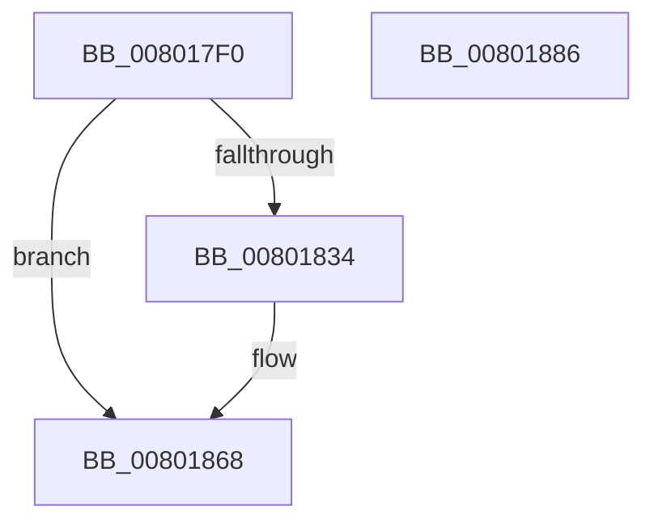

# MiAllocateHotPatchRecord

- RVA: `0x008017F0`–`0x00801887` (길이 `151` bytes)
- VA: `0x00000001408017F0`
- 실행 섹션: `PAGE`
- PDB 이름 있음: `예`; PDB Function 태그: `아니요`
- unwind 정보 RVA: `0x0005E6B4`
- 디코드: `42`개 명령, `151/151` bytes 표시
- 미해석 바이트: `0` (있으면 어셈블리에 `.byte`로 보존)

> 이 문서는 커널 이미지의 기계어와 PDB 기호를 분석해 생성했습니다. 4번과 5번은 함수 원형과 자료형을 바이너리 사용 방식에서 추정한 C 해석이며 원본 소스 복구 결과는 아닙니다.

## 1. Dependencies

- 직접 호출 지점: **2**; 고유 호출 대상: **2**
- 직접 호출자로 확인된 함수: **3**
- RIP 상대 이미지 참조: **0**

### Outgoing calls
- `0x00801827` → [MiAllocatePool](../../text/35/MiAllocatePool_function_0035B540.md) (function, `0x0035B540`)
- `0x00801863` → [memcpy](../../text/6C/memcpy_function_006C6840.md) (function, `0x006C6840`)

### Direct callers
- [MiLoadHotPatchForUserSid](../AB/MiLoadHotPatchForUserSid_function_00AB4F08.md) at `0x00AB4FB4`
- [MiLoadHotPatch](../AB/MiLoadHotPatch_function_00AB521C.md) at `0x00AB533F`
- [MmRegisterHotPatches](../../init/C6/MmRegisterHotPatches_function_00C678DC.md) at `0x00C67971`

### Static image references
- 디코드된 RIP-relative 메모리 참조가 없습니다.

## 2. Other-region calls and transfers

- 다른 실행 섹션으로 향하는 call: **2**
  - `0x00801827` → [MiAllocatePool](../../text/35/MiAllocatePool_function_0035B540.md) (`PAGE` → `.text`)
  - `0x00801863` → [memcpy](../../text/6C/memcpy_function_006C6840.md) (`PAGE` → `.text`)
- 별도 외부 분기/꼬리 이동을 확인하지 못했습니다.

## 3. Assembly (complete function range)

```asm
008017F0  48 8B C4                        mov rax, rsp
008017F3  48 89 58 08                     mov qword ptr [rax + 8], rbx
008017F7  48 89 68 10                     mov qword ptr [rax + 0x10], rbp
008017FB  48 89 70 18                     mov qword ptr [rax + 0x18], rsi
008017FF  48 89 78 20                     mov qword ptr [rax + 0x20], rdi
00801803  41 56                           push r14
00801805  48 83 EC 20                     sub rsp, 0x20
00801809  8B EA                           mov ebp, edx
0080180B  41 8B F0                        mov esi, r8d
0080180E  41 0F B7 11                     movzx edx, word ptr [r9]
00801812  44 8B F1                        mov r14d, ecx
00801815  48 83 C2 38                     add rdx, 0x38
00801819  B9 00 01 00 00                  mov ecx, 0x100
0080181E  41 B8 4D 6D 48 70               mov r8d, 0x70486d4d
00801824  49 8B F9                        mov rdi, r9
00801827  E8 14 9D B5 FF                  call 0x14035b540
0080182C  48 8B D8                        mov rbx, rax
0080182F  48 85 C0                        test rax, rax
00801832  74 34                           je 0x140801868
00801834  8B 4C 24 50                     mov ecx, dword ptr [rsp + 0x50]
00801838  89 48 24                        mov dword ptr [rax + 0x24], ecx
0080183B  44 89 70 18                     mov dword ptr [rax + 0x18], r14d
0080183F  89 68 1C                        mov dword ptr [rax + 0x1c], ebp
00801842  89 70 20                        mov dword ptr [rax + 0x20], esi
00801845  0F B7 0F                        movzx ecx, word ptr [rdi]
00801848  66 89 48 28                     mov word ptr [rax + 0x28], cx
0080184C  0F B7 0F                        movzx ecx, word ptr [rdi]
0080184F  66 89 48 2A                     mov word ptr [rax + 0x2a], cx
00801853  48 8D 48 38                     lea rcx, [rax + 0x38]
00801857  48 89 48 30                     mov qword ptr [rax + 0x30], rcx
0080185B  44 0F B7 07                     movzx r8d, word ptr [rdi]
0080185F  48 8B 57 08                     mov rdx, qword ptr [rdi + 8]
00801863  E8 D8 4F EC FF                  call 0x1406c6840
00801868  48 8B 6C 24 38                  mov rbp, qword ptr [rsp + 0x38]
0080186D  48 8B C3                        mov rax, rbx
00801870  48 8B 5C 24 30                  mov rbx, qword ptr [rsp + 0x30]
00801875  48 8B 74 24 40                  mov rsi, qword ptr [rsp + 0x40]
0080187A  48 8B 7C 24 48                  mov rdi, qword ptr [rsp + 0x48]
0080187F  48 83 C4 20                     add rsp, 0x20
00801883  41 5E                           pop r14
00801885  C3                              ret
00801886  CC                              int3
```

## 4. C-style interpretation (structured pseudocode)

```c
__int64 __fastcall MiAllocateHotPatchRecord(int a1, int a2, int a3, __int64 a4, unsigned int a5)
{
    __int64 result;
    __int64 v_rsp;
    unsigned __int64 v_stack_p10;
    unsigned __int64 v_stack_p18;
    unsigned __int64 v_stack_p20;
    unsigned __int64 v_stack_p8;

    *(unsigned __int64 *)(v_rsp + 8) = v_rbx;
    *(unsigned __int64 *)(v_rsp + 16) = v_rbp;
    *(unsigned __int64 *)(v_rsp + 24) = v_rsi;
    *(unsigned __int64 *)(v_rsp + 32) = v_rdi;
    v_rsp = (v_rsp) - (32);
    a2 = (*(unsigned __int16 *)(a4)) + (56);
    result = MiAllocatePool(256, a2, (unsigned int)(0x70486D4DULL), a4);
    if (result != 0) {
        a1 = a5;
        *(unsigned int *)(result + 36) = a1;
        *(unsigned int *)(result + 24) = (unsigned int)((unsigned int)(a1));
        *(unsigned int *)(result + 28) = (unsigned int)((unsigned int)(a2));
        *(unsigned int *)(result + 32) = (unsigned int)((unsigned int)(a3));
        a1 = *(unsigned __int16 *)(a4);
        *(unsigned __int16 *)(result + 40) = (unsigned __int16)(a1);
        a1 = *(unsigned __int16 *)(a4);
        *(unsigned __int16 *)(result + 42) = (unsigned __int16)(a1);
        a1 = result + 56;
        *(unsigned __int64 *)(result + 48) = a1;
        a3 = *(unsigned __int16 *)(a4);
        a2 = *(unsigned __int64 *)(a4 + 8);
        result = memcpy(a1, a2, a3, a4);
    }
    v_rsp = (v_rsp) + (32);
    return result;
}
```

## 5. (Beta) C Style

```c
int64_t MiAllocateHotPatchRecord(int32_t Arg1, int32_t Arg2, int32_t Arg3, void *Arg4, uint32_t Arg5)
{
    uint8_t *arg4 = (uint8_t *)Arg4;

    int64_t result;
    int64_t local_rsp;
    uint64_t v_stack_p10;
    uint64_t v_stack_p18;
    uint64_t v_stack_p20;
    uint64_t v_stack_p8;

    *(uint64_t *)(local_rsp + 0x8) = local_rbx;
    *(uint64_t *)(local_rsp + 0x10) = local_rbp;
    *(uint64_t *)(local_rsp + 0x18) = local_rsi;
    *(uint64_t *)(local_rsp + 0x20) = local_rdi;
    local_rsp = (local_rsp) - (32);
    Arg2 = (*(uint16_t *)(arg4)) + (56);
    result = MiAllocatePool(256, Arg2, (uint32_t)(0x70486D4DULL), Arg4);
    if (result != 0) {
        Arg1 = Arg5;
        *(uint32_t *)(result + 0x24) = Arg1;
        *(uint32_t *)(result + 0x18) = (uint32_t)((uint32_t)(Arg1));
        *(uint32_t *)(result + 0x1C) = (uint32_t)((uint32_t)(Arg2));
        *(uint32_t *)(result + 0x20) = (uint32_t)((uint32_t)(Arg3));
        Arg1 = *(uint16_t *)(arg4);
        *(uint16_t *)(result + 0x28) = (uint16_t)(Arg1);
        Arg1 = *(uint16_t *)(arg4);
        *(uint16_t *)(result + 0x2A) = (uint16_t)(Arg1);
        Arg1 = result + 56;
        *(uint64_t *)(result + 0x30) = Arg1;
        Arg3 = *(uint16_t *)(arg4);
        Arg2 = *(uint64_t *)(arg4 + 0x8);
        result = memcpy(Arg1, Arg2, Arg3, Arg4);
    }
    local_rsp = (local_rsp) + (32);
    return result;
}
```

### 관측된 메모리 오프셋

구조체 형식이 확인되지 않은 접근은 인자 기준의 오프셋으로만 기록했습니다.

| 기준 인자 | 오프셋 표현 | 폭 (bit) | 접근 |
|---|---:|---:|---|
| `Arg4` | `+ 0x0` | `16` | `R` |
| `Arg4` | `+ 0x8` | `64` | `R` |

## 6. Execution-region graph

[열기: 2D/3D 그래프와 함수 탐색 컨트롤 패널](../../../control-panel.html?section=page&rva=0x008017F0&view=graph)

- 2D 그래프는 위에서 아래로 흐르고, 3D 그래프는 빈 공간을 드래그해 회전합니다. Shift+드래그는 이동, 휠은 확대·축소, 함수 노드 선택은 대상 보고서 이동입니다.

### Static fallback


