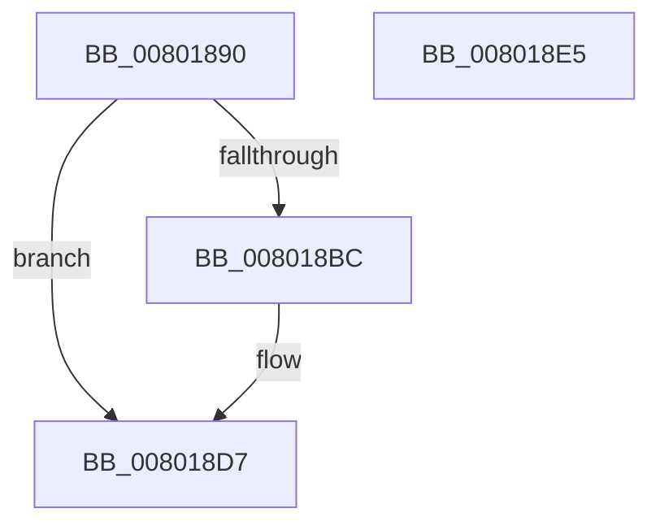

# MiAllocateSecureImageActivePatch

- RVA: `0x00801890`–`0x008018E6` (길이 `86` bytes)
- VA: `0x0000000140801890`
- 실행 섹션: `PAGE`
- PDB 이름 있음: `예`; PDB Function 태그: `아니요`
- unwind 정보 RVA: `0x0005CAAC`
- 디코드: `25`개 명령, `86/86` bytes 표시
- 미해석 바이트: `0` (있으면 어셈블리에 `.byte`로 보존)

> 이 문서는 커널 이미지의 기계어와 PDB 기호를 분석해 생성했습니다. 4번과 5번은 함수 원형과 자료형을 바이너리 사용 방식에서 추정한 C 해석이며 원본 소스 복구 결과는 아닙니다.

## 1. Dependencies

- 직접 호출 지점: **2**; 고유 호출 대상: **2**
- 직접 호출자로 확인된 함수: **3**
- RIP 상대 이미지 참조: **0**

### Outgoing calls
- `0x008018AF` → [MiAllocatePool](../../text/35/MiAllocatePool_function_0035B540.md) (function, `0x0035B540`)
- `0x008018D2` → [RtlCopyUnicodeString](../../text/3F/RtlCopyUnicodeString_function_003FEF30.md) (function, `0x003FEF30`)

### Direct callers
- [MmInsertSecureImageActivePatch](MmInsertSecureImageActivePatch_function_008073E4.md) at `0x0080745F`
- [MiLoadHotPatch](../AB/MiLoadHotPatch_function_00AB521C.md) at `0x00AB5473`
- [MmRegisterHotPatches](../../init/C6/MmRegisterHotPatches_function_00C678DC.md) at `0x00C679C8`

### Static image references
- 디코드된 RIP-relative 메모리 참조가 없습니다.

## 2. Other-region calls and transfers

- 다른 실행 섹션으로 향하는 call: **2**
  - `0x008018AF` → [MiAllocatePool](../../text/35/MiAllocatePool_function_0035B540.md) (`PAGE` → `.text`)
  - `0x008018D2` → [RtlCopyUnicodeString](../../text/3F/RtlCopyUnicodeString_function_003FEF30.md) (`PAGE` → `.text`)
- 별도 외부 분기/꼬리 이동을 확인하지 못했습니다.

## 3. Assembly (complete function range)

```asm
00801890  48 89 5C 24 08                  mov qword ptr [rsp + 8], rbx
00801895  57                              push rdi
00801896  48 83 EC 20                     sub rsp, 0x20
0080189A  0F B7 11                        movzx edx, word ptr [rcx]
0080189D  48 8B F9                        mov rdi, rcx
008018A0  48 83 C2 40                     add rdx, 0x40
008018A4  B9 00 01 00 00                  mov ecx, 0x100
008018A9  41 B8 4D 6D 48 73               mov r8d, 0x73486d4d
008018AF  E8 8C 9C B5 FF                  call 0x14035b540
008018B4  48 8B D8                        mov rbx, rax
008018B7  48 85 C0                        test rax, rax
008018BA  74 1B                           je 0x1408018d7
008018BC  48 8D 50 40                     lea rdx, [rax + 0x40]
008018C0  48 89 50 38                     mov qword ptr [rax + 0x38], rdx
008018C4  48 8B D7                        mov rdx, rdi
008018C7  0F B7 0F                        movzx ecx, word ptr [rdi]
008018CA  66 89 48 32                     mov word ptr [rax + 0x32], cx
008018CE  48 8D 48 30                     lea rcx, [rax + 0x30]
008018D2  E8 59 D6 BF FF                  call 0x1403fef30
008018D7  48 8B C3                        mov rax, rbx
008018DA  48 8B 5C 24 30                  mov rbx, qword ptr [rsp + 0x30]
008018DF  48 83 C4 20                     add rsp, 0x20
008018E3  5F                              pop rdi
008018E4  C3                              ret
008018E5  CC                              int3
```

## 4. C-style interpretation (structured pseudocode)

```c
__int64 __fastcall MiAllocateSecureImageActivePatch(__int64 a1)
{
    __int64 result;
    __int64 v_rsp;
    unsigned __int64 v_stack_p8;

    v_stack_p8 = v_rbx;
    v_rsp = (v_rsp) - (32);
    a2 = (*(unsigned __int16 *)(a1)) + (64);
    result = MiAllocatePool(256, a2, (unsigned int)(0x73486D4DULL), a4);
    if (result != 0) {
        a2 = result + 64;
        *(unsigned __int64 *)(result + 56) = a2;
        a2 = a1;
        a1 = *(unsigned __int16 *)(a1);
        *(unsigned __int16 *)(result + 50) = (unsigned __int16)(a1);
        a1 = result + 48;
        result = RtlCopyUnicodeString(a1, a2, (unsigned int)(0x73486D4DULL), a4);
    }
    v_rsp = (v_rsp) + (32);
    return result;
}
```

## 5. (Beta) C Style

```c
int64_t MiAllocateSecureImageActivePatch(void *Arg1)
{
    uint8_t *arg1 = (uint8_t *)Arg1;

    int64_t result;
    int64_t local_rsp;
    uint64_t v_stack_p8;

    v_stack_p8 = local_rbx;
    local_rsp = (local_rsp) - (32);
    a2 = (*(uint16_t *)(arg1)) + (64);
    result = MiAllocatePool(256, a2, (uint32_t)(0x73486D4DULL), a4);
    if (result != 0) {
        a2 = result + 64;
        *(uint64_t *)(result + 0x38) = a2;
        a2 = Arg1;
        Arg1 = *(uint16_t *)(arg1);
        *(uint16_t *)(result + 0x32) = (uint16_t)(Arg1);
        Arg1 = result + 48;
        result = RtlCopyUnicodeString(Arg1, a2, (uint32_t)(0x73486D4DULL), a4);
    }
    local_rsp = (local_rsp) + (32);
    return result;
}
```

### 관측된 메모리 오프셋

구조체 형식이 확인되지 않은 접근은 인자 기준의 오프셋으로만 기록했습니다.

| 기준 인자 | 오프셋 표현 | 폭 (bit) | 접근 |
|---|---:|---:|---|
| `Arg1` | `+ 0x0` | `16` | `R` |

## 6. Execution-region graph

[열기: 2D/3D 그래프와 함수 탐색 컨트롤 패널](../../../control-panel.html?section=page&rva=0x00801890&view=graph)

- 2D 그래프는 위에서 아래로 흐르고, 3D 그래프는 빈 공간을 드래그해 회전합니다. Shift+드래그는 이동, 휠은 확대·축소, 함수 노드 선택은 대상 보고서 이동입니다.

### Static fallback


