# MiApplyDriverHotPatch

- RVA: `0x008018EC`–`0x00801E5D` (길이 `1,393` bytes)
- VA: `0x00000001408018EC`
- 실행 섹션: `PAGE`
- PDB 이름 있음: `예`; PDB Function 태그: `아니요`
- unwind 정보 RVA: `0x000D85B0`
- 디코드: `350`개 명령, `1,393/1,393` bytes 표시
- 미해석 바이트: `0` (있으면 어셈블리에 `.byte`로 보존)

> 이 문서는 커널 이미지의 기계어와 PDB 기호를 분석해 생성했습니다. 4번과 5번은 함수 원형과 자료형을 바이너리 사용 방식에서 추정한 C 해석이며 원본 소스 복구 결과는 아닙니다.

## 1. Dependencies

- 직접 호출 지점: **40**; 고유 호출 대상: **28**
- 직접 호출자로 확인된 함수: **1**
- RIP 상대 이미지 참조: **3**

### Outgoing calls
- `0x0080193E` → [memset](../../text/6C/memset_function_006C6C40.md) (function, `0x006C6C40`)
- `0x00801946` → [MiGetBaseLoaderPortion](../../text/4D/MiGetBaseLoaderPortion_function_004D9D34.md) (function, `0x004D9D34`)
- `0x00801967` → [MiGetBaseLoaderPortion](../../text/4D/MiGetBaseLoaderPortion_function_004D9D34.md) (function, `0x004D9D34`)
- `0x00801977` → [RtlFindHotPatchInformation](../84/RtlFindHotPatchInformation_function_00840F24.md) (function, `0x00840F24`)
- `0x00801995` → [RtlFindHotPatchBaseMachine](../84/RtlFindHotPatchBaseMachine_function_00840EBC.md) (function, `0x00840EBC`)
- `0x008019B7` → [RtlValidateHotPatchBase](../84/RtlValidateHotPatchBase_function_008411D0.md) (function, `0x008411D0`)
- `0x008019CE` → [memset](../../text/6C/memset_function_006C6C40.md) (function, `0x006C6C40`)
- `0x008019FD` → [memset](../../text/6C/memset_function_006C6C40.md) (function, `0x006C6C40`)
- `0x00801A3B` → [memset](../../text/6C/memset_function_006C6C40.md) (function, `0x006C6C40`)
- `0x00801A5A` → [VslpEnterIumSecureMode](../../text/23/VslpEnterIumSecureMode_function_00235E50.md) (function, `0x00235E50`)
- `0x00801A7E` → [MiAllocatePool](../../text/35/MiAllocatePool_function_0035B540.md) (function, `0x0035B540`)
- `0x00801AA1` → [VslObtainHotPatchUndoTable](../71/VslObtainHotPatchUndoTable_function_00718F50.md) (function, `0x00718F50`)
- `0x00801AB5` → [MiGetAnyMultiplexedVm](../../text/44/MiGetAnyMultiplexedVm_function_00448BD0.md) (function, `0x00448BD0`)
- `0x00801AE0` → [MiAddEntryToImportList](../7F/MiAddEntryToImportList_function_007F7D20.md) (function, `0x007F7D20`)
- `0x00801AFE` → [MiPrepareDriverPatchState](../7F/MiPrepareDriverPatchState_function_007F8C8C.md) (function, `0x007F8C8C`)
- `0x00801B14` → [MiPrepareDriverPatchState](../7F/MiPrepareDriverPatchState_function_007F8C8C.md) (function, `0x007F8C8C`)
- `0x00801B4E` → [MiIdentifyPatchImageDataPages](MiIdentifyPatchImageDataPages_function_00803EBC.md) (function, `0x00803EBC`)
- `0x00801B61` → [MiIdentifyImageDiscardablePages](MiIdentifyImageDiscardablePages_function_00803DB4.md) (function, `0x00803DB4`)
- `0x00801B75` → [MiPrepareDriverForHotPatch](MiPrepareDriverForHotPatch_function_008066F4.md) (function, `0x008066F4`)
- `0x00801B8F` → [MiGetSectionStrongImageReference](../93/MiGetSectionStrongImageReference_function_0093E9C0.md) (function, `0x0093E9C0`)
- `0x00801BCC` → [RtlGetHotPatchSize](../../text/6A/RtlGetHotPatchSize_function_006AA1D0.md) (function, `0x006AA1D0`)
- `0x00801C0A` → [MiAllocateKernelCfgBitmapPageTables](../A4/MiAllocateKernelCfgBitmapPageTables_function_00A4B80C.md) (function, `0x00A4B80C`)
- `0x00801C44` → [VslApplyHotPatch](../../text/58/VslApplyHotPatch_function_0058DEC0.md) (function, `0x0058DEC0`)
- `0x00801C72` → [KeBugCheckEx](../../text/4F/KeBugCheckEx_function_004FD660.md) (function, `0x004FD660`)
- `0x00801C7D` → [MiApplyHotPatchToDriverDataPages](MiApplyHotPatchToDriverDataPages_function_00801F18.md) (function, `0x00801F18`)
- `0x00801CA6` → [RtlFindExportedRoutineByName](../90/RtlFindExportedRoutineByName_function_0090F0A0.md) (function, `0x0090F0A0`)
- `0x00801CC1` → [MiInvokePatchCallback](MiInvokePatchCallback_function_00804538.md) (function, `0x00804538`)
- `0x00801CF7` → [MiUpdatePatchInProgress](../../text/68/MiUpdatePatchInProgress_function_00683E04.md) (function, `0x00683E04`)
- `0x00801D2F` → [VslApplyHotPatch](../../text/58/VslApplyHotPatch_function_0058DEC0.md) (function, `0x0058DEC0`)
- `0x00801D5D` → [KeBugCheckEx](../../text/4F/KeBugCheckEx_function_004FD660.md) (function, `0x004FD660`)
- `0x00801D78` → [MiInvokePatchCallback](MiInvokePatchCallback_function_00804538.md) (function, `0x00804538`)
- `0x00801D97` → [MiFreeLoadedImportList](../AB/MiFreeLoadedImportList_function_00AB6380.md) (function, `0x00AB6380`)
- `0x00801DC1` → [MiLinkHotPatchToBase](../../text/68/MiLinkHotPatchToBase_function_00683728.md) (function, `0x00683728`)
- `0x00801DDB` → [MiUpdatePatchInProgress](../../text/68/MiUpdatePatchInProgress_function_00683E04.md) (function, `0x00683E04`)
- `0x00801DE4` → [MiUnlockDriverPages](../A4/MiUnlockDriverPages_function_00A4BA6C.md) (function, `0x00A4BA6C`)
- `0x00801DED` → [MiUnlockDriverPages](../A4/MiUnlockDriverPages_function_00A4BA6C.md) (function, `0x00A4BA6C`)
- `0x00801DFD` → [ExFreePoolWithTag](../../poolcode/B8/ExFreePoolWithTag_function_00B82870.md) (function, `0x00B82870`)
- `0x00801E0A` → [MiFreeLoadedImportList](../AB/MiFreeLoadedImportList_function_00AB6380.md) (function, `0x00AB6380`)
- `0x00801E24` → [MiInvokePatchCallback](MiInvokePatchCallback_function_00804538.md) (function, `0x00804538`)
- `0x00801E3C` → [_security_check_cookie](../../text/6A/_security_check_cookie_function_006AC640.md) (function, `0x006AC640`)

### Direct callers
- [MiApplyHotPatchToLoadedDriver](MiApplyHotPatchToLoadedDriver_function_00802078.md) at `0x008022C0`

### Static image references
- `0x0080190B` → RVA `0x00E0A740` (`.data`; read)
- `0x00801BB8` → RVA `0x00FC6A88` (`ALMOSTRO`; read)
- `0x00801C9F` → RVA `0x00B09FC0` (` ?? ::NNGAKEGL::`string'`; read)

## 2. Other-region calls and transfers

- 다른 실행 섹션으로 향하는 call: **19**
  - `0x0080193E` → [memset](../../text/6C/memset_function_006C6C40.md) (`PAGE` → `.text`)
  - `0x00801946` → [MiGetBaseLoaderPortion](../../text/4D/MiGetBaseLoaderPortion_function_004D9D34.md) (`PAGE` → `.text`)
  - `0x00801967` → [MiGetBaseLoaderPortion](../../text/4D/MiGetBaseLoaderPortion_function_004D9D34.md) (`PAGE` → `.text`)
  - `0x008019CE` → [memset](../../text/6C/memset_function_006C6C40.md) (`PAGE` → `.text`)
  - `0x008019FD` → [memset](../../text/6C/memset_function_006C6C40.md) (`PAGE` → `.text`)
  - `0x00801A3B` → [memset](../../text/6C/memset_function_006C6C40.md) (`PAGE` → `.text`)
  - `0x00801A5A` → [VslpEnterIumSecureMode](../../text/23/VslpEnterIumSecureMode_function_00235E50.md) (`PAGE` → `.text`)
  - `0x00801A7E` → [MiAllocatePool](../../text/35/MiAllocatePool_function_0035B540.md) (`PAGE` → `.text`)
  - `0x00801AB5` → [MiGetAnyMultiplexedVm](../../text/44/MiGetAnyMultiplexedVm_function_00448BD0.md) (`PAGE` → `.text`)
  - `0x00801BCC` → [RtlGetHotPatchSize](../../text/6A/RtlGetHotPatchSize_function_006AA1D0.md) (`PAGE` → `.text`)
  - `0x00801C44` → [VslApplyHotPatch](../../text/58/VslApplyHotPatch_function_0058DEC0.md) (`PAGE` → `.text`)
  - `0x00801C72` → [KeBugCheckEx](../../text/4F/KeBugCheckEx_function_004FD660.md) (`PAGE` → `.text`)
  - `0x00801CF7` → [MiUpdatePatchInProgress](../../text/68/MiUpdatePatchInProgress_function_00683E04.md) (`PAGE` → `.text`)
  - `0x00801D2F` → [VslApplyHotPatch](../../text/58/VslApplyHotPatch_function_0058DEC0.md) (`PAGE` → `.text`)
  - `0x00801D5D` → [KeBugCheckEx](../../text/4F/KeBugCheckEx_function_004FD660.md) (`PAGE` → `.text`)
  - `0x00801DC1` → [MiLinkHotPatchToBase](../../text/68/MiLinkHotPatchToBase_function_00683728.md) (`PAGE` → `.text`)
  - `0x00801DDB` → [MiUpdatePatchInProgress](../../text/68/MiUpdatePatchInProgress_function_00683E04.md) (`PAGE` → `.text`)
  - `0x00801DFD` → [ExFreePoolWithTag](../../poolcode/B8/ExFreePoolWithTag_function_00B82870.md) (`PAGE` → `POOLCODE`)
  - `0x00801E3C` → [_security_check_cookie](../../text/6A/_security_check_cookie_function_006AC640.md) (`PAGE` → `.text`)
- 별도 외부 분기/꼬리 이동을 확인하지 못했습니다.

## 3. Assembly (complete function range)

```asm
008018EC  48 89 5C 24 20                  mov qword ptr [rsp + 0x20], rbx
008018F1  55                              push rbp
008018F2  56                              push rsi
008018F3  57                              push rdi
008018F4  41 54                           push r12
008018F6  41 55                           push r13
008018F8  41 56                           push r14
008018FA  41 57                           push r15
008018FC  48 8D AC 24 F0 FE FF FF         lea rbp, [rsp - 0x110]
00801904  48 81 EC 10 02 00 00            sub rsp, 0x210
0080190B  48 8B 05 2E 8E 60 00            mov rax, qword ptr [rip + 0x608e2e]
00801912  48 33 C4                        xor rax, rsp
00801915  48 89 85 00 01 00 00            mov qword ptr [rbp + 0x100], rax
0080191C  45 33 FF                        xor r15d, r15d
0080191F  4C 89 45 A0                     mov qword ptr [rbp - 0x60], r8
00801923  44 21 7C 24 40                  and dword ptr [rsp + 0x40], r15d
00801928  48 8B F2                        mov rsi, rdx
0080192B  44 21 7C 24 44                  and dword ptr [rsp + 0x44], r15d
00801930  48 8B F9                        mov rdi, rcx
00801933  33 D2                           xor edx, edx
00801935  48 8D 4C 24 60                  lea rcx, [rsp + 0x60]
0080193A  45 8D 47 40                     lea r8d, [r15 + 0x40]
0080193E  E8 FD 52 EC FF                  call 0x1406c6c40
00801943  48 8B CE                        mov rcx, rsi
00801946  E8 E9 83 CD FF                  call 0x1404d9d34
0080194B  48 89 44 24 50                  mov qword ptr [rsp + 0x50], rax
00801950  8B 80 B8 00 00 00               mov eax, dword ptr [rax + 0xb8]
00801956  84 C0                           test al, al
00801958  79 0A                           jns 0x140801964
0080195A  B8 18 00 00 C0                  mov eax, 0xc0000018
0080195F  E9 CE 04 00 00                  jmp 0x140801e32
00801964  48 8B CF                        mov rcx, rdi
00801967  E8 C8 83 CD FF                  call 0x1404d9d34
0080196C  48 8B 4F 30                     mov rcx, qword ptr [rdi + 0x30]
00801970  33 D2                           xor edx, edx
00801972  48 89 44 24 48                  mov qword ptr [rsp + 0x48], rax
00801977  E8 A8 F5 03 00                  call 0x140840f24
0080197C  48 89 44 24 78                  mov qword ptr [rsp + 0x78], rax
00801981  4C 8B F0                        mov r14, rax
00801984  48 85 C0                        test rax, rax
00801987  0F 84 A0 04 00 00               je 0x140801e2d
0080198D  BA 64 86 00 00                  mov edx, 0x8664
00801992  48 8B C8                        mov rcx, rax
00801995  E8 22 F5 03 00                  call 0x140840ebc
0080199A  44 8B 67 40                     mov r12d, dword ptr [rdi + 0x40]
0080199E  48 8B D0                        mov rdx, rax
008019A1  8B 5E 40                        mov ebx, dword ptr [rsi + 0x40]
008019A4  45 8B CC                        mov r9d, r12d
008019A7  44 8B C3                        mov r8d, ebx
008019AA  66 C7 44 24 28 64 86            mov word ptr [rsp + 0x28], 0x8664
008019B1  49 8B CE                        mov rcx, r14
008019B4  4C 8B E8                        mov r13, rax
008019B7  E8 14 F8 03 00                  call 0x1408411d0
008019BC  84 C0                           test al, al
008019BE  0F 84 69 04 00 00               je 0x140801e2d
008019C4  33 D2                           xor edx, edx
008019C6  48 8D 4D B0                     lea rcx, [rbp - 0x50]
008019CA  44 8D 42 68                     lea r8d, [rdx + 0x68]
008019CE  E8 6D 52 EC FF                  call 0x1406c6c40
008019D3  F7 C3 FF 0F 00 00               test ebx, 0xfff
008019D9  48 89 75 B0                     mov qword ptr [rbp - 0x50], rsi
008019DD  41 8B C7                        mov eax, r15d
008019E0  4C 89 6D B8                     mov qword ptr [rbp - 0x48], r13
008019E4  0F 95 C0                        setne al
008019E7  48 8D 4D 20                     lea rcx, [rbp + 0x20]
008019EB  C1 EB 0C                        shr ebx, 0xc
008019EE  33 D2                           xor edx, edx
008019F0  03 C3                           add eax, ebx
008019F2  BB 68 00 00 00                  mov ebx, 0x68
008019F7  44 8B C3                        mov r8d, ebx
008019FA  89 45 C8                        mov dword ptr [rbp - 0x38], eax
008019FD  E8 3E 52 EC FF                  call 0x1406c6c40
00801A02  41 F7 C4 FF 0F 00 00            test r12d, 0xfff
00801A09  48 89 7D 20                     mov qword ptr [rbp + 0x20], rdi
00801A0D  41 8B C7                        mov eax, r15d
00801A10  0F 95 C0                        setne al
00801A13  41 C1 EC 0C                     shr r12d, 0xc
00801A17  41 03 C4                        add eax, r12d
00801A1A  89 45 38                        mov dword ptr [rbp + 0x38], eax
00801A1D  48 8B 44 24 50                  mov rax, qword ptr [rsp + 0x50]
00801A22  4C 39 B8 F8 00 00 00            cmp qword ptr [rax + 0xf8], r15
00801A29  0F 84 81 00 00 00               je 0x140801ab0
00801A2F  44 8B C3                        mov r8d, ebx
00801A32  48 8D 8D 90 00 00 00            lea rcx, [rbp + 0x90]
00801A39  33 D2                           xor edx, edx
00801A3B  E8 00 52 EC FF                  call 0x1406c6c40
00801A40  48 8B 46 30                     mov rax, qword ptr [rsi + 0x30]
00801A44  8D 53 E3                        lea edx, [rbx - 0x1d]
00801A47  4C 8D 8D 90 00 00 00            lea r9, [rbp + 0x90]
00801A4E  48 89 85 98 00 00 00            mov qword ptr [rbp + 0x98], rax
00801A55  45 33 C0                        xor r8d, r8d
00801A58  B1 02                           mov cl, 2
00801A5A  E8 F1 43 A3 FF                  call 0x140235e50
00801A5F  85 C0                           test eax, eax
00801A61  0F 88 CB 03 00 00               js 0x140801e32
00801A67  8B 9D A0 00 00 00               mov ebx, dword ptr [rbp + 0xa0]
00801A6D  85 DB                           test ebx, ebx
00801A6F  74 3F                           je 0x140801ab0
00801A71  8B D3                           mov edx, ebx
00801A73  B9 00 01 00 00                  mov ecx, 0x100
00801A78  41 B8 48 50 55 54               mov r8d, 0x54555048
00801A7E  E8 BD 9A B5 FF                  call 0x14035b540
00801A83  48 89 45 88                     mov qword ptr [rbp - 0x78], rax
00801A87  48 85 C0                        test rax, rax
00801A8A  75 0A                           jne 0x140801a96
00801A8C  B8 9A 00 00 C0                  mov eax, 0xc000009a
00801A91  E9 9C 03 00 00                  jmp 0x140801e32
00801A96  48 8B 55 88                     mov rdx, qword ptr [rbp - 0x78]
00801A9A  44 8B C3                        mov r8d, ebx
00801A9D  48 8B 4E 30                     mov rcx, qword ptr [rsi + 0x30]
00801AA1  E8 AA 74 F1 FF                  call 0x140718f50
00801AA6  8B D8                           mov ebx, eax
00801AA8  85 C0                           test eax, eax
00801AAA  0F 88 30 03 00 00               js 0x140801de0
00801AB0  B9 01 00 00 00                  mov ecx, 1
00801AB5  E8 16 71 C4 FF                  call 0x140448bd0
00801ABA  48 8B 8E 88 00 00 00            mov rcx, qword ptr [rsi + 0x88]
00801AC1  4C 8B E0                        mov r12, rax
00801AC4  48 8B 44 24 48                  mov rax, qword ptr [rsp + 0x48]
00801AC9  48 89 4D A8                     mov qword ptr [rbp - 0x58], rcx
00801ACD  8B 80 B8 00 00 00               mov eax, dword ptr [rax + 0xb8]
00801AD3  84 C0                           test al, al
00801AD5  78 20                           js 0x140801af7
00801AD7  48 83 F9 01                     cmp rcx, 1
00801ADB  74 1A                           je 0x140801af7
00801ADD  48 8B D7                        mov rdx, rdi
00801AE0  E8 3B 62 FF FF                  call 0x1407f7d20
00801AE5  4C 8B F8                        mov r15, rax
00801AE8  48 85 C0                        test rax, rax
00801AEB  75 0A                           jne 0x140801af7
00801AED  BB 9A 00 00 C0                  mov ebx, 0xc000009a
00801AF2  E9 E9 02 00 00                  jmp 0x140801de0
00801AF7  49 8B D4                        mov rdx, r12
00801AFA  48 8D 4D B0                     lea rcx, [rbp - 0x50]
00801AFE  E8 89 71 FF FF                  call 0x1407f8c8c
00801B03  8B D8                           mov ebx, eax
00801B05  85 C0                           test eax, eax
00801B07  0F 88 D3 02 00 00               js 0x140801de0
00801B0D  49 8B D4                        mov rdx, r12
00801B10  48 8D 4D 20                     lea rcx, [rbp + 0x20]
00801B14  E8 73 71 FF FF                  call 0x1407f8c8c
00801B19  8B D8                           mov ebx, eax
00801B1B  85 C0                           test eax, eax
00801B1D  0F 88 BD 02 00 00               js 0x140801de0
00801B23  45 8B 65 18                     mov r12d, dword ptr [r13 + 0x18]
00801B27  48 8D 45 B0                     lea rax, [rbp - 0x50]
00801B2B  4C 8B 6D A0                     mov r13, qword ptr [rbp - 0x60]
00801B2F  48 8D 4C 24 60                  lea rcx, [rsp + 0x60]
00801B34  48 89 44 24 60                  mov qword ptr [rsp + 0x60], rax
00801B39  4D 03 E6                        add r12, r14
00801B3C  48 8D 45 20                     lea rax, [rbp + 0x20]
00801B40  4C 89 65 80                     mov qword ptr [rbp - 0x80], r12
00801B44  48 89 44 24 68                  mov qword ptr [rsp + 0x68], rax
00801B49  4C 89 6C 24 70                  mov qword ptr [rsp + 0x70], r13
00801B4E  E8 69 23 00 00                  call 0x140803ebc
00801B53  8B D8                           mov ebx, eax
00801B55  85 C0                           test eax, eax
00801B57  0F 88 83 02 00 00               js 0x140801de0
00801B5D  48 8D 4D B0                     lea rcx, [rbp - 0x50]
00801B61  E8 4E 22 00 00                  call 0x140803db4
00801B66  8B D8                           mov ebx, eax
00801B68  85 C0                           test eax, eax
00801B6A  0F 88 70 02 00 00               js 0x140801de0
00801B70  48 8D 4C 24 60                  lea rcx, [rsp + 0x60]
00801B75  E8 7A 4B 00 00                  call 0x1408066f4
00801B7A  8B D8                           mov ebx, eax
00801B7C  85 C0                           test eax, eax
00801B7E  0F 88 5C 02 00 00               js 0x140801de0
00801B84  4D 8B 6D 60                     mov r13, qword ptr [r13 + 0x60]
00801B88  49 83 E5 F8                     and r13, 0xfffffffffffffff8
00801B8C  49 8B CD                        mov rcx, r13
00801B8F  E8 2C CE 13 00                  call 0x14093e9c0
00801B94  8B D8                           mov ebx, eax
00801B96  85 C0                           test eax, eax
00801B98  0F 88 42 02 00 00               js 0x140801de0
00801B9E  48 8B 44 24 48                  mov rax, qword ptr [rsp + 0x48]
00801BA3  8B 80 B8 00 00 00               mov eax, dword ptr [rax + 0xb8]
00801BA9  84 C0                           test al, al
00801BAB  0F 88 2C 01 00 00               js 0x140801cdd
00801BB1  41 8B 4E 20                     mov ecx, dword ptr [r14 + 0x20]
00801BB5  83 E1 02                        and ecx, 2
00801BB8  48 F7 05 C5 4E 7C 00 00 00 04 00  test qword ptr [rip + 0x7c4ec5], 0x40000
00801BC3  74 54                           je 0x140801c19
00801BC5  85 C9                           test ecx, ecx
00801BC7  75 37                           jne 0x140801c00
00801BC9  49 8B CE                        mov rcx, r14
00801BCC  E8 FF 85 EA FF                  call 0x1406aa1d0
00801BD1  44 8B C0                        mov r8d, eax
00801BD4  41 8B 14 24                     mov edx, dword ptr [r12]
00801BD8  85 D2                           test edx, edx
00801BDA  74 3D                           je 0x140801c19
00801BDC  8B CA                           mov ecx, edx
00801BDE  81 E1 00 C0 0F 00               and ecx, 0xfc000
00801BE4  81 F9 00 40 04 00               cmp ecx, 0x44000
00801BEA  74 14                           je 0x140801c00
00801BEC  81 E2 FF 0F 00 00               and edx, 0xfff
00801BF2  41 0F AF D0                     imul edx, r8d
00801BF6  4D 8D 24 94                     lea r12, [r12 + rdx*4]
00801BFA  49 83 C4 04                     add r12, 4
00801BFE  EB D4                           jmp 0x140801bd4
00801C00  8B 57 40                        mov edx, dword ptr [rdi + 0x40]
00801C03  45 33 C0                        xor r8d, r8d
00801C06  48 8B 4F 30                     mov rcx, qword ptr [rdi + 0x30]
00801C0A  E8 FD 9B 24 00                  call 0x140a4b80c
00801C0F  8B D8                           mov ebx, eax
00801C11  85 C0                           test eax, eax
00801C13  0F 88 C7 01 00 00               js 0x140801de0
00801C19  48 83 64 24 38 00               and qword ptr [rsp + 0x38], 0
00801C1F  4C 8B CE                        mov r9, rsi
00801C22  48 8B 47 30                     mov rax, qword ptr [rdi + 0x30]
00801C26  4C 8B 46 30                     mov r8, qword ptr [rsi + 0x30]
00801C2A  48 8B 57 70                     mov rdx, qword ptr [rdi + 0x70]
00801C2E  49 8B 4D 40                     mov rcx, qword ptr [r13 + 0x40]
00801C32  C7 44 24 30 03 00 00 00         mov dword ptr [rsp + 0x30], 3
00801C3A  48 89 7C 24 28                  mov qword ptr [rsp + 0x28], rdi
00801C3F  48 89 44 24 20                  mov qword ptr [rsp + 0x20], rax
00801C44  E8 77 C2 D8 FF                  call 0x14058dec0
00801C49  8B D8                           mov ebx, eax
00801C4B  85 C0                           test eax, eax
00801C4D  79 29                           jns 0x140801c78
00801C4F  3D AC 04 00 C0                  cmp eax, 0xc00004ac
00801C54  0F 85 86 01 00 00               jne 0x140801de0
00801C5A  48 83 64 24 20 00               and qword ptr [rsp + 0x20], 0
00801C60  BA C1 15 05 00                  mov edx, 0x515c1
00801C65  4C 8B 4F 30                     mov r9, qword ptr [rdi + 0x30]
00801C69  B9 1A 00 00 00                  mov ecx, 0x1a
00801C6E  4C 8B 46 30                     mov r8, qword ptr [rsi + 0x30]
00801C72  E8 E9 B9 CF FF                  call 0x1404fd660
00801C77  CC                              int3
00801C78  48 8D 4C 24 60                  lea rcx, [rsp + 0x60]
00801C7D  E8 96 02 00 00                  call 0x140801f18
00801C82  8B D8                           mov ebx, eax
00801C84  85 C0                           test eax, eax
00801C86  0F 88 54 01 00 00               js 0x140801de0
00801C8C  48 8B 44 24 50                  mov rax, qword ptr [rsp + 0x50]
00801C91  8B 80 B8 00 00 00               mov eax, dword ptr [rax + 0xb8]
00801C97  A8 02                           test al, 2
00801C99  74 14                           je 0x140801caf
00801C9B  48 8B 4F 30                     mov rcx, qword ptr [rdi + 0x30]
00801C9F  48 8D 15 1A 83 30 00            lea rdx, [rip + 0x30831a]
00801CA6  E8 F5 D3 10 00                  call 0x14090f0a0
00801CAB  48 89 45 90                     mov qword ptr [rbp - 0x70], rax
00801CAF  48 83 7D 90 00                  cmp qword ptr [rbp - 0x70], 0
00801CB4  74 27                           je 0x140801cdd
00801CB6  83 65 98 00                     and dword ptr [rbp - 0x68], 0
00801CBA  48 8D 55 90                     lea rdx, [rbp - 0x70]
00801CBE  48 8B CF                        mov rcx, rdi
00801CC1  E8 72 28 00 00                  call 0x140804538
00801CC6  8B D8                           mov ebx, eax
00801CC8  85 C0                           test eax, eax
00801CCA  0F 88 10 01 00 00               js 0x140801de0
00801CD0  4C 8B 74 24 78                  mov r14, qword ptr [rsp + 0x78]
00801CD5  C7 44 24 40 01 00 00 00         mov dword ptr [rsp + 0x40], 1
00801CDD  4C 8B 64 24 48                  mov r12, qword ptr [rsp + 0x48]
00801CE2  41 8B 84 24 B8 00 00 00         mov eax, dword ptr [r12 + 0xb8]
00801CEA  84 C0                           test al, al
00801CEC  78 16                           js 0x140801d04
00801CEE  45 33 C0                        xor r8d, r8d
00801CF1  48 8B D7                        mov rdx, rdi
00801CF4  48 8B CE                        mov rcx, rsi
00801CF7  E8 08 21 E8 FF                  call 0x140683e04
00801CFC  C7 44 24 44 01 00 00 00         mov dword ptr [rsp + 0x44], 1
00801D04  48 83 64 24 38 00               and qword ptr [rsp + 0x38], 0
00801D0A  4C 8B CE                        mov r9, rsi
00801D0D  48 8B 47 30                     mov rax, qword ptr [rdi + 0x30]
00801D11  4C 8B 46 30                     mov r8, qword ptr [rsi + 0x30]
00801D15  48 8B 57 70                     mov rdx, qword ptr [rdi + 0x70]
00801D19  49 8B 4D 40                     mov rcx, qword ptr [r13 + 0x40]
00801D1D  C7 44 24 30 01 00 00 00         mov dword ptr [rsp + 0x30], 1
00801D25  48 89 7C 24 28                  mov qword ptr [rsp + 0x28], rdi
00801D2A  48 89 44 24 20                  mov qword ptr [rsp + 0x20], rax
00801D2F  E8 8C C1 D8 FF                  call 0x14058dec0
00801D34  8B D8                           mov ebx, eax
00801D36  85 C0                           test eax, eax
00801D38  79 29                           jns 0x140801d63
00801D3A  3D AC 04 00 C0                  cmp eax, 0xc00004ac
00801D3F  0F 85 83 00 00 00               jne 0x140801dc8
00801D45  48 83 64 24 20 00               and qword ptr [rsp + 0x20], 0
00801D4B  BA C2 15 05 00                  mov edx, 0x515c2
00801D50  4C 8B 4F 30                     mov r9, qword ptr [rdi + 0x30]
00801D54  B9 1A 00 00 00                  mov ecx, 0x1a
00801D59  4C 8B 46 30                     mov r8, qword ptr [rsi + 0x30]
00801D5D  E8 FE B8 CF FF                  call 0x1404fd660
00801D62  CC                              int3
00801D63  48 83 7D 90 00                  cmp qword ptr [rbp - 0x70], 0
00801D68  74 1D                           je 0x140801d87
00801D6A  48 8D 55 90                     lea rdx, [rbp - 0x70]
00801D6E  C7 45 98 01 00 00 00            mov dword ptr [rbp - 0x68], 1
00801D75  48 8B CF                        mov rcx, rdi
00801D78  E8 BB 27 00 00                  call 0x140804538
00801D7D  83 64 24 40 00                  and dword ptr [rsp + 0x40], 0
00801D82  4C 8B 74 24 78                  mov r14, qword ptr [rsp + 0x78]
00801D87  4D 85 FF                        test r15, r15
00801D8A  74 13                           je 0x140801d9f
00801D8C  48 8B 4D A8                     mov rcx, qword ptr [rbp - 0x58]
00801D90  4C 89 BE 88 00 00 00            mov qword ptr [rsi + 0x88], r15
00801D97  E8 E4 45 2B 00                  call 0x140ab6380
00801D9C  45 33 FF                        xor r15d, r15d
00801D9F  48 8B 44 24 50                  mov rax, qword ptr [rsp + 0x50]
00801DA4  48 89 B8 F8 00 00 00            mov qword ptr [rax + 0xf8], rdi
00801DAB  41 8B 84 24 B8 00 00 00         mov eax, dword ptr [r12 + 0xb8]
00801DB3  84 C0                           test al, al
00801DB5  78 11                           js 0x140801dc8
00801DB7  45 8B 46 08                     mov r8d, dword ptr [r14 + 8]
00801DBB  48 8B D7                        mov rdx, rdi
00801DBE  48 8B CE                        mov rcx, rsi
00801DC1  E8 62 19 E8 FF                  call 0x140683728
00801DC6  EB 18                           jmp 0x140801de0
00801DC8  83 7C 24 44 00                  cmp dword ptr [rsp + 0x44], 0
00801DCD  74 11                           je 0x140801de0
00801DCF  41 B8 01 00 00 00               mov r8d, 1
00801DD5  48 8B D7                        mov rdx, rdi
00801DD8  48 8B CE                        mov rcx, rsi
00801DDB  E8 24 20 E8 FF                  call 0x140683e04
00801DE0  48 8D 4D B0                     lea rcx, [rbp - 0x50]
00801DE4  E8 83 9C 24 00                  call 0x140a4ba6c
00801DE9  48 8D 4D 20                     lea rcx, [rbp + 0x20]
00801DED  E8 7A 9C 24 00                  call 0x140a4ba6c
00801DF2  48 8B 4D 88                     mov rcx, qword ptr [rbp - 0x78]
00801DF6  48 85 C9                        test rcx, rcx
00801DF9  74 07                           je 0x140801e02
00801DFB  33 D2                           xor edx, edx
00801DFD  E8 6E 0A 38 00                  call 0x140b82870
00801E02  4D 85 FF                        test r15, r15
00801E05  74 08                           je 0x140801e0f
00801E07  49 8B CF                        mov rcx, r15
00801E0A  E8 71 45 2B 00                  call 0x140ab6380
00801E0F  83 7C 24 40 00                  cmp dword ptr [rsp + 0x40], 0
00801E14  74 13                           je 0x140801e29
00801E16  48 8D 55 90                     lea rdx, [rbp - 0x70]
00801E1A  C7 45 98 02 00 00 00            mov dword ptr [rbp - 0x68], 2
00801E21  48 8B CF                        mov rcx, rdi
00801E24  E8 0F 27 00 00                  call 0x140804538
00801E29  8B C3                           mov eax, ebx
00801E2B  EB 05                           jmp 0x140801e32
00801E2D  B8 7B 00 00 C0                  mov eax, 0xc000007b
00801E32  48 8B 8D 00 01 00 00            mov rcx, qword ptr [rbp + 0x100]
00801E39  48 33 CC                        xor rcx, rsp
00801E3C  E8 FF A7 EA FF                  call 0x1406ac640
00801E41  48 8B 9C 24 68 02 00 00         mov rbx, qword ptr [rsp + 0x268]
00801E49  48 81 C4 10 02 00 00            add rsp, 0x210
00801E50  41 5F                           pop r15
00801E52  41 5E                           pop r14
00801E54  41 5D                           pop r13
00801E56  41 5C                           pop r12
00801E58  5F                              pop rdi
00801E59  5E                              pop rsi
00801E5A  5D                              pop rbp
00801E5B  C3                              ret
00801E5C  CC                              int3
```

## 4. C-style interpretation (structured pseudocode)

```c
__int64 __fastcall MiApplyDriverHotPatch(__int64 a1, __int64 a2, __int64 a3)
{
    __int64 result;
    __int64 v_r12;
    __int64 v_r13;
    __int64 v_r14;
    __int64 v_r15;
    __int64 v_rbx;
    __int64 v_rsp;
    unsigned int v_stack_m110;
    unsigned __int64 v_stack_m128;
    unsigned __int64 v_stack_m148;
    unsigned int v_stack_m180;
    unsigned __int64 v_stack_m190;
    unsigned __int64 v_stack_m198;
    unsigned __int64 v_stack_m1A0;
    unsigned __int64 v_stack_m1A8;
    unsigned int v_stack_m1B0;
    unsigned __int64 v_stack_m1B8;
    unsigned __int64 v_stack_m1C0;
    unsigned __int64 v_stack_m1C8;
    unsigned __int64 v_stack_m1D0;
    unsigned __int64 v_stack_m1D8;
    unsigned __int64 v_stack_m1E0;
    unsigned __int64 v_stack_m1E8;
    unsigned __int64 v_stack_m1F8;
    unsigned __int64 v_stack_m200;
    unsigned int v_stack_m204;
    unsigned int v_stack_m208;
    unsigned __int64 v_stack_m210;
    unsigned int v_stack_m218;
    unsigned __int16 v_stack_m220;
    unsigned __int64 v_stack_m228;
    unsigned __int64 v_stack_m48;
    unsigned int v_stack_mA8;
    unsigned __int64 v_stack_mB0;
    unsigned __int64 v_stack_mB8;
    unsigned __int64 v_stack_p20;

    v_stack_p20 = v_rbx;
    v_rsp = (v_rsp) - (528);
    result = (*(unsigned __int64 *)(v_rip + 6327854)) ^ (v_rsp);
    v_stack_m48 = result;
    v_r15 = 0;
    v_stack_m1A8 = a3;
    a2 = 0;
    result = memset(v_stack_m1E8, a2, v_r15 + 64, a4);
    result = MiGetBaseLoaderPortion(0, a2, v_r15 + 64, a4);
    v_stack_m1F8 = result;
    if (!sign_flag) goto loc_00801964;
    goto loc_00801E32;
loc_00801964:
    result = MiGetBaseLoaderPortion(a1, a2, v_r15 + 64, a4);
    a2 = 0;
    v_stack_m200 = result;
    result = RtlFindHotPatchInformation(*(unsigned __int64 *)(a1 + 48), a2, v_r15 + 64, a4);
    v_stack_m1D0 = result;
    if (result == 0) goto loc_00801E2D;
    result = RtlFindHotPatchBaseMachine(result, (unsigned int)(0x8664ULL), v_r15 + 64, a4);
    v_stack_m220 = 0x8664ULL;
    result = RtlValidateHotPatchBase(result, result, (unsigned int)((unsigned int)((unsigned int)(*(unsigned int *)(a2 + 64)))), (unsigned int)((unsigned int)((unsigned int)(*(unsigned int *)(a1 + 64)))));
    if ((unsigned __int8)(result) == 0) goto loc_00801E2D;
    a2 = 0;
    result = memset(v_stack_m198, a2, a2 + 104, (unsigned int)((unsigned int)((unsigned int)(*(unsigned int *)(a1 + 64)))));
    v_stack_m198 = 0;
    v_stack_m190 = result;
    result = ((((unsigned int)((unsigned int)(*(unsigned int *)(a2 + 64)))) & (0xFFFULL)) != 0) ? 1 : 0;
    v_rbx = (unsigned int)(((unsigned int)(*(unsigned int *)(a2 + 64))) >> (12));
    a2 = 0;
    result = (unsigned int)((result) + ((unsigned int)(v_rbx)));
    v_stack_m180 = (unsigned int)(result);
    result = memset(v_stack_m128, a2, 104, (unsigned int)((unsigned int)((unsigned int)(*(unsigned int *)(a1 + 64)))));
    v_stack_m128 = a1;
    result = ((((unsigned int)((unsigned int)(*(unsigned int *)(a1 + 64)))) & (0xFFFULL)) != 0) ? 1 : 0;
    v_r12 = (unsigned int)(((unsigned int)(*(unsigned int *)(a1 + 64))) >> (12));
    result = (unsigned int)((result) + ((unsigned int)(v_r12)));
    v_stack_m110 = (unsigned int)(result);
    if ((*(unsigned __int64 *)(v_stack_m1F8 + 248)) == 0) goto loc_00801AB0;
    a2 = 0;
    result = memset(v_stack_mB8, a2, 104, (unsigned int)((unsigned int)((unsigned int)(*(unsigned int *)(a1 + 64)))));
    v_stack_mB0 = *(unsigned __int64 *)(a2 + 48);
    a3 = 0;
    result = VslpEnterIumSecureMode(2, 104 - 29, a3, v_stack_mB8);
    if (sign_flag) goto loc_00801E32;
    if ((unsigned int)((unsigned int)(v_stack_mA8)) == 0) goto loc_00801AB0;
    result = MiAllocatePool(256, (unsigned int)((unsigned int)((unsigned int)(v_stack_mA8))), (unsigned int)(0x54555048ULL), v_stack_mB8);
    v_stack_m1C0 = result;
    if (result != 0) goto loc_00801A96;
    goto loc_00801E32;
loc_00801A96:
    result = VslObtainHotPatchUndoTable(*(unsigned __int64 *)(a2 + 48), v_stack_m1C0, (unsigned int)((unsigned int)((unsigned int)(v_stack_mA8))), v_stack_mB8);
    if (sign_flag) goto loc_00801DE0;
loc_00801AB0:
    result = MiGetAnyMultiplexedVm(1, v_stack_m1C0, (unsigned int)((unsigned int)((unsigned int)(v_stack_mA8))), v_stack_mB8);
    v_stack_m1A0 = *(unsigned __int64 *)(a2 + 136);
    if (sign_flag) goto loc_00801AF7;
    if ((*(unsigned __int64 *)(a2 + 136)) == 1) goto loc_00801AF7;
    result = MiAddEntryToImportList(*(unsigned __int64 *)(a2 + 136), a1, (unsigned int)((unsigned int)((unsigned int)(v_stack_mA8))), v_stack_mB8);
    if (result != 0) goto loc_00801AF7;
    goto loc_00801DE0;
loc_00801AF7:
    result = MiPrepareDriverPatchState(v_stack_m198, result, (unsigned int)((unsigned int)((unsigned int)(v_stack_mA8))), v_stack_mB8);
    if (sign_flag) goto loc_00801DE0;
    result = MiPrepareDriverPatchState(v_stack_m128, result, (unsigned int)((unsigned int)((unsigned int)(v_stack_mA8))), v_stack_mB8);
    if (sign_flag) goto loc_00801DE0;
    v_stack_m1E8 = v_stack_m198;
    v_r12 = ((unsigned int)(*(unsigned int *)(result + 24))) + (result);
    v_stack_m1C8 = v_r12;
    v_stack_m1E0 = v_stack_m128;
    v_stack_m1D8 = v_stack_m1A8;
    result = MiIdentifyPatchImageDataPages(v_stack_m1E8, result, (unsigned int)((unsigned int)((unsigned int)(v_stack_mA8))), v_stack_mB8);
    if (sign_flag) goto loc_00801DE0;
    result = MiIdentifyImageDiscardablePages(v_stack_m198, result, (unsigned int)((unsigned int)((unsigned int)(v_stack_mA8))), v_stack_mB8);
    if (sign_flag) goto loc_00801DE0;
    result = MiPrepareDriverForHotPatch(v_stack_m1E8, result, (unsigned int)((unsigned int)((unsigned int)(v_stack_mA8))), v_stack_mB8);
    if (sign_flag) goto loc_00801DE0;
    v_r13 = (*(unsigned __int64 *)(v_stack_m1A8 + 96)) & (-8);
    result = MiGetSectionStrongImageReference(v_r13, result, (unsigned int)((unsigned int)((unsigned int)(v_stack_mA8))), v_stack_mB8);
    if (sign_flag) goto loc_00801DE0;
    if (sign_flag) goto loc_00801CDD;
    a1 = (unsigned int)(((unsigned int)(*(unsigned int *)(result + 32))) & (2));
    if (((*(unsigned __int64 *)(v_rip + 8146629)) & (0x40000ULL)) == 0) goto loc_00801C19;
    if ((unsigned int)(a1) != 0) goto loc_00801C00;
    result = RtlGetHotPatchSize(result, result, (unsigned int)((unsigned int)((unsigned int)(v_stack_mA8))), v_stack_mB8);
loc_00801BD4:
    if ((unsigned int)((unsigned int)(*(unsigned int *)(v_r12))) == 0) goto loc_00801C19;
    a1 = (unsigned int)(((unsigned int)((unsigned int)((unsigned int)(*(unsigned int *)(v_r12))))) & (0xFC000ULL));
    if (((unsigned int)(a1)) == 0x44000ULL) goto loc_00801C00;
    a2 = (unsigned int)(((unsigned int)(*(unsigned int *)(v_r12))) & (0xFFFULL));
    a2 = (unsigned int)((a2) * ((unsigned int)((unsigned int)((unsigned int)(result)))));
    v_r12 = (v_r12 + a2 * 4) + (4);
    goto loc_00801BD4;
loc_00801C00:
    a3 = 0;
    result = MiAllocateKernelCfgBitmapPageTables(*(unsigned __int64 *)(a1 + 48), (unsigned int)(*(unsigned int *)(a1 + 64)), a3, v_stack_mB8);
    if (sign_flag) goto loc_00801DE0;
loc_00801C19:
    v_stack_m218 = 3;
    v_stack_m220 = a1;
    v_stack_m228 = *(unsigned __int64 *)(a1 + 48);
    result = VslApplyHotPatch(*(unsigned __int64 *)(v_r13 + 64), *(unsigned __int64 *)(a1 + 112), *(unsigned __int64 *)(a2 + 48), a2);
    if (!sign_flag) goto loc_00801C78;
    if (((unsigned int)(result)) != 0xC00004ACULL) goto loc_00801DE0;
    result = KeBugCheckEx(26, (unsigned int)(0x515C1ULL), *(unsigned __int64 *)(a2 + 48), *(unsigned __int64 *)(a1 + 48));
loc_00801C78:
    result = MiApplyHotPatchToDriverDataPages(v_stack_m1E8, (unsigned int)(0x515C1ULL), *(unsigned __int64 *)(a2 + 48), *(unsigned __int64 *)(a1 + 48));
    if (sign_flag) goto loc_00801DE0;
    result = (unsigned int)(*(unsigned int *)(v_stack_m1F8 + 184));
    if ((((unsigned __int8)((unsigned int)(*(unsigned int *)(v_stack_m1F8 + 184)))) & (2)) != 0) {
        a1 = *(unsigned __int64 *)(a1 + 48);
        a2 = v_rip + 3179290;
        result = RtlFindExportedRoutineByName(a1, a2, *(unsigned __int64 *)(a2 + 48), *(unsigned __int64 *)(a1 + 48));
        v_stack_m1B8 = result;
    }
    if (v_stack_m1B8 == 0) goto loc_00801CDD;
    result = MiInvokePatchCallback(a1, v_stack_m1B8, *(unsigned __int64 *)(a2 + 48), *(unsigned __int64 *)(a1 + 48));
    if (sign_flag) goto loc_00801DE0;
    v_stack_m208 = 1;
loc_00801CDD:
    result = (unsigned int)(*(unsigned int *)(v_stack_m200 + 184));
    if (!(sign_flag)) {
        a3 = 0;
        a2 = a1;
        a1 = a2;
        result = MiUpdatePatchInProgress(a1, a2, a3, *(unsigned __int64 *)(a1 + 48));
        v_stack_m204 = 1;
    }
    v_stack_m218 = 1;
    v_stack_m220 = a1;
    v_stack_m228 = *(unsigned __int64 *)(a1 + 48);
    result = VslApplyHotPatch(*(unsigned __int64 *)(v_r13 + 64), *(unsigned __int64 *)(a1 + 112), *(unsigned __int64 *)(a2 + 48), a2);
    if (!sign_flag) goto loc_00801D63;
    if (((unsigned int)(result)) != 0xC00004ACULL) goto loc_00801DC8;
    result = KeBugCheckEx(26, (unsigned int)(0x515C2ULL), *(unsigned __int64 *)(a2 + 48), *(unsigned __int64 *)(a1 + 48));
loc_00801D63:
    v_r14 = v_stack_m1D0;
    if (v_stack_m1B8 != 0) {
        a2 = v_stack_m1B8;
        v_stack_m1B0 = 1;
        a1 = a1;
        result = MiInvokePatchCallback(a1, a2, *(unsigned __int64 *)(a2 + 48), *(unsigned __int64 *)(a1 + 48));
        v_r14 = v_stack_m1D0;
    }
    v_r15 = result;
    if (result != 0) {
        a1 = v_stack_m1A0;
        *(unsigned __int64 *)(a2 + 136) = result;
        result = MiFreeLoadedImportList(a1, a2, *(unsigned __int64 *)(a2 + 48), *(unsigned __int64 *)(a1 + 48));
        v_r15 = 0;
    }
    *(unsigned __int64 *)(v_stack_m1F8 + 248) = a1;
    if (sign_flag) goto loc_00801DC8;
    result = MiLinkHotPatchToBase(a2, a1, (unsigned int)(*(unsigned int *)(v_r14 + 8)), *(unsigned __int64 *)(a1 + 48));
    goto loc_00801DE0;
loc_00801DC8:
    if (v_stack_m204 != 0) {
        a3 = 1;
        a2 = a1;
        a1 = a2;
        result = MiUpdatePatchInProgress(a1, a2, a3, *(unsigned __int64 *)(a1 + 48));
    }
    result = MiUnlockDriverPages(v_stack_m198, a2, a3, *(unsigned __int64 *)(a1 + 48));
    result = MiUnlockDriverPages(v_stack_m128, a2, a3, *(unsigned __int64 *)(a1 + 48));
    if (v_stack_m1C0 != 0) {
        a2 = 0;
        result = ExFreePoolWithTag(v_stack_m1C0, a2, a3, *(unsigned __int64 *)(a1 + 48));
    }
    if (0 != 0) {
        a1 = 0;
        result = MiFreeLoadedImportList(a1, a2, a3, *(unsigned __int64 *)(a1 + 48));
    }
    if (v_stack_m208 != 0) {
        a2 = v_stack_m1B8;
        v_stack_m1B0 = 2;
        a1 = a1;
        result = MiInvokePatchCallback(a1, a2, a3, *(unsigned __int64 *)(a1 + 48));
    }
    goto loc_00801E32;
loc_00801E2D:
loc_00801E32:
    a1 = (v_stack_m48) ^ (v_rsp);
    result = _security_check_cookie(a1, a2, a3, *(unsigned __int64 *)(a1 + 48));
    v_rsp = (v_rsp) + (528);
    return result;
}
```

## 5. (Beta) C Style

```c
int64_t MiApplyDriverHotPatch(void *Arg1, void *Arg2, int64_t Arg3)
{
    uint8_t *arg1 = (uint8_t *)Arg1;
    uint8_t *arg2 = (uint8_t *)Arg2;

    int64_t result;
    int64_t local_r12;
    int64_t local_r13;
    int64_t local_r14;
    int64_t local_r15;
    int64_t local_rbx;
    int64_t local_rsp;
    uint32_t v_stack_m110;
    uint64_t v_stack_m128;
    uint64_t v_stack_m148;
    uint32_t v_stack_m180;
    uint64_t v_stack_m190;
    uint64_t v_stack_m198;
    uint64_t v_stack_m1A0;
    uint64_t v_stack_m1A8;
    uint32_t v_stack_m1B0;
    uint64_t v_stack_m1B8;
    uint64_t v_stack_m1C0;
    uint64_t v_stack_m1C8;
    uint64_t v_stack_m1D0;
    uint64_t v_stack_m1D8;
    uint64_t v_stack_m1E0;
    uint64_t v_stack_m1E8;
    uint64_t v_stack_m1F8;
    uint64_t v_stack_m200;
    uint32_t v_stack_m204;
    uint32_t v_stack_m208;
    uint64_t v_stack_m210;
    uint32_t v_stack_m218;
    uint16_t v_stack_m220;
    uint64_t v_stack_m228;
    uint64_t v_stack_m48;
    uint32_t v_stack_mA8;
    uint64_t v_stack_mB0;
    uint64_t v_stack_mB8;
    uint64_t v_stack_p20;

    v_stack_p20 = local_rbx;
    local_rsp = (local_rsp) - (528);
    result = (*(uint64_t *)(v_rip + 0x608E2E)) ^ (local_rsp);
    v_stack_m48 = result;
    local_r15 = 0;
    v_stack_m1A8 = Arg3;
    Arg2 = 0;
    result = memset(v_stack_m1E8, Arg2, local_r15 + 64, a4);
    result = MiGetBaseLoaderPortion(0, Arg2, local_r15 + 64, a4);
    v_stack_m1F8 = result;
    if (!sign_flag) goto loc_00801964;
    goto loc_00801E32;
loc_00801964:
    result = MiGetBaseLoaderPortion(Arg1, Arg2, local_r15 + 64, a4);
    Arg2 = 0;
    v_stack_m200 = result;
    result = RtlFindHotPatchInformation(*(uint64_t *)(arg1 + 0x30), Arg2, local_r15 + 64, a4);
    v_stack_m1D0 = result;
    if (result == 0) goto loc_00801E2D;
    result = RtlFindHotPatchBaseMachine(result, (uint32_t)(0x8664ULL), local_r15 + 64, a4);
    v_stack_m220 = 0x8664ULL;
    result = RtlValidateHotPatchBase(result, result, (uint32_t)((uint32_t)((uint32_t)(*(uint32_t *)(arg2 + 0x40)))), (uint32_t)((uint32_t)((uint32_t)(*(uint32_t *)(arg1 + 0x40)))));
    if ((uint8_t)(result) == 0) goto loc_00801E2D;
    Arg2 = 0;
    result = memset(v_stack_m198, Arg2, Arg2 + 104, (uint32_t)((uint32_t)((uint32_t)(*(uint32_t *)(arg1 + 0x40)))));
    v_stack_m198 = 0;
    v_stack_m190 = result;
    result = ((((uint32_t)((uint32_t)(*(uint32_t *)(arg2 + 0x40)))) & (0xFFFULL)) != 0) ? 1 : 0;
    local_rbx = (uint32_t)(((uint32_t)(*(uint32_t *)(arg2 + 0x40))) >> (12));
    Arg2 = 0;
    result = (uint32_t)((result) + ((uint32_t)(local_rbx)));
    v_stack_m180 = (uint32_t)(result);
    result = memset(v_stack_m128, Arg2, 104, (uint32_t)((uint32_t)((uint32_t)(*(uint32_t *)(arg1 + 0x40)))));
    v_stack_m128 = Arg1;
    result = ((((uint32_t)((uint32_t)(*(uint32_t *)(arg1 + 0x40)))) & (0xFFFULL)) != 0) ? 1 : 0;
    local_r12 = (uint32_t)(((uint32_t)(*(uint32_t *)(arg1 + 0x40))) >> (12));
    result = (uint32_t)((result) + ((uint32_t)(local_r12)));
    v_stack_m110 = (uint32_t)(result);
    if ((*(uint64_t *)(v_stack_m1F8 + 0xF8)) == 0) goto loc_00801AB0;
    Arg2 = 0;
    result = memset(v_stack_mB8, Arg2, 104, (uint32_t)((uint32_t)((uint32_t)(*(uint32_t *)(arg1 + 0x40)))));
    v_stack_mB0 = *(uint64_t *)(arg2 + 0x30);
    Arg3 = 0;
    result = VslpEnterIumSecureMode(2, 104 - 29, Arg3, v_stack_mB8);
    if (sign_flag) goto loc_00801E32;
    if ((uint32_t)((uint32_t)(v_stack_mA8)) == 0) goto loc_00801AB0;
    result = MiAllocatePool(256, (uint32_t)((uint32_t)((uint32_t)(v_stack_mA8))), (uint32_t)(0x54555048ULL), v_stack_mB8);
    v_stack_m1C0 = result;
    if (result != 0) goto loc_00801A96;
    goto loc_00801E32;
loc_00801A96:
    result = VslObtainHotPatchUndoTable(*(uint64_t *)(arg2 + 0x30), v_stack_m1C0, (uint32_t)((uint32_t)((uint32_t)(v_stack_mA8))), v_stack_mB8);
    if (sign_flag) goto loc_00801DE0;
loc_00801AB0:
    result = MiGetAnyMultiplexedVm(1, v_stack_m1C0, (uint32_t)((uint32_t)((uint32_t)(v_stack_mA8))), v_stack_mB8);
    v_stack_m1A0 = *(uint64_t *)(arg2 + 0x88);
    if (sign_flag) goto loc_00801AF7;
    if ((*(uint64_t *)(arg2 + 0x88)) == 1) goto loc_00801AF7;
    result = MiAddEntryToImportList(*(uint64_t *)(arg2 + 0x88), Arg1, (uint32_t)((uint32_t)((uint32_t)(v_stack_mA8))), v_stack_mB8);
    if (result != 0) goto loc_00801AF7;
    goto loc_00801DE0;
loc_00801AF7:
    result = MiPrepareDriverPatchState(v_stack_m198, result, (uint32_t)((uint32_t)((uint32_t)(v_stack_mA8))), v_stack_mB8);
    if (sign_flag) goto loc_00801DE0;
    result = MiPrepareDriverPatchState(v_stack_m128, result, (uint32_t)((uint32_t)((uint32_t)(v_stack_mA8))), v_stack_mB8);
    if (sign_flag) goto loc_00801DE0;
    v_stack_m1E8 = v_stack_m198;
    local_r12 = ((uint32_t)(*(uint32_t *)(result + 0x18))) + (result);
    v_stack_m1C8 = local_r12;
    v_stack_m1E0 = v_stack_m128;
    v_stack_m1D8 = v_stack_m1A8;
    result = MiIdentifyPatchImageDataPages(v_stack_m1E8, result, (uint32_t)((uint32_t)((uint32_t)(v_stack_mA8))), v_stack_mB8);
    if (sign_flag) goto loc_00801DE0;
    result = MiIdentifyImageDiscardablePages(v_stack_m198, result, (uint32_t)((uint32_t)((uint32_t)(v_stack_mA8))), v_stack_mB8);
    if (sign_flag) goto loc_00801DE0;
    result = MiPrepareDriverForHotPatch(v_stack_m1E8, result, (uint32_t)((uint32_t)((uint32_t)(v_stack_mA8))), v_stack_mB8);
    if (sign_flag) goto loc_00801DE0;
    local_r13 = (*(uint64_t *)(v_stack_m1A8 + 0x60)) & (-8);
    result = MiGetSectionStrongImageReference(local_r13, result, (uint32_t)((uint32_t)((uint32_t)(v_stack_mA8))), v_stack_mB8);
    if (sign_flag) goto loc_00801DE0;
    if (sign_flag) goto loc_00801CDD;
    Arg1 = (uint32_t)(((uint32_t)(*(uint32_t *)(result + 0x20))) & (2));
    if (((*(uint64_t *)(v_rip + 0x7C4EC5)) & (0x40000ULL)) == 0) goto loc_00801C19;
    if ((uint32_t)(Arg1) != 0) goto loc_00801C00;
    result = RtlGetHotPatchSize(result, result, (uint32_t)((uint32_t)((uint32_t)(v_stack_mA8))), v_stack_mB8);
loc_00801BD4:
    if ((uint32_t)((uint32_t)(*(uint32_t *)(local_r12))) == 0) goto loc_00801C19;
    Arg1 = (uint32_t)(((uint32_t)((uint32_t)((uint32_t)(*(uint32_t *)(local_r12))))) & (0xFC000ULL));
    if (((uint32_t)(Arg1)) == 0x44000ULL) goto loc_00801C00;
    Arg2 = (uint32_t)(((uint32_t)(*(uint32_t *)(local_r12))) & (0xFFFULL));
    Arg2 = (uint32_t)((Arg2) * ((uint32_t)((uint32_t)((uint32_t)(result)))));
    local_r12 = (local_r12 + Arg2 * 4) + (4);
    goto loc_00801BD4;
loc_00801C00:
    Arg3 = 0;
    result = MiAllocateKernelCfgBitmapPageTables(*(uint64_t *)(arg1 + 0x30), (uint32_t)(*(uint32_t *)(arg1 + 0x40)), Arg3, v_stack_mB8);
    if (sign_flag) goto loc_00801DE0;
loc_00801C19:
    v_stack_m218 = 3;
    v_stack_m220 = Arg1;
    v_stack_m228 = *(uint64_t *)(arg1 + 0x30);
    result = VslApplyHotPatch(*(uint64_t *)(local_r13 + 0x40), *(uint64_t *)(arg1 + 0x70), *(uint64_t *)(arg2 + 0x30), Arg2);
    if (!sign_flag) goto loc_00801C78;
    if (((uint32_t)(result)) != 0xC00004ACULL) goto loc_00801DE0;
    result = KeBugCheckEx(26, (uint32_t)(0x515C1ULL), *(uint64_t *)(arg2 + 0x30), *(uint64_t *)(arg1 + 0x30));
loc_00801C78:
    result = MiApplyHotPatchToDriverDataPages(v_stack_m1E8, (uint32_t)(0x515C1ULL), *(uint64_t *)(arg2 + 0x30), *(uint64_t *)(arg1 + 0x30));
    if (sign_flag) goto loc_00801DE0;
    result = (uint32_t)(*(uint32_t *)(v_stack_m1F8 + 0xB8));
    if ((((uint8_t)((uint32_t)(*(uint32_t *)(v_stack_m1F8 + 0xB8)))) & (2)) != 0) {
        Arg1 = *(uint64_t *)(arg1 + 0x30);
        Arg2 = v_rip + 3179290;
        result = RtlFindExportedRoutineByName(Arg1, Arg2, *(uint64_t *)(arg2 + 0x30), *(uint64_t *)(arg1 + 0x30));
        v_stack_m1B8 = result;
    }
    if (v_stack_m1B8 == 0) goto loc_00801CDD;
    result = MiInvokePatchCallback(Arg1, v_stack_m1B8, *(uint64_t *)(arg2 + 0x30), *(uint64_t *)(arg1 + 0x30));
    if (sign_flag) goto loc_00801DE0;
    v_stack_m208 = 1;
loc_00801CDD:
    result = (uint32_t)(*(uint32_t *)(v_stack_m200 + 0xB8));
    if (!(sign_flag)) {
        Arg3 = 0;
        Arg2 = Arg1;
        Arg1 = Arg2;
        result = MiUpdatePatchInProgress(Arg1, Arg2, Arg3, *(uint64_t *)(arg1 + 0x30));
        v_stack_m204 = 1;
    }
    v_stack_m218 = 1;
    v_stack_m220 = Arg1;
    v_stack_m228 = *(uint64_t *)(arg1 + 0x30);
    result = VslApplyHotPatch(*(uint64_t *)(local_r13 + 0x40), *(uint64_t *)(arg1 + 0x70), *(uint64_t *)(arg2 + 0x30), Arg2);
    if (!sign_flag) goto loc_00801D63;
    if (((uint32_t)(result)) != 0xC00004ACULL) goto loc_00801DC8;
    result = KeBugCheckEx(26, (uint32_t)(0x515C2ULL), *(uint64_t *)(arg2 + 0x30), *(uint64_t *)(arg1 + 0x30));
loc_00801D63:
    local_r14 = v_stack_m1D0;
    if (v_stack_m1B8 != 0) {
        Arg2 = v_stack_m1B8;
        v_stack_m1B0 = 1;
        Arg1 = Arg1;
        result = MiInvokePatchCallback(Arg1, Arg2, *(uint64_t *)(arg2 + 0x30), *(uint64_t *)(arg1 + 0x30));
        local_r14 = v_stack_m1D0;
    }
    local_r15 = result;
    if (result != 0) {
        Arg1 = v_stack_m1A0;
        *(uint64_t *)(arg2 + 0x88) = result;
        result = MiFreeLoadedImportList(Arg1, Arg2, *(uint64_t *)(arg2 + 0x30), *(uint64_t *)(arg1 + 0x30));
        local_r15 = 0;
    }
    *(void **)(v_stack_m1F8 + 0xF8) = Arg1;
    if (sign_flag) goto loc_00801DC8;
    result = MiLinkHotPatchToBase(Arg2, Arg1, (uint32_t)(*(uint32_t *)(local_r14 + 0x8)), *(uint64_t *)(arg1 + 0x30));
    goto loc_00801DE0;
loc_00801DC8:
    if (v_stack_m204 != 0) {
        Arg3 = 1;
        Arg2 = Arg1;
        Arg1 = Arg2;
        result = MiUpdatePatchInProgress(Arg1, Arg2, Arg3, *(uint64_t *)(arg1 + 0x30));
    }
    result = MiUnlockDriverPages(v_stack_m198, Arg2, Arg3, *(uint64_t *)(arg1 + 0x30));
    result = MiUnlockDriverPages(v_stack_m128, Arg2, Arg3, *(uint64_t *)(arg1 + 0x30));
    if (v_stack_m1C0 != 0) {
        Arg2 = 0;
        result = ExFreePoolWithTag(v_stack_m1C0, Arg2, Arg3, *(uint64_t *)(arg1 + 0x30));
    }
    if (0 != 0) {
        Arg1 = 0;
        result = MiFreeLoadedImportList(Arg1, Arg2, Arg3, *(uint64_t *)(arg1 + 0x30));
    }
    if (v_stack_m208 != 0) {
        Arg2 = v_stack_m1B8;
        v_stack_m1B0 = 2;
        Arg1 = Arg1;
        result = MiInvokePatchCallback(Arg1, Arg2, Arg3, *(uint64_t *)(arg1 + 0x30));
    }
    goto loc_00801E32;
loc_00801E2D:
loc_00801E32:
    Arg1 = (v_stack_m48) ^ (local_rsp);
    result = _security_check_cookie(Arg1, Arg2, Arg3, *(uint64_t *)(arg1 + 0x30));
    local_rsp = (local_rsp) + (528);
    return result;
}
```

### 관측된 메모리 오프셋

구조체 형식이 확인되지 않은 접근은 인자 기준의 오프셋으로만 기록했습니다.

| 기준 인자 | 오프셋 표현 | 폭 (bit) | 접근 |
|---|---:|---:|---|
| `Arg1` | `+ 0x30` | `64` | `R` |
| `Arg1` | `+ 0x40` | `32` | `R` |
| `Arg1` | `+ 0x70` | `64` | `R` |
| `Arg2` | `+ 0x30` | `64` | `R` |
| `Arg2` | `+ 0x40` | `32` | `R` |
| `Arg2` | `+ 0x88` | `64` | `R` |
| `Arg2` | `+ 0x88` | `64` | `W` |

## 6. Execution-region graph

[열기: 2D/3D 그래프와 함수 탐색 컨트롤 패널](../../../control-panel.html?section=page&rva=0x008018EC&view=graph)

- 2D 그래프는 위에서 아래로 흐르고, 3D 그래프는 빈 공간을 드래그해 회전합니다. Shift+드래그는 이동, 휠은 확대·축소, 함수 노드 선택은 대상 보고서 이동입니다.

### Static fallback

```mermaid
flowchart TD
  bb_008018EC[BB_008018EC]
  bb_0080195A[BB_0080195A]
  bb_00801964[BB_00801964]
  bb_0080198D[BB_0080198D]
  bb_008019C4[BB_008019C4]
  bb_00801A2F[BB_00801A2F]
  bb_00801A67[BB_00801A67]
  bb_00801A71[BB_00801A71]
  bb_00801A8C[BB_00801A8C]
  bb_00801A96[BB_00801A96]
  bb_00801AB0[BB_00801AB0]
  bb_00801AD7[BB_00801AD7]
  bb_00801ADD[BB_00801ADD]
  bb_00801AED[BB_00801AED]
  bb_00801AF7[BB_00801AF7]
  bb_00801B0D[BB_00801B0D]
  bb_00801B23[BB_00801B23]
  bb_00801B5D[BB_00801B5D]
  bb_00801B70[BB_00801B70]
  bb_00801B84[BB_00801B84]
  bb_00801B9E[BB_00801B9E]
  bb_00801BB1[BB_00801BB1]
  bb_00801BC5[BB_00801BC5]
  bb_00801BC9[BB_00801BC9]
  bb_00801BD4[BB_00801BD4]
  bb_00801BDC[BB_00801BDC]
  bb_00801BEC[BB_00801BEC]
  bb_00801C00[BB_00801C00]
  bb_00801C19[BB_00801C19]
  bb_00801C4F[BB_00801C4F]
  bb_00801C5A[BB_00801C5A]
  bb_00801C78[BB_00801C78]
  bb_00801C8C[BB_00801C8C]
  bb_00801C9B[BB_00801C9B]
  bb_00801CAF[BB_00801CAF]
  bb_00801CB6[BB_00801CB6]
  bb_00801CD0[BB_00801CD0]
  bb_00801CDD[BB_00801CDD]
  bb_00801CEE[BB_00801CEE]
  bb_00801D04[BB_00801D04]
  bb_00801D3A[BB_00801D3A]
  bb_00801D45[BB_00801D45]
  bb_00801D63[BB_00801D63]
  bb_00801D6A[BB_00801D6A]
  bb_00801D87[BB_00801D87]
  bb_00801D8C[BB_00801D8C]
  bb_00801D9F[BB_00801D9F]
  bb_00801DB7[BB_00801DB7]
  bb_00801DC8[BB_00801DC8]
  bb_00801DCF[BB_00801DCF]
  bb_00801DE0[BB_00801DE0]
  bb_00801DFB[BB_00801DFB]
  bb_00801E02[BB_00801E02]
  bb_00801E07[BB_00801E07]
  bb_00801E0F[BB_00801E0F]
  bb_00801E16[BB_00801E16]
  bb_00801E29[BB_00801E29]
  bb_00801E2D[BB_00801E2D]
  bb_00801E32[BB_00801E32]
  bb_00801E5C[BB_00801E5C]
  bb_008018EC -->|branch| bb_00801964
  bb_008018EC -->|fallthrough| bb_0080195A
  bb_0080195A -->|branch| bb_00801E32
  bb_00801964 -->|branch| bb_00801E2D
  bb_00801964 -->|fallthrough| bb_0080198D
  bb_0080198D -->|branch| bb_00801E2D
  bb_0080198D -->|fallthrough| bb_008019C4
  bb_008019C4 -->|branch| bb_00801AB0
  bb_008019C4 -->|fallthrough| bb_00801A2F
  bb_00801A2F -->|branch| bb_00801E32
  bb_00801A2F -->|fallthrough| bb_00801A67
  bb_00801A67 -->|branch| bb_00801AB0
  bb_00801A67 -->|fallthrough| bb_00801A71
  bb_00801A71 -->|branch| bb_00801A96
  bb_00801A71 -->|fallthrough| bb_00801A8C
  bb_00801A8C -->|branch| bb_00801E32
  bb_00801A96 -->|branch| bb_00801DE0
  bb_00801A96 -->|fallthrough| bb_00801AB0
  bb_00801AB0 -->|branch| bb_00801AF7
  bb_00801AB0 -->|fallthrough| bb_00801AD7
  bb_00801AD7 -->|branch| bb_00801AF7
  bb_00801AD7 -->|fallthrough| bb_00801ADD
  bb_00801ADD -->|branch| bb_00801AF7
  bb_00801ADD -->|fallthrough| bb_00801AED
  bb_00801AED -->|branch| bb_00801DE0
  bb_00801AF7 -->|branch| bb_00801DE0
  bb_00801AF7 -->|fallthrough| bb_00801B0D
  bb_00801B0D -->|branch| bb_00801DE0
  bb_00801B0D -->|fallthrough| bb_00801B23
  bb_00801B23 -->|branch| bb_00801DE0
  bb_00801B23 -->|fallthrough| bb_00801B5D
  bb_00801B5D -->|branch| bb_00801DE0
  bb_00801B5D -->|fallthrough| bb_00801B70
  bb_00801B70 -->|branch| bb_00801DE0
  bb_00801B70 -->|fallthrough| bb_00801B84
  bb_00801B84 -->|branch| bb_00801DE0
  bb_00801B84 -->|fallthrough| bb_00801B9E
  bb_00801B9E -->|branch| bb_00801CDD
  bb_00801B9E -->|fallthrough| bb_00801BB1
  bb_00801BB1 -->|branch| bb_00801C19
  bb_00801BB1 -->|fallthrough| bb_00801BC5
  bb_00801BC5 -->|branch| bb_00801C00
  bb_00801BC5 -->|fallthrough| bb_00801BC9
  bb_00801BC9 -->|flow| bb_00801BD4
  bb_00801BD4 -->|branch| bb_00801C19
  bb_00801BD4 -->|fallthrough| bb_00801BDC
  bb_00801BDC -->|branch| bb_00801C00
  bb_00801BDC -->|fallthrough| bb_00801BEC
  bb_00801BEC -->|branch| bb_00801BD4
  bb_00801C00 -->|branch| bb_00801DE0
  bb_00801C00 -->|fallthrough| bb_00801C19
  bb_00801C19 -->|branch| bb_00801C78
  bb_00801C19 -->|fallthrough| bb_00801C4F
  bb_00801C4F -->|branch| bb_00801DE0
  bb_00801C4F -->|fallthrough| bb_00801C5A
  bb_00801C5A -->|flow| bb_00801C78
  bb_00801C78 -->|branch| bb_00801DE0
  bb_00801C78 -->|fallthrough| bb_00801C8C
  bb_00801C8C -->|branch| bb_00801CAF
  bb_00801C8C -->|fallthrough| bb_00801C9B
  bb_00801C9B -->|flow| bb_00801CAF
  bb_00801CAF -->|branch| bb_00801CDD
  bb_00801CAF -->|fallthrough| bb_00801CB6
  bb_00801CB6 -->|branch| bb_00801DE0
  bb_00801CB6 -->|fallthrough| bb_00801CD0
  bb_00801CD0 -->|flow| bb_00801CDD
  bb_00801CDD -->|branch| bb_00801D04
  bb_00801CDD -->|fallthrough| bb_00801CEE
  bb_00801CEE -->|flow| bb_00801D04
  bb_00801D04 -->|branch| bb_00801D63
  bb_00801D04 -->|fallthrough| bb_00801D3A
  bb_00801D3A -->|branch| bb_00801DC8
  bb_00801D3A -->|fallthrough| bb_00801D45
  bb_00801D45 -->|flow| bb_00801D63
  bb_00801D63 -->|branch| bb_00801D87
  bb_00801D63 -->|fallthrough| bb_00801D6A
  bb_00801D6A -->|flow| bb_00801D87
  bb_00801D87 -->|branch| bb_00801D9F
  bb_00801D87 -->|fallthrough| bb_00801D8C
  bb_00801D8C -->|flow| bb_00801D9F
  bb_00801D9F -->|branch| bb_00801DC8
  bb_00801D9F -->|fallthrough| bb_00801DB7
  bb_00801DB7 -->|branch| bb_00801DE0
  bb_00801DC8 -->|branch| bb_00801DE0
  bb_00801DC8 -->|fallthrough| bb_00801DCF
  bb_00801DCF -->|flow| bb_00801DE0
  bb_00801DE0 -->|branch| bb_00801E02
  bb_00801DE0 -->|fallthrough| bb_00801DFB
  bb_00801DFB -->|flow| bb_00801E02
  bb_00801E02 -->|branch| bb_00801E0F
  bb_00801E02 -->|fallthrough| bb_00801E07
  bb_00801E07 -->|flow| bb_00801E0F
  bb_00801E0F -->|branch| bb_00801E29
  bb_00801E0F -->|fallthrough| bb_00801E16
  bb_00801E16 -->|flow| bb_00801E29
  bb_00801E29 -->|branch| bb_00801E32
  bb_00801E2D -->|flow| bb_00801E32
```


