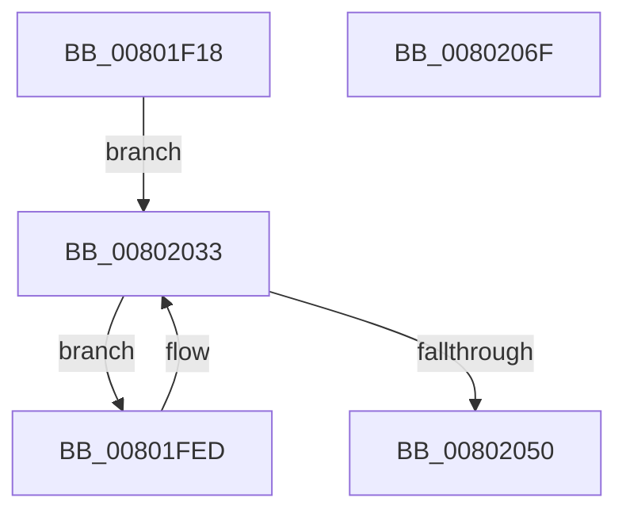

# MiApplyHotPatchToDriverDataPages

- RVA: `0x00801F18`–`0x00802070` (길이 `344` bytes)
- VA: `0x0000000140801F18`
- 실행 섹션: `PAGE`
- PDB 이름 있음: `예`; PDB Function 태그: `아니요`
- unwind 정보 RVA: `0x000D85F4`
- 디코드: `84`개 명령, `344/344` bytes 표시
- 미해석 바이트: `0` (있으면 어셈블리에 `.byte`로 보존)

> 이 문서는 커널 이미지의 기계어와 PDB 기호를 분석해 생성했습니다. 4번과 5번은 함수 원형과 자료형을 바이너리 사용 방식에서 추정한 C 해석이며 원본 소스 복구 결과는 아닙니다.

## 1. Dependencies

- 직접 호출 지점: **4**; 고유 호출 대상: **4**
- 직접 호출자로 확인된 함수: **1**
- RIP 상대 이미지 참조: **1**

### Outgoing calls
- `0x00801FE2` → [RtlApplyHotPatch](../../pagelk/B7/RtlApplyHotPatch_function_00B7528C.md) (function, `0x00B7528C`)
- `0x00802018` → [MiSetImageProtection](../../text/38/MiSetImageProtection_function_003843D0.md) (function, `0x003843D0`)
- `0x0080202B` → [RtlClearBitsEx](../../text/29/RtlClearBitsEx_function_00297740.md) (function, `0x00297740`)
- `0x00802043` → [RtlFindNextForwardRunSetEx](../../text/47/RtlFindNextForwardRunSetEx_function_0047D290.md) (function, `0x0047D290`)

### Direct callers
- [MiApplyDriverHotPatch](MiApplyDriverHotPatch_function_008018EC.md) at `0x00801C7D`

### Static image references
- `0x00801F36` → RVA `0x00806610` (`MiPatchDataPagesCallback`; read)

## 2. Other-region calls and transfers

- 다른 실행 섹션으로 향하는 call: **4**
  - `0x00801FE2` → [RtlApplyHotPatch](../../pagelk/B7/RtlApplyHotPatch_function_00B7528C.md) (`PAGE` → `PAGELK`)
  - `0x00802018` → [MiSetImageProtection](../../text/38/MiSetImageProtection_function_003843D0.md) (`PAGE` → `.text`)
  - `0x0080202B` → [RtlClearBitsEx](../../text/29/RtlClearBitsEx_function_00297740.md) (`PAGE` → `.text`)
  - `0x00802043` → [RtlFindNextForwardRunSetEx](../../text/47/RtlFindNextForwardRunSetEx_function_0047D290.md) (`PAGE` → `.text`)
- 별도 외부 분기/꼬리 이동을 확인하지 못했습니다.

## 3. Assembly (complete function range)

```asm
00801F18  4C 8B DC                        mov r11, rsp
00801F1B  49 89 5B 10                     mov qword ptr [r11 + 0x10], rbx
00801F1F  49 89 6B 18                     mov qword ptr [r11 + 0x18], rbp
00801F23  49 89 73 20                     mov qword ptr [r11 + 0x20], rsi
00801F27  57                              push rdi
00801F28  41 56                           push r14
00801F2A  41 57                           push r15
00801F2C  48 81 EC 10 01 00 00            sub rsp, 0x110
00801F33  45 33 FF                        xor r15d, r15d
00801F36  48 8D 05 D3 46 00 00            lea rax, [rip + 0x46d3]
00801F3D  49 89 43 C8                     mov qword ptr [r11 - 0x38], rax
00801F41  48 8B F1                        mov rsi, rcx
00801F44  48 8B 41 08                     mov rax, qword ptr [rcx + 8]
00801F48  45 33 C9                        xor r9d, r9d
00801F4B  49 89 43 D8                     mov qword ptr [r11 - 0x28], rax
00801F4F  4D 89 7B 08                     mov qword ptr [r11 + 8], r15
00801F53  4D 89 7B D0                     mov qword ptr [r11 - 0x30], r15
00801F57  48 8B 00                        mov rax, qword ptr [rax]
00801F5A  4C 8B 40 30                     mov r8, qword ptr [rax + 0x30]
00801F5E  48 8B 01                        mov rax, qword ptr [rcx]
00801F61  48 8B 10                        mov rdx, qword ptr [rax]
00801F64  49 8D 43 C8                     lea rax, [r11 - 0x38]
00801F68  49 89 43 98                     mov qword ptr [r11 - 0x68], rax
00801F6C  48 8B 46 20                     mov rax, qword ptr [rsi + 0x20]
00801F70  4D 89 7B 90                     mov qword ptr [r11 - 0x70], r15
00801F74  48 8B 4A 30                     mov rcx, qword ptr [rdx + 0x30]
00801F78  4D 89 7B 88                     mov qword ptr [r11 - 0x78], r15
00801F7C  48 8B D1                        mov rdx, rcx
00801F7F  66 41 C7 43 80 64 86            mov word ptr [r11 - 0x80], 0x8664
00801F86  C7 84 24 A0 00 00 00 02 00 00 00  mov dword ptr [rsp + 0xa0], 2
00801F91  49 89 83 70 FF FF FF            mov qword ptr [r11 - 0x90], rax
00801F98  48 8B 46 18                     mov rax, qword ptr [rsi + 0x18]
00801F9C  49 89 83 68 FF FF FF            mov qword ptr [r11 - 0x98], rax
00801FA3  45 89 BB 60 FF FF FF            mov dword ptr [r11 - 0xa0], r15d
00801FAA  4D 89 BB 58 FF FF FF            mov qword ptr [r11 - 0xa8], r15
00801FB1  4C 89 7C 24 70                  mov qword ptr [rsp + 0x70], r15
00801FB6  44 89 7C 24 68                  mov dword ptr [rsp + 0x68], r15d
00801FBB  4C 89 7C 24 60                  mov qword ptr [rsp + 0x60], r15
00801FC0  4C 89 44 24 58                  mov qword ptr [rsp + 0x58], r8
00801FC5  4C 89 44 24 50                  mov qword ptr [rsp + 0x50], r8
00801FCA  45 33 C0                        xor r8d, r8d
00801FCD  48 83 4C 24 40 FF               or qword ptr [rsp + 0x40], 0xffffffffffffffff
00801FD3  44 89 7C 24 38                  mov dword ptr [rsp + 0x38], r15d
00801FD8  4C 89 7C 24 30                  mov qword ptr [rsp + 0x30], r15
00801FDD  4C 89 7C 24 20                  mov qword ptr [rsp + 0x20], r15
00801FE2  E8 A5 32 37 00                  call 0x140b7528c
00801FE7  8B E8                           mov ebp, eax
00801FE9  33 D2                           xor edx, edx
00801FEB  EB 46                           jmp 0x140802033
00801FED  48 8B 4E 08                     mov rcx, qword ptr [rsi + 8]
00801FF1  45 8B C6                        mov r8d, r14d
00801FF4  48 8B 9C 24 30 01 00 00         mov rbx, qword ptr [rsp + 0x130]
00801FFC  41 B9 00 01 00 00               mov r9d, 0x100
00802002  48 8B D3                        mov rdx, rbx
00802005  41 C1 E0 0C                     shl r8d, 0xc
00802009  48 C1 E2 0C                     shl rdx, 0xc
0080200D  48 8B 09                        mov rcx, qword ptr [rcx]
00802010  49 8D 3C 1E                     lea rdi, [r14 + rbx]
00802014  48 03 51 30                     add rdx, qword ptr [rcx + 0x30]
00802018  E8 B3 23 B8 FF                  call 0x1403843d0
0080201D  48 8B 4E 08                     mov rcx, qword ptr [rsi + 8]
00802021  4D 8B C6                        mov r8, r14
00802024  48 83 C1 40                     add rcx, 0x40
00802028  48 8B D3                        mov rdx, rbx
0080202B  E8 10 57 A9 FF                  call 0x140297740
00802030  48 8B D7                        mov rdx, rdi
00802033  48 8B 4E 08                     mov rcx, qword ptr [rsi + 8]
00802037  4C 8D 84 24 30 01 00 00         lea r8, [rsp + 0x130]
0080203F  48 83 C1 40                     add rcx, 0x40
00802043  E8 48 B2 C7 FF                  call 0x14047d290
00802048  4C 8B F0                        mov r14, rax
0080204B  48 85 C0                        test rax, rax
0080204E  75 9D                           jne 0x140801fed
00802050  4C 8D 9C 24 10 01 00 00         lea r11, [rsp + 0x110]
00802058  8B C5                           mov eax, ebp
0080205A  49 8B 5B 28                     mov rbx, qword ptr [r11 + 0x28]
0080205E  49 8B 6B 30                     mov rbp, qword ptr [r11 + 0x30]
00802062  49 8B 73 38                     mov rsi, qword ptr [r11 + 0x38]
00802066  49 8B E3                        mov rsp, r11
00802069  41 5F                           pop r15
0080206B  41 5E                           pop r14
0080206D  5F                              pop rdi
0080206E  C3                              ret
0080206F  CC                              int3
```

## 4. C-style interpretation (structured pseudocode)

```c
__int64 __fastcall MiApplyHotPatchToDriverDataPages(__int64 a1, __int64 a2, __int64 a3, int a4)
{
    __int64 result;
    __int64 v_r15;
    __int64 v_rsp;
    unsigned __int64 v_stack_m108;
    unsigned __int64 v_stack_m18;
    unsigned int v_stack_m88;
    unsigned __int64 v_stack_mB8;
    unsigned int v_stack_mC0;
    unsigned __int64 v_stack_mC8;
    unsigned __int64 v_stack_mD0;
    unsigned __int64 v_stack_mD8;
    unsigned __int64 v_stack_mE8;
    unsigned int v_stack_mF0;
    unsigned __int64 v_stack_mF8;
    unsigned __int64 v_stack_p8;

    *(unsigned __int64 *)(v_rsp + 16) = v_rbx;
    *(unsigned __int64 *)(v_rsp + 24) = v_rbp;
    *(unsigned __int64 *)(v_rsp + 32) = v_rsi;
    v_rsp = (v_rsp) - (272);
    v_r15 = 0;
    *(unsigned __int64 *)(v_rsp - 56) = v_rip + 18131;
    a4 = 0;
    *(unsigned __int64 *)(v_rsp - 40) = *(unsigned __int64 *)(a1 + 8);
    *(unsigned __int64 *)(v_rsp + 8) = 0;
    *(unsigned __int64 *)(v_rsp - 48) = 0;
    *(unsigned __int64 *)(v_rsp - 104) = v_rsp - 56;
    *(unsigned __int64 *)(v_rsp - 112) = 0;
    *(unsigned __int64 *)(v_rsp - 120) = 0;
    *(unsigned __int16 *)(v_rsp - 128) = 0x8664ULL;
    v_stack_m88 = 2;
    *(unsigned __int64 *)(v_rsp - 144) = *(unsigned __int64 *)(a1 + 32);
    *(unsigned __int64 *)(v_rsp - 152) = *(unsigned __int64 *)(a1 + 24);
    *(unsigned int *)(v_rsp - 160) = 0;
    *(unsigned __int64 *)(v_rsp - 168) = 0;
    v_stack_mB8 = 0;
    v_stack_mC0 = 0;
    v_stack_mC8 = 0;
    v_stack_mD0 = *(unsigned __int64 *)(*(unsigned __int64 *)(*(unsigned __int64 *)(a1 + 8)) + 48);
    v_stack_mD8 = *(unsigned __int64 *)(*(unsigned __int64 *)(*(unsigned __int64 *)(a1 + 8)) + 48);
    a3 = 0;
    v_stack_mF0 = 0;
    v_stack_mF8 = 0;
    v_stack_m108 = 0;
    result = RtlApplyHotPatch(*(unsigned __int64 *)(*(unsigned __int64 *)(*(unsigned __int64 *)(a1)) + 48), *(unsigned __int64 *)(*(unsigned __int64 *)(*(unsigned __int64 *)(a1)) + 48), a3, a4);
    a2 = 0;
    goto loc_00802033;
loc_00801FED:
    a3 = (unsigned int)(((unsigned int)((unsigned int)(v_r14))) << (12));
    a2 = (v_stack_p8) << (12);
    a2 = (a2) + (*(unsigned __int64 *)(*(unsigned __int64 *)(*(unsigned __int64 *)(a1 + 8)) + 48));
    result = MiSetImageProtection(*(unsigned __int64 *)(*(unsigned __int64 *)(a1 + 8)), a2, a3, 256);
    a1 = (*(unsigned __int64 *)(a1 + 8)) + (64);
    result = RtlClearBitsEx(a1, v_stack_p8, v_r14, 256);
loc_00802033:
    a1 = (*(unsigned __int64 *)(a1 + 8)) + (64);
    result = RtlFindNextForwardRunSetEx(a1, v_r14 + v_stack_p8 * 1, v_stack_p8, 256);
    if (result != 0) goto loc_00801FED;
    return (unsigned int)((unsigned int)((unsigned int)((unsigned int)(result))));
}
```

## 5. (Beta) C Style

```c
int64_t MiApplyHotPatchToDriverDataPages(void *Arg1, int64_t Arg2, int64_t Arg3, int32_t Arg4)
{
    uint8_t *arg1 = (uint8_t *)Arg1;

    int64_t result;
    int64_t local_r15;
    int64_t local_rsp;
    uint64_t v_stack_m108;
    uint64_t v_stack_m18;
    uint32_t v_stack_m88;
    uint64_t v_stack_mB8;
    uint32_t v_stack_mC0;
    uint64_t v_stack_mC8;
    uint64_t v_stack_mD0;
    uint64_t v_stack_mD8;
    uint64_t v_stack_mE8;
    uint32_t v_stack_mF0;
    uint64_t v_stack_mF8;
    uint64_t v_stack_p8;

    *(uint64_t *)(local_rsp + 0x10) = local_rbx;
    *(uint64_t *)(local_rsp + 0x18) = local_rbp;
    *(uint64_t *)(local_rsp + 0x20) = local_rsi;
    local_rsp = (local_rsp) - (272);
    local_r15 = 0;
    *(uint64_t *)(local_rsp - 0x38) = v_rip + 18131;
    Arg4 = 0;
    *(uint64_t *)(local_rsp - 0x28) = *(uint64_t *)(arg1 + 0x8);
    *(uint64_t *)(local_rsp + 0x8) = 0;
    *(uint64_t *)(local_rsp - 0x30) = 0;
    *(uint64_t *)(local_rsp - 0x68) = local_rsp - 56;
    *(uint64_t *)(local_rsp - 0x70) = 0;
    *(uint64_t *)(local_rsp - 0x78) = 0;
    *(uint16_t *)(local_rsp - 0x80) = 0x8664ULL;
    v_stack_m88 = 2;
    *(uint64_t *)(local_rsp - 0x90) = *(uint64_t *)(arg1 + 0x20);
    *(uint64_t *)(local_rsp - 0x98) = *(uint64_t *)(arg1 + 0x18);
    *(uint32_t *)(local_rsp - 0xA0) = 0;
    *(uint64_t *)(local_rsp - 0xA8) = 0;
    v_stack_mB8 = 0;
    v_stack_mC0 = 0;
    v_stack_mC8 = 0;
    v_stack_mD0 = *(uint64_t *)(*(uint64_t *)(*(uint64_t *)(arg1 + 0x8)) + 0x30);
    v_stack_mD8 = *(uint64_t *)(*(uint64_t *)(*(uint64_t *)(arg1 + 0x8)) + 0x30);
    Arg3 = 0;
    v_stack_mF0 = 0;
    v_stack_mF8 = 0;
    v_stack_m108 = 0;
    result = RtlApplyHotPatch(*(uint64_t *)(*(uint64_t *)(*(uint64_t *)(arg1)) + 0x30), *(uint64_t *)(*(uint64_t *)(*(uint64_t *)(arg1)) + 0x30), Arg3, Arg4);
    Arg2 = 0;
    goto loc_00802033;
loc_00801FED:
    Arg3 = (uint32_t)(((uint32_t)((uint32_t)(local_r14))) << (12));
    Arg2 = (v_stack_p8) << (12);
    Arg2 = (Arg2) + (*(uint64_t *)(*(uint64_t *)(*(uint64_t *)(arg1 + 0x8)) + 0x30));
    result = MiSetImageProtection(*(uint64_t *)(*(uint64_t *)(arg1 + 0x8)), Arg2, Arg3, 256);
    Arg1 = (*(uint64_t *)(arg1 + 0x8)) + (64);
    result = RtlClearBitsEx(Arg1, v_stack_p8, local_r14, 256);
loc_00802033:
    Arg1 = (*(uint64_t *)(arg1 + 0x8)) + (64);
    result = RtlFindNextForwardRunSetEx(Arg1, local_r14 + v_stack_p8 * 1, v_stack_p8, 256);
    if (result != 0) goto loc_00801FED;
    return (uint32_t)((uint32_t)((uint32_t)((uint32_t)(result))));
}
```

### 관측된 메모리 오프셋

구조체 형식이 확인되지 않은 접근은 인자 기준의 오프셋으로만 기록했습니다.

| 기준 인자 | 오프셋 표현 | 폭 (bit) | 접근 |
|---|---:|---:|---|
| `Arg1` | `+ 0x0` | `64` | `R` |
| `Arg1` | `+ 0x8` | `64` | `R` |
| `Arg1` | `+ 0x18` | `64` | `R` |
| `Arg1` | `+ 0x20` | `64` | `R` |

## 6. Execution-region graph

[열기: 2D/3D 그래프와 함수 탐색 컨트롤 패널](../../../control-panel.html?section=page&rva=0x00801F18&view=graph)

- 2D 그래프는 위에서 아래로 흐르고, 3D 그래프는 빈 공간을 드래그해 회전합니다. Shift+드래그는 이동, 휠은 확대·축소, 함수 노드 선택은 대상 보고서 이동입니다.

### Static fallback


